<p align="center">
  <a href="README.md">Français</a> · <a href="README.en.md">English</a> · <a href="README.es.md">Español</a> · <b>Deutsch</b> · <a href="README.it.md">Italiano</a> · <a href="README.pt-BR.md">Português</a> · <a href="README.zh-CN.md">简体中文</a>
</p>

<p align="center">
  <picture>
    <source media="(prefers-color-scheme: dark)" srcset="docs/images/de/banner-dark.webp">
    
  </picture>
</p>

<p align="center">
  <a href="https://github.com/Jacckisback/eclair-cms/raw/main/dist/eclair-cms-1.5.0.zip"></a>
  
  
  
  <a href="LICENSE"></a>
</p>

<h3 align="center">Eine professionelle Website in 3 Minuten, auf jedem Shared Hosting.<br>Ohne Datenbank. Ohne Plugins. Ohne Wartung.</h3>

<p align="center">
  <a href="#installation-in-3-minuten"><b>Installieren</b></a> ·
  <a href="#warum-éclair"><b>Warum Éclair</b></a> ·
  <a href="#ki-assistent-bitten-prüfen-veröffentlichen"><b>KI-Assistent</b></a> ·
  <a href="#claude-und-chatgpt-mit-deinem-abo"><b>Claude und ChatGPT</b></a> ·
  <a href="#themes-und-shop"><b>Themes und Shop</b></a> ·
  <a href="#vorschau"><b>Vorschau</b></a> ·
  <a href="#sicherheit"><b>Sicherheit</b></a> ·
  <a href="docs/GUIDE.de.md"><b>Vollständiges Handbuch</b></a>
</p>

<br>

<p align="center">
  
</p>

## Warum Éclair

WordPress kann alles, braucht dafür aber eine Datenbank, Plugins für SEO, Sicherheit und Caching … und endlose Updates. Éclair vereint das Wesentliche in einem CMS mit **unter 1 MB**, gemacht für Selbstständige, Handwerksbetriebe und kleine Unternehmen.

<table>
  <tr>
    <td width="33%" valign="top">
      <h3>⚡ Ultraschnell</h3>
      Jede Seite kommt aus einem statischen Cache, ohne die Anwendung zu laden: <b>100/100</b> bei Lighthouse und <b>0,7 ms</b> Server-Antwortzeit (lokal gemessen).
    </td>
    <td width="33%" valign="top">
      <h3>🔎 SEO integriert</h3>
      Strukturierte Daten, Sitemap, Weiterleitungen, Google-Vorschau und ein <b>Live-SEO-Score</b> im Editor, ganz ohne Plugin.
    </td>
    <td width="33%" valign="top">
      <h3>🤖 Bereit für KI</h3>
      <code>llms.txt</code>, eine Markdown-Version jeder Seite, Regeln für 30 KI-Bots und ein <b>GEO-Score</b>, damit ChatGPT, Perplexity oder Gemini dich zitieren.
    </td>
  </tr>
  <tr>
    <td width="33%" valign="top">
      <h3>🛡️ Sicher ab Werk</h3>
      Zwei-Faktor-Authentifizierung, Brute-Force-Schutz, strenge Header, bereinigte Inhalte. <b>Ein offensives Sicherheitsaudit</b>, alle Lücken geschlossen.
    </td>
    <td width="33%" valign="top">
      <h3>🪶 Ultraleicht</h3>
      Keine Datenbank: Deine Inhalte liegen in geschützten Dateien. Ein Download von <b>433 KB</b>, null Abhängigkeiten, null Cookies auf der öffentlichen Website.
    </td>
    <td width="33%" valign="top">
      <h3>😊 Kinderleicht</h3>
      Geführte Installation mit 4 Fragen, Block-Editor mit <code>/</code>, Checkliste für den Start. Verwaltung in <b>7 Sprachen</b>, Website in 6 Sprachen (jeweils auch auf Deutsch).
    </td>
  </tr>
</table>

## KI-Assistent: bitten, prüfen, veröffentlichen

<p align="center">
  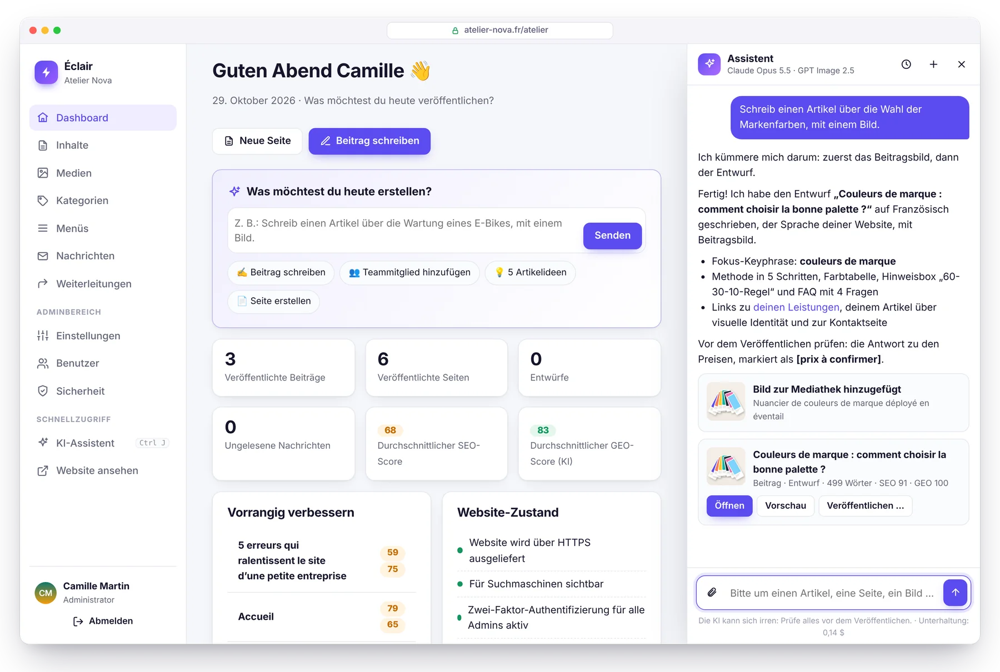
</p>

Beschreib einfach, was du brauchst, wie im Gespräch mit einem Kollegen: *„Schreib einen Artikel über die Wahl der Markenfarben, mit einem Bild.“* Der Assistent prüft, ob es zum Thema schon einen Artikel gibt, erstellt das Bild, schreibt den vollständigen Entwurf (Titel, „Das Wichtigste“, Zwischenüberschriften, Tabelle, FAQ, Meta-Beschreibung, interne Links) **im Ton deiner Website** und legt ihn dir dann mit seinen SEO- und GEO-Scores vor. **Nichts wird ohne deinen Klick veröffentlicht.**

<table>
  <tr>
    <td width="50%" valign="top">
      <h3>✍️ Schreibt wie du</h3>
      Ein <b>Redaktionsprofil</b>, mit einem Klick aus deiner Website entworfen: Zielgruppe, Ton, Werte, Regeln, Bildstil. Jeder Text folgt außerdem den Analyseregeln von Éclair: Die Entwürfe zielen von Anfang an auf einen hohen Score.
    </td>
    <td width="50%" valign="top">
      <h3>🖼️ Bilder inklusive</h3>
      <b>GPT Image 2.5</b>, <b>FLUX 3</b> oder <b>Ideogram 3</b>: Das Beitragsbild wird passend zum Artikel gestaltet, als WebP optimiert und beschrieben (Alternativtext). Oder du hängst deine eigenen Fotos an.
    </td>
  </tr>
  <tr>
    <td width="50%" valign="top">
      <h3>👥 Arbeitet direkt an deiner Website</h3>
      „Füge Léa Martin mit dem angehängten Foto zur Teamseite hinzu“: Die Änderung ist vorbereitet, du siehst sie dir in der Vorschau an und übernimmst sie mit einem Klick. Rückgängig geht ebenfalls mit einem Klick.
    </td>
    <td width="50%" valign="top">
      <h3>🛡️ Du behältst die Kontrolle</h3>
      Die KI veröffentlicht und löscht nie etwas. Verschlüsselte API-Schlüssel, Monatsbudget, Tageslimit. <b>Claude oder ChatGPT</b> mit deinem eigenen Schlüssel: kein Abo, etwa <b>0,24 $ pro Artikel</b> mit Claude Opus 5.5.
    </td>
  </tr>
</table>

<table>
  <tr>
    <td width="50%" valign="top">
      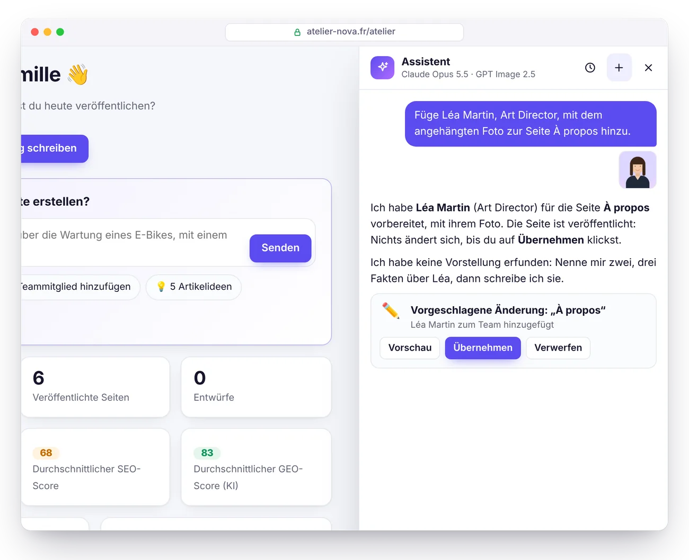
      <p align="center"><b>Vorschläge zur Freigabe</b><br><sub>Auf einer veröffentlichten Seite ändert sich nichts ohne deine Zustimmung.</sub></p>
    </td>
    <td width="50%" valign="top">
      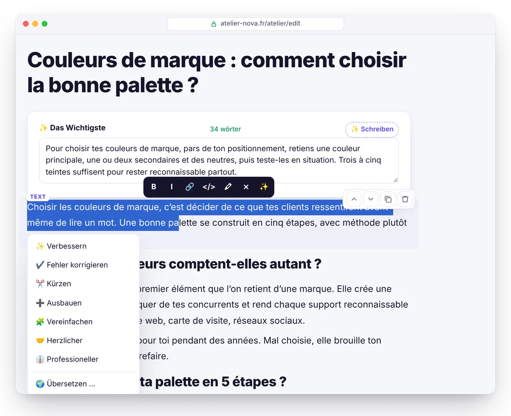
      <p align="center"><b>Feinschliff mit einem Klick</b><br><sub>Verbessern, korrigieren, kürzen, übersetzen, FAQ oder Alternativtexte schreiben.</sub></p>
    </td>
  </tr>
</table>

Aktivierung in 5 Minuten und Preise im Detail: siehe [Handbuch, Abschnitt KI-Assistent](docs/GUIDE.de.md#ki-assistent).

## Claude und ChatGPT, mit deinem Abo

<p align="center">
  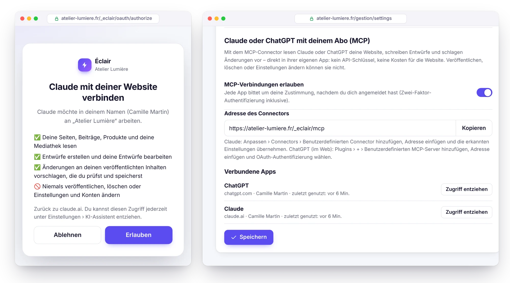
</p>

Du arbeitest schon mit Claude oder ChatGPT? Verbinde sie über den integrierten **MCP-Connector** mit deiner Website: Aktiviere ihn unter Einstellungen › KI-Assistent, füge seine Adresse in Claude oder ChatGPT ein und gib deine Zustimmung. Deine KI liest deine Website, erhält dein Redaktionsprofil und die SEO- und GEO-Regeln von Éclair, schreibt Entwürfe und bereitet Änderungen an deinen veröffentlichten Seiten vor, die du im Editor prüfst. **Dein Abo erledigt die Arbeit: kein API-Schlüssel, keine Kosten für die Website.**

- **Nichts wird veröffentlicht oder gelöscht**: nur Entwürfe und Vorschläge, das Veröffentlichen übernimmst du selbst in Éclair.
- **Zugriff unter deiner Kontrolle**: OAuth 2.1 mit PKCE, Zustimmung nach der Anmeldung (Zwei-Faktor-Authentifizierung inklusive), Zugriff mit einem Klick entzogen, oder automatisch, wenn du dein Passwort änderst.
- **Leichtgewichtig**: MCP-Server und Autorisierung kommen mit weniger als 25 KB PHP aus, ohne Abhängigkeiten.
- **Auch im integrierten Assistenten** wählst du die KI für jede Unterhaltung, mit deinen API-Schlüsseln für Claude und ChatGPT.

Einrichtung in 3 Minuten und kompatible Tarife: siehe [Handbuch, Abschnitt MCP-Connector](docs/GUIDE.de.md#mcp-connector-claude-und-chatgpt).

## Themes und Shop

<p align="center">
  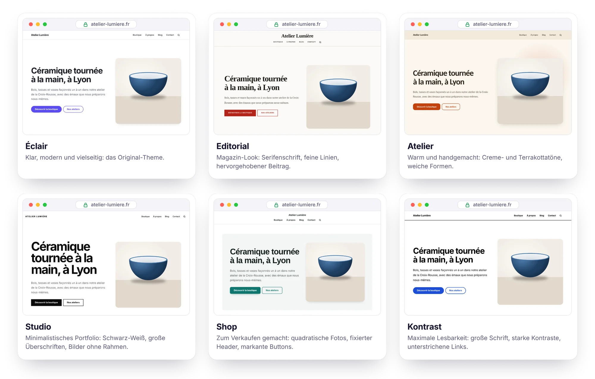
</p>

**6 Themes inklusive**, auswählbar unter Einstellungen › Design, mit einer **Live-Vorschau** deiner echten Website in der Desktop- oder Mobilansicht, bevor du speicherst: Éclair, Editorial, Atelier, Studio, Shop und Kontrast. Header zentriert oder nicht, Listen als Kartenraster oder Liste, Farbe und Schriften nach Wahl. Jedes Theme ist nur ein Stylesheet von 1,5 bis 3 KB: Das HTML bleibt gleich und damit auch Geschwindigkeit, Barrierefreiheit und SEO. Für eigene Anpassungen gibt es ein Feld **Eigenes CSS**: Es kommt nach dem Theme und bleibt bei Updates erhalten.

<p align="center">
  
</p>

**Schlanker Shop-Modus**: Verkaufe deine Produkte ohne den Ballast eines klassischen Onlineshops. Jedes Produkt hat seine eigene Seite, sein **Kauf-Button** führt zu einem **Stripe-Zahlungslink**, und das war's: kein Warenkorb, keine Datenbank, keine Bankdaten auf deinem Server. Einzige Kosten: die Stripe-Gebühr von **1,5 % + 0,25 €** pro Zahlung mit einer europäischen Standardkarte[^stripe].

<table>
  <tr>
    <td width="50%" valign="top">
      <h3>🛍️ Produktseiten, die verkaufen</h3>
      Fotogalerie, Preis und Streichpreis, <b>Varianten ohne JavaScript</b> (Größe, Farbe), Lagerbestand, angezeigte Versandkosten und Rückgabebedingungen, ähnliche Produkte. Katalog mit Kategoriefiltern und ein Block <b>Produkte</b> für deine Startseite.
    </td>
    <td width="50%" valign="top">
      <h3>💳 Bezahlt über Stripe</h3>
      Ein <b>Stripe-Zahlungslink</b> pro Produkt (oder pro Variante): Stripe wickelt die Zahlung ab, verschickt die Belege und kümmert sich um Rückerstattungen. <b>Kein Abo</b>, weder bei Éclair noch bei Stripe.
    </td>
  </tr>
  <tr>
    <td width="50%" valign="top">
      <h3>🔎 Gemacht für Google</h3>
      Strukturierte Daten <b>Product und Offer</b> (Preis, Lagerbestand, Versand, Rückgabebedingungen), „Säulen“-Kategorien und ein <b>Produktfeed für Google Merchant Center</b>, um kostenlos auf dem Tab „Shopping“ zu erscheinen.
    </td>
    <td width="50%" valign="top">
      <h3>🤖 Zitiert von KI</h3>
      Preis und Verfügbarkeit in <code>llms.txt</code> und in der Markdown-Version jeder Produktseite. Der KI-Assistent schreibt eine Produktseite anhand deines Fotos, ohne je einen Preis zu erfinden.
    </td>
  </tr>
</table>

<table>
  <tr>
    <td width="50%" valign="top">
      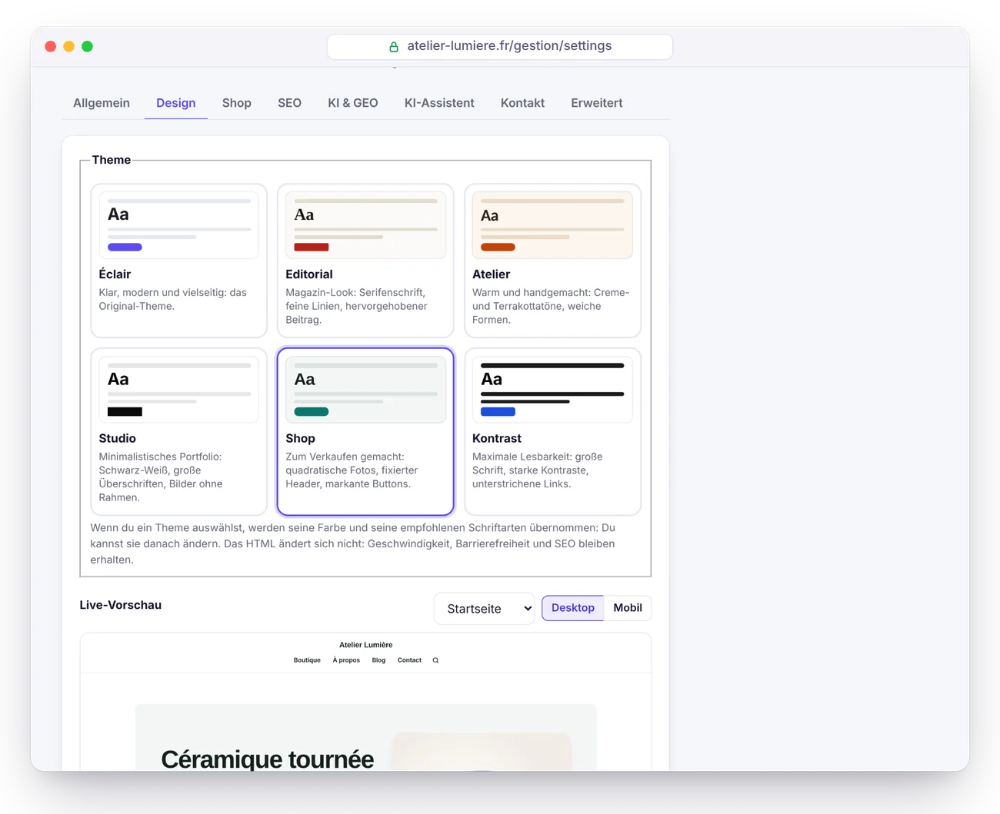
      <p align="center"><b>Live-Vorschau</b><br><sub>Probiere jedes Theme auf deiner echten Website aus: Nichts wird veröffentlicht, bevor du speicherst.</sub></p>
    </td>
    <td width="50%" valign="top">
      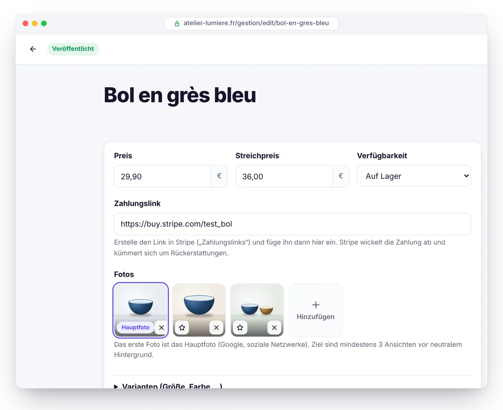
      <p align="center"><b>Produktseite</b><br><sub>Preis, Stripe-Link, Fotos und Varianten, ganz oben im Editor.</sub></p>
    </td>
  </tr>
</table>

Der Shop lässt sich erst öffnen, wenn Impressum und Allgemeine Geschäftsbedingungen veröffentlicht sind. Vollständige Anleitung: [Handbuch, Abschnitt Shop](docs/GUIDE.de.md#shop).

## Éclair im Vergleich zu WordPress

| | Klassisches WordPress | ⚡ Éclair |
|---|---|---|
| **Installation** | MySQL-Datenbank anlegen, dann den Assistenten starten | ✅ Ordner hochladen, 4 Fragen beantworten |
| **Datenbank** | MySQL erforderlich | ✅ Keine (geschützte Dateien) |
| **Download-Größe** | ≈ 35 MB[^wp] | ✅ 433 KB |
| **SEO, Sitemap, strukturierte Daten** | Ein Plugin, das installiert und gepflegt werden muss | ✅ Integriert |
| **GEO: llms.txt, Markdown, KI-Bots** | Plugins, selten vollständig | ✅ Integriert |
| **Öffentliche Seiten** | Bei jedem Aufruf neu erzeugt, außer mit Cache-Plugin | ✅ Aus einem statischen Cache ausgeliefert |
| **Cookies auf der öffentlichen Website** | Oft viele | ✅ Keine |
| **Zwei-Faktor-Authentifizierung, Brute-Force-Schutz** | Plugins | ✅ Integriert |
| **Plugin-Updates** | Ständig, die häufigste Ursache für Sicherheitslücken | ✅ Keine Plugins zu aktualisieren |
| **KI-Assistent (Texte, Bilder)** | Plugins, oft mit Abo | ✅ Integriert: Claude oder ChatGPT, mit deinem Schlüssel |
| **Themes** | Müssen installiert werden, oft schwergewichtig, manchmal kostenpflichtig | ✅ 6 integrierte Themes, Live-Vorschau |
| **Online verkaufen** | WooCommerce: Plugin, Datenbank, Updates | ✅ Schlanker Shop integriert, Bezahlung per Stripe-Zahlungslink |

## Performance

<picture>
  <source media="(prefers-color-scheme: dark)" srcset="docs/images/de/performance-dark.webp">
  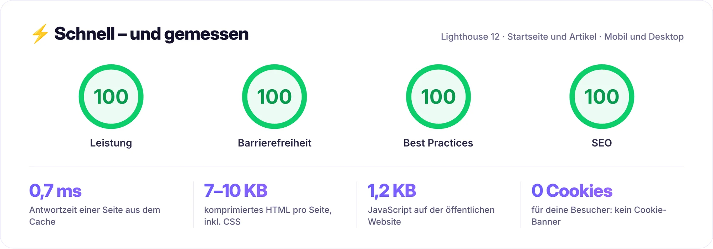
</picture>

Lokal auf der Demo-Website gemessen (PHP 8.3, bebilderte Startseite und ein Artikel mit 600 Wörtern), mit Lighthouse 12 auf Mobilgeräten und Desktop; ein Wert kann von Durchlauf zu Durchlauf um einen Punkt schwanken. So funktioniert es:

- **Automatischer statischer Cache**: Jede Seite wird einmal erzeugt und dann direkt von `index.php` ausgeliefert. Bei jeder Änderung leert sich der Cache von selbst.
- **CSS direkt in der Seite**, Systemschriften: keine blockierenden Anfragen, keine Layoutverschiebungen.
- **Bilder beim Hochladen optimiert**: verkleinert, in **responsives WebP** umgewandelt (480 bis 1600 px), feste Abmessungen und Lazy Loading.
- **Ein einziges öffentliches Skript**, verzögert geladen, 1,2 KB komprimiert. Brotli- oder Gzip-Komprimierung und ein Jahr Browser-Cache per `.htaccess`.

Auf echtem Shared Hosting kommen die Netzwerklatenz und der PHP-Start deines Hosters hinzu.

## SEO und GEO: gefunden bei Google, zitiert von KI

<picture>
  <source media="(prefers-color-scheme: dark)" srcset="docs/images/de/geo-dark.webp">
  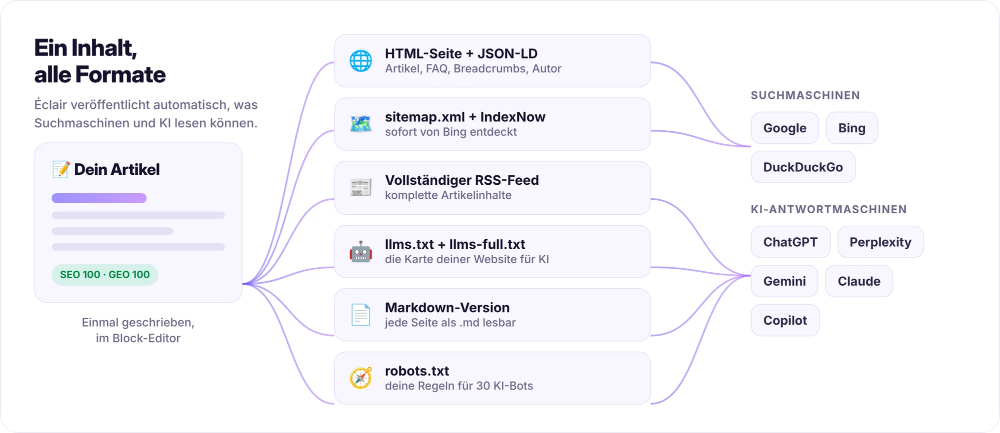
</picture>

<table>
  <tr>
    <td width="50%" valign="top">
      <h3>🔎 SEO</h3>
      <ul>
        <li><b>Echtzeit-Analyse</b> mit Score: Titel, Meta-Beschreibung, Fokus-Keyphrase, Struktur, interne Verlinkung, Alternativtexte …</li>
        <li><b>Strukturierte Daten in JSON-LD</b>: Organization oder LocalBusiness, BlogPosting, FAQPage, BreadcrumbList, Autor …</li>
        <li>Sitemap mit Bildern und <code>hreflang</code>, vollständiger RSS-Feed, Open Graph mit <b>automatisch erzeugtem Vorschaubild</b>.</li>
        <li><b>Automatische 301-Weiterleitungen</b>, wenn sich eine Adresse ändert, und ein Weiterleitungsmanager für den Umzug einer alten Website.</li>
        <li><b>IndexNow</b>: Bing und andere kompatible Suchmaschinen werden bei jeder Veröffentlichung benachrichtigt.</li>
      </ul>
    </td>
    <td width="50%" valign="top">
      <h3>🤖 GEO (KI-Antwortmaschinen)</h3>
      <ul>
        <li><code>/llms.txt</code> und <code>/llms-full.txt</code> werden automatisch erzeugt (Vorschlag <a href="https://llmstxt.org/">llmstxt.org</a>).</li>
        <li><b>Markdown-Version jeder Seite</b>: Hänge <code>.md</code> an eine beliebige Adresse an.</li>
        <li><b>KI-Bot-Regeln mit einem Klick</b>: offen, nur Zitate oder gesperrt, für 30 Bots (GPTBot, ClaudeBot, PerplexityBot …).</li>
        <li>Ein Block <b>„Das Wichtigste“</b> am Anfang jedes Artikels: die Zusammenfassung, die KI gern zitiert.</li>
        <li><b>GEO-Score</b>: FAQ, Zwischenüberschriften als Fragen, konkrete Zahlen, Quellen, erkennbarer Autor (E-E-A-T) …</li>
      </ul>
    </td>
  </tr>
</table>

## Vorschau

<table>
  <tr>
    <td width="50%" valign="top">
      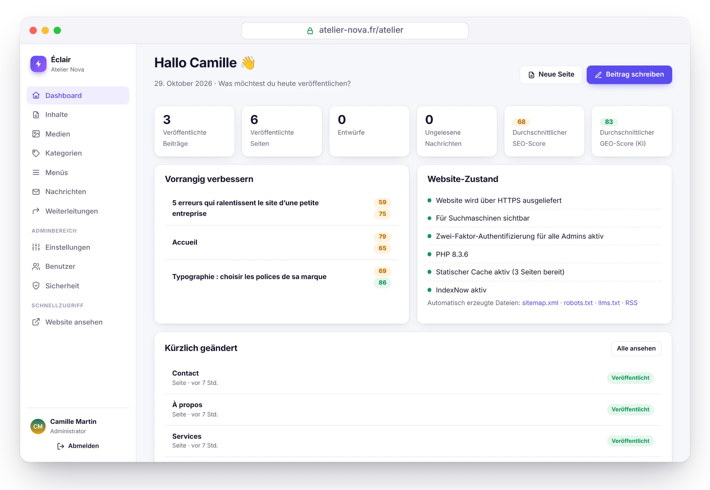
      <p align="center"><b>Dashboard</b><br><sub>Was zu verbessern ist und wie es der Website geht, auf einen Blick.</sub></p>
    </td>
    <td width="50%" valign="top">
      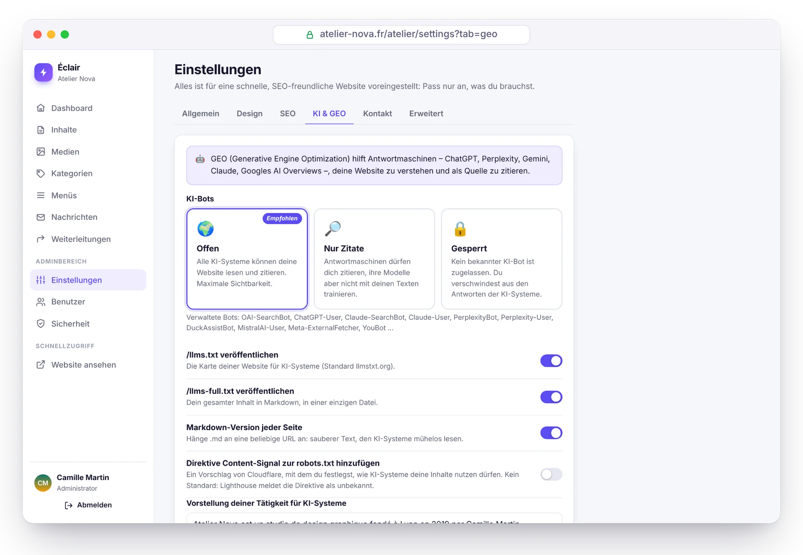
      <p align="center"><b>Sichtbarkeit in KI</b><br><sub>KI-Bots mit einem Klick zulassen, begrenzen oder sperren.</sub></p>
    </td>
  </tr>
  <tr>
    <td width="50%" valign="top">
      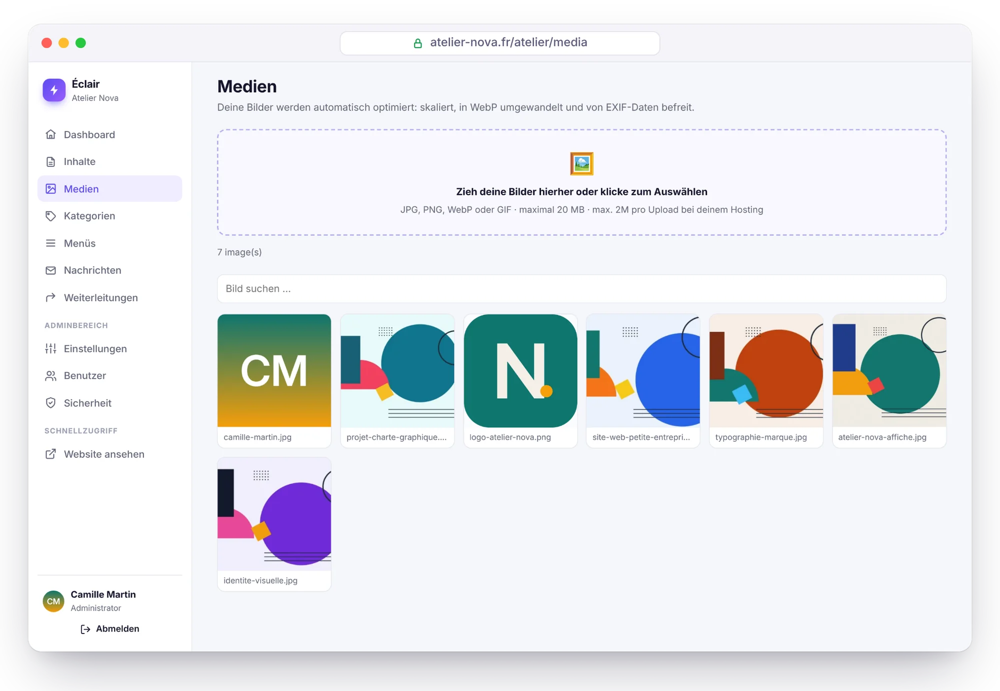
      <p align="center"><b>Mediathek</b><br><sub>Bilder werden automatisch verkleinert und in WebP umgewandelt.</sub></p>
    </td>
    <td width="50%" valign="top">
      
      <p align="center"><b>Automatischer Dark Mode</b><br><sub>Die Website passt sich dem Farbschema jedes Besuchers an.</sub></p>
    </td>
  </tr>
</table>

<sub>Screenshots von „Atelier Nova“, einer fiktiven, mit Éclair erstellten Demo-Website (eigene Illustrationen). Die Verwaltung ist auf Deutsch zu sehen, die Demo-Inhalte sind auf Französisch.</sub>

## Sicherheit

Éclair ist für eine feindliche Umgebung gebaut: Shared Hosting und Bots, die rund um die Uhr Passwörter ausprobieren.

- **Keine Datenbank**, also keine SQL-Injection. Die Datendateien sind doppelt geschützt (`.htaccess` und eine Zeile `<?php exit; ?>`), privat und werden atomar geschrieben.
- **Abgesicherte Anmeldung**: Passwörter mit Argon2id, Limits pro Netzwerk und pro Konto (dein gewohntes Gerät wird nie von einem Angreifer ausgesperrt), **Zwei-Faktor-Authentifizierung** mit Wiederherstellungscodes.
- **Erneute Passwortabfrage** bei sensiblen Aktionen, vorläufige Passwörter, die geändert werden müssen, kurze und widerrufbare Sitzungen.
- **Abgeriegelte öffentliche Website**: strenge Content-Security-Policy, Inhaltsbereinigung per Allowlist, keine offenen Weiterleitungen, neu kodierte Bilder.
- **Geschützte Installation**: ein Zeitfenster von 2 Stunden, und die Adresse der Website wird vom Server selbst geprüft, bevor weitergeleitet wird.
- **Seite „Sicherheit“**: Integritätsprüfung der Dateien, Test des Ordnerschutzes, Sicherheitsprotokoll, Backup mit einem Klick.
- **MCP-Connector standardmäßig deaktiviert**: Ist er aktiviert, gelten OAuth 2.1 mit PKCE, Zustimmung nach der Anmeldung sowie gehashte und widerrufbare Tokens; Veröffentlichen und Löschen sind nicht möglich.

> [!NOTE]
> **Offensives Sicherheitsaudit.** Race Conditions, Brute Force, Weiterleitungen, Injections, präparierte Dateien: 17 Schwachstellen wurden gefunden (2 schwere, 7 mittlere, 8 geringe) und alle behoben. Anschließend wurden die 13 Angriffsszenarien gegen die korrigierte Version wiederholt: alle abgewehrt. Die automatischen Tests (`php tests/run.php`) decken einen großen Teil davon ab.

Alle Details im [Handbuch, Abschnitt Sicherheit](docs/GUIDE.de.md#sicherheit).

## Installation in 3 Minuten

<p align="center">
  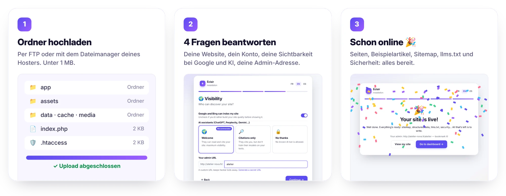
</p>

1. **Lade** das Archiv [`eclair-cms-1.5.0.zip`](https://github.com/Jacckisback/eclair-cms/raw/main/dist/eclair-cms-1.5.0.zip) (433 KB) **herunter** und entpacke es.
2. **Lade den Inhalt des Ordners `eclair`** in den öffentlichen Ordner deines Webspace hoch (`public_html`, `www` …), einschließlich der versteckten `.htaccess`-Dateien.
3. **Öffne die Adresse deiner Website**: Der Assistent startet. Vier Fragen, ein bisschen Konfetti, und deine Website ist mit ihren ersten Seiten online.

**Voraussetzungen**: PHP 8.1 oder neuer (8.3 empfohlen), Apache oder LiteSpeed (praktisch jedes Shared Hosting: Hostinger, IONOS, OVHcloud …) und ein HTTPS-Zertifikat. Der Assistent prüft alles und erklärt, was zu tun ist. Nginx funktioniert ebenfalls ([Konfiguration](docs/GUIDE.de.md#nginx)).

> [!TIP]
> Aus Sicherheitsgründen muss die Installation innerhalb von **2 Stunden** nach dem ersten Aufruf abgeschlossen werden. Danach lösche `data/install-window.php` per FTP und lade die Seite neu.

## Dokumentation

Das [vollständige Handbuch](docs/GUIDE.de.md) erklärt alles Weitere:

- [Installation](docs/GUIDE.de.md#installation): Voraussetzungen, Website-Typen, erste Schritte
- [Funktionen im Detail](docs/GUIDE.de.md#funktionen-im-detail): Geschwindigkeit, SEO, GEO, Block-Editor
- [Éclair im Alltag](docs/GUIDE.de.md#éclair-im-alltag)
- [Themes](docs/GUIDE.de.md#themes) und [Shop](docs/GUIDE.de.md#shop): Live-Vorschau, Produktseiten, Stripe, Google Shopping
- [KI-Assistent](docs/GUIDE.de.md#ki-assistent): Aktivierung, Redaktionsprofil, Kosten, Sicherheit
- [MCP-Connector](docs/GUIDE.de.md#mcp-connector-claude-und-chatgpt): Claude und ChatGPT mit deinem Abo
- [Aktualisieren, sichern, umziehen](docs/GUIDE.de.md#aktualisieren-sichern-umziehen)
- [Fehlerbehebung](docs/GUIDE.de.md#fehlerbehebung): Passwort vergessen, Fehler 404 oder 500, Nginx …

## Für Entwickler

PHP 8.1+ ohne Framework und ohne Composer: einfache Klassen in `eclair/app/lib/`, PHP-Views und natives JavaScript.

```bash
PHP_CLI_SERVER_WORKERS=4 php -S localhost:8000 -t eclair tools/router.php   # Entwicklungsserver
php tests/run.php                                                           # 456 Unit- und HTTP-Prüfungen
php tools/build.php                                                         # Archiv zum Verteilen
```

Projektstruktur und Anpassung des Themes: siehe [Für Entwickler](docs/GUIDE.de.md#für-entwickler).

## Lizenz

Éclair steht unter der **MIT-Lizenz** ([`LICENSE`](LICENSE)): Du darfst es frei nutzen, verändern und weitergeben, auch kommerziell, solange der Copyright-Hinweis erhalten bleibt. Ein Teil der Icons der Verwaltung basiert auf [Lucide](https://lucide.dev) (ISC-Lizenz, siehe [`THIRD-PARTY-NOTICES.txt`](THIRD-PARTY-NOTICES.txt)).

<br>

<p align="center"><sub>⚡ Éclair, für Selbstständige und kleine Unternehmen, die eine schnelle, gut auffindbare und sorgenfreie Website wollen.</sub></p>

[^stripe]: Stripe-Gebühr in Frankreich für eine Standardkarte aus dem Europäischen Wirtschaftsraum (EWR); 2,8 % + 0,25 € für eine Premiumkarte, 3,15 % + 0,25 € für Karten von außerhalb des EWR ([stripe.com/fr/pricing](https://stripe.com/fr/pricing), geprüft am 30. Oktober 2026). Zahlungslinks sind ohne Zusatzkosten enthalten.

[^wp]: Offizielles Archiv von WordPress 7.1.4: 37.239.942 Bytes, also 35,5 MB ([Download-Link](https://downloads.wordpress.org/release/wordpress-7.1.4.zip), geprüft am 29. Oktober 2026).
