<p align="center">
  <a href="README.md">Français</a> · <b>English</b> · <a href="README.es.md">Español</a> · <a href="README.de.md">Deutsch</a> · <a href="README.it.md">Italiano</a> · <a href="README.pt-BR.md">Português</a> · <a href="README.zh-CN.md">简体中文</a>
</p>

<p align="center">
  <picture>
    <source media="(prefers-color-scheme: dark)" srcset="docs/images/en/banner-dark.webp">
    
  </picture>
</p>

<p align="center">
  <a href="https://github.com/Jacckisback/eclair-cms/raw/main/dist/eclair-cms-1.5.0.zip"></a>
  
  
  
  <a href="LICENSE"></a>
</p>

<h3 align="center">A professional website in 3 minutes, on any shared hosting.<br>No database. No plugins. No maintenance.</h3>

<p align="center">
  <a href="#install-in-3-minutes"><b>Install</b></a> ·
  <a href="#why-éclair"><b>Why Éclair</b></a> ·
  <a href="#ai-assistant-ask-review-publish"><b>AI assistant</b></a> ·
  <a href="#claude-and-chatgpt-with-your-subscription"><b>Claude and ChatGPT</b></a> ·
  <a href="#themes-and-shop"><b>Themes and shop</b></a> ·
  <a href="#preview"><b>Preview</b></a> ·
  <a href="#security"><b>Security</b></a> ·
  <a href="docs/GUIDE.en.md"><b>Full guide</b></a>
</p>

<br>

<p align="center">
  
</p>

## Why Éclair

WordPress can do everything, but it needs a database, plugins for SEO, security and caching… and endless updates. Éclair packs the essentials into a CMS **under 1 MB**, designed for freelancers, craftspeople and small businesses.

<table>
  <tr>
    <td width="33%" valign="top">
      <h3>⚡ Ultra-fast</h3>
      Every page is served from a static cache, without loading the application: <b>100/100</b> on Lighthouse and a <b>0.7 ms</b> server response time (measured locally).
    </td>
    <td width="33%" valign="top">
      <h3>🔎 SEO built in</h3>
      Structured data, sitemap, redirects, Google preview and a <b>live SEO score</b> in the editor, without a single plugin.
    </td>
    <td width="33%" valign="top">
      <h3>🤖 Ready for AI</h3>
      <code>llms.txt</code>, a Markdown version of every page, rules for 30 AI bots and a <b>GEO score</b> to get cited by ChatGPT, Perplexity or Gemini.
    </td>
  </tr>
  <tr>
    <td width="33%" valign="top">
      <h3>🛡️ Secure by default</h3>
      Two-factor authentication, brute-force protection, strict headers, sanitized content. <b>An offensive security review</b>, every vulnerability fixed.
    </td>
    <td width="33%" valign="top">
      <h3>🪶 Ultra-light</h3>
      No database: your content lives in protected files. A <b>433 KB</b> download, zero dependencies, zero cookies on the public site.
    </td>
    <td width="33%" valign="top">
      <h3>😊 Dead simple</h3>
      Guided setup in 4 questions, block editor with <code>/</code>, getting-started checklist. Admin in <b>7 languages</b>, site in 6 languages.
    </td>
  </tr>
</table>

## AI assistant: ask, review, publish

<p align="center">
  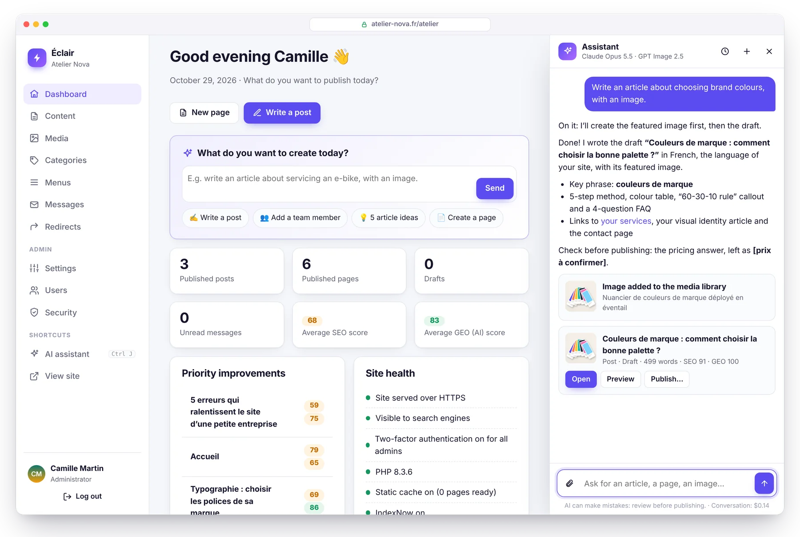
</p>

Type what you need, as you would to a colleague: *“Write an article about choosing brand colors, with an image.”* The assistant checks that the topic isn't already covered, creates the image, writes the complete draft (title, Key takeaways, subheadings, table, FAQ, meta description, internal links) **in your site's voice**, then shows it to you with its SEO and GEO scores. **Nothing is published without your click.**

<table>
  <tr>
    <td width="50%" valign="top">
      <h3>✍️ Writes like you</h3>
      An <b>editorial profile</b> drafted from your site in one click: audience, tone, values, rules, image style. Every text also follows Éclair's analysis rules, so drafts aim for a high score right from the start.
    </td>
    <td width="50%" valign="top">
      <h3>🖼️ Images included</h3>
      <b>GPT Image 2.5</b>, <b>FLUX 3</b> or <b>Ideogram 3</b>: the featured image is designed around the article, optimized as WebP and described (alt text). Or attach your own photos.
    </td>
  </tr>
  <tr>
    <td width="50%" valign="top">
      <h3>👥 Acts on your site</h3>
      “Add Léa Martin to the team page with the attached photo”: the change is ready, you preview it and apply it in one click. It can be undone in one click, too.
    </td>
    <td width="50%" valign="top">
      <h3>🛡️ You stay in control</h3>
      The AI never publishes or deletes anything. Encrypted keys, monthly budget, daily quota. <b>Claude or ChatGPT</b> with your own key: no subscription, about <b>$0.24 per post</b> with Claude Opus 5.5.
    </td>
  </tr>
</table>

<table>
  <tr>
    <td width="50%" valign="top">
      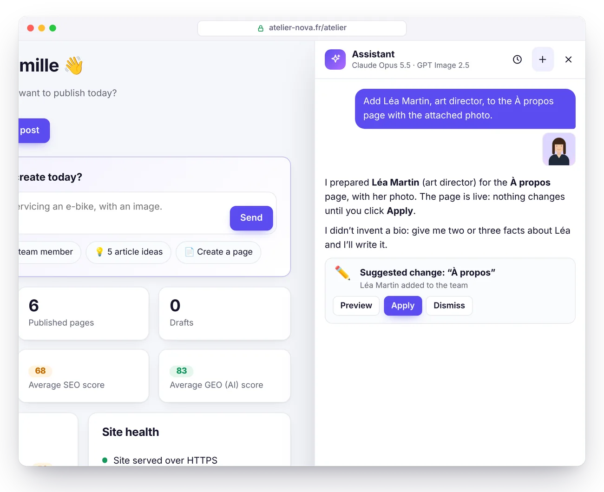
      <p align="center"><b>Suggestions to approve</b><br><sub>On a published page, nothing changes until you approve.</sub></p>
    </td>
    <td width="50%" valign="top">
      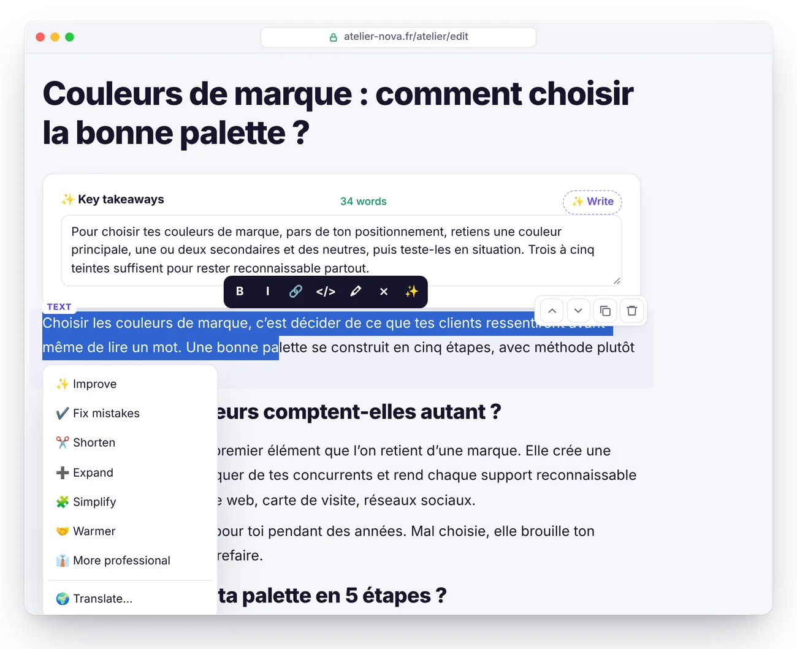
      <p align="center"><b>One-click touch-ups</b><br><sub>Improve, fix, shorten, translate, write the FAQ or the alt texts.</sub></p>
    </td>
  </tr>
</table>

5-minute setup and detailed pricing: see the [guide, AI assistant section](docs/GUIDE.en.md#ai-assistant).

## Claude and ChatGPT, with your subscription

<p align="center">
  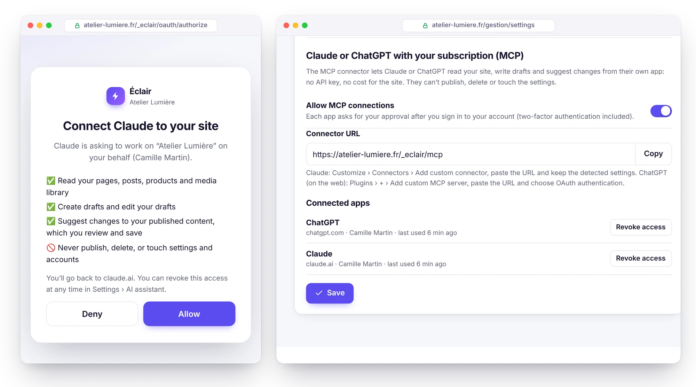
</p>

Already working in Claude or ChatGPT? Connect them to your site with the built-in **MCP connector**: turn it on in Settings › AI assistant, paste its URL into Claude or ChatGPT, and give your approval. Your AI reads your site, gets your editorial profile and Éclair's SEO and GEO rules, writes drafts and prepares changes to your published pages, which you review in the editor. **Your subscription does the work: no API key, no cost for the site.**

- **Nothing is published or deleted**: drafts and suggestions only, and you're the one who publishes in Éclair.
- **Access under your control**: OAuth 2.1 with PKCE, approval given after you log in (two-factor authentication included), access revoked in one click, or automatically if you change your password.
- **Lightweight**: the MCP server and authorization fit in under 25 KB of PHP, with no dependencies.
- **In the built-in assistant too**, with your Claude and ChatGPT API keys, you choose the AI for each conversation.

3-minute setup and compatible plans: see the [guide, MCP connector section](docs/GUIDE.en.md#mcp-connector-claude-and-chatgpt).

## Themes and shop

<p align="center">
  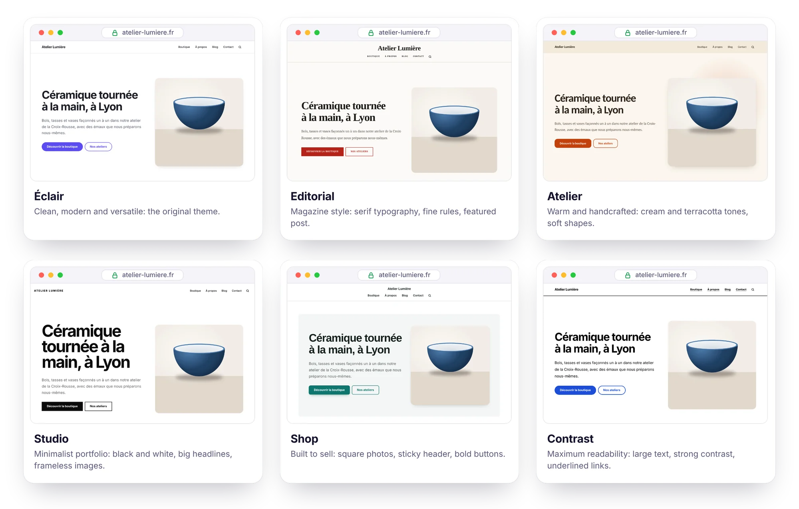
</p>

**6 built-in themes**, to choose from in Settings › Appearance with a **live preview** of your real site, on desktop or mobile, before you save: Éclair, Editorial, Atelier, Studio, Shop and Contrast. Centered header or not, posts and products in a grid or a list, your choice of color and fonts. Each theme is just a 1.5 to 3 KB stylesheet: the HTML stays the same, and so do speed, accessibility and SEO. For your own tweaks, a **Custom CSS** field is added after the theme and stays in place through updates.

<p align="center">
  
</p>

**Lightweight shop mode**: sell your products without the overhead of a full e-commerce platform. Each product gets its own page, with a **Buy now** button that leads to a **Stripe payment link**, and that's it: no cart, no database, no payment details on your server. The only cost: Stripe's fee, **1.5% + €0.25** per payment with a standard European card[^stripe].

<table>
  <tr>
    <td width="50%" valign="top">
      <h3>🛍️ Product pages that sell</h3>
      Photo gallery, price and compare-at price, <b>variants without JavaScript</b> (size, color), stock, shipping costs and returns shown on the page, related products. A catalog with category filters and a <b>Products</b> block for your home page.
    </td>
    <td width="50%" valign="top">
      <h3>💳 Paid via Stripe</h3>
      One <b>Stripe payment link</b> per product (or per variant): Stripe collects payments, sends receipts and handles refunds. <b>No subscription</b>, neither with Éclair nor with Stripe.
    </td>
  </tr>
  <tr>
    <td width="50%" valign="top">
      <h3>🔎 Built for Google</h3>
      <b>Product and Offer</b> structured data (price, stock, shipping, return policy), pillar categories, and a <b>Google Merchant Center feed</b> to appear for free in the Shopping tab.
    </td>
    <td width="50%" valign="top">
      <h3>🤖 Cited by AI</h3>
      Price and availability in <code>llms.txt</code> and in the Markdown version of every product page. The AI assistant drafts a product page from your photo, without ever making up a price.
    </td>
  </tr>
</table>

<table>
  <tr>
    <td width="50%" valign="top">
      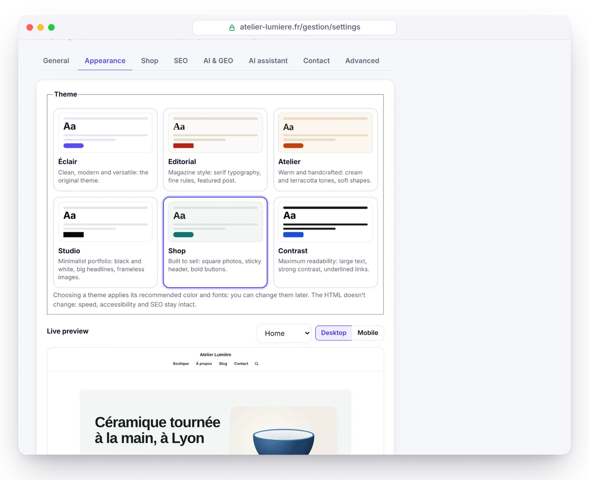
      <p align="center"><b>Live preview</b><br><sub>Try each theme on your real site: nothing is published until you save.</sub></p>
    </td>
    <td width="50%" valign="top">
      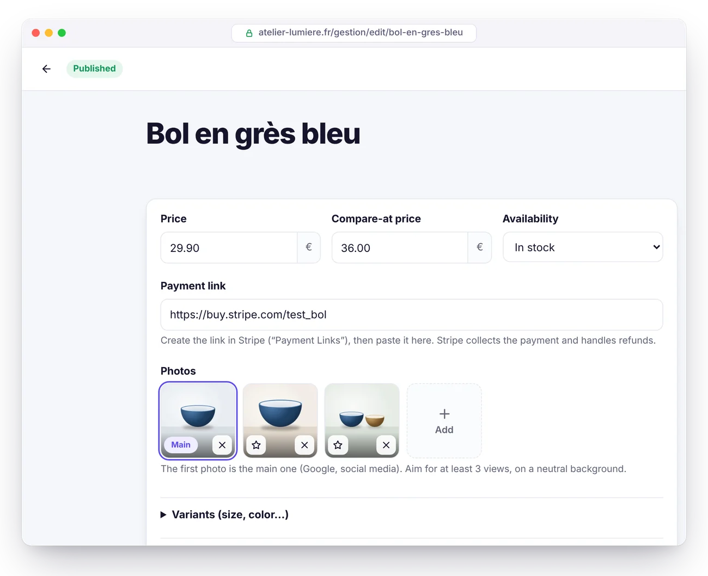
      <p align="center"><b>Product page</b><br><sub>Price, Stripe link, photos and variants, at the top of the editor.</sub></p>
    </td>
  </tr>
</table>

The shop only opens once your legal notice and terms of sale are published. Step-by-step instructions: see the [guide, Shop section](docs/GUIDE.en.md#shop).

## Éclair vs. WordPress

| | Classic WordPress | ⚡ Éclair |
|---|---|---|
| **Installation** | Create a MySQL database, then run the wizard | ✅ Upload the folder, answer 4 questions |
| **Database** | MySQL required | ✅ None (protected files) |
| **Download size** | ≈ 35 MB[^wp] | ✅ 433 KB |
| **SEO, sitemap, structured data** | A plugin to install and maintain | ✅ Built in |
| **GEO: llms.txt, Markdown, AI bots** | Plugins, rarely complete | ✅ Built in |
| **Public pages** | Generated on every visit, unless you add a cache plugin | ✅ Served from a static cache |
| **Cookies on the public site** | Often many | ✅ None |
| **Two-factor authentication, brute-force protection** | Plugins | ✅ Built in |
| **Plugin updates** | Frequent, the #1 source of vulnerabilities | ✅ No plugins to update |
| **AI assistant (writing, images)** | Plugins, often with a subscription | ✅ Built in: Claude or ChatGPT, with your own key |
| **Themes** | Installed separately, often heavy, sometimes paid | ✅ 6 built-in themes, live preview |
| **Selling online** | WooCommerce: a plugin, a database, updates | ✅ Built-in lightweight shop, payment via Stripe link |

## Performance

<picture>
  <source media="(prefers-color-scheme: dark)" srcset="docs/images/en/performance-dark.webp">
  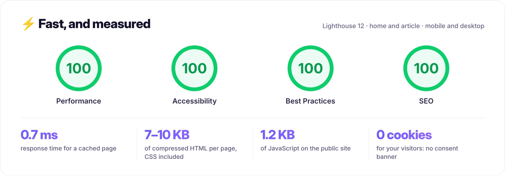
</picture>

Measured locally on the demo site (PHP 8.3, illustrated home page and a 600-word article), with Lighthouse 12 on mobile and desktop; a score can vary by one point from one run to the next. How it works:

- **Automatic static cache**: each page is generated once, then served directly by `index.php`. The cache clears itself whenever you change something.
- **CSS inlined in the page**, system fonts: no render-blocking requests, no layout shift.
- **Images optimized on upload**: resized, converted to **responsive WebP** (480 to 1600 px), explicit dimensions and lazy loading.
- **A single public script**, deferred, 1.2 KB compressed. Brotli or Gzip compression and one-year browser caching via `.htaccess`.

On real shared hosting, add your host's network latency and PHP startup time.

## SEO and GEO: found on Google, cited by AI

<picture>
  <source media="(prefers-color-scheme: dark)" srcset="docs/images/en/geo-dark.webp">
  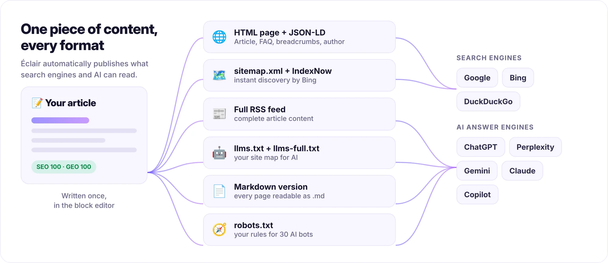
</picture>

<table>
  <tr>
    <td width="50%" valign="top">
      <h3>🔎 SEO</h3>
      <ul>
        <li><b>Real-time analysis</b> with a score: title, meta description, keyphrase, structure, internal linking, alt text…</li>
        <li><b>JSON-LD structured data</b>: Organization or LocalBusiness, BlogPosting, FAQPage, BreadcrumbList, author…</li>
        <li>Sitemap with images and <code>hreflang</code>, full RSS feed, Open Graph with a <b>generated share image</b>.</li>
        <li><b>Automatic 301 redirects</b> when a URL changes, plus a redirect manager to migrate an old site.</li>
        <li><b>IndexNow</b>: Bing and other compatible engines are notified every time you publish.</li>
      </ul>
    </td>
    <td width="50%" valign="top">
      <h3>🤖 GEO (AI answer engines)</h3>
      <ul>
        <li><code>/llms.txt</code> and <code>/llms-full.txt</code> generated automatically (<a href="https://llmstxt.org/">llmstxt.org</a> proposal).</li>
        <li><b>A Markdown version of every page</b>: add <code>.md</code> to any URL.</li>
        <li><b>One-click AI bot policy</b>: open, citations only or closed, for 30 bots (GPTBot, ClaudeBot, PerplexityBot…).</li>
        <li>A <b>“Key takeaways”</b> block at the top of each article: the summary AI likes to quote.</li>
        <li><b>GEO score</b>: FAQ, question-style subheadings, concrete figures, sources, identified author (E-E-A-T)…</li>
      </ul>
    </td>
  </tr>
</table>

## Preview

<table>
  <tr>
    <td width="50%" valign="top">
      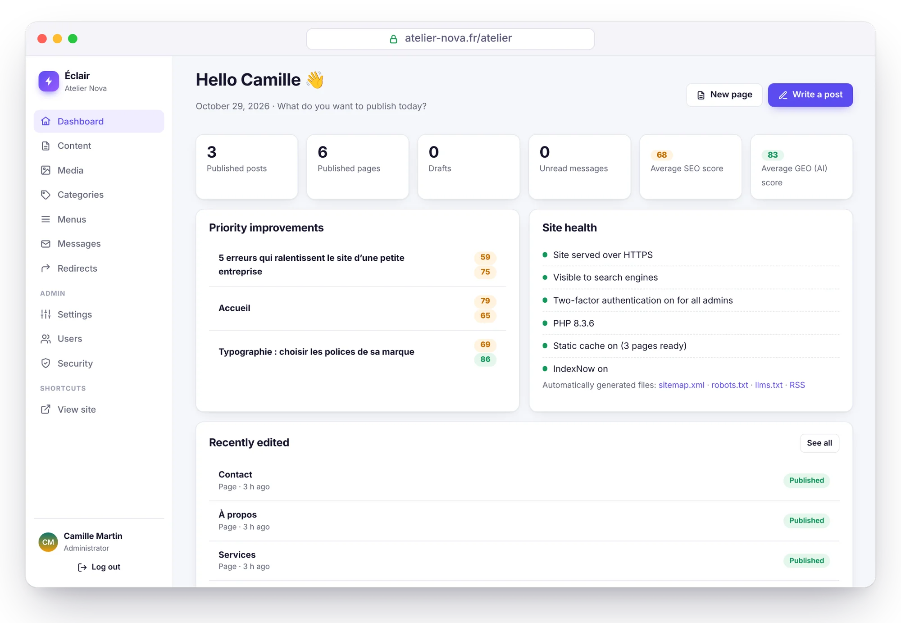
      <p align="center"><b>Dashboard</b><br><sub>What to improve and your site's health, at a glance.</sub></p>
    </td>
    <td width="50%" valign="top">
      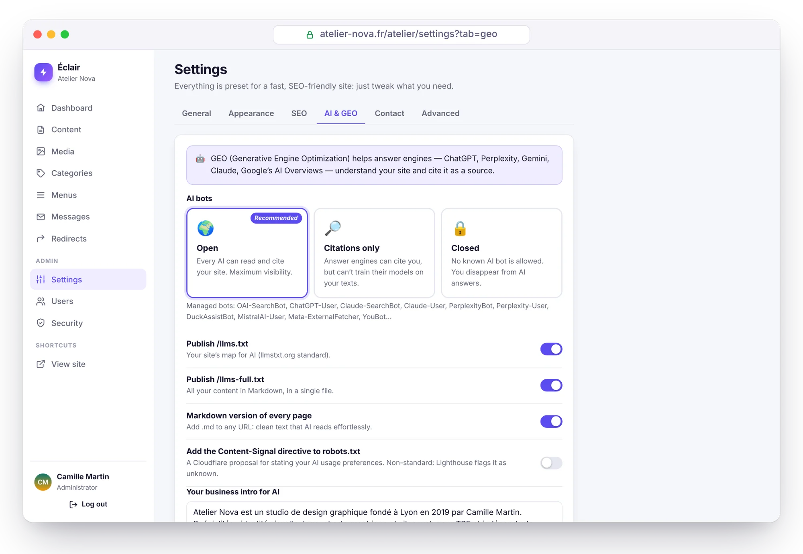
      <p align="center"><b>AI visibility</b><br><sub>Allow, limit or block AI bots in one click.</sub></p>
    </td>
  </tr>
  <tr>
    <td width="50%" valign="top">
      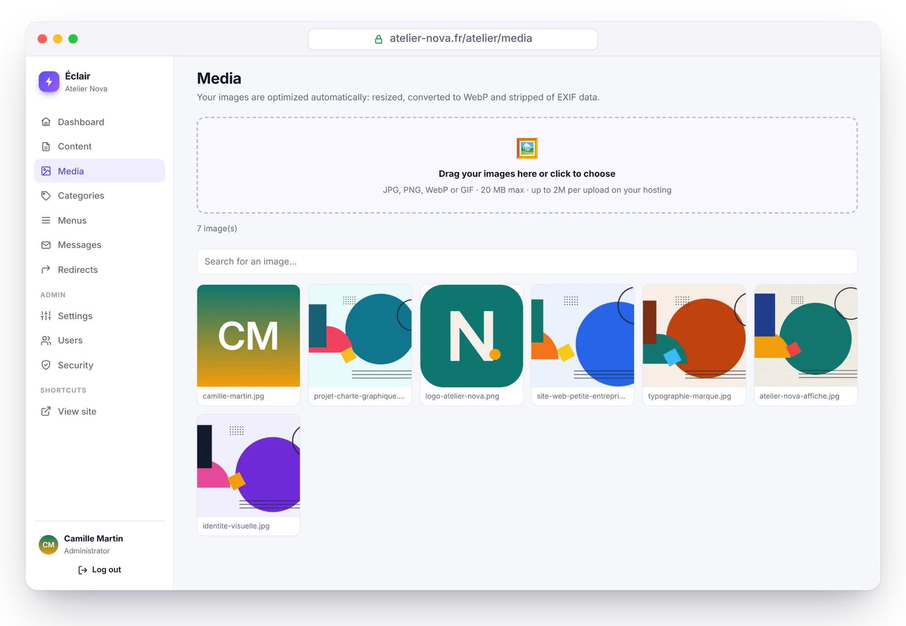
      <p align="center"><b>Media library</b><br><sub>Images resized and converted to WebP automatically.</sub></p>
    </td>
    <td width="50%" valign="top">
      
      <p align="center"><b>Automatic dark mode</b><br><sub>The site adapts to each visitor's theme.</sub></p>
    </td>
  </tr>
</table>

<sub>Screenshots from “Atelier Nova”, a fictional demo site built with Éclair (original illustrations). The admin is shown in English; the demo content is in French.</sub>

## Security

Éclair is built for a hostile environment: shared hosting, bots trying passwords around the clock.

- **No database**, so no SQL injection. Data files are doubly protected (`.htaccess` and a `<?php exit; ?>` line), private and written atomically.
- **Hardened login**: Argon2id password hashing, limits per network and per account (your usual device is never locked out by an attacker), **two-factor authentication** with recovery codes.
- **Password re-prompt** for sensitive actions, temporary passwords that must be changed, short and revocable sessions.
- **Locked-down public site**: strict Content-Security-Policy, allowlist-based content sanitizing, no open redirects, re-encoded images.
- **Protected installation**: a 2-hour window, and the site URL verified by the server itself before any redirect.
- **Security page**: file integrity check, folder protection test, security log, one-click backup.
- **MCP connector disabled by default**: once enabled, OAuth 2.1 with PKCE, approval after login, hashed and revocable tokens, no publishing or deleting possible.

> [!NOTE]
> **Offensive security review.** Race conditions, brute force, redirects, injections, booby-trapped files: 17 vulnerabilities were found (2 high, 7 medium, 8 low) and all of them fixed. The 13 attack scenarios were then replayed against the fixed version: all neutralized. The automated tests (`php tests/run.php`) cover a large part of them.

Full details in the [guide, Security section](docs/GUIDE.en.md#security).

## Install in 3 minutes

<p align="center">
  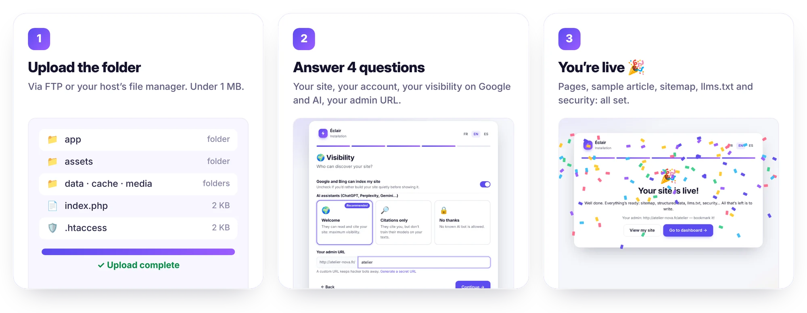
</p>

1. **Download** the [`eclair-cms-1.5.0.zip`](https://github.com/Jacckisback/eclair-cms/raw/main/dist/eclair-cms-1.5.0.zip) archive (433 KB) and unzip it.
2. **Upload the contents of the `eclair` folder** to your hosting's public folder (`public_html`, `www`…), hidden `.htaccess` files included.
3. **Open your site's URL**: the setup wizard starts. Four questions, some confetti, and your site is live with its first pages.

**Requirements**: PHP 8.1 or later (8.3 recommended), Apache or LiteSpeed (virtually every shared host: Hostinger, IONOS, OVHcloud…), an HTTPS certificate. The wizard checks everything and explains what to fix. Nginx works too ([configuration](docs/GUIDE.en.md#nginx)).

> [!TIP]
> For security, the installation must be completed within **2 hours** of the first visit. After that, delete `data/install-window.php` via FTP and reload the page.

## Documentation

The [full guide](docs/GUIDE.en.md) covers everything else:

- [Installation](docs/GUIDE.en.md#installation): requirements, site types, first steps
- [Features in detail](docs/GUIDE.en.md#features-in-detail): speed, SEO, GEO, block editor
- [Everyday use](docs/GUIDE.en.md#everyday-use)
- [Themes](docs/GUIDE.en.md#themes) and [Shop](docs/GUIDE.en.md#shop): live preview, product pages, Stripe, Google Shopping
- [AI assistant](docs/GUIDE.en.md#ai-assistant): activation, editorial profile, costs, security
- [MCP connector](docs/GUIDE.en.md#mcp-connector-claude-and-chatgpt): Claude and ChatGPT with your subscription
- [Updating, backing up, moving](docs/GUIDE.en.md#updating-backing-up-moving)
- [Troubleshooting](docs/GUIDE.en.md#troubleshooting): forgotten password, 404 or 500 errors, Nginx…

## For developers

PHP 8.1+ with no framework and no Composer: plain classes in `eclair/app/lib/`, PHP views and vanilla JavaScript.

```bash
PHP_CLI_SERVER_WORKERS=4 php -S localhost:8000 -t eclair tools/router.php   # development server
php tests/run.php                                                           # 456 unit and HTTP checks
php tools/build.php                                                         # ready-to-ship archive
```

Project structure and theme customization: see [For developers](docs/GUIDE.en.md#for-developers).

## License

Éclair is released under the **MIT license** ([`LICENSE`](LICENSE)): use it, modify it and redistribute it freely, including for commercial use, as long as you keep the copyright notice. Some admin icons are derived from [Lucide](https://lucide.dev) (ISC license, see [`THIRD-PARTY-NOTICES.txt`](THIRD-PARTY-NOTICES.txt)).

<br>

<p align="center"><sub>⚡ Éclair, for freelancers and small businesses who want a fast, well-ranked, hassle-free website.</sub></p>

[^stripe]: Stripe's pricing in France for a standard card from the European Economic Area (EEA); 2.8% + €0.25 for a premium card, 3.15% + €0.25 for a card from outside the EEA ([stripe.com/fr/pricing](https://stripe.com/fr/pricing), checked on October 30, 2026). Payment Links are included at no extra cost.

[^wp]: Official WordPress 7.1.4 archive: 37,239,942 bytes, i.e. 35.5 MB ([download link](https://downloads.wordpress.org/release/wordpress-7.1.4.zip), checked on October 29, 2026).
