<p align="center">
  <a href="README.md">Français</a> · <a href="README.en.md">English</a> · <b>Español</b> · <a href="README.de.md">Deutsch</a> · <a href="README.it.md">Italiano</a> · <a href="README.pt-BR.md">Português</a> · <a href="README.zh-CN.md">简体中文</a>
</p>

<p align="center">
  <picture>
    <source media="(prefers-color-scheme: dark)" srcset="docs/images/es/banner-dark.webp">
    
  </picture>
</p>

<p align="center">
  <a href="https://github.com/Jacckisback/eclair-cms/raw/main/dist/eclair-cms-1.4.0.zip"></a>
  
  
  
  <a href="LICENSE"></a>
</p>

<h3 align="center">Una web profesional en 3 minutos, en cualquier hosting compartido.<br>Sin base de datos. Sin plugins. Sin mantenimiento.</h3>

<p align="center">
  <a href="#instalación-en-3-minutos"><b>Instalar</b></a> ·
  <a href="#por-qué-éclair"><b>Por qué Éclair</b></a> ·
  <a href="#asistente-ia-pide-revisa-publica"><b>Asistente IA</b></a> ·
  <a href="#claude-y-chatgpt-con-tu-suscripción"><b>Claude y ChatGPT</b></a> ·
  <a href="#temas-y-tienda"><b>Temas y tienda</b></a> ·
  <a href="#vista-previa"><b>Vista previa</b></a> ·
  <a href="#seguridad"><b>Seguridad</b></a> ·
  <a href="docs/GUIDE.es.md"><b>Guía completa</b></a>
</p>

<br>

<p align="center">
  
</p>

## Por qué Éclair

WordPress lo hace todo, pero necesita una base de datos, plugins para el SEO, la seguridad y la caché… y actualizaciones sin fin. Éclair reúne lo esencial en un CMS de **menos de 1 MB**, pensado para autónomos, artesanos y pequeñas empresas.

<table>
  <tr>
    <td width="33%" valign="top">
      <h3>⚡ Ultrarrápido</h3>
      Cada página se sirve desde una caché estática, sin cargar la aplicación: <b>100/100</b> en Lighthouse y <b>0,7 ms</b> de tiempo de respuesta del servidor (medido en local).
    </td>
    <td width="33%" valign="top">
      <h3>🔎 SEO integrado</h3>
      Datos estructurados, sitemap, redirecciones, vista previa de Google y <b>puntuación SEO en directo</b> en el editor, sin ningún plugin.
    </td>
    <td width="33%" valign="top">
      <h3>🤖 Listo para la IA</h3>
      <code>llms.txt</code>, versión Markdown de cada página, reglas para 30 robots de IA y <b>puntuación GEO</b> para que ChatGPT, Perplexity o Gemini te citen.
    </td>
  </tr>
  <tr>
    <td width="33%" valign="top">
      <h3>🛡️ Seguro por defecto</h3>
      Verificación en dos pasos, protección contra fuerza bruta, cabeceras estrictas, contenido saneado. <b>Una auditoría de seguridad ofensiva</b>, todas las vulnerabilidades corregidas.
    </td>
    <td width="33%" valign="top">
      <h3>🪶 Ultraligero</h3>
      Sin base de datos: tu contenido se guarda en archivos protegidos. Un archivo de <b>432 KB</b>, cero dependencias, cero cookies en el sitio público.
    </td>
    <td width="33%" valign="top">
      <h3>😊 Facilísimo</h3>
      Instalación guiada en 4 preguntas, editor de bloques con <code>/</code>, lista de primeros pasos. Panel en <b>7 idiomas</b>, sitio en 6 idiomas.
    </td>
  </tr>
</table>

## Asistente IA: pide, revisa, publica

<p align="center">
  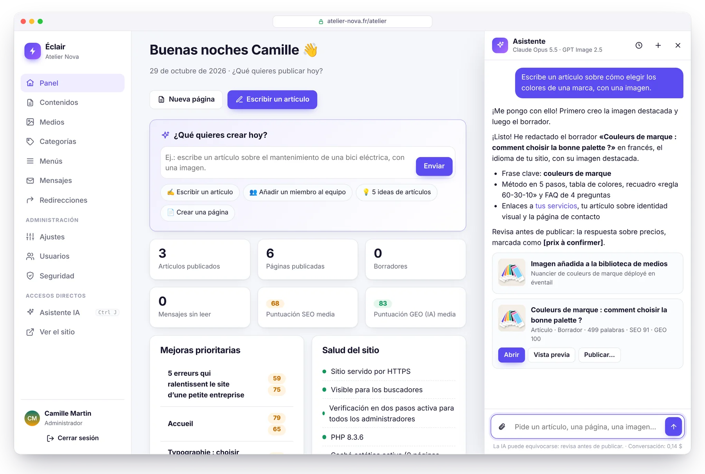
</p>

Escribe lo que necesitas, como si se lo pidieras a un compañero: *«Escribe un artículo sobre cómo elegir los colores de una marca, con una imagen»*. El asistente comprueba que el tema no exista ya, crea la imagen, redacta el borrador completo (título, Lo esencial, subtítulos, tabla, FAQ, metadescripción, enlaces internos) **con el tono de tu sitio** y te lo presenta con sus puntuaciones SEO y GEO. **No se publica nada sin tu clic.**

<table>
  <tr>
    <td width="50%" valign="top">
      <h3>✍️ Escribe como tú</h3>
      Un <b>perfil editorial</b> redactado en un clic a partir de tu sitio: público, tono, valores, reglas, estilo de las imágenes. Cada texto sigue además las reglas de análisis de Éclair: los borradores apuntan a una puntuación alta desde el principio.
    </td>
    <td width="50%" valign="top">
      <h3>🖼️ Imágenes incluidas</h3>
      <b>GPT Image 2.5</b>, <b>FLUX 3</b> o <b>Ideogram 3</b>: la imagen destacada se concibe a partir del artículo, se optimiza en WebP y se describe (texto alternativo). O adjunta tus propias fotos.
    </td>
  </tr>
  <tr>
    <td width="50%" valign="top">
      <h3>👥 Actúa en tu sitio</h3>
      «Añade a Léa Martin a la página del equipo con la foto adjunta»: el cambio queda listo, lo revisas en vista previa y lo aplicas con un clic. Y se deshace con otro clic.
    </td>
    <td width="50%" valign="top">
      <h3>🛡️ Tú tienes el control</h3>
      La IA nunca publica ni elimina nada. Claves cifradas, presupuesto mensual, cuota diaria. <b>Claude o ChatGPT</b> con tu propia clave: sin suscripción, unos <b>0,24 $ por artículo</b> con Claude Opus 5.5.
    </td>
  </tr>
</table>

<table>
  <tr>
    <td width="50%" valign="top">
      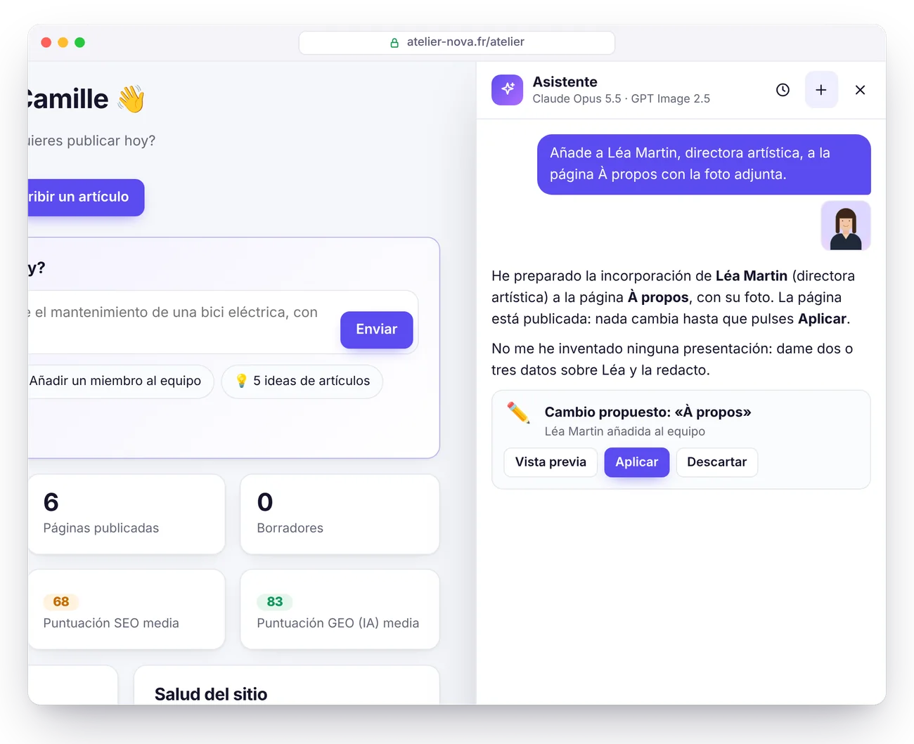
      <p align="center"><b>Propuestas por validar</b><br><sub>En una página publicada, nada cambia sin tu aprobación.</sub></p>
    </td>
    <td width="50%" valign="top">
      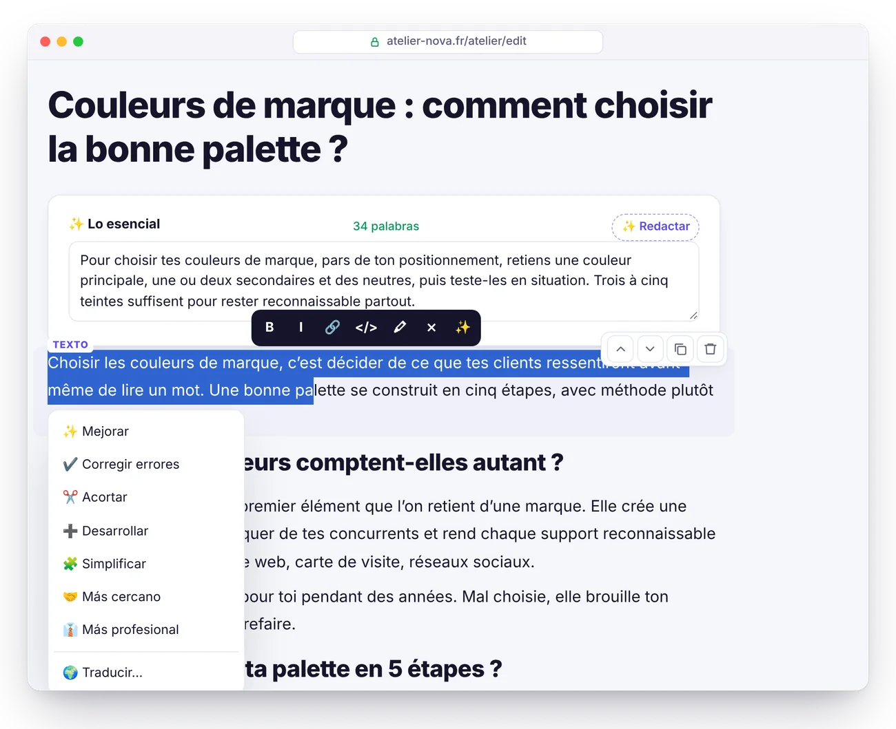
      <p align="center"><b>Retoques en un clic</b><br><sub>Mejorar, corregir, acortar, traducir, redactar las FAQ o los textos alternativos.</sub></p>
    </td>
  </tr>
</table>

Activación en 5 minutos y tarifas detalladas: consulta la [guía, sección Asistente IA](docs/GUIDE.es.md#asistente-ia).

## Claude y ChatGPT, con tu suscripción

<p align="center">
  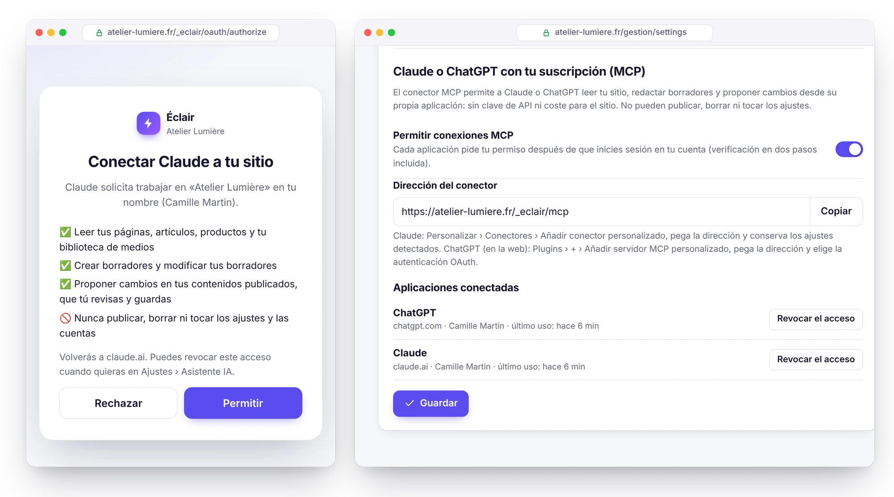
</p>

¿Ya trabajas en Claude o ChatGPT? Conéctalos a tu sitio con el **conector MCP** integrado: actívalo en Ajustes › Asistente IA, pega su dirección en Claude o ChatGPT y da tu permiso. Tu IA lee tu sitio, recibe tu perfil editorial y las reglas SEO y GEO de Éclair, redacta borradores y prepara cambios en tus páginas publicadas, que tú revisas en el editor. **Tu suscripción hace el trabajo: sin clave de API ni coste para el sitio.**

- **No se publica ni se elimina nada**: solo borradores y propuestas; eres tú quien publica en Éclair.
- **Acceso bajo tu control**: OAuth 2.1 con PKCE, permiso concedido tras iniciar sesión (verificación en dos pasos incluida), acceso revocado en un clic, o automáticamente si cambias la contraseña.
- **Ligero**: el servidor MCP y la autorización caben en menos de 25 KB de PHP, sin dependencias.
- **También en el asistente integrado**, con tus claves de API de Claude y ChatGPT, eliges la IA en cada conversación.

Puesta en marcha en 3 minutos y planes compatibles: consulta la [guía, sección Conector MCP](docs/GUIDE.es.md#conector-mcp-claude-y-chatgpt).

## Temas y tienda

<p align="center">
  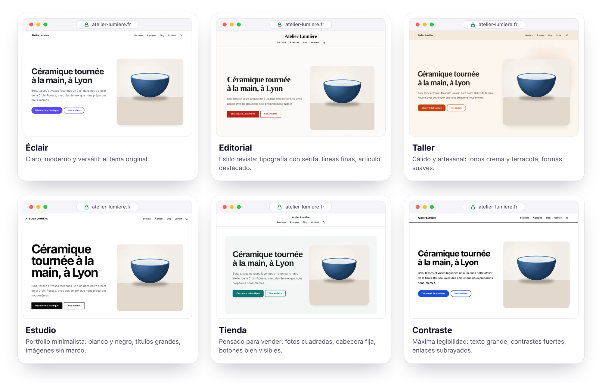
</p>

**6 temas incluidos**, para elegir en Ajustes › Apariencia con una **vista previa en directo** de tu sitio real, en ordenador o en móvil, antes de guardar: Éclair, Editorial, Taller, Estudio, Tienda y Contraste. Cabecera centrada o no, listas en cuadrícula o en lista, color y fuentes a tu gusto. Cada tema es solo una hoja de estilos de 1,5 a 3 KB: el HTML no cambia, así que la velocidad, la accesibilidad y el posicionamiento tampoco.

<p align="center">
  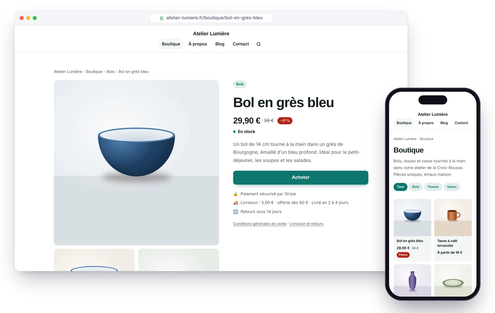
</p>

**Modo tienda ligera**: vende tus productos sin el peso de un e-commerce. Cada producto tiene su ficha y su botón **Comprar** lleva a un **enlace de pago de Stripe**, y eso es todo: sin carrito, sin base de datos, ningún dato bancario en tu servidor. Único coste: la comisión de Stripe, **1,5 % + 0,25 €** por pago con una tarjeta europea estándar[^stripe].

<table>
  <tr>
    <td width="50%" valign="top">
      <h3>🛍️ Fichas que venden</h3>
      Galería de fotos, precio y precio tachado, <b>variantes sin JavaScript</b> (talla, color), stock, gastos de envío y devoluciones a la vista, productos relacionados. Catálogo con filtros por categoría y bloque <b>Productos</b> para tu página de inicio.
    </td>
    <td width="50%" valign="top">
      <h3>💳 Pago con Stripe</h3>
      Un <b>enlace de pago de Stripe</b> por producto (o por variante): Stripe cobra, envía los recibos y gestiona los reembolsos. <b>Sin suscripción</b>, ni con Éclair ni con Stripe.
    </td>
  </tr>
  <tr>
    <td width="50%" valign="top">
      <h3>🔎 Hecho para Google</h3>
      Datos estructurados <b>Product y Offer</b> (precio, stock, envío, política de devoluciones), categorías pilar y <b>feed de Google Merchant Center</b> para aparecer gratis en la pestaña Shopping.
    </td>
    <td width="50%" valign="top">
      <h3>🤖 Citado por la IA</h3>
      Precio y disponibilidad en <code>llms.txt</code> y en la versión Markdown de cada ficha. El asistente IA redacta una ficha a partir de tu foto, sin inventarse nunca un precio.
    </td>
  </tr>
</table>

<table>
  <tr>
    <td width="50%" valign="top">
      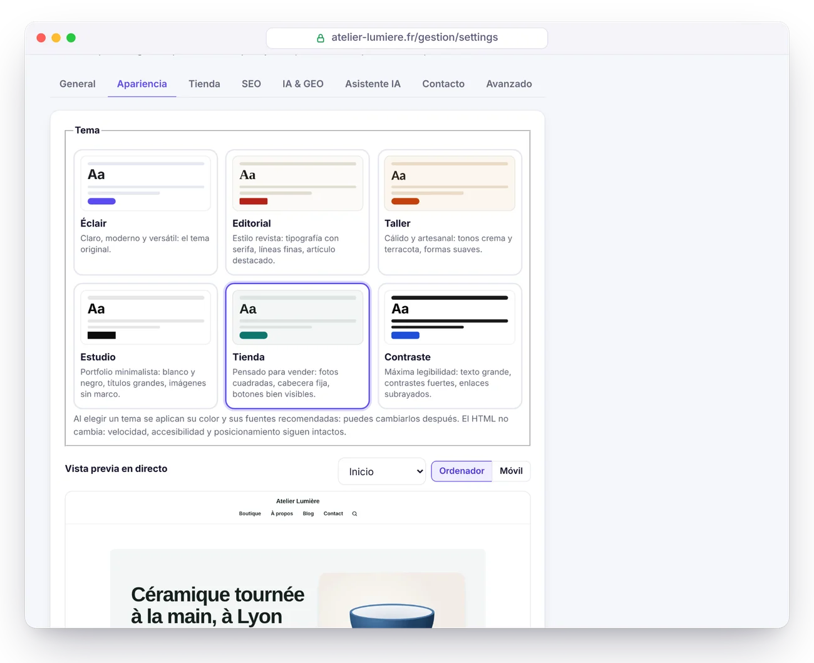
      <p align="center"><b>Vista previa en directo</b><br><sub>Prueba cada tema en tu sitio real: no se publica nada hasta que guardes.</sub></p>
    </td>
    <td width="50%" valign="top">
      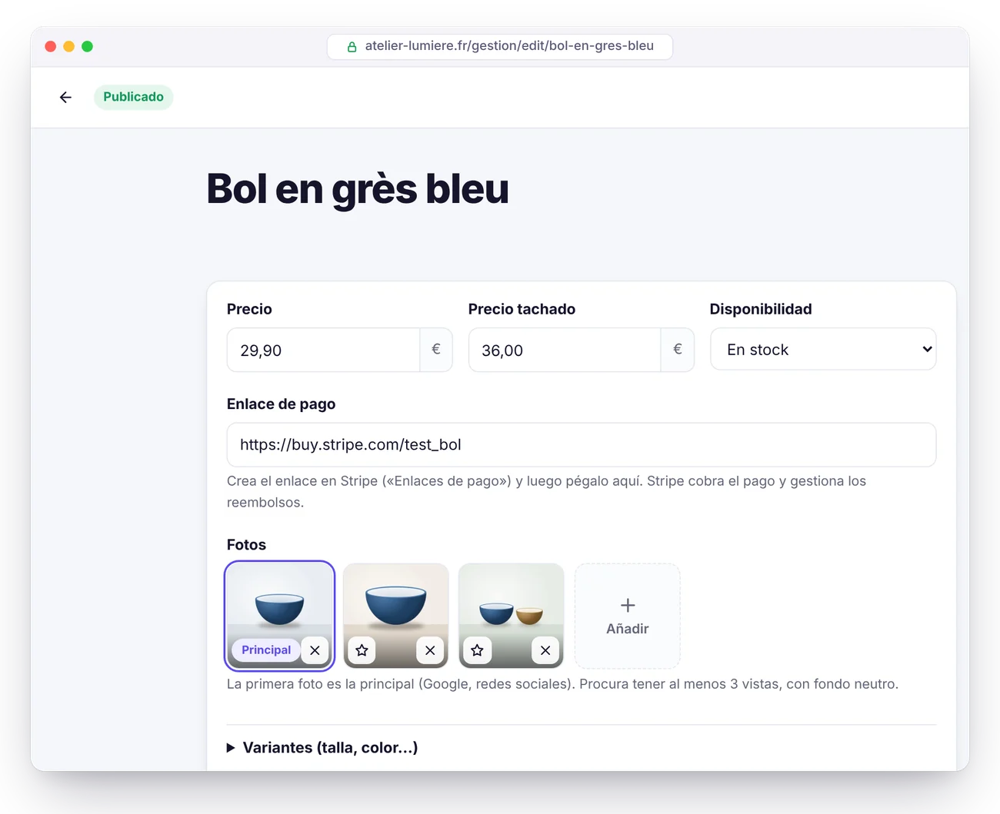
      <p align="center"><b>Ficha de producto</b><br><sub>Precio, enlace de Stripe, fotos y variantes, en la parte superior del editor.</sub></p>
    </td>
  </tr>
</table>

La tienda solo se abre cuando el aviso legal y las condiciones generales de venta están publicados. Instrucciones completas: consulta la [guía, sección Tienda](docs/GUIDE.es.md#tienda).

## Éclair frente a WordPress

| | WordPress clásico | ⚡ Éclair |
|---|---|---|
| **Instalación** | Crear una base de datos MySQL y luego lanzar el asistente | ✅ Subir la carpeta y responder 4 preguntas |
| **Base de datos** | MySQL obligatorio | ✅ Ninguna (archivos protegidos) |
| **Archivo de descarga** | ≈ 35 MB[^wp] | ✅ 432 KB |
| **SEO, sitemap, datos estructurados** | Un plugin que instalar y mantener | ✅ Integrado |
| **GEO: llms.txt, Markdown, robots de IA** | Plugins, rara vez completos | ✅ Integrado |
| **Páginas públicas** | Generadas en cada visita, salvo con un plugin de caché | ✅ Servidas desde una caché estática |
| **Cookies en el sitio público** | A menudo muchas | ✅ Ninguna |
| **Verificación en dos pasos, protección contra fuerza bruta** | Plugins | ✅ Integradas |
| **Actualizaciones de plugins** | Constantes, la principal fuente de vulnerabilidades | ✅ Ningún plugin que actualizar |
| **Asistente IA (redacción, imágenes)** | Plugins, a menudo con suscripción | ✅ Integrado: Claude o ChatGPT, con tu clave |
| **Temas** | Hay que instalarlos; a menudo pesados, a veces de pago | ✅ 6 temas integrados, vista previa en directo |
| **Vender en línea** | WooCommerce: plugin, base de datos, actualizaciones | ✅ Tienda ligera integrada, pago mediante enlace de Stripe |

## Rendimiento

<picture>
  <source media="(prefers-color-scheme: dark)" srcset="docs/images/es/performance-dark.webp">
  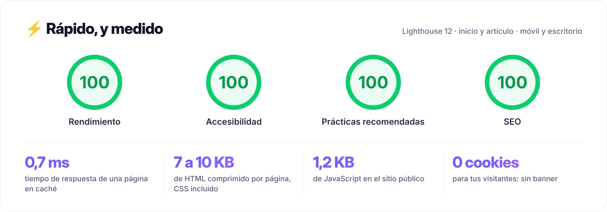
</picture>

Medido en local en el sitio de demostración (PHP 8.3, página de inicio con imágenes y artículo de 600 palabras), con Lighthouse 12 en móvil y escritorio; una puntuación puede variar un punto de una pasada a otra. Cómo se consigue:

- **Caché estática automática**: cada página se genera una vez y después la sirve directamente `index.php`. La caché se vacía sola con cada cambio.
- **CSS integrado en la página**, fuentes del sistema: ninguna petición bloqueante, ningún salto de diseño.
- **Imágenes optimizadas al subirlas**: redimensionadas, convertidas a **WebP adaptable** (de 480 a 1600 px), dimensiones explícitas y carga diferida.
- **Un único script público**, diferido, de 1,2 KB comprimido. Compresión Brotli o Gzip y caché del navegador de un año mediante `.htaccess`.

En un hosting compartido real, suma la latencia de red y el arranque de PHP de tu proveedor.

## SEO y GEO: encontrado en Google, citado por la IA

<picture>
  <source media="(prefers-color-scheme: dark)" srcset="docs/images/es/geo-dark.webp">
  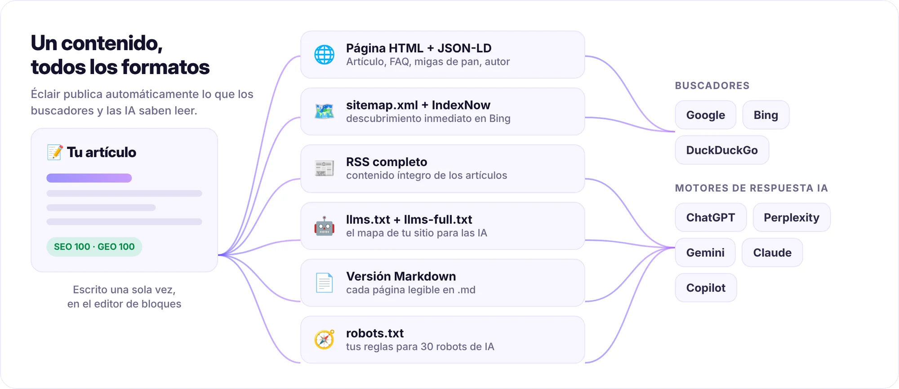
</picture>

<table>
  <tr>
    <td width="50%" valign="top">
      <h3>🔎 SEO</h3>
      <ul>
        <li><b>Análisis en tiempo real</b> con puntuación: título, metadescripción, frase clave, estructura, enlazado interno, textos alternativos…</li>
        <li><b>Datos estructurados JSON-LD</b>: Organization o LocalBusiness, BlogPosting, FAQPage, BreadcrumbList, autor…</li>
        <li>Sitemap con imágenes y <code>hreflang</code>, feed RSS completo, Open Graph con <b>imagen para compartir generada</b>.</li>
        <li><b>Redirecciones 301 automáticas</b> cuando cambia una URL, y un gestor de redirecciones para migrar una web antigua.</li>
        <li><b>IndexNow</b>: Bing y los demás buscadores compatibles reciben un aviso en cada publicación.</li>
      </ul>
    </td>
    <td width="50%" valign="top">
      <h3>🤖 GEO (motores de respuesta IA)</h3>
      <ul>
        <li><code>/llms.txt</code> y <code>/llms-full.txt</code> generados automáticamente (propuesta <a href="https://llmstxt.org/">llmstxt.org</a>).</li>
        <li><b>Versión Markdown de cada página</b>: añade <code>.md</code> a cualquier URL.</li>
        <li><b>Política de robots de IA en un clic</b>: abierto, solo citas o cerrado, para 30 robots (GPTBot, ClaudeBot, PerplexityBot…).</li>
        <li>Bloque <b>«Lo esencial»</b> al principio de cada artículo: el resumen que las IA citan con gusto.</li>
        <li><b>Puntuación GEO</b>: FAQ, subtítulos en forma de pregunta, cifras concretas, fuentes, autor identificado (E-E-A-T)…</li>
      </ul>
    </td>
  </tr>
</table>

## Vista previa

<table>
  <tr>
    <td width="50%" valign="top">
      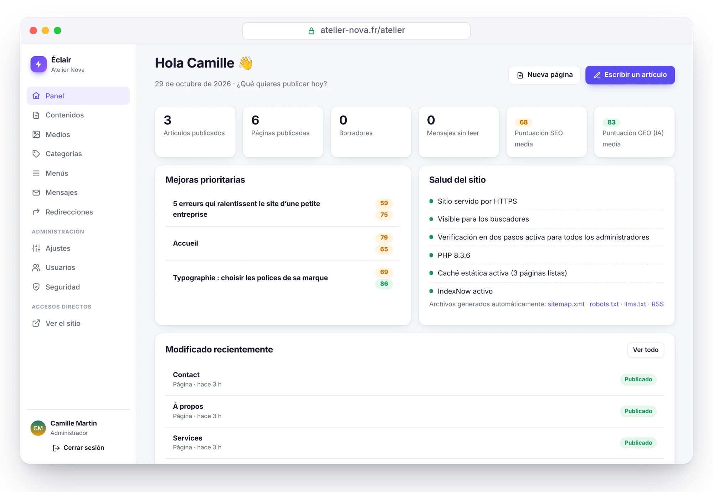
      <p align="center"><b>Panel</b><br><sub>Lo que hay que mejorar y el estado del sitio, de un vistazo.</sub></p>
    </td>
    <td width="50%" valign="top">
      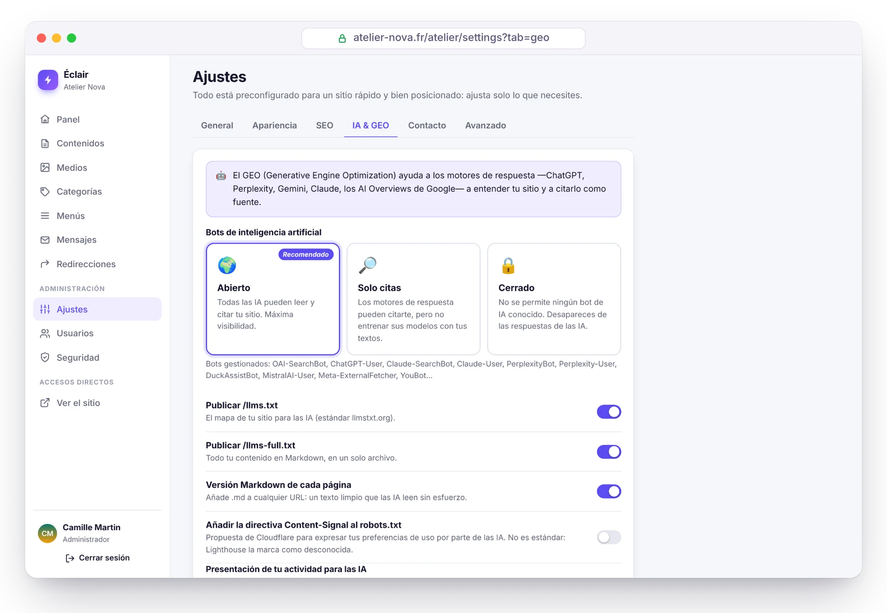
      <p align="center"><b>Visibilidad en IA</b><br><sub>Permite, limita o bloquea los robots de IA en un clic.</sub></p>
    </td>
  </tr>
  <tr>
    <td width="50%" valign="top">
      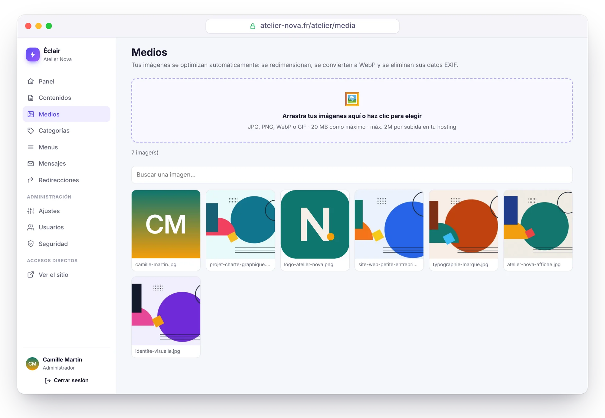
      <p align="center"><b>Biblioteca de medios</b><br><sub>Imágenes redimensionadas y convertidas a WebP automáticamente.</sub></p>
    </td>
    <td width="50%" valign="top">
      
      <p align="center"><b>Modo oscuro automático</b><br><sub>El sitio se adapta al tema de cada visitante.</sub></p>
    </td>
  </tr>
</table>

<sub>Capturas de «Atelier Nova», un sitio de demostración ficticio creado con Éclair (ilustraciones originales). El panel aparece en español; el contenido de demostración está en francés.</sub>

## Seguridad

Éclair está pensado para un entorno hostil: hosting compartido y robots probando contraseñas sin descanso.

- **Sin base de datos**, así que sin inyección SQL. Los archivos de datos tienen doble protección (`.htaccess` y una línea `<?php exit; ?>`), son privados y se escriben de forma atómica.
- **Inicio de sesión blindado**: contraseñas con Argon2id, límites por red y por cuenta (un atacante nunca puede bloquear tu dispositivo habitual), **verificación en dos pasos** con códigos de recuperación.
- **Contraseña solicitada de nuevo** para las acciones sensibles, contraseñas temporales que hay que cambiar, sesiones cortas y revocables.
- **Sitio público blindado**: Content-Security-Policy estricta, contenido saneado mediante lista blanca, ninguna redirección abierta, imágenes recodificadas.
- **Instalación protegida**: un plazo de 2 horas, y la URL del sitio verificada por el propio servidor antes de cualquier redirección.
- **Página Seguridad**: control de integridad de los archivos, prueba de protección de las carpetas, registro, copia de seguridad en un clic.
- **Conector MCP desactivado por defecto**: una vez activado, OAuth 2.1 con PKCE, permiso tras iniciar sesión, tokens almacenados con hash y revocables, sin posibilidad de publicar ni eliminar nada.

> [!NOTE]
> **Auditoría de seguridad ofensiva.** Condiciones de carrera, fuerza bruta, redirecciones, inyecciones, archivos trampa: se encontraron 17 vulnerabilidades (2 graves, 7 medias, 8 leves) y todas se corrigieron. Después se repitieron los 13 escenarios de ataque contra la versión corregida: todos neutralizados. Las pruebas automáticas (`php tests/run.php`) cubren gran parte de ellos.

Todos los detalles en la [guía, sección Seguridad](docs/GUIDE.es.md#seguridad).

## Instalación en 3 minutos

<p align="center">
  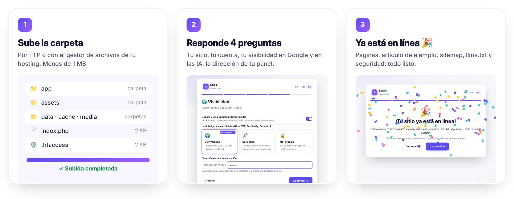
</p>

1. **Descarga** el archivo [`eclair-cms-1.4.0.zip`](https://github.com/Jacckisback/eclair-cms/raw/main/dist/eclair-cms-1.4.0.zip) (432 KB) y descomprímelo.
2. **Sube el contenido de la carpeta `eclair`** a la carpeta pública de tu hosting (`public_html`, `www`…), incluidos los archivos ocultos `.htaccess`.
3. **Abre la dirección de tu sitio**: arranca el asistente. Cuatro preguntas, un poco de confeti, y tu sitio está en línea con sus primeras páginas.

**Requisitos**: PHP 8.1 o superior (se recomienda 8.3), Apache o LiteSpeed (casi todos los hostings compartidos: Hostinger, IONOS, OVHcloud…) y un certificado HTTPS. El asistente lo comprueba todo y te explica qué corregir. También funciona con Nginx ([configuración](docs/GUIDE.es.md#nginx)).

> [!TIP]
> Por seguridad, la instalación debe hacerse en las **2 horas** siguientes a la primera visita. Pasado ese plazo, borra `data/install-window.php` por FTP y recarga la página.

## Documentación

La [guía completa](docs/GUIDE.es.md) detalla todo lo demás:

- [Instalación](docs/GUIDE.es.md#instalación): requisitos, tipos de sitio, primeros pasos
- [Funciones en detalle](docs/GUIDE.es.md#funciones-en-detalle): velocidad, SEO, GEO, editor de bloques
- [Uso diario](docs/GUIDE.es.md#uso-diario)
- [Temas](docs/GUIDE.es.md#temas) y [Tienda](docs/GUIDE.es.md#tienda): vista previa en directo, fichas de producto, Stripe, Google Shopping
- [Asistente IA](docs/GUIDE.es.md#asistente-ia): activación, perfil editorial, costes, seguridad
- [Conector MCP](docs/GUIDE.es.md#conector-mcp-claude-y-chatgpt): Claude y ChatGPT con tu suscripción
- [Actualizar, hacer copias de seguridad, mudarse](docs/GUIDE.es.md#actualizar-hacer-copias-de-seguridad-mudarse)
- [Solución de problemas](docs/GUIDE.es.md#solución-de-problemas): contraseña olvidada, errores 404 o 500, Nginx…

## Para desarrolladores

PHP 8.1+ sin framework ni Composer: clases sencillas en `eclair/app/lib/`, vistas PHP y JavaScript nativo.

```bash
PHP_CLI_SERVER_WORKERS=4 php -S localhost:8000 -t eclair tools/router.php   # servidor de desarrollo
php tests/run.php                                                           # 445 comprobaciones unitarias y HTTP
php tools/build.php                                                         # archivo listo para distribuir
```

Estructura del proyecto y personalización del tema: consulta [Para desarrolladores](docs/GUIDE.es.md#para-desarrolladores).

## Licencia

Éclair se distribuye con **licencia MIT** ([`LICENSE`](LICENSE)): úsalo, modifícalo y redistribúyelo libremente, también con fines comerciales, siempre que conserves el aviso de copyright. Parte de los iconos del panel deriva de [Lucide](https://lucide.dev) (licencia ISC, consulta [`THIRD-PARTY-NOTICES.txt`](THIRD-PARTY-NOTICES.txt)).

<br>

<p align="center"><sub>⚡ Éclair, para autónomos y pequeñas empresas que quieren una web rápida, bien posicionada y sin complicaciones.</sub></p>

[^stripe]: Tarifa de Stripe en España para una tarjeta estándar del Espacio Económico Europeo; 2,8 % + 0,25 € para una tarjeta premium, 3,15 % + 0,25 € fuera del EEE ([stripe.com/es/pricing](https://stripe.com/es/pricing), comprobado el 30 de octubre de 2026). Los enlaces de pago están incluidos sin coste adicional.

[^wp]: Archivo oficial de WordPress 7.1.4: 37.239.942 bytes, es decir, 35,5 MB ([enlace de descarga](https://downloads.wordpress.org/release/wordpress-7.1.4.zip), comprobado el 29 de octubre de 2026).
