<p align="center">
  <a href="README.md">Français</a> · <a href="README.en.md">English</a> · <a href="README.es.md">Español</a> · <a href="README.de.md">Deutsch</a> · <b>Italiano</b> · <a href="README.pt-BR.md">Português</a> · <a href="README.zh-CN.md">简体中文</a>
</p>

<p align="center">
  <picture>
    <source media="(prefers-color-scheme: dark)" srcset="docs/images/it/banner-dark.webp">
    
  </picture>
</p>

<p align="center">
  <a href="https://github.com/Jacckisback/eclair-cms/raw/main/dist/eclair-cms-1.7.0.zip"></a>
  
  
  
  <a href="LICENSE"></a>
</p>

<h3 align="center">Un sito professionale in 3 minuti, su qualsiasi hosting condiviso.<br>Senza database. Senza plugin. Senza manutenzione.</h3>

<p align="center">
  <a href="#installazione-in-3-minuti"><b>Installa</b></a> ·
  <a href="#perché-éclair"><b>Perché Éclair</b></a> ·
  <a href="#assistente-ia-chiedi-rileggi-pubblica"><b>Assistente IA</b></a> ·
  <a href="#claude-e-chatgpt-con-il-tuo-abbonamento"><b>Claude e ChatGPT</b></a> ·
  <a href="#temi-e-negozio"><b>Temi e negozio</b></a> ·
  <a href="#anteprima"><b>Anteprima</b></a> ·
  <a href="#sicurezza"><b>Sicurezza</b></a> ·
  <a href="docs/GUIDE.it.md"><b>Guida completa</b></a>
</p>

<br>

<p align="center">
  
</p>

## Perché Éclair

WordPress fa tutto, ma ha bisogno di un database, di plugin per la SEO, la sicurezza e la cache… e di aggiornamenti continui. Éclair riunisce l’essenziale in un CMS di **meno di 1 MB**, pensato per liberi professionisti, artigiani e piccole imprese.

<table>
  <tr>
    <td width="33%" valign="top">
      <h3>⚡ Ultraveloce</h3>
      Ogni pagina è servita da una cache statica, senza caricare l’applicazione: <b>100/100</b> su Lighthouse e <b>0,7 ms</b> di tempo di risposta del server (misurato in locale).
    </td>
    <td width="33%" valign="top">
      <h3>🔎 SEO integrata</h3>
      Dati strutturati, sitemap, reindirizzamenti, anteprima Google e <b>punteggio SEO in tempo reale</b> nell’editor, senza alcun plugin.
    </td>
    <td width="33%" valign="top">
      <h3>🤖 Pronto per l’IA</h3>
      <code>llms.txt</code>, versione Markdown di ogni pagina, regole per 30 bot IA e <b>punteggio GEO</b> per farti citare da ChatGPT, Perplexity o Gemini.
    </td>
  </tr>
  <tr>
    <td width="33%" valign="top">
      <h3>🛡️ Sicuro di default</h3>
      Autenticazione a due fattori, protezione anti brute force, header rigorosi, contenuti sanificati. <b>Un audit di sicurezza offensivo</b>, tutte le vulnerabilità corrette.
    </td>
    <td width="33%" valign="top">
      <h3>🪶 Ultraleggero</h3>
      Nessun database: i tuoi contenuti sono file protetti. Un archivio di <b>440 KB</b>, zero dipendenze, zero cookie sul sito pubblico.
    </td>
    <td width="33%" valign="top">
      <h3>😊 Semplicissimo</h3>
      Installazione guidata in 4 domande, editor a blocchi con <code>/</code> o <b>modalità Visuale</b> (la pagina così come appare), checklist per iniziare. Pannello in <b>7 lingue</b>, sito in 6 lingue (italiano compreso in entrambi).
    </td>
  </tr>
</table>

## Assistente IA: chiedi, rileggi, pubblica

<p align="center">
  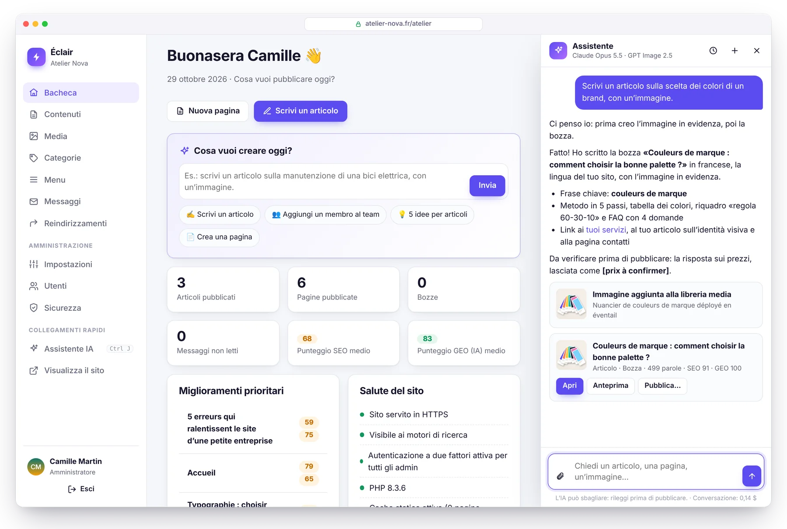
</p>

Chiedi quello che ti serve, come faresti con un collega: *«Scrivi un articolo sulla scelta dei colori di un brand, con un’immagine.»* L’assistente controlla che l’argomento non sia già stato trattato, crea l’immagine, scrive la bozza completa (titolo, L’essenziale, sottotitoli, tabella, FAQ, meta description, link interni) **con il tono del tuo sito**, poi te la presenta con i punteggi SEO e GEO. **Nulla viene pubblicato senza il tuo clic.**

<table>
  <tr>
    <td width="50%" valign="top">
      <h3>✍️ Scrive come te</h3>
      Un <b>profilo editoriale</b> scritto in un clic a partire dal tuo sito: pubblico, tono, valori, regole, stile delle immagini. Ogni testo segue anche i criteri di analisi di Éclair: le bozze puntano a un punteggio alto fin dall’inizio.
    </td>
    <td width="50%" valign="top">
      <h3>🖼️ Immagini incluse</h3>
      <b>GPT Image 2.5</b>, <b>FLUX 3</b> o <b>Ideogram 3</b>: l’immagine in evidenza nasce dall’articolo, viene ottimizzata in WebP e descritta (testo alternativo). Oppure allega le tue foto.
    </td>
  </tr>
  <tr>
    <td width="50%" valign="top">
      <h3>👥 Agisce sul tuo sito</h3>
      «Aggiungi Léa Martin alla pagina del team con la foto allegata»: la modifica è pronta, la vedi in anteprima e la applichi in un clic. E in un clic puoi anche annullarla.
    </td>
    <td width="50%" valign="top">
      <h3>🛡️ Hai sempre il controllo</h3>
      L’IA non pubblica e non elimina mai nulla. Chiavi cifrate, budget mensile, limite giornaliero. <b>Claude o ChatGPT</b> con la tua chiave: nessun abbonamento, circa <b>0,24 $ ad articolo</b> con Claude Opus 5.5.
    </td>
  </tr>
</table>

<table>
  <tr>
    <td width="50%" valign="top">
      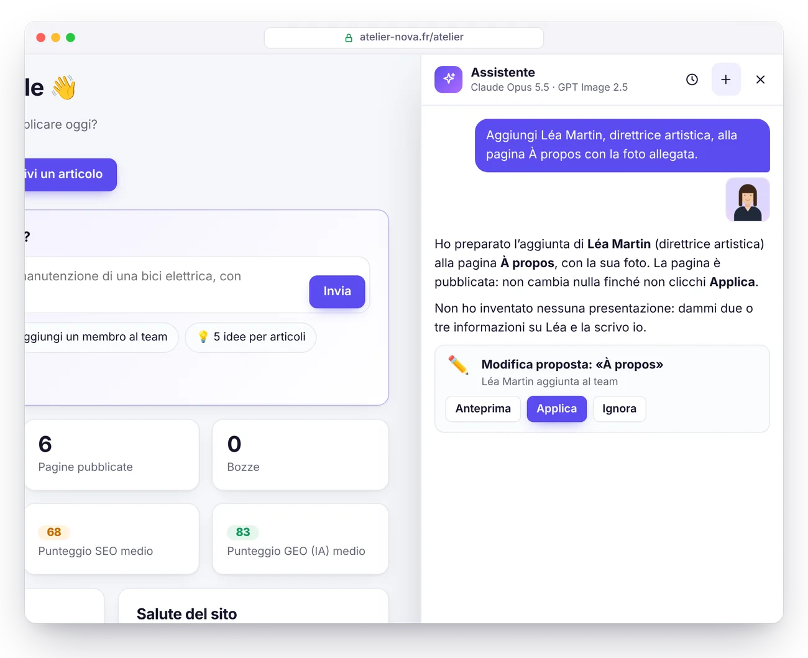
      <p align="center"><b>Proposte da approvare</b><br><sub>Su una pagina pubblicata non cambia nulla senza il tuo via libera.</sub></p>
    </td>
    <td width="50%" valign="top">
      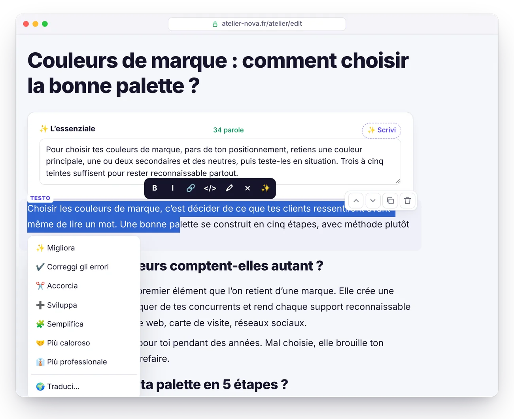
      <p align="center"><b>Ritocchi in un clic</b><br><sub>Migliorare, correggere, accorciare, tradurre, scrivere le FAQ o i testi alternativi.</sub></p>
    </td>
  </tr>
</table>

Attivazione in 5 minuti e prezzi nel dettaglio: vedi la [guida, sezione Assistente IA](docs/GUIDE.it.md#assistente-ia).

## Claude e ChatGPT, con il tuo abbonamento

<p align="center">
  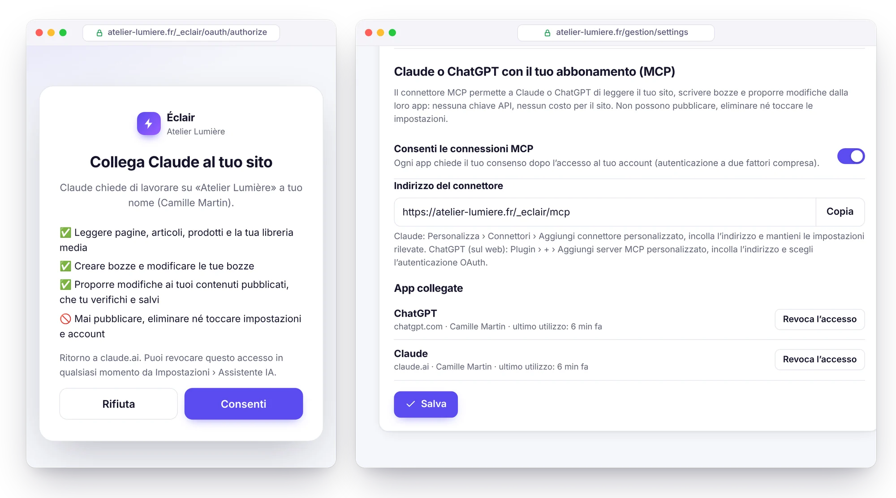
</p>

Lavori già in Claude o ChatGPT? Collegali al tuo sito con il **connettore MCP** integrato: attivalo in Impostazioni › Assistente IA, incolla il suo indirizzo in Claude o ChatGPT, dai il tuo consenso. La tua IA legge il tuo sito, riceve il tuo profilo editoriale e le regole SEO e GEO di Éclair, scrive bozze e prepara modifiche alle tue pagine pubblicate, che verifichi nell’editor. **Il lavoro lo fa il tuo abbonamento: nessuna chiave API, nessun costo per il sito.**

- **Nulla viene pubblicato né eliminato**: solo bozze e proposte, sei tu a pubblicare in Éclair.
- **Accesso sotto il tuo controllo**: OAuth 2.1 con PKCE, consenso dato dopo l’accesso (autenticazione a due fattori compresa), accesso revocato in un clic, o automaticamente se cambi password.
- **Leggero**: server MCP e autorizzazione stanno in meno di 25 KB di PHP, senza dipendenze.
- **Anche nell’assistente integrato**, con le tue chiavi API di Claude e ChatGPT, scegli l’IA a ogni conversazione.

Configurazione in 3 minuti e piani compatibili: vedi la [guida, sezione Connettore MCP](docs/GUIDE.it.md#connettore-mcp-claude-e-chatgpt).

## Modalità Visuale: modifica la tua pagina così come appare

<p align="center">
  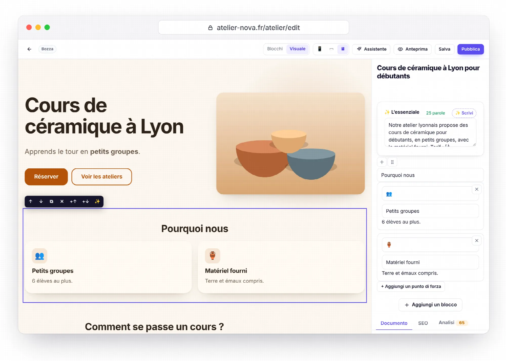
</p>

Nell’editor, passa da **Blocchi** a **Visuale**: la tua pagina appare con il tuo tema, esattamente come la vedranno i tuoi visitatori, e la modifichi direttamente lì. Clicca su un titolo o un paragrafo per scriverci, su un’immagine per cambiarla. Una piccola barra sposta, duplica, elimina o aggiunge un blocco; ✨ ritocca il passaggio con l’IA. Controlla la resa in larghezza smartphone, tablet o computer, e annulla con Ctrl+Z.

**Non sai da dove cominciare?** In un nuovo contenuto, apri **Crea con l’IA** e descrivi la tua pagina: il suo obiettivo, il suo pubblico, il suo tono, le sezioni che vuoi. L’IA compone una bozza completa (banner, punti di forza, FAQ, invito all’azione, titolo e descrizione per Google) con il tono del tuo sito, usando le tue vere pagine per i link e le tue immagini. Non inventa nulla: ciò che manca è segnato con «[Da completare: …]», e l’analisi te lo ricorda finché non lo compili. La bozza si apre direttamente in modalità Visuale.

- **Impatto zero sul tuo sito**: la modalità Visuale esiste solo nell’anteprima del pannello. Le tue pagine pubbliche restano identiche fino all’ultimo byte, sempre 100/100 su Lighthouse.
- **Leggera**: 3,3 KB compressi per la modalità Visuale, senza librerie.
- **Con Claude o ChatGPT**: il costo è mostrato prima di ogni richiesta (≈ 0,08 $ a pagina con Claude Sonnet 5.5) e detratto dal budget dell’assistente. Anche il connettore MCP sa comporre una pagina in sezioni.

Istruzioni: vedi la [guida, sezione Modalità Visuale](docs/GUIDE.it.md#modalità-visuale) e [Creare una pagina con l’IA](docs/GUIDE.it.md#creare-una-pagina-con-lia).

## Temi e negozio

<p align="center">
  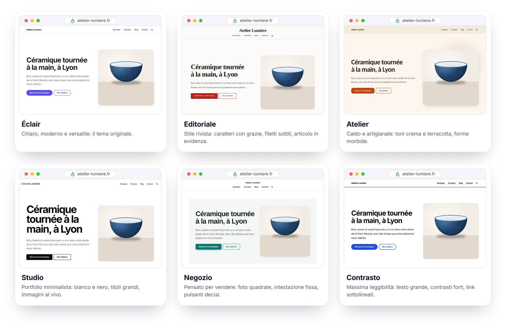
</p>

**6 temi inclusi**, da scegliere in Impostazioni › Aspetto con un’**anteprima in tempo reale** del tuo vero sito, su computer o su smartphone, prima di salvare: Éclair, Editoriale, Atelier, Studio, Negozio e Contrasto. Intestazione centrata o no, articoli e prodotti in griglia o in elenco, colore e font a scelta. Ogni tema è solo un foglio di stile da 1,5 a 3 KB: il codice HTML non cambia, quindi non cambiano nemmeno la velocità, l’accessibilità e il posizionamento. Per i tuoi ritocchi, un campo **CSS personalizzato** si aggiunge dopo il tema e resta al suo posto con gli aggiornamenti.

<p align="center">
  
</p>

**Negozio leggero**: vendi i tuoi prodotti senza la pesantezza di un e-commerce. Ogni prodotto ha la sua scheda, il suo pulsante **Acquista** porta a un **link di pagamento Stripe, PayPal o Revolut Business**, e basta: niente carrello, niente database, nessun dato bancario sul tuo server. Unico costo: la commissione del tuo fornitore di pagamenti, per esempio **1% + 0,20 €** con Revolut Business o **1,5% + 0,25 €** con Stripe per una carta europea standard[^stripe].

<table>
  <tr>
    <td width="50%" valign="top">
      <h3>🛍️ Schede che vendono</h3>
      Galleria fotografica, prezzo e prezzo barrato, <b>varianti senza JavaScript</b> (taglia, colore), disponibilità, spese di spedizione e resi ben visibili, prodotti correlati. Catalogo con filtri per categoria e blocco <b>Prodotti</b> per la tua home page.
    </td>
    <td width="50%" valign="top">
      <h3>💳 Stripe, PayPal o Revolut</h3>
      Un <b>link di pagamento</b> Stripe, PayPal o Revolut Business per ogni prodotto (o per ogni variante): il tuo fornitore di pagamenti incassa, invia le ricevute e gestisce i rimborsi. <b>Nessun abbonamento</b> con Éclair.
    </td>
  </tr>
  <tr>
    <td width="50%" valign="top">
      <h3>🔎 Pensato per Google</h3>
      Dati strutturati <b>Product e Offer</b> (prezzo, disponibilità, spedizione, politica di reso), categorie pilastro e <b>feed per Google Merchant Center</b> per comparire gratuitamente nella scheda Shopping.
    </td>
    <td width="50%" valign="top">
      <h3>🤖 Citato dalle IA</h3>
      Prezzo e disponibilità in <code>llms.txt</code> e nella versione Markdown di ogni scheda. L’assistente IA scrive una scheda a partire dalla tua foto, senza mai inventare un prezzo.
    </td>
  </tr>
</table>

<table>
  <tr>
    <td width="50%" valign="top">
      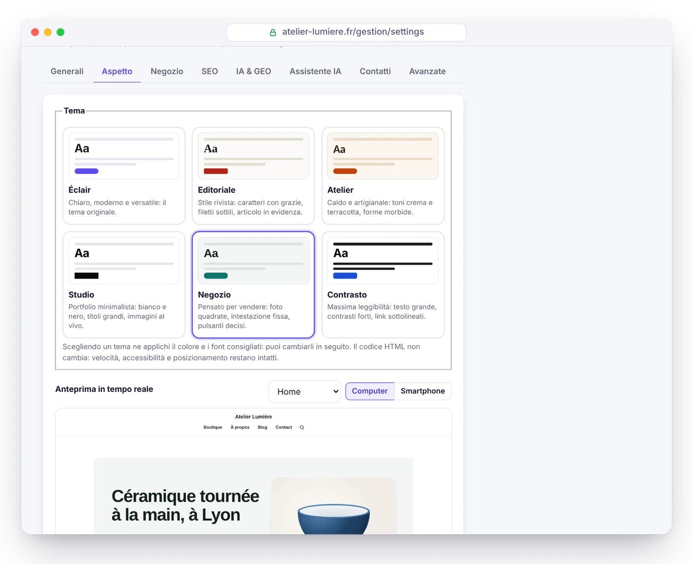
      <p align="center"><b>Anteprima in tempo reale</b><br><sub>Prova ogni tema sul tuo vero sito: non si pubblica nulla finché non salvi.</sub></p>
    </td>
    <td width="50%" valign="top">
      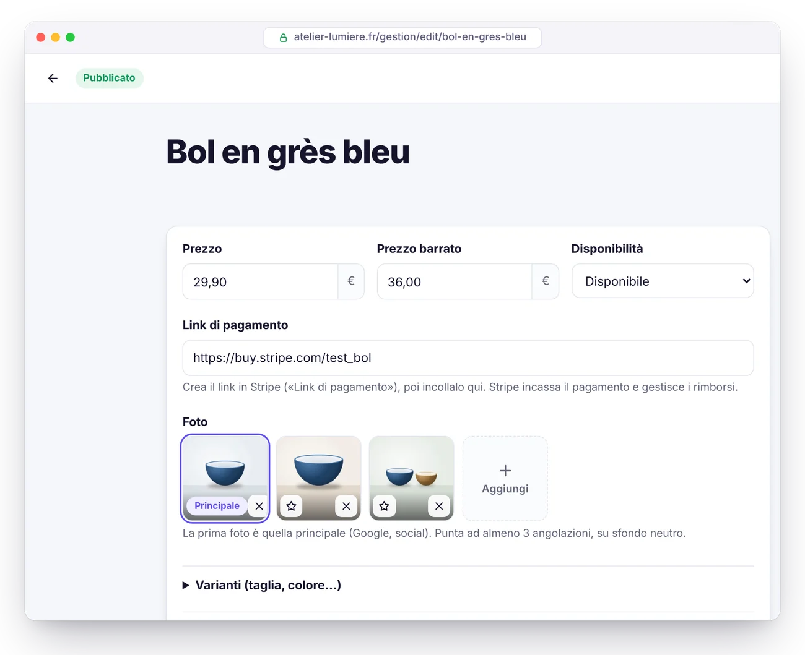
      <p align="center"><b>Scheda prodotto</b><br><sub>Prezzo, link Stripe, foto e varianti, in cima all’editor.</sub></p>
    </td>
  </tr>
</table>

Il negozio si apre solo quando le note legali e le condizioni generali di vendita sono pubblicate. Istruzioni complete: vedi la [guida, sezione Negozio](docs/GUIDE.it.md#negozio).

## Éclair a confronto con WordPress

| | WordPress classico | ⚡ Éclair |
|---|---|---|
| **Installazione** | Creare un database MySQL, poi avviare la procedura guidata | ✅ Caricare la cartella, rispondere a 4 domande |
| **Database** | MySQL obbligatorio | ✅ Nessuno (file protetti) |
| **Archivio da scaricare** | ≈ 35 MB[^wp] | ✅ 440 KB |
| **SEO, sitemap, dati strutturati** | Un plugin da installare e mantenere | ✅ Integrati |
| **GEO: llms.txt, Markdown, bot IA** | Plugin, raramente completi | ✅ Integrato |
| **Pagine pubbliche** | Generate a ogni visita, salvo con un plugin di cache | ✅ Servite da una cache statica |
| **Cookie sul sito pubblico** | Spesso tanti | ✅ Nessuno |
| **Autenticazione a due fattori, anti brute force** | Plugin | ✅ Integrate |
| **Aggiornamenti dei plugin** | Continui, la prima fonte di vulnerabilità | ✅ Nessun plugin da aggiornare |
| **Assistente IA (scrittura, immagini)** | Plugin, spesso in abbonamento | ✅ Integrato: Claude o ChatGPT, con la tua chiave |
| **Temi** | Da installare, spesso pesanti, a volte a pagamento | ✅ 6 temi integrati, anteprima in tempo reale |
| **Vendere online** | WooCommerce: plugin, database, aggiornamenti | ✅ Negozio leggero integrato, pagamento tramite link Stripe, PayPal o Revolut |

## Prestazioni

<picture>
  <source media="(prefers-color-scheme: dark)" srcset="docs/images/it/performance-dark.webp">
  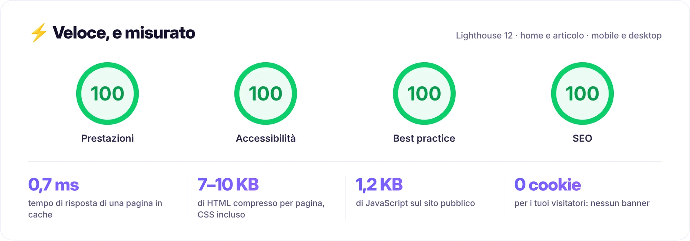
</picture>

Misurato in locale sul sito dimostrativo (PHP 8.3, home page illustrata e articolo di 600 parole), con Lighthouse 12 su mobile e desktop; un punteggio può variare di un punto da un’esecuzione all’altra. Come funziona:

- **Cache statica automatica**: ogni pagina viene generata una volta, poi servita direttamente da `index.php`. La cache si svuota da sola a ogni modifica.
- **CSS incorporato nella pagina**, font di sistema: nessuna richiesta bloccante, nessuno spostamento del layout.
- **Immagini ottimizzate al caricamento**: ridimensionate, convertite in **WebP responsive** (da 480 a 1600 px), dimensioni esplicite e caricamento differito.
- **Un solo script pubblico**, differito, di 1,2 KB compresso. Compressione Brotli o Gzip e cache del browser di un anno tramite `.htaccess`.

Su un vero hosting condiviso, aggiungi la latenza di rete e l’avvio di PHP del tuo provider.

## SEO e GEO: trovato su Google, citato dalle IA

<picture>
  <source media="(prefers-color-scheme: dark)" srcset="docs/images/it/geo-dark.webp">
  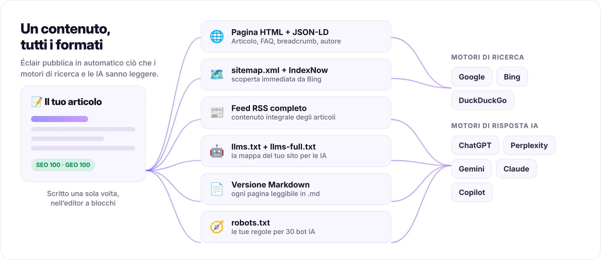
</picture>

<table>
  <tr>
    <td width="50%" valign="top">
      <h3>🔎 SEO</h3>
      <ul>
        <li><b>Analisi in tempo reale</b> con punteggio: titolo, meta description, frase chiave, struttura, link interni, testi alternativi…</li>
        <li><b>Dati strutturati JSON-LD</b>: Organization o LocalBusiness, BlogPosting, FAQPage, BreadcrumbList, autore…</li>
        <li>Sitemap con immagini e <code>hreflang</code>, feed RSS completo, Open Graph con <b>immagine di condivisione generata</b>.</li>
        <li><b>Reindirizzamenti 301 automatici</b> quando un indirizzo cambia, e un gestore dei reindirizzamenti per migrare un vecchio sito.</li>
        <li><b>IndexNow</b>: Bing e gli altri motori compatibili vengono avvisati a ogni pubblicazione.</li>
      </ul>
    </td>
    <td width="50%" valign="top">
      <h3>🤖 GEO (motori di risposta IA)</h3>
      <ul>
        <li><code>/llms.txt</code> e <code>/llms-full.txt</code> generati automaticamente (proposta <a href="https://llmstxt.org/">llmstxt.org</a>).</li>
        <li><b>Versione Markdown di ogni pagina</b>: aggiungi <code>.md</code> a qualsiasi indirizzo.</li>
        <li><b>Regole per i bot IA in un clic</b>: aperto, solo citazioni o chiuso, per 30 bot (GPTBot, ClaudeBot, PerplexityBot…).</li>
        <li>Blocco <b>«In breve»</b> in apertura di ogni articolo: il riassunto che le IA citano volentieri.</li>
        <li><b>Punteggio GEO</b>: FAQ, sottotitoli in forma di domanda, dati concreti, fonti, autore identificato (E-E-A-T)…</li>
      </ul>
    </td>
  </tr>
</table>

## Anteprima

<table>
  <tr>
    <td width="50%" valign="top">
      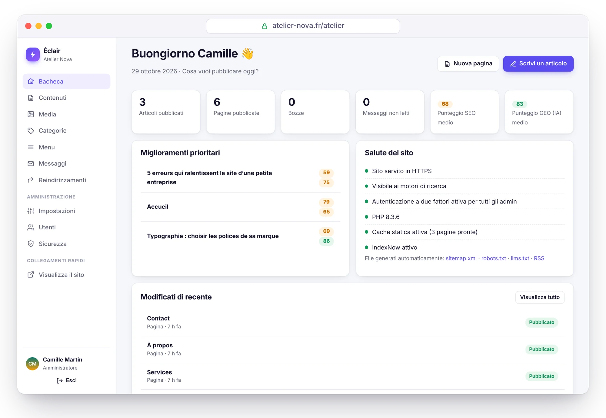
      <p align="center"><b>Bacheca</b><br><sub>Cosa migliorare e lo stato del sito, a colpo d’occhio.</sub></p>
    </td>
    <td width="50%" valign="top">
      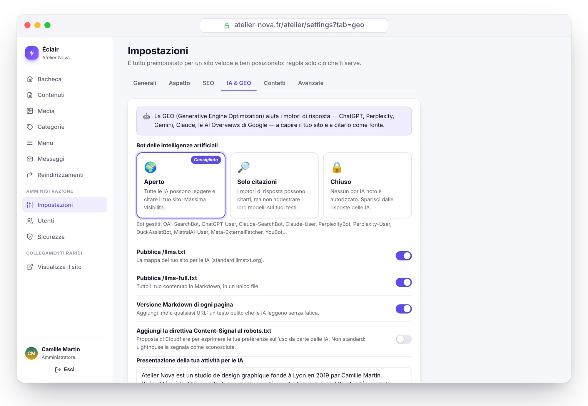
      <p align="center"><b>Visibilità nelle IA</b><br><sub>Consenti, limita o blocca i bot IA in un clic.</sub></p>
    </td>
  </tr>
  <tr>
    <td width="50%" valign="top">
      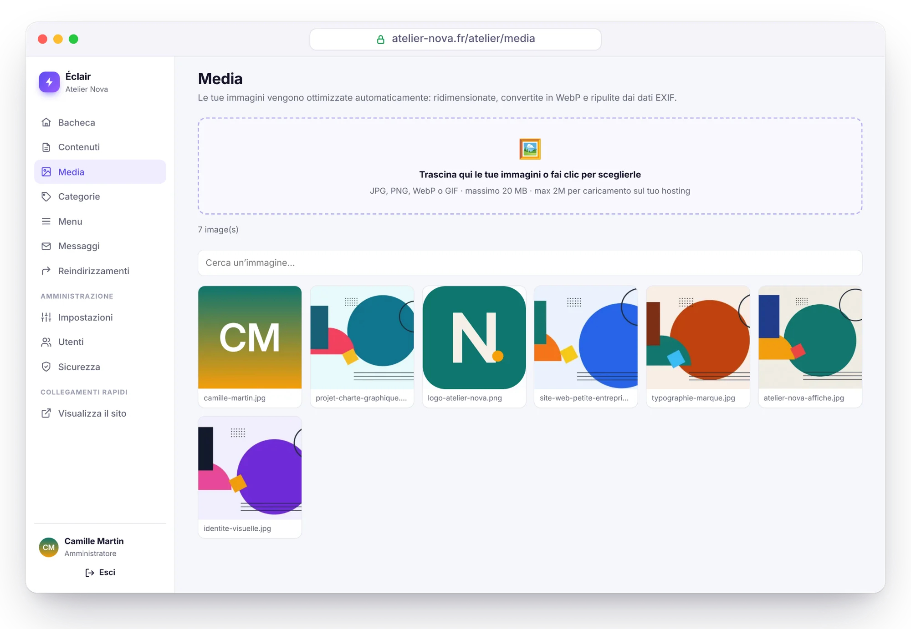
      <p align="center"><b>Libreria media</b><br><sub>Immagini ridimensionate e convertite in WebP automaticamente.</sub></p>
    </td>
    <td width="50%" valign="top">
      
      <p align="center"><b>Modalità scura automatica</b><br><sub>Il sito si adatta al tema di ogni visitatore.</sub></p>
    </td>
  </tr>
</table>

<sub>Screenshot di «Atelier Nova», un sito dimostrativo immaginario creato con Éclair (illustrazioni originali). Il pannello è mostrato in italiano, i contenuti dimostrativi sono in francese.</sub>

## Sicurezza

Éclair è pensato per un ambiente ostile: hosting condiviso e bot che provano password giorno e notte.

- **Nessun database**, quindi nessuna SQL injection. I file di dati hanno una doppia protezione (`.htaccess` e una riga `<?php exit; ?>`), sono privati e scritti in modo atomico.
- **Accesso blindato**: password con Argon2id, limiti per rete e per account (il tuo dispositivo abituale non viene mai bloccato da un attaccante), **autenticazione a due fattori** con codici di recupero.
- **Password richiesta di nuovo** per le azioni sensibili, password provvisorie da cambiare, sessioni brevi e revocabili.
- **Sito pubblico blindato**: Content-Security-Policy rigorosa, contenuti sanificati tramite lista bianca, nessun reindirizzamento aperto, immagini ricodificate.
- **Installazione protetta**: una finestra di 2 ore, e l’indirizzo del sito verificato dal server stesso prima di qualsiasi reindirizzamento.
- **Pagina Sicurezza**: controllo di integrità dei file, test di protezione delle cartelle, registro, backup in un clic.
- **Connettore MCP disattivato di default**: una volta attivato, OAuth 2.1 con PKCE, consenso dopo l’accesso, token salvati come hash e revocabili, nessuna pubblicazione né eliminazione possibile.

> [!NOTE]
> **Audit di sicurezza offensivo.** Race condition, brute force, reindirizzamenti, injection, file trappola: sono state trovate 17 vulnerabilità (2 gravi, 7 medie, 8 lievi), tutte corrette. I 13 scenari di attacco sono poi stati ripetuti sulla versione corretta: tutti neutralizzati. I test automatici (`php tests/run.php`) ne coprono gran parte.

Tutti i dettagli nella [guida, sezione Sicurezza](docs/GUIDE.it.md#sicurezza).

## Installazione in 3 minuti

<p align="center">
  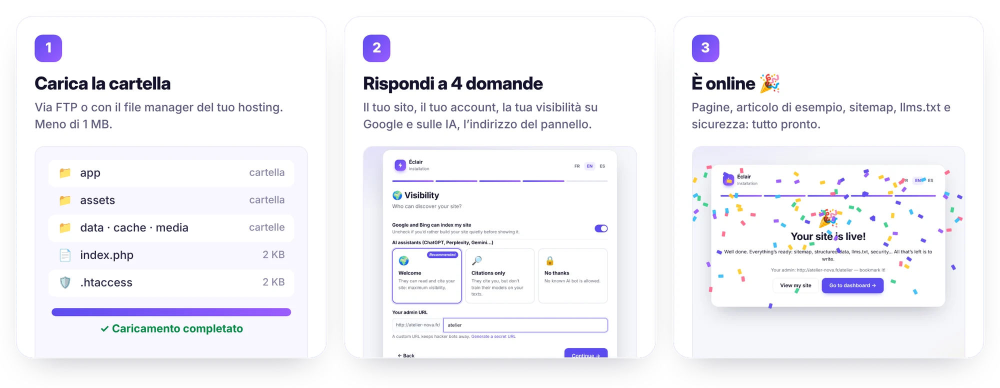
</p>

1. **Scarica** l’archivio [`eclair-cms-1.7.0.zip`](https://github.com/Jacckisback/eclair-cms/raw/main/dist/eclair-cms-1.7.0.zip) (440 KB) ed estrailo.
2. **Carica il contenuto della cartella `eclair`** nella cartella pubblica del tuo hosting (`public_html`, `www`…), compresi i file nascosti `.htaccess`.
3. **Apri l’indirizzo del tuo sito**: parte la procedura guidata. Quattro domande, un po’ di coriandoli, e il tuo sito è online con le sue prime pagine.

**Requisiti**: PHP 8.1 o successivo (consigliato 8.3), Apache o LiteSpeed (praticamente tutti gli hosting condivisi: Hostinger, IONOS, OVHcloud…) e un certificato HTTPS. La procedura guidata controlla tutto e spiega cosa correggere. Funziona anche con Nginx ([configurazione](docs/GUIDE.it.md#nginx)).

> [!TIP]
> Per sicurezza, l’installazione va completata entro **2 ore** dalla prima visita. Scaduto il tempo, elimina `data/install-window.php` via FTP e ricarica la pagina.

## Documentazione

La [guida completa](docs/GUIDE.it.md) spiega tutto il resto:

- [Installazione](docs/GUIDE.it.md#installazione): requisiti, tipi di sito, primi passi
- [Funzionalità in dettaglio](docs/GUIDE.it.md#funzionalità-in-dettaglio): velocità, SEO, GEO, editor a blocchi
- [Uso quotidiano](docs/GUIDE.it.md#uso-quotidiano) e la [modalità Visuale](docs/GUIDE.it.md#modalità-visuale)
- [Temi](docs/GUIDE.it.md#temi) e [Negozio](docs/GUIDE.it.md#negozio): anteprima in tempo reale, schede prodotto, Stripe, PayPal, Revolut, Google Shopping
- [Assistente IA](docs/GUIDE.it.md#assistente-ia): attivazione, profilo editoriale, creare una pagina con l’IA, costi, sicurezza
- [Connettore MCP](docs/GUIDE.it.md#connettore-mcp-claude-e-chatgpt): Claude e ChatGPT con il tuo abbonamento
- [Aggiornare, fare backup, traslocare](docs/GUIDE.it.md#aggiornare-fare-backup-traslocare)
- [Risoluzione dei problemi](docs/GUIDE.it.md#risoluzione-dei-problemi): password dimenticata, errori 404 o 500, Nginx…

## Per sviluppatori

PHP 8.1+ senza framework né Composer: classi semplici in `eclair/app/lib/`, viste PHP e JavaScript nativo.

```bash
PHP_CLI_SERVER_WORKERS=4 php -S localhost:8000 -t eclair tools/router.php   # server di sviluppo
php tests/run.php                                                           # 502 verifiche unitarie e HTTP
php tools/build.php                                                         # archivio pronto da distribuire
```

Struttura del progetto e personalizzazione del tema: vedi [Per sviluppatori](docs/GUIDE.it.md#per-sviluppatori).

## Licenza

Éclair è distribuito con **licenza MIT** ([`LICENSE`](LICENSE)): usalo, modificalo e ridistribuiscilo liberamente, anche per uso commerciale, mantenendo l’avviso di copyright. Una parte delle icone del pannello deriva da [Lucide](https://lucide.dev) (licenza ISC, vedi [`THIRD-PARTY-NOTICES.txt`](THIRD-PARTY-NOTICES.txt)).

<br>

<p align="center"><sub>⚡ Éclair, per liberi professionisti e piccole imprese che vogliono un sito veloce, ben posizionato e senza pensieri.</sub></p>

[^stripe]: Per una carta standard dello Spazio economico europeo (SEE). Revolut Business: 1% + 0,20 €, 2,8% + 0,20 € fuori dal SEE ([aiuto Revolut](https://help.revolut.com/en-ES/business/help/merchant-accounts/fees/how-much-does-it-cost-to-accept-card-payments/), verificata il 31 ottobre 2026). Stripe in Francia: 1,5% + 0,25 €, 2,8% + 0,25 € per una carta premium, 3,15% + 0,25 € fuori dal SEE ([stripe.com/fr/pricing](https://stripe.com/fr/pricing), verificata il 30 ottobre 2026). PayPal in Francia: 1,2% + 0,35 € con carta, 2,9% + 0,35 € con un conto PayPal ([tariffe PayPal](https://www.paypal.com/fr/business/paypal-business-fees), verificata il 31 ottobre 2026). Con Stripe e Revolut, i link di pagamento sono inclusi senza costi aggiuntivi.

[^wp]: Archivio ufficiale di WordPress 7.1.4: 37.239.942 byte, cioè 35,5 MB ([link per il download](https://downloads.wordpress.org/release/wordpress-7.1.4.zip), verificato il 29 ottobre 2026).
