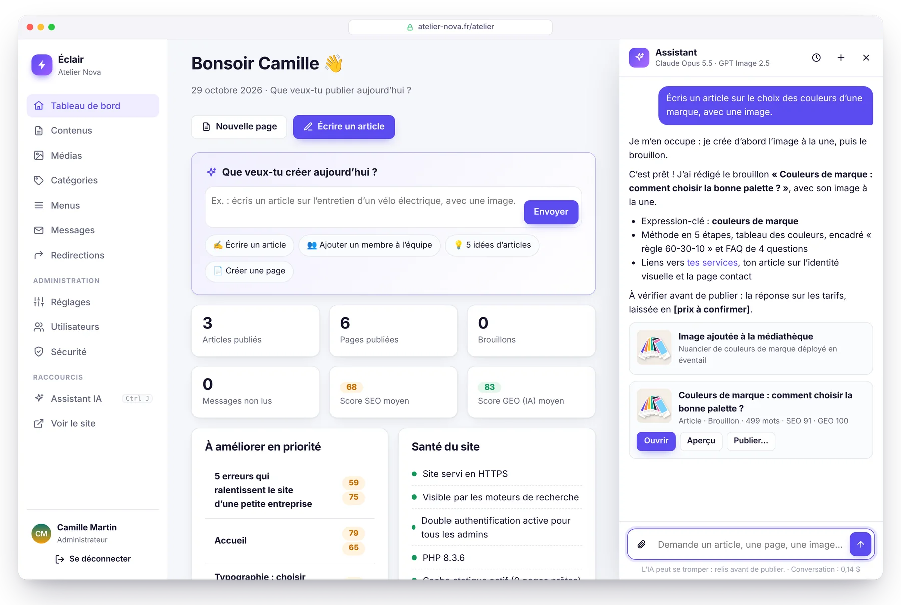
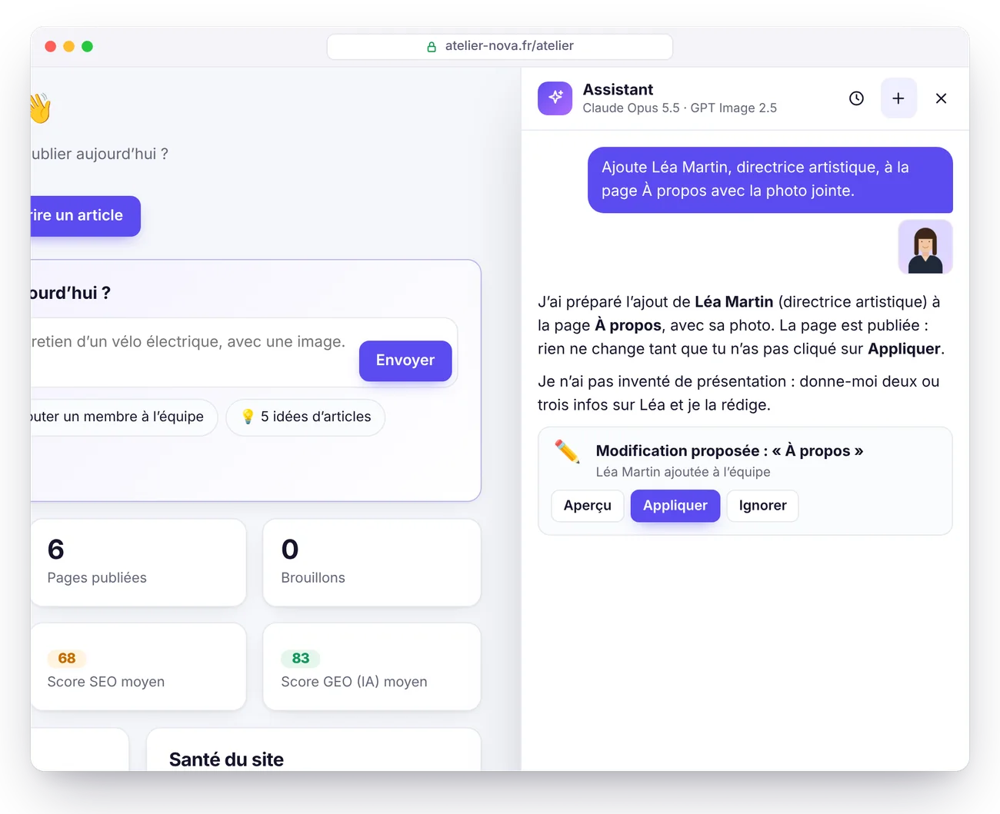
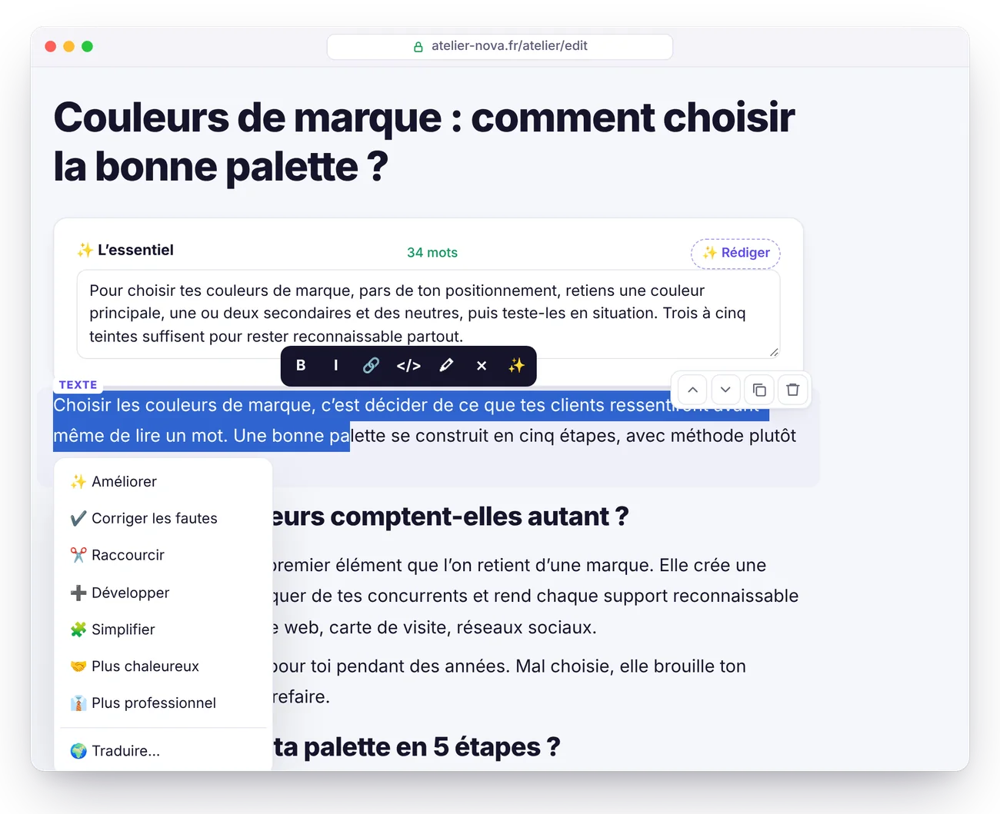
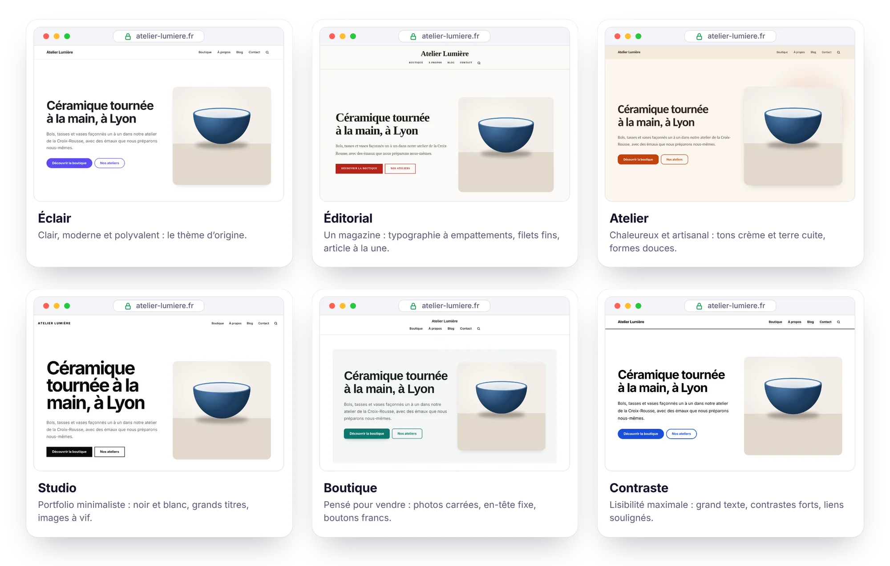
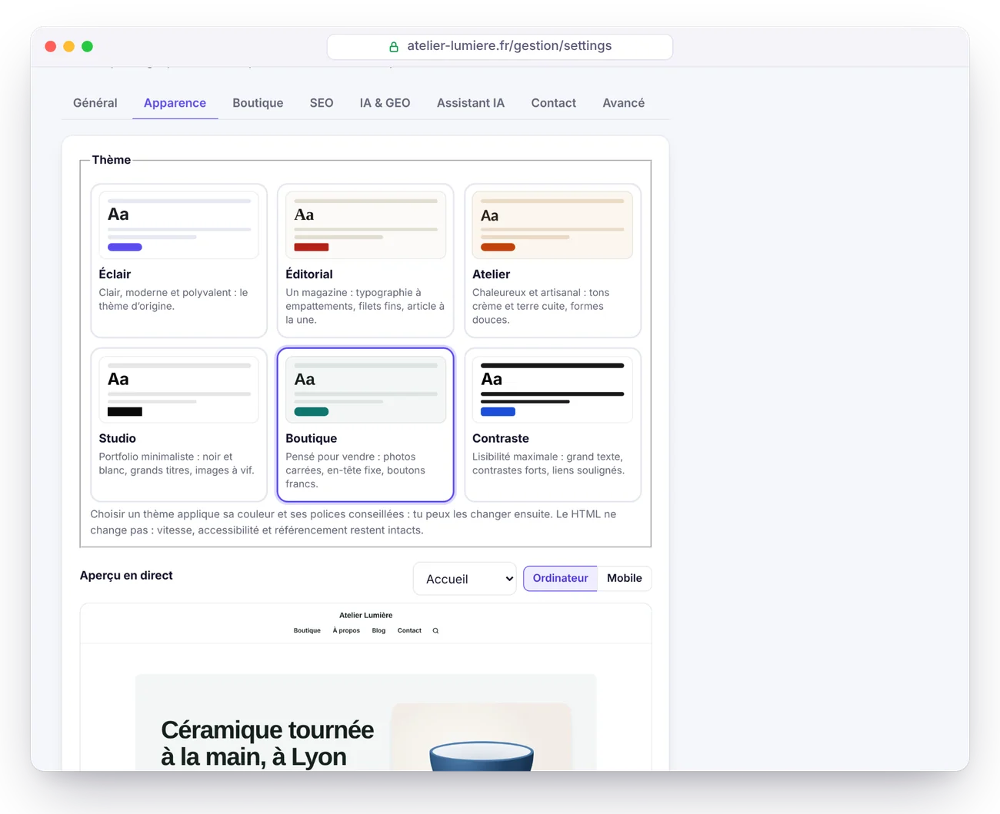
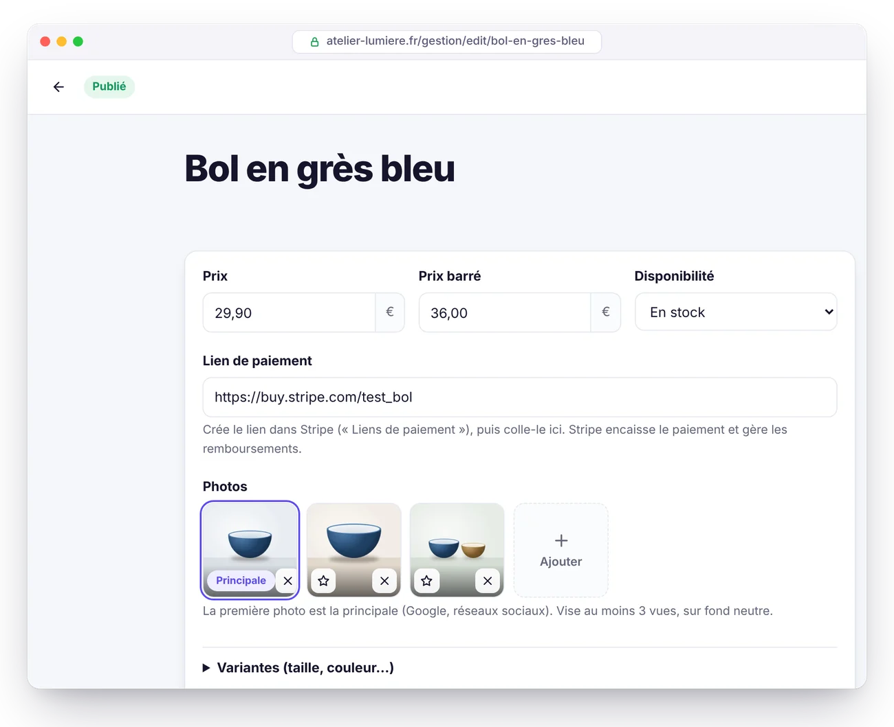
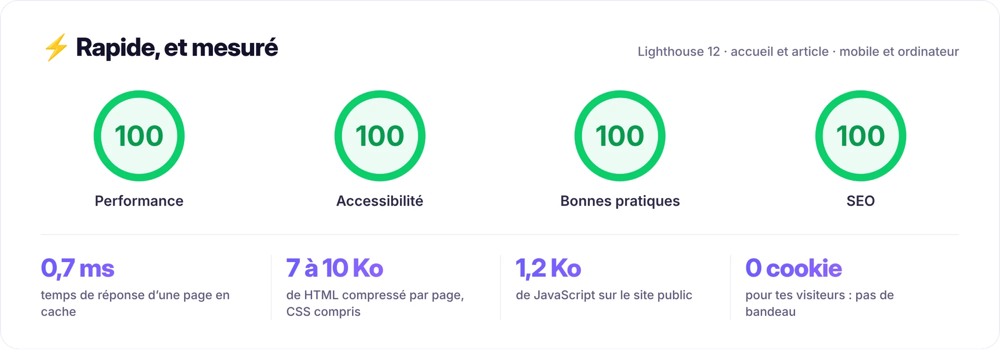
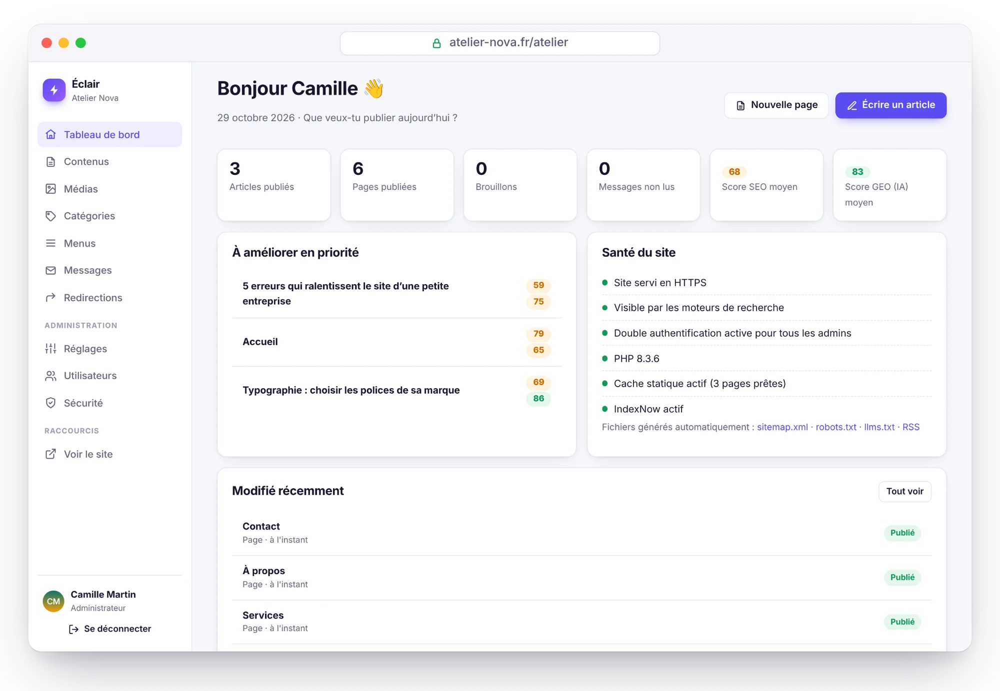
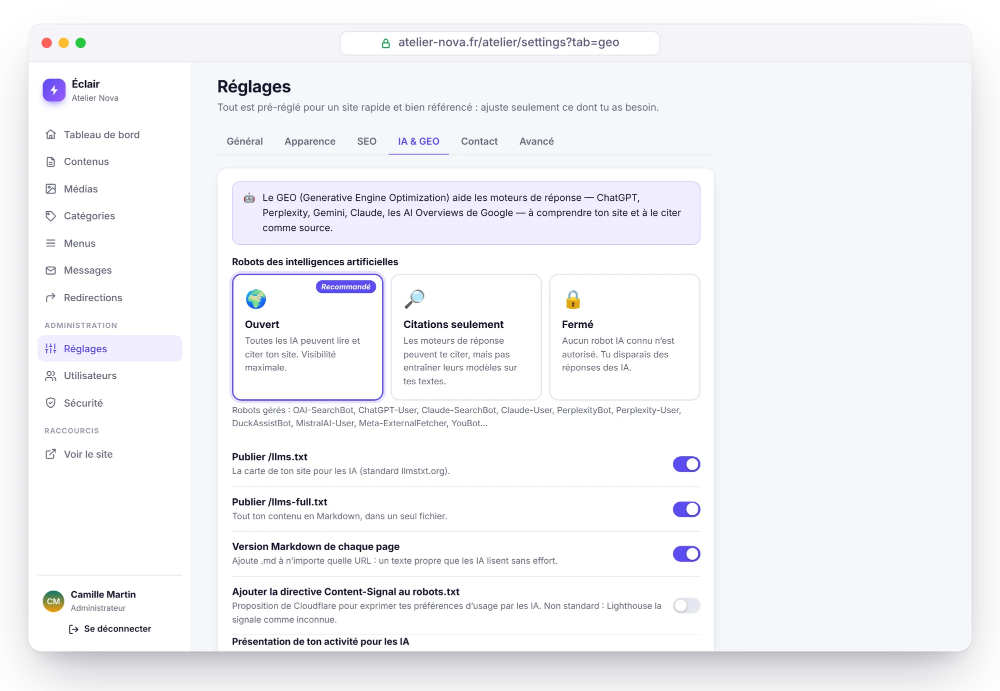
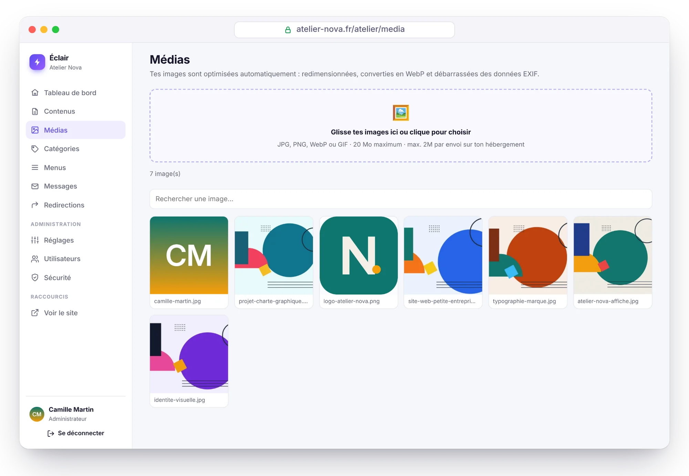

<p align="center">
  <b>Français</b> · <a href="README.en.md">English</a> · <a href="README.es.md">Español</a> · <a href="README.de.md">Deutsch</a> · <a href="README.it.md">Italiano</a> · <a href="README.pt-BR.md">Português</a> · <a href="README.zh-CN.md">简体中文</a>
</p>

<p align="center">
  <picture>
    <source media="(prefers-color-scheme: dark)" srcset="docs/images/banner-dark.webp">
    
  </picture>
</p>

<p align="center">
  <a href="https://github.com/Jacckisback/eclair-cms/raw/main/dist/eclair-cms-1.3.0.zip"></a>
  
  
  
  <a href="LICENSE"></a>
</p>

<h3 align="center">Un site professionnel en 3 minutes, sur n'importe quel hébergement mutualisé.<br>Sans base de données. Sans extensions. Sans maintenance.</h3>

<p align="center">
  <a href="#installation-en-3-minutes"><b>Installer</b></a> ·
  <a href="#pourquoi-éclair"><b>Pourquoi Éclair</b></a> ·
  <a href="#assistant-ia--demande-relis-publie"><b>Assistant IA</b></a> ·
  <a href="#thèmes-et-boutique"><b>Thèmes et boutique</b></a> ·
  <a href="#aperçu"><b>Aperçu</b></a> ·
  <a href="#sécurité"><b>Sécurité</b></a> ·
  <a href="docs/GUIDE.md"><b>Guide complet</b></a>
</p>

<br>

<p align="center">
  
</p>

## Pourquoi Éclair

WordPress sait tout faire, mais il lui faut une base de données, des extensions pour le SEO, la sécurité et le cache… et des mises à jour sans fin. Éclair réunit l'essentiel dans un CMS de **moins de 1 Mo**, pensé pour les indépendants, les artisans et les petites entreprises.

<table>
  <tr>
    <td width="33%" valign="top">
      <h3>⚡ Ultra rapide</h3>
      Chaque page est servie depuis un cache statique, sans charger l'application : <b>100/100</b> sur Lighthouse et <b>0,7 ms</b> de temps de réponse serveur (mesuré en local).
    </td>
    <td width="33%" valign="top">
      <h3>🔎 SEO intégré</h3>
      Données structurées, sitemap, redirections, aperçu Google et <b>score SEO en direct</b> dans l'éditeur, sans aucune extension.
    </td>
    <td width="33%" valign="top">
      <h3>🤖 Prêt pour les IA</h3>
      <code>llms.txt</code>, version Markdown de chaque page, règles pour 30 robots d'IA et <b>score GEO</b> pour être cité par ChatGPT, Perplexity ou Gemini.
    </td>
  </tr>
  <tr>
    <td width="33%" valign="top">
      <h3>🛡️ Sécurisé par défaut</h3>
      Double authentification, anti-bruteforce, en-têtes stricts, contenus assainis. <b>Une revue de sécurité offensive</b>, toutes les failles corrigées.
    </td>
    <td width="33%" valign="top">
      <h3>🪶 Ultra léger</h3>
      Aucune base de données : tes contenus sont des fichiers protégés. Une archive de <b>415 Ko</b>, zéro dépendance, zéro cookie sur le site public.
    </td>
    <td width="33%" valign="top">
      <h3>😊 Simple comme bonjour</h3>
      Installation guidée en 4 questions, éditeur de blocs avec <code>/</code>, checklist de démarrage. Administration en <b>7 langues</b>, site en 6 langues.
    </td>
  </tr>
</table>

## Assistant IA : demande, relis, publie

<p align="center">
  
</p>

Écris ce dont tu as besoin, comme à un collègue : *« Écris un article sur le choix des couleurs d'une marque, avec une image. »* L'assistant vérifie que le sujet n'existe pas déjà, crée l'image, rédige le brouillon complet (titre, L'essentiel, intertitres, tableau, FAQ, méta-description, liens internes) **dans le ton de ton site**, puis te le présente avec ses scores SEO et GEO. **Rien n'est publié sans ton clic.**

<table>
  <tr>
    <td width="50%" valign="top">
      <h3>✍️ Écrit comme toi</h3>
      Un <b>profil éditorial</b> rédigé en un clic à partir de ton site : public, ton, valeurs, règles, style des images. Chaque texte suit aussi les règles d'analyse d'Éclair : les brouillons visent un score élevé dès le départ.
    </td>
    <td width="50%" valign="top">
      <h3>🖼️ Images comprises</h3>
      <b>GPT Image 2.5</b>, <b>FLUX 3</b> ou <b>Ideogram 3</b> : l'image à la une est imaginée à partir de l'article, optimisée en WebP et décrite (texte alternatif). Ou joins tes propres photos.
    </td>
  </tr>
  <tr>
    <td width="50%" valign="top">
      <h3>👥 Agit sur ton site</h3>
      « Ajoute Léa Martin à la page équipe avec la photo jointe » : la modification est prête, tu la prévisualises et l’appliques d’un clic. Annulable d’un clic aussi.
    </td>
    <td width="50%" valign="top">
      <h3>🛡️ Tu gardes la main</h3>
      L'IA ne publie et ne supprime jamais rien. Clés chiffrées, budget mensuel, quota quotidien. <b>Claude ou ChatGPT</b> avec ta propre clé : aucun abonnement, environ <b>0,24 $ l'article</b> avec Claude Opus 5.5.
    </td>
  </tr>
</table>

<table>
  <tr>
    <td width="50%" valign="top">
      
      <p align="center"><b>Propositions à valider</b><br><sub>Sur une page publiée, rien ne change avant ton accord.</sub></p>
    </td>
    <td width="50%" valign="top">
      
      <p align="center"><b>Retouches en un clic</b><br><sub>Améliorer, corriger, raccourcir, traduire, rédiger la FAQ ou les textes alternatifs.</sub></p>
    </td>
  </tr>
</table>

Activation en 5 minutes et tarifs détaillés : voir le [guide, section Assistant IA](docs/GUIDE.md#assistant-ia).

## Thèmes et boutique

<p align="center">
  
</p>

**6 thèmes livrés**, à choisir dans Réglages › Apparence avec un **aperçu en direct** de ton vrai site, sur ordinateur ou sur mobile, avant d'enregistrer : Éclair, Éditorial, Atelier, Studio, Boutique et Contraste. En-tête centré ou non, listes en grille ou en liste, couleur et polices au choix. Chaque thème n'est qu'une feuille de style de 1,5 à 3 Ko : le HTML ne change pas, donc la vitesse, l'accessibilité et le référencement non plus.

<p align="center">
  
</p>

**Mode boutique léger** : vends tes produits sans la lourdeur d'un e-commerce. Chaque produit a sa fiche, son bouton **Acheter** mène à un **lien de paiement Stripe**, et c'est tout : pas de panier, pas de base de données, aucune donnée bancaire sur ton serveur. Seul coût : la commission Stripe, **1,5 % + 0,25 €** par paiement avec une carte européenne standard[^stripe].

<table>
  <tr>
    <td width="50%" valign="top">
      <h3>🛍️ Des fiches qui vendent</h3>
      Galerie photo, prix et prix barré, <b>variantes sans JavaScript</b> (taille, couleur), stock, frais de livraison et retours affichés, produits associés. Catalogue avec filtres par catégorie et bloc <b>Produits</b> pour ta page d'accueil.
    </td>
    <td width="50%" valign="top">
      <h3>💳 Payé par Stripe</h3>
      Un <b>lien de paiement Stripe</b> par produit (ou par variante) : Stripe encaisse, envoie les reçus et gère les remboursements. <b>Aucun abonnement</b>, ni chez Éclair ni chez Stripe.
    </td>
  </tr>
  <tr>
    <td width="50%" valign="top">
      <h3>🔎 Taillé pour Google</h3>
      Données structurées <b>Product et Offer</b> (prix, stock, livraison, politique de retour), catégories piliers, et <b>flux Google Merchant Center</b> pour apparaître gratuitement dans l'onglet Shopping.
    </td>
    <td width="50%" valign="top">
      <h3>🤖 Cité par les IA</h3>
      Prix et disponibilité dans <code>llms.txt</code> et dans la version Markdown de chaque fiche. L'assistant IA rédige une fiche à partir de ta photo, sans jamais inventer de prix.
    </td>
  </tr>
</table>

<table>
  <tr>
    <td width="50%" valign="top">
      
      <p align="center"><b>Aperçu en direct</b><br><sub>Essaie chaque thème sur ton vrai site, rien n'est publié avant d'enregistrer.</sub></p>
    </td>
    <td width="50%" valign="top">
      
      <p align="center"><b>Fiche produit</b><br><sub>Prix, lien Stripe, photos et variantes, en haut de l'éditeur.</sub></p>
    </td>
  </tr>
</table>

La boutique ne s'ouvre qu'avec des mentions légales et des conditions générales de vente publiées. Mode d'emploi complet : [guide, section Boutique](docs/GUIDE.md#boutique).

## Éclair face à WordPress

| | WordPress classique | ⚡ Éclair |
|---|---|---|
| **Installation** | Créer une base MySQL, puis lancer l'assistant | ✅ Envoyer le dossier, répondre à 4 questions |
| **Base de données** | MySQL obligatoire | ✅ Aucune (fichiers protégés) |
| **Archive à télécharger** | ≈ 35 Mo[^wp] | ✅ 415 Ko |
| **SEO, sitemap, données structurées** | Extension à installer et à maintenir | ✅ Intégré |
| **GEO : llms.txt, Markdown, robots IA** | Extensions, rarement complet | ✅ Intégré |
| **Pages publiques** | Générées à chaque visite, sauf extension de cache | ✅ Servies depuis un cache statique |
| **Cookies sur le site public** | Souvent nombreux | ✅ Aucun |
| **Double authentification, anti-bruteforce** | Extensions | ✅ Intégrés |
| **Mises à jour d'extensions** | Régulières, première source de failles | ✅ Aucune extension à mettre à jour |
| **Assistant IA (rédaction, images)** | Extensions, souvent avec abonnement | ✅ Intégré : Claude ou ChatGPT, avec ta clé |
| **Thèmes** | À installer, souvent lourds, parfois payants | ✅ 6 thèmes intégrés, aperçu en direct |
| **Vendre en ligne** | WooCommerce : extension, base de données, mises à jour | ✅ Boutique légère intégrée, paiement par lien Stripe |

## Performances

<picture>
  <source media="(prefers-color-scheme: dark)" srcset="docs/images/performance-dark.webp">
  
</picture>

Mesuré en local sur le site de démonstration (PHP 8.3, page d'accueil illustrée et article de 600 mots), avec Lighthouse 12 en mobile et sur ordinateur ; un score peut varier d'un point d'une passe à l'autre. Comment c'est possible :

- **Cache statique automatique** : chaque page est générée une fois, puis servie directement par `index.php`. Le cache se vide tout seul à chaque modification.
- **CSS intégré dans la page**, polices système : aucune requête bloquante, aucun décalage de mise en page.
- **Images optimisées à l'envoi** : redimensionnées, converties en **WebP responsive** (480 à 1600 px), dimensions explicites et chargement différé.
- **Un seul script public**, différé, de 1,2 Ko compressé. Compression Brotli ou Gzip et cache navigateur d'un an via `.htaccess`.

Sur un vrai mutualisé, ajoute la latence réseau et le démarrage de PHP de ton hébergeur.

## SEO et GEO : trouvé sur Google, cité par les IA

<picture>
  <source media="(prefers-color-scheme: dark)" srcset="docs/images/geo-dark.webp">
  
</picture>

<table>
  <tr>
    <td width="50%" valign="top">
      <h3>🔎 SEO</h3>
      <ul>
        <li><b>Analyse en temps réel</b> avec score : titre, méta-description, expression-clé, structure, maillage interne, textes alternatifs…</li>
        <li><b>Données structurées JSON-LD</b> : Organization ou LocalBusiness, BlogPosting, FAQPage, BreadcrumbList, auteur…</li>
        <li>Sitemap avec images et <code>hreflang</code>, flux RSS complet, Open Graph avec <b>image de partage générée</b>.</li>
        <li><b>Redirections 301 automatiques</b> quand une adresse change, et un gestionnaire de redirections pour reprendre un ancien site.</li>
        <li><b>IndexNow</b> : Bing et les autres moteurs compatibles sont prévenus à chaque publication.</li>
      </ul>
    </td>
    <td width="50%" valign="top">
      <h3>🤖 GEO (moteurs de réponse IA)</h3>
      <ul>
        <li><code>/llms.txt</code> et <code>/llms-full.txt</code> générés automatiquement (proposition <a href="https://llmstxt.org/">llmstxt.org</a>).</li>
        <li><b>Version Markdown de chaque page</b> : ajoute <code>.md</code> à n'importe quelle adresse.</li>
        <li><b>Politique robots IA en un clic</b> : ouvert, citations seulement ou fermé, pour 30 robots (GPTBot, ClaudeBot, PerplexityBot…).</li>
        <li>Bloc <b>« L'essentiel »</b> en tête d'article : le résumé que les IA reprennent volontiers.</li>
        <li><b>Score GEO</b> : FAQ, intertitres en questions, chiffres concrets, sources, auteur identifié (E-E-A-T)…</li>
      </ul>
    </td>
  </tr>
</table>

## Aperçu

<table>
  <tr>
    <td width="50%" valign="top">
      
      <p align="center"><b>Tableau de bord</b><br><sub>Ce qu'il faut améliorer et la santé du site, d'un coup d'œil.</sub></p>
    </td>
    <td width="50%" valign="top">
      
      <p align="center"><b>Visibilité IA</b><br><sub>Autorise, limite ou bloque les robots d'IA en un clic.</sub></p>
    </td>
  </tr>
  <tr>
    <td width="50%" valign="top">
      
      <p align="center"><b>Médiathèque</b><br><sub>Images redimensionnées et converties en WebP automatiquement.</sub></p>
    </td>
    <td width="50%" valign="top">
      
      <p align="center"><b>Mode sombre automatique</b><br><sub>Le site s'adapte au thème de chaque visiteur.</sub></p>
    </td>
  </tr>
</table>

<sub>Captures réalisées sur « Atelier Nova », un site de démonstration fictif créé avec Éclair (illustrations originales).</sub>

## Sécurité

Éclair est conçu pour un environnement hostile : hébergement mutualisé, robots qui testent des mots de passe en permanence.

- **Aucune base de données**, donc aucune injection SQL. Les fichiers de données sont doublement protégés (`.htaccess` et ligne `<?php exit; ?>`), privés et écrits de façon atomique.
- **Connexion blindée** : mots de passe en Argon2id, limites par réseau et par compte (ton appareil habituel n'est jamais bloqué par un attaquant), **double authentification** avec codes de secours.
- **Mot de passe redemandé** pour les actions sensibles, mots de passe provisoires à changer, sessions courtes et révocables.
- **Site public verrouillé** : Content-Security-Policy stricte, contenus assainis par liste blanche, aucune redirection ouverte, images ré-encodées.
- **Installation protégée** : fenêtre de 2 heures, et adresse du site vérifiée par le serveur lui-même avant toute redirection.
- **Page Sécurité** : contrôle d'intégrité des fichiers, test de protection des dossiers, journal, sauvegarde en un clic.

> [!NOTE]
> **Revue de sécurité offensive.** Courses entre requêtes, force brute, redirections, injections, fichiers piégés : 17 failles ont été trouvées (2 graves, 7 moyennes, 8 mineures) et toutes corrigées. Les 13 scénarios d'attaque ont ensuite été rejoués sur la version corrigée : tous neutralisés. Les tests automatiques (`php tests/run.php`) en reprennent une grande partie.

Détails complets dans le [guide, section Sécurité](docs/GUIDE.md#sécurité).

## Installation en 3 minutes

<p align="center">
  
</p>

1. **Télécharge** l'archive [`eclair-cms-1.3.0.zip`](https://github.com/Jacckisback/eclair-cms/raw/main/dist/eclair-cms-1.3.0.zip) (415 Ko) et décompresse-la.
2. **Envoie le contenu du dossier `eclair`** dans le dossier public de ton hébergement (`public_html`, `www`…), fichiers cachés `.htaccess` compris.
3. **Ouvre l'adresse de ton site** : l'assistant démarre. Quatre questions, des confettis, et ton site est en ligne avec ses premières pages.

**Prérequis** : PHP 8.1 ou plus (8.3 recommandé), Apache ou LiteSpeed (la quasi-totalité des mutualisés : OVH, o2switch, Hostinger, IONOS…), un certificat HTTPS. L'assistant vérifie tout et explique quoi corriger. Nginx est aussi possible ([configuration](docs/GUIDE.md#nginx)).

> [!TIP]
> Par sécurité, l'installation doit être faite dans les **2 heures** qui suivent la première visite. Passé ce délai, supprime `data/install-window.php` par FTP et recharge la page.

## Documentation

Le [guide complet](docs/GUIDE.md) détaille tout le reste :

- [Installation](docs/GUIDE.md#installation) : prérequis, types de site, premiers pas
- [Fonctionnalités en détail](docs/GUIDE.md#fonctionnalités-en-détail) : vitesse, SEO, GEO, éditeur de blocs
- [Utiliser Éclair au quotidien](docs/GUIDE.md#utiliser-éclair-au-quotidien)
- [Thèmes](docs/GUIDE.md#thèmes) et [Boutique](docs/GUIDE.md#boutique) : aperçu en direct, fiches produit, Stripe, Google Shopping
- [Assistant IA](docs/GUIDE.md#assistant-ia) : activation, profil éditorial, coûts, sécurité
- [Mettre à jour, sauvegarder, déménager](docs/GUIDE.md#mettre-à-jour-sauvegarder-déménager)
- [Dépannage](docs/GUIDE.md#dépannage) : mot de passe oublié, erreurs 404 ou 500, Nginx…

## Pour les développeurs

PHP 8.1+ sans framework ni Composer : des classes simples dans `eclair/app/lib/`, des vues PHP et du JavaScript natif.

```bash
PHP_CLI_SERVER_WORKERS=4 php -S localhost:8000 -t eclair tools/router.php   # serveur de développement
php tests/run.php                                                           # 367 vérifications unitaires et HTTP
php tools/build.php                                                         # archive prête à distribuer
```

Structure du projet et personnalisation du thème : voir [Pour les développeurs](docs/GUIDE.md#pour-les-développeurs).

## Licence

Éclair est distribué sous **licence MIT** ([`LICENSE`](LICENSE)) : utilise-le, modifie-le et redistribue-le librement, y compris pour un usage commercial, en conservant la mention de copyright. Une partie des icônes de l'administration est dérivée de [Lucide](https://lucide.dev) (licence ISC, voir [`THIRD-PARTY-NOTICES.txt`](THIRD-PARTY-NOTICES.txt)).

<br>

<p align="center"><sub>⚡ Éclair, pour les indépendants et les petites entreprises qui veulent un site rapide, bien référencé et tranquille.</sub></p>

[^stripe]: Tarif Stripe en France pour une carte standard de l'Espace économique européen ; 2,8 % + 0,25 € pour une carte premium, 3,15 % + 0,25 € hors EEE ([stripe.com/fr/pricing](https://stripe.com/fr/pricing), vérifié le 30 octobre 2026). Les liens de paiement sont inclus sans frais supplémentaires.

[^wp]: Archive officielle de WordPress 7.1.4 : 37 239 942 octets, soit 35,5 Mo ([lien de téléchargement](https://downloads.wordpress.org/release/wordpress-7.1.4.zip), vérifié le 29 octobre 2026).
