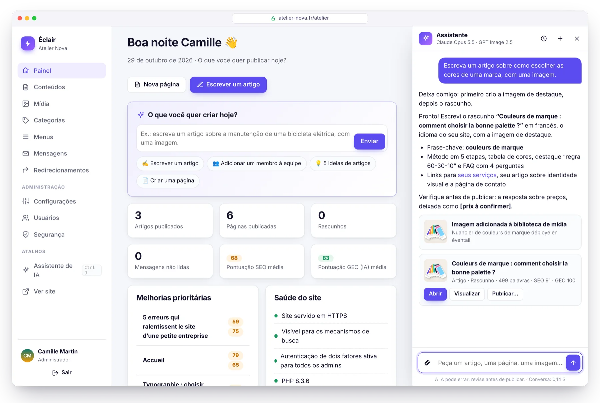
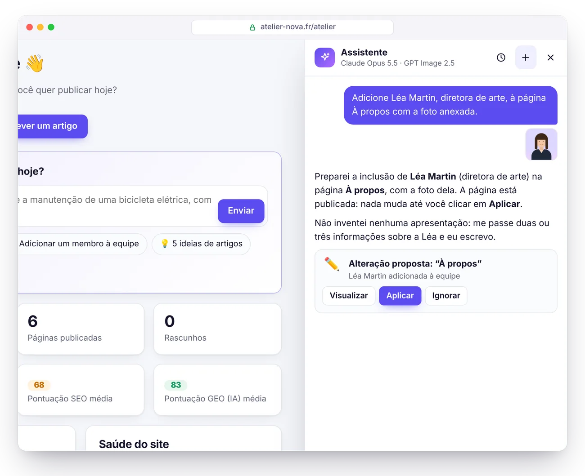
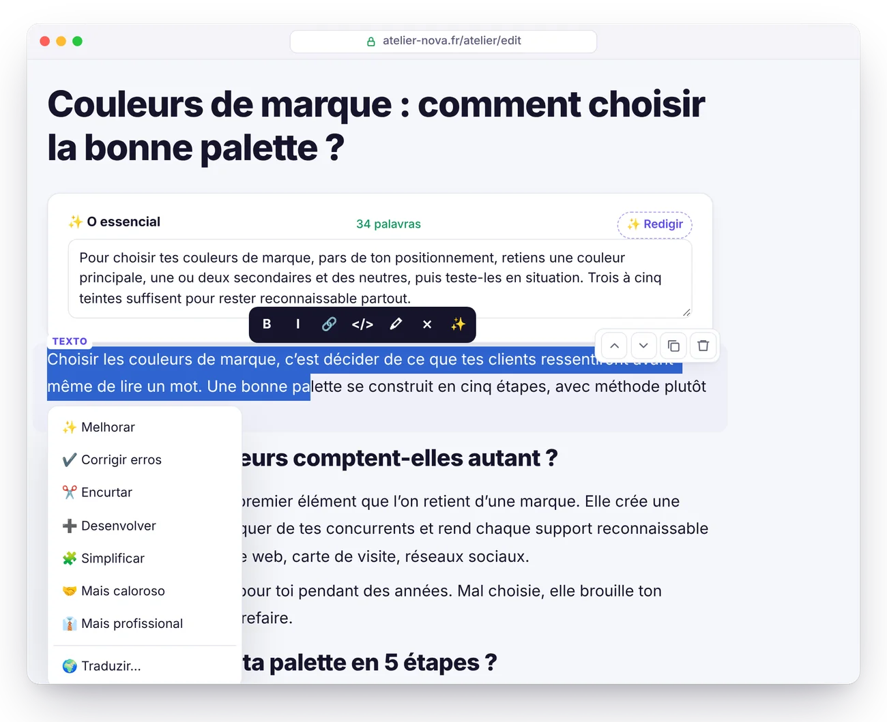
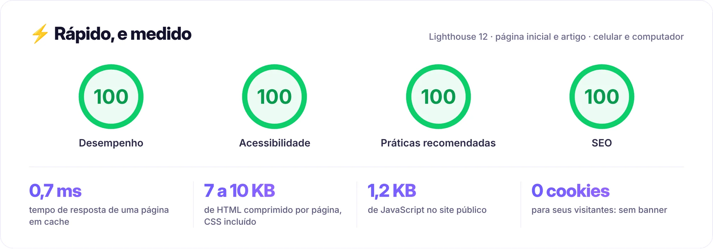
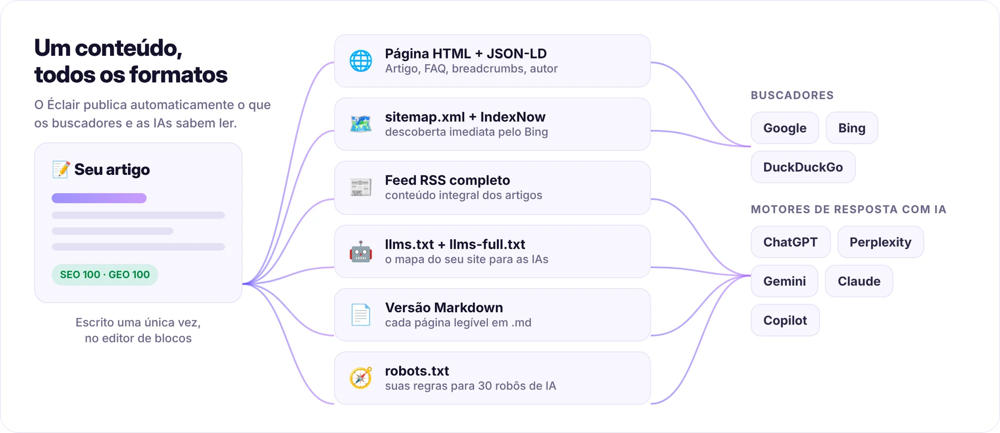
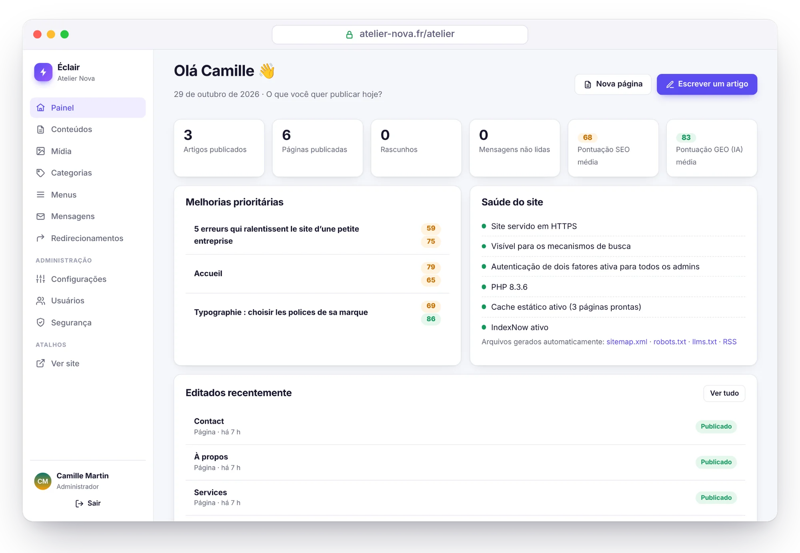
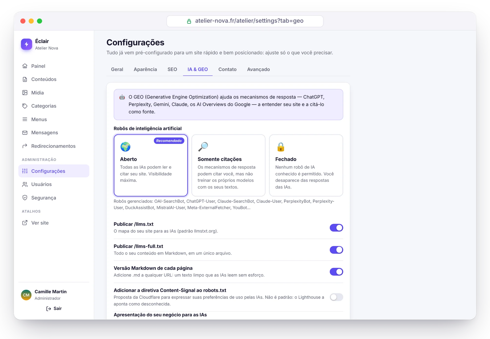
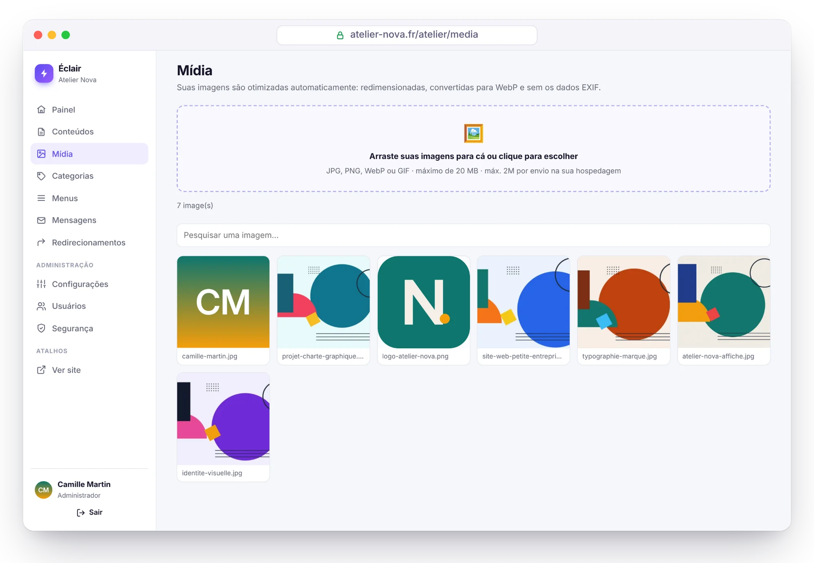
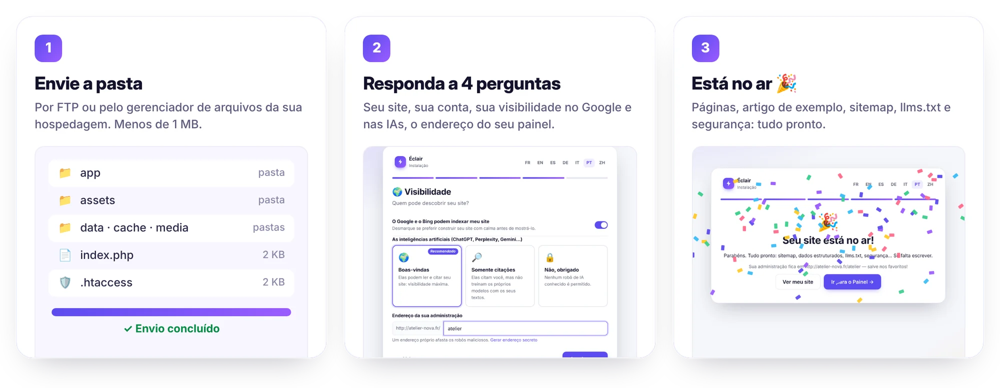

<p align="center">
  <a href="README.md">Français</a> · <a href="README.en.md">English</a> · <a href="README.es.md">Español</a> · <a href="README.de.md">Deutsch</a> · <a href="README.it.md">Italiano</a> · <b>Português</b> · <a href="README.zh-CN.md">简体中文</a>
</p>

<p align="center">
  <picture>
    <source media="(prefers-color-scheme: dark)" srcset="docs/images/pt-BR/banner-dark.webp">
    
  </picture>
</p>

<p align="center">
  <a href="https://github.com/Jacckisback/eclair-cms/raw/main/dist/eclair-cms-1.2.0.zip"></a>
  
  
  
  <a href="LICENSE"></a>
</p>

<h3 align="center">Um site profissional em 3 minutos, em qualquer hospedagem compartilhada.<br>Sem banco de dados. Sem plugins. Sem manutenção.</h3>

<p align="center">
  <a href="#instalação-em-3-minutos"><b>Instalar</b></a> ·
  <a href="#por-que-o-éclair"><b>Por que o Éclair</b></a> ·
  <a href="#assistente-de-ia-peça-revise-publique"><b>Assistente de IA</b></a> ·
  <a href="#prévia"><b>Prévia</b></a> ·
  <a href="#segurança"><b>Segurança</b></a> ·
  <a href="docs/GUIDE.pt-BR.md"><b>Guia completo</b></a>
</p>

<br>

<p align="center">
  
</p>

## Por que o Éclair

O WordPress faz de tudo, mas precisa de um banco de dados, de plugins para SEO, segurança e cache… e de atualizações sem fim. O Éclair reúne o essencial em um CMS com **menos de 1 MB**, pensado para profissionais autônomos, artesãos e pequenas empresas.

<table>
  <tr>
    <td width="33%" valign="top">
      <h3>⚡ Ultrarrápido</h3>
      Cada página é servida a partir de um cache estático, sem carregar a aplicação: <b>100/100</b> no Lighthouse e <b>0,7 ms</b> de tempo de resposta do servidor (medido localmente).
    </td>
    <td width="33%" valign="top">
      <h3>🔎 SEO integrado</h3>
      Dados estruturados, sitemap, redirecionamentos, prévia do Google e <b>pontuação de SEO ao vivo</b> no editor, sem nenhum plugin.
    </td>
    <td width="33%" valign="top">
      <h3>🤖 Pronto para a IA</h3>
      <code>llms.txt</code>, versão Markdown de cada página, regras para 30 robôs de IA e <b>pontuação GEO</b> para ser citado pelo ChatGPT, Perplexity ou Gemini.
    </td>
  </tr>
  <tr>
    <td width="33%" valign="top">
      <h3>🛡️ Seguro por padrão</h3>
      Autenticação em dois fatores, proteção contra força bruta, cabeçalhos rígidos, conteúdo higienizado. <b>Uma auditoria de segurança ofensiva</b>, todas as falhas corrigidas.
    </td>
    <td width="33%" valign="top">
      <h3>🪶 Ultraleve</h3>
      Sem banco de dados: seu conteúdo fica em arquivos protegidos. Um arquivo de <b>402 KB</b>, zero dependências, zero cookies no site público.
    </td>
    <td width="33%" valign="top">
      <h3>😊 Facílimo</h3>
      Instalação guiada em 4 perguntas, editor de blocos com <code>/</code>, checklist para começar. Painel em <b>7 idiomas</b>, site em 6 idiomas (português incluído nos dois).
    </td>
  </tr>
</table>

## Assistente de IA: peça, revise, publique

<p align="center">
  
</p>

Escreva o que você precisa, como se estivesse falando com um colega: *“Escreva um artigo sobre como escolher as cores de uma marca, com uma imagem.”* O assistente verifica se já existe algo sobre o assunto no site, cria a imagem, redige o rascunho completo (título, O essencial, subtítulos, tabela, FAQ, meta description, links internos) **no tom do seu site** e o apresenta a você com as pontuações de SEO e GEO. **Nada é publicado sem o seu clique.**

<table>
  <tr>
    <td width="50%" valign="top">
      <h3>✍️ Escreve como você</h3>
      Um <b>perfil editorial</b> redigido em um clique a partir do seu site: público, tom, valores, regras, estilo das imagens. Cada texto também segue as regras de análise do Éclair: os rascunhos já miram uma pontuação alta desde o início.
    </td>
    <td width="50%" valign="top">
      <h3>🖼️ Imagens incluídas</h3>
      <b>GPT Image 2.5</b>, <b>FLUX 3</b> ou <b>Ideogram 3</b>: a imagem destacada é pensada a partir do artigo, otimizada em WebP e descrita (texto alternativo). Ou anexe suas próprias fotos.
    </td>
  </tr>
  <tr>
    <td width="50%" valign="top">
      <h3>👥 Atua no seu site</h3>
      “Adicione Léa Martin à página da equipe com a foto anexada”: a alteração fica pronta, você visualiza e aplica com um clique. E também dá para desfazer com um clique.
    </td>
    <td width="50%" valign="top">
      <h3>🛡️ Você continua no controle</h3>
      A IA nunca publica nem exclui nada. Chaves criptografadas, orçamento mensal, cota diária. <b>Claude ou ChatGPT</b> com a sua própria chave: sem assinatura, cerca de <b>US$ 0,24 por artigo</b> com o Claude Opus 5.5.
    </td>
  </tr>
</table>

<table>
  <tr>
    <td width="50%" valign="top">
      
      <p align="center"><b>Propostas para validar</b><br><sub>Em uma página publicada, nada muda até você aprovar.</sub></p>
    </td>
    <td width="50%" valign="top">
      
      <p align="center"><b>Retoques em um clique</b><br><sub>Melhorar, corrigir, encurtar, traduzir, redigir o FAQ ou os textos alternativos.</sub></p>
    </td>
  </tr>
</table>

Ativação em 5 minutos e preços detalhados: veja o [guia, seção Assistente de IA](docs/GUIDE.pt-BR.md#assistente-de-ia).

## Éclair comparado ao WordPress

| | WordPress clássico | ⚡ Éclair |
|---|---|---|
| **Instalação** | Criar um banco de dados MySQL e depois rodar o assistente | ✅ Enviar a pasta e responder a 4 perguntas |
| **Banco de dados** | MySQL obrigatório | ✅ Nenhum (arquivos protegidos) |
| **Arquivo para baixar** | ≈ 35 MB[^wp] | ✅ 402 KB |
| **SEO, sitemap, dados estruturados** | Um plugin para instalar e manter | ✅ Integrado |
| **GEO: llms.txt, Markdown, robôs de IA** | Plugins, raramente completos | ✅ Integrado |
| **Páginas públicas** | Geradas a cada visita, a menos que você use um plugin de cache | ✅ Servidas a partir de um cache estático |
| **Cookies no site público** | Muitas vezes, vários | ✅ Nenhum |
| **Autenticação em dois fatores, proteção contra força bruta** | Plugins | ✅ Integradas |
| **Atualizações de plugins** | Constantes, a principal fonte de falhas | ✅ Nenhum plugin para atualizar |
| **Assistente de IA (textos, imagens)** | Plugins, muitas vezes com assinatura | ✅ Integrado: Claude ou ChatGPT, com a sua chave |

## Desempenho

<picture>
  <source media="(prefers-color-scheme: dark)" srcset="docs/images/pt-BR/performance-dark.webp">
  
</picture>

Medido localmente no site de demonstração (PHP 8.3, página inicial com imagens e artigo de 600 palavras), com o Lighthouse 12 no celular e no computador; uma pontuação pode variar um ponto de uma execução para outra. Como funciona:

- **Cache estático automático**: cada página é gerada uma vez e depois servida diretamente pelo `index.php`. O cache se limpa sozinho a cada alteração.
- **CSS embutido na página**, fontes do sistema: nenhuma requisição bloqueante, nenhum deslocamento de layout.
- **Imagens otimizadas no envio**: redimensionadas, convertidas em **WebP responsivo** (de 480 a 1600 px), dimensões explícitas e carregamento lento.
- **Um único script público**, adiado, de 1,2 KB comprimido. Compressão Brotli ou Gzip e cache do navegador de um ano via `.htaccess`.

Em uma hospedagem compartilhada de verdade, some a latência de rede e a inicialização do PHP do seu provedor.

## SEO e GEO: encontrado no Google, citado pelas IAs

<picture>
  <source media="(prefers-color-scheme: dark)" srcset="docs/images/pt-BR/geo-dark.webp">
  
</picture>

<table>
  <tr>
    <td width="50%" valign="top">
      <h3>🔎 SEO</h3>
      <ul>
        <li><b>Análise em tempo real</b> com pontuação: título, meta description, frase-chave, estrutura, links internos, textos alternativos…</li>
        <li><b>Dados estruturados JSON-LD</b>: Organization ou LocalBusiness, BlogPosting, FAQPage, BreadcrumbList, autor…</li>
        <li>Sitemap com imagens e <code>hreflang</code>, feed RSS completo, Open Graph com <b>imagem de compartilhamento gerada</b>.</li>
        <li><b>Redirecionamentos 301 automáticos</b> quando um endereço muda, e um gerenciador de redirecionamentos para migrar um site antigo.</li>
        <li><b>IndexNow</b>: o Bing e os outros buscadores compatíveis são avisados a cada publicação.</li>
      </ul>
    </td>
    <td width="50%" valign="top">
      <h3>🤖 GEO (motores de resposta com IA)</h3>
      <ul>
        <li><code>/llms.txt</code> e <code>/llms-full.txt</code> gerados automaticamente (proposta <a href="https://llmstxt.org/">llmstxt.org</a>).</li>
        <li><b>Versão Markdown de cada página</b>: adicione <code>.md</code> a qualquer endereço.</li>
        <li><b>Regras para robôs de IA em um clique</b>: aberto, só citações ou fechado, para 30 robôs (GPTBot, ClaudeBot, PerplexityBot…).</li>
        <li>Bloco <b>“O essencial”</b> no início de cada artigo: o resumo que as IAs gostam de citar.</li>
        <li><b>Pontuação GEO</b>: FAQ, subtítulos em forma de pergunta, números concretos, fontes, autor identificado (E-E-A-T)…</li>
      </ul>
    </td>
  </tr>
</table>

## Prévia

<table>
  <tr>
    <td width="50%" valign="top">
      
      <p align="center"><b>Painel</b><br><sub>O que melhorar e a saúde do site, em um piscar de olhos.</sub></p>
    </td>
    <td width="50%" valign="top">
      
      <p align="center"><b>Visibilidade nas IAs</b><br><sub>Permita, limite ou bloqueie os robôs de IA em um clique.</sub></p>
    </td>
  </tr>
  <tr>
    <td width="50%" valign="top">
      
      <p align="center"><b>Biblioteca de mídia</b><br><sub>Imagens redimensionadas e convertidas em WebP automaticamente.</sub></p>
    </td>
    <td width="50%" valign="top">
      
      <p align="center"><b>Modo escuro automático</b><br><sub>O site se adapta ao tema de cada visitante.</sub></p>
    </td>
  </tr>
</table>

<sub>Capturas de tela do “Atelier Nova”, um site de demonstração fictício criado com o Éclair (ilustrações originais). O painel aparece em português; o conteúdo de demonstração está em francês.</sub>

## Segurança

O Éclair foi feito para um ambiente hostil: hospedagem compartilhada e robôs testando senhas o tempo todo.

- **Sem banco de dados**, portanto sem injeção de SQL. Os arquivos de dados têm proteção dupla (`.htaccess` e uma linha `<?php exit; ?>`), são privados e gravados de forma atômica.
- **Login blindado**: senhas com Argon2id, limites por rede e por conta (seu dispositivo de costume nunca é bloqueado por um atacante), **autenticação em dois fatores** com códigos de recuperação.
- **Senha solicitada de novo** nas ações sensíveis, senhas provisórias que precisam ser trocadas, sessões curtas e revogáveis.
- **Site público blindado**: Content-Security-Policy rígida, conteúdo higienizado por lista de permissões, nenhum redirecionamento aberto, imagens recodificadas.
- **Instalação protegida**: uma janela de 2 horas, e o endereço do site verificado pelo próprio servidor antes de qualquer redirecionamento.
- **Página Segurança**: verificação de integridade dos arquivos, teste de proteção das pastas, registro, backup em um clique.

> [!NOTE]
> **Auditoria de segurança ofensiva.** Condições de corrida, força bruta, redirecionamentos, injeções, arquivos maliciosos: foram encontradas 17 falhas (2 graves, 7 médias, 8 leves), todas corrigidas. Depois, os 13 cenários de ataque foram repetidos na versão corrigida: todos neutralizados. Os testes automáticos (`php tests/run.php`) cobrem boa parte deles.

Todos os detalhes no [guia, seção Segurança](docs/GUIDE.pt-BR.md#segurança).

## Instalação em 3 minutos

<p align="center">
  
</p>

1. **Baixe** o arquivo [`eclair-cms-1.2.0.zip`](https://github.com/Jacckisback/eclair-cms/raw/main/dist/eclair-cms-1.2.0.zip) (402 KB) e descompacte-o.
2. **Envie o conteúdo da pasta `eclair`** para a pasta pública da sua hospedagem (`public_html`, `www`…), incluindo os arquivos ocultos `.htaccess`.
3. **Abra o endereço do seu site**: o assistente começa. Quatro perguntas, um pouco de confete, e seu site está no ar com as primeiras páginas.

**Requisitos**: PHP 8.1 ou superior (8.3 recomendado), Apache ou LiteSpeed (praticamente todas as hospedagens compartilhadas: Hostinger, IONOS, OVHcloud…) e um certificado HTTPS. O assistente verifica tudo e explica o que corrigir. Também funciona com Nginx ([configuração](docs/GUIDE.pt-BR.md#nginx)).

> [!TIP]
> Por segurança, a instalação precisa ser feita nas **2 horas** seguintes à primeira visita. Depois desse prazo, apague `data/install-window.php` por FTP e recarregue a página.

## Documentação

O [guia completo](docs/GUIDE.pt-BR.md) explica todo o resto:

- [Instalação](docs/GUIDE.pt-BR.md#instalação): requisitos, tipos de site, primeiros passos
- [Recursos em detalhe](docs/GUIDE.pt-BR.md#recursos-em-detalhe): velocidade, SEO, GEO, editor de blocos
- [Uso no dia a dia](docs/GUIDE.pt-BR.md#uso-no-dia-a-dia)
- [Assistente de IA](docs/GUIDE.pt-BR.md#assistente-de-ia): ativação, perfil editorial, custos, segurança
- [Atualizar, fazer backup, mudar de hospedagem](docs/GUIDE.pt-BR.md#atualizar-fazer-backup-mudar-de-hospedagem)
- [Solução de problemas](docs/GUIDE.pt-BR.md#solução-de-problemas): senha esquecida, erros 404 ou 500, Nginx…

## Para desenvolvedores

PHP 8.1+ sem framework nem Composer: classes simples em `eclair/app/lib/`, views em PHP e JavaScript puro.

```bash
PHP_CLI_SERVER_WORKERS=4 php -S localhost:8000 -t eclair tools/router.php   # servidor de desenvolvimento
php tests/run.php                                                           # 299 verificações unitárias e HTTP
php tools/build.php                                                         # arquivo pronto para distribuir
```

Estrutura do projeto e personalização do tema: veja [Para desenvolvedores](docs/GUIDE.pt-BR.md#para-desenvolvedores).

## Licença

O Éclair é distribuído sob a **licença MIT** ([`LICENSE`](LICENSE)): use, modifique e redistribua livremente, inclusive para fins comerciais, mantendo o aviso de copyright. Parte dos ícones do painel é derivada do [Lucide](https://lucide.dev) (licença ISC, veja [`THIRD-PARTY-NOTICES.txt`](THIRD-PARTY-NOTICES.txt)).

<br>

<p align="center"><sub>⚡ Éclair, para profissionais autônomos e pequenas empresas que querem um site rápido, bem posicionado e sem dor de cabeça.</sub></p>

[^wp]: Arquivo oficial do WordPress 7.1.4: 37.239.942 bytes, ou seja, 35,5 MB ([link para download](https://downloads.wordpress.org/release/wordpress-7.1.4.zip), verificado em 29 de outubro de 2026).
