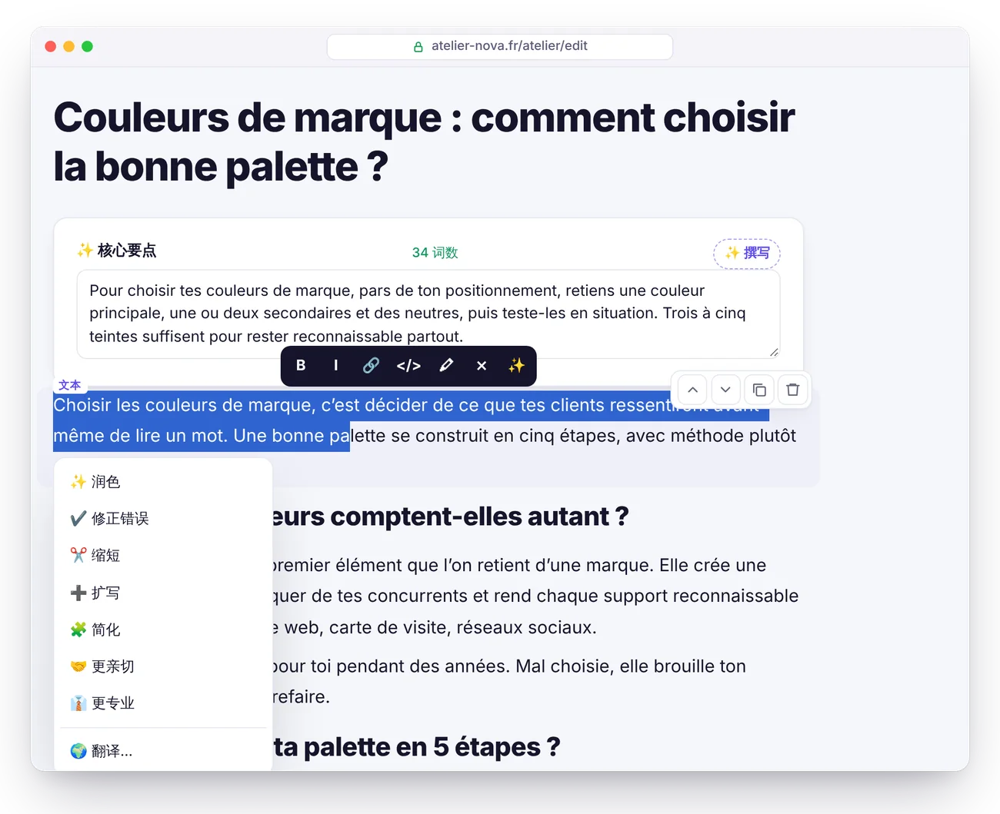
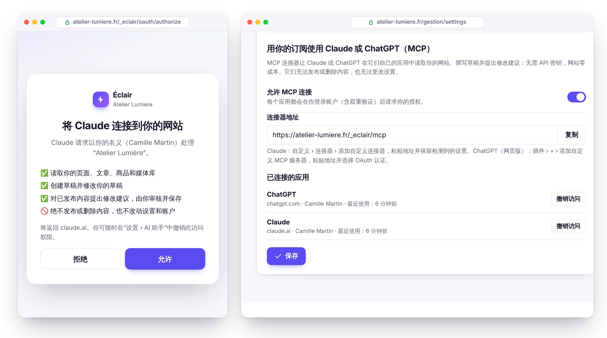
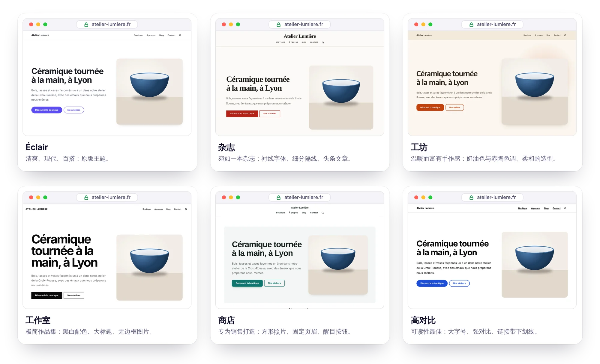
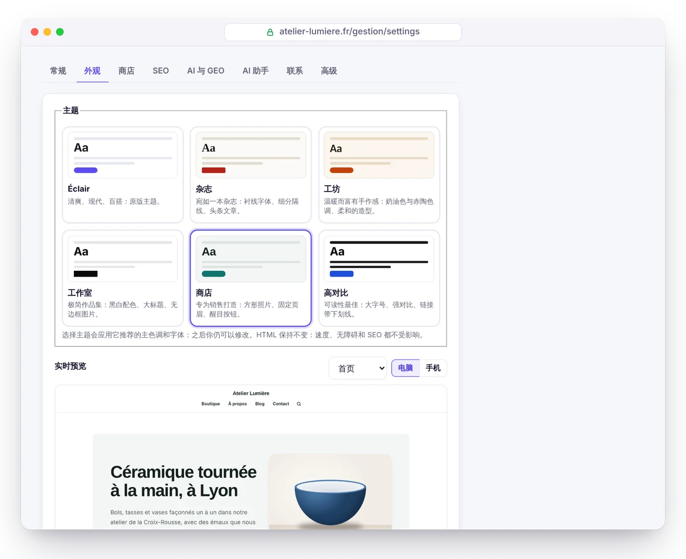
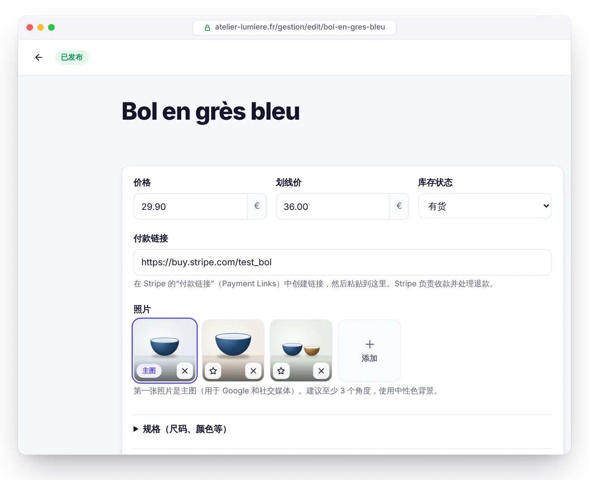
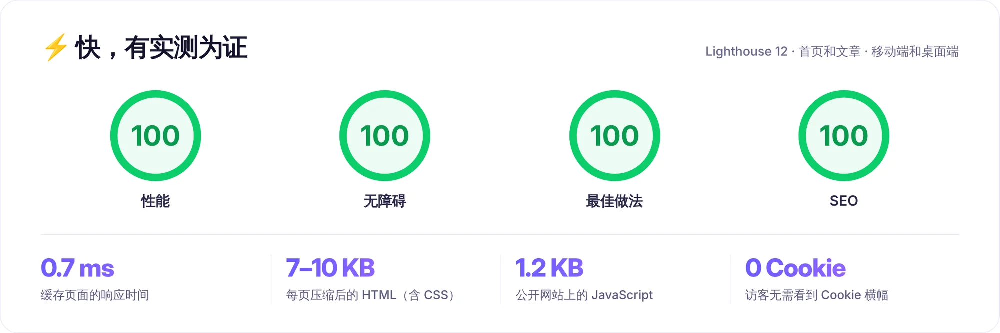
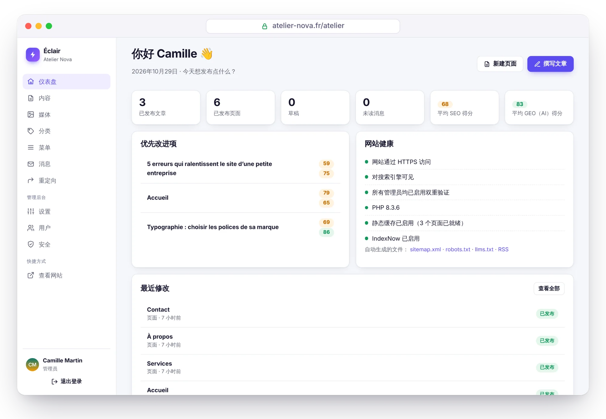
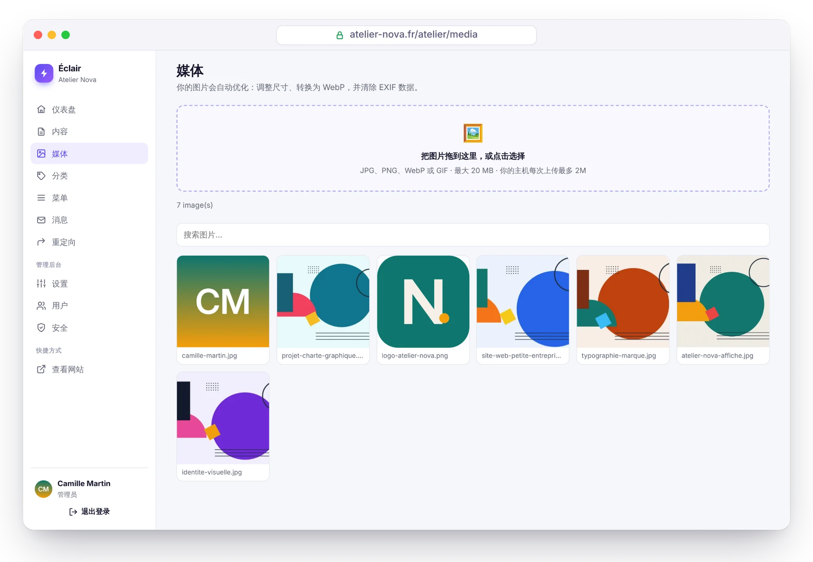

<p align="center">
  <a href="README.md">Français</a> · <a href="README.en.md">English</a> · <a href="README.es.md">Español</a> · <a href="README.de.md">Deutsch</a> · <a href="README.it.md">Italiano</a> · <a href="README.pt-BR.md">Português</a> · <b>简体中文</b>
</p>

<p align="center">
  <picture>
    <source media="(prefers-color-scheme: dark)" srcset="docs/images/zh-CN/banner-dark.webp">
    
  </picture>
</p>

<p align="center">
  <a href="https://github.com/Jacckisback/eclair-cms/raw/main/dist/eclair-cms-1.4.0.zip"></a>
  
  
  
  <a href="LICENSE"></a>
</p>

<h3 align="center">3 分钟搭建专业网站，任何虚拟主机都能用。<br>无需数据库，无需插件，无需维护。</h3>

<p align="center">
  <a href="#3-分钟完成安装"><b>安装</b></a> ·
  <a href="#为什么选择-éclair"><b>为什么选择 Éclair</b></a> ·
  <a href="#ai-助手提需求审阅发布"><b>AI 助手</b></a> ·
  <a href="#claude-与-chatgpt用你的订阅"><b>Claude 与 ChatGPT</b></a> ·
  <a href="#主题与商店"><b>主题与商店</b></a> ·
  <a href="#界面预览"><b>界面预览</b></a> ·
  <a href="#安全"><b>安全</b></a> ·
  <a href="docs/GUIDE.zh-CN.md"><b>完整指南</b></a>
</p>

<br>

<p align="center">
  
</p>

## 为什么选择 Éclair

WordPress 无所不能，但它需要数据库，需要插件来做 SEO、安全和缓存……还要没完没了地更新。Éclair 把核心功能装进一个**不到 1 MB** 的 CMS，专为自由职业者、手艺人和小企业打造。

<table>
  <tr>
    <td width="33%" valign="top">
      <h3>⚡ 超快速</h3>
      每个页面都从静态缓存直接输出，无需加载应用：Lighthouse <b>100/100</b>，服务器响应时间 <b>0.7 ms</b>（本地实测）。
    </td>
    <td width="33%" valign="top">
      <h3>🔎 内置 SEO</h3>
      结构化数据、站点地图、重定向、Google 搜索预览，编辑器内还有<b>实时 SEO 评分</b>，不需要任何插件。
    </td>
    <td width="33%" valign="top">
      <h3>🤖 为 AI 做好准备</h3>
      <code>llms.txt</code>、每个页面的 Markdown 版本、针对 30 个 AI 爬虫的规则，以及帮助你被 ChatGPT、Perplexity 或 Gemini 引用的 <b>GEO 评分</b>。
    </td>
  </tr>
  <tr>
    <td width="33%" valign="top">
      <h3>🛡️ 默认安全</h3>
      双重认证、防暴力破解、严格的安全响应头、内容过滤。<b>经过一次攻击性安全审计</b>，发现的漏洞已全部修复。
    </td>
    <td width="33%" valign="top">
      <h3>🪶 超轻量</h3>
      无需数据库：内容保存在受保护的文件中。安装包仅 <b>432 KB</b>，零依赖，公开网站零 Cookie。
    </td>
    <td width="33%" valign="top">
      <h3>😊 简单易用</h3>
      4 个问题完成引导式安装，输入 <code>/</code> 即可插入区块，附带入门清单。后台支持<b>7 种语言</b>（含简体中文），网站前台支持 6 种语言（暂不支持中文）。
    </td>
  </tr>
</table>

## AI 助手：提需求、审阅、发布

<p align="center">
  
</p>

像跟同事交代工作一样，写下你的需求：*“写一篇关于如何选择品牌色彩的文章，并配一张图片。”* 助手会先确认网站上还没有写过这个主题，然后生成图片，**按照你网站的语气**写出完整的草稿（标题、核心要点、小标题、表格、FAQ、元描述、内部链接），再连同 SEO 和 GEO 评分一起交给你。**不经你点击，任何内容都不会发布。**

<table>
  <tr>
    <td width="50%" valign="top">
      <h3>✍️ 用你的口吻写作</h3>
      一键根据你的网站起草<b>编辑风格档案</b>：目标读者、语气、价值观、规则、图片风格。写出的每篇内容也都遵循 Éclair 的分析规则：草稿从一开始就力求高分。
    </td>
    <td width="50%" valign="top">
      <h3>🖼️ 配图一并搞定</h3>
      <b>GPT Image 2.5</b>、<b>FLUX 3</b> 或 <b>Ideogram 3</b>：根据文章内容构思特色图片，优化为 WebP 格式并配上描述（替代文本）。也可以附上你自己的照片。
    </td>
  </tr>
  <tr>
    <td width="50%" valign="top">
      <h3>👥 直接修改你的网站</h3>
      “把 Léa Martin 连同附带的照片加到团队页面”：修改随即准备就绪，你先预览，再一键应用。撤销同样只需一键。
    </td>
    <td width="50%" valign="top">
      <h3>🛡️ 一切由你掌控</h3>
      AI 从不发布，也从不删除任何内容。密钥加密存储，设有每月预算和每日配额。<b>Claude 或 ChatGPT</b>，用你自己的密钥：无需订阅，使用 Claude Opus 5.5 时<b>每篇文章约 $0.24</b>。
    </td>
  </tr>
</table>

<table>
  <tr>
    <td width="50%" valign="top">
      
      <p align="center"><b>修改建议，确认后生效</b><br><sub>对于已发布的页面，未经你同意，什么都不会改变。</sub></p>
    </td>
    <td width="50%" valign="top">
      
      <p align="center"><b>一键修改</b><br><sub>润色、修正错误、缩短、翻译，还能撰写 FAQ 或替代文本。</sub></p>
    </td>
  </tr>
</table>

5 分钟即可启用，详细价格请见[指南中的 AI 助手章节](docs/GUIDE.zh-CN.md#ai-助手)。

## Claude 与 ChatGPT，用你的订阅

<p align="center">
  
</p>

你已经在用 Claude 或 ChatGPT 工作了？用内置的 **MCP 连接器**把它们接入你的网站：在 设置 › AI 助手 中启用它，把它的地址粘贴到 Claude 或 ChatGPT 中，再确认授权。你的 AI 会读取你的网站，获取你的编辑风格档案以及 Éclair 的 SEO 和 GEO 规则，撰写草稿，并为你已发布的页面准备修改，供你在编辑器中核对。**你的订阅负责干活：无需 API 密钥，网站零成本。**

- **任何内容都不会被发布或删除**：只有草稿和修改建议，发布由你在 Éclair 中完成。
- **访问由你掌控**：采用带 PKCE 的 OAuth 2.1，登录（含双重认证）后才由你授权，一键即可撤销访问，修改密码时也会自动撤销。
- **轻量**：MCP 服务器和授权功能加起来不到 25 KB 的 PHP 代码，零依赖。
- **内置助手中也能用**：使用你的 Claude 和 ChatGPT API 密钥，每次对话都可以选择 AI。

3 分钟即可完成设置，支持的订阅方案请见[指南中的 MCP 连接器章节](docs/GUIDE.zh-CN.md#mcp-连接器claude-与-chatgpt)。

## 主题与商店

<p align="center">
  
</p>

**内置 6 个主题**：Éclair、杂志、工坊、工作室、商店和高对比。在 设置 › 外观 中挑选，保存之前就能在电脑或手机上**实时预览**你的真实网站。页眉可选是否居中，列表可选网格或列表样式，主色和字体随你选择。每个主题只是一个 1.5 至 3 KB 的样式表：HTML 不变，速度、无障碍和 SEO 自然也不变。

<p align="center">
  
</p>

**轻量商店模式**：无需笨重的电商系统，也能销售你的商品。每件商品都有自己的详情页，**购买**按钮直接通向 **Stripe 付款链接**，仅此而已：没有购物车，没有数据库，你的服务器上也不保存任何银行卡数据。唯一的费用是 Stripe 的手续费：使用欧洲标准卡付款，每笔 **1.5% + €0.25**[^stripe]。

<table>
  <tr>
    <td width="50%" valign="top">
      <h3>🛍️ 会卖货的详情页</h3>
      照片图库、价格和划线价、<b>无需 JavaScript 的规格选择</b>（尺码、颜色）、库存，清楚标明运费和退货信息，并推荐相关商品。商品目录支持按分类筛选，还有可放在首页的<b>商品</b>区块。
    </td>
    <td width="50%" valign="top">
      <h3>💳 由 Stripe 收款</h3>
      每件商品（或每个规格）对应一个 <b>Stripe 付款链接</b>：Stripe 负责收款、发送收据并处理退款。<b>无需订阅</b>：Éclair 和 Stripe 都不收订阅费。
    </td>
  </tr>
  <tr>
    <td width="50%" valign="top">
      <h3>🔎 专为 Google 优化</h3>
      <b>Product 和 Offer</b> 结构化数据（价格、库存、配送、退货政策）、支柱分类，以及 <b>Google Merchant Center 商品 Feed</b>，让你的商品免费出现在“购物”（Shopping）标签页中。
    </td>
    <td width="50%" valign="top">
      <h3>🤖 被 AI 引用</h3>
      价格和库存状态会写入 <code>llms.txt</code> 和每个详情页的 Markdown 版本。AI 助手能根据你的照片撰写商品详情页，但绝不会编造价格。
    </td>
  </tr>
</table>

<table>
  <tr>
    <td width="50%" valign="top">
      
      <p align="center"><b>实时预览</b><br><sub>在你的真实网站上试用每个主题，保存之前什么都不会发布。</sub></p>
    </td>
    <td width="50%" valign="top">
      
      <p align="center"><b>商品详情</b><br><sub>价格、Stripe 链接、照片和规格，都在编辑器顶部。</sub></p>
    </td>
  </tr>
</table>

只有发布了法律声明和销售条款之后，商店才能开放。完整使用说明请见[指南中的商店章节](docs/GUIDE.zh-CN.md#商店)。

## Éclair 与 WordPress 对比

| | 传统 WordPress | ⚡ Éclair |
|---|---|---|
| **安装** | 先创建 MySQL 数据库，再运行安装向导 | ✅ 上传文件夹，回答 4 个问题 |
| **数据库** | 必须使用 MySQL | ✅ 无需（受保护的文件） |
| **安装包大小** | ≈ 35 MB[^wp] | ✅ 432 KB |
| **SEO、站点地图、结构化数据** | 需要安装并维护插件 | ✅ 内置 |
| **GEO：llms.txt、Markdown、AI 爬虫** | 依赖插件，很少完整 | ✅ 内置 |
| **公开页面** | 每次访问都重新生成，除非安装缓存插件 | ✅ 从静态缓存直接输出 |
| **公开网站上的 Cookie** | 往往很多 | ✅ 没有 |
| **双重认证、防暴力破解** | 需要插件 | ✅ 内置 |
| **插件更新** | 频繁，是安全漏洞的头号来源 | ✅ 没有插件需要更新 |
| **AI 助手（写作、配图）** | 依赖插件，往往还要订阅 | ✅ 内置：Claude 或 ChatGPT，使用你自己的密钥 |
| **主题** | 需要另行安装，往往很臃肿，有时还要付费 | ✅ 内置 6 个主题，支持实时预览 |
| **在线销售** | WooCommerce：插件、数据库、更新 | ✅ 内置轻量商店，通过 Stripe 付款链接收款 |

## 性能

<picture>
  <source media="(prefers-color-scheme: dark)" srcset="docs/images/zh-CN/performance-dark.webp">
  
</picture>

以上数据在本地演示网站上测得（PHP 8.3，带插图的首页和一篇 600 词的文章），使用 Lighthouse 12 分别测试移动端和桌面端；不同轮次之间分数可能相差 1 分。实现方式：

- **自动静态缓存**：每个页面只生成一次，之后由 `index.php` 直接输出。每次修改后缓存会自动清空。
- **CSS 内联在页面中**，使用系统字体：没有阻塞渲染的请求，也没有布局偏移。
- **上传时自动优化图片**：缩放尺寸，转换为**响应式 WebP**（480 至 1600 px），写明宽高并延迟加载。
- **公开网站只有一个脚本**，延迟加载，压缩后仅 1.2 KB。通过 `.htaccess` 启用 Brotli 或 Gzip 压缩和一年的浏览器缓存。

在真实的虚拟主机上，还需要加上主机的网络延迟和 PHP 启动时间。

## SEO 与 GEO：被 Google 找到，被 AI 引用

<picture>
  <source media="(prefers-color-scheme: dark)" srcset="docs/images/zh-CN/geo-dark.webp">
  
</picture>

<table>
  <tr>
    <td width="50%" valign="top">
      <h3>🔎 SEO</h3>
      <ul>
        <li><b>实时分析</b>并给出评分：标题、元描述、关键词、结构、内部链接、替代文本……</li>
        <li><b>JSON-LD 结构化数据</b>：Organization 或 LocalBusiness、BlogPosting、FAQPage、BreadcrumbList、作者……</li>
        <li>包含图片和 <code>hreflang</code> 的站点地图、全文 RSS 订阅、带<b>自动生成分享图</b>的 Open Graph。</li>
        <li>网址变更时<b>自动 301 重定向</b>，另有重定向管理器，方便迁移旧网站。</li>
        <li><b>IndexNow</b>：每次发布都会通知 Bing 及其他兼容的搜索引擎。</li>
      </ul>
    </td>
    <td width="50%" valign="top">
      <h3>🤖 GEO（AI 问答引擎）</h3>
      <ul>
        <li>自动生成 <code>/llms.txt</code> 和 <code>/llms-full.txt</code>（<a href="https://llmstxt.org/">llmstxt.org</a> 提案）。</li>
        <li><b>每个页面都有 Markdown 版本</b>：在任意网址后加上 <code>.md</code> 即可。</li>
        <li><b>一键设置 AI 爬虫策略</b>：开放、仅限引用或关闭，覆盖 30 个爬虫（GPTBot、ClaudeBot、PerplexityBot……）。</li>
        <li>文章开头的<b>要点区块</b>（后台中名为“核心要点”）：AI 最爱引用的摘要。</li>
        <li><b>GEO 评分</b>：FAQ、问句式小标题、具体数据、信息来源、明确的作者（E-E-A-T）……</li>
      </ul>
    </td>
  </tr>
</table>

## 界面预览

<table>
  <tr>
    <td width="50%" valign="top">
      
      <p align="center"><b>仪表盘</b><br><sub>需要改进的地方和网站健康状况，一目了然。</sub></p>
    </td>
    <td width="50%" valign="top">
      
      <p align="center"><b>AI 可见性</b><br><sub>一键允许、限制或屏蔽 AI 爬虫。</sub></p>
    </td>
  </tr>
  <tr>
    <td width="50%" valign="top">
      
      <p align="center"><b>媒体库</b><br><sub>图片自动缩放并转换为 WebP。</sub></p>
    </td>
    <td width="50%" valign="top">
      
      <p align="center"><b>自动深色模式</b><br><sub>网站会根据每位访客的主题自动切换。</sub></p>
    </td>
  </tr>
</table>

<sub>截图来自“Atelier Nova”，一个用 Éclair 搭建的虚构演示网站（插图均为原创）。后台界面为简体中文，演示内容为法语。</sub>

## 安全

Éclair 为恶劣环境而设计：共享主机，以及全天候尝试破解密码的机器人。

- **没有数据库**，因此不存在 SQL 注入。数据文件有双重保护（`.htaccess` 和一行 `<?php exit; ?>`），权限私有，并以原子方式写入。
- **加固的登录**：密码使用 Argon2id 哈希，按网络和账户分别限流（攻击者永远无法把你常用的设备锁在门外），支持带恢复码的**双重认证**。
- **敏感操作需再次输入密码**，临时密码必须修改，会话时间短且可随时撤销。
- **公开网站全面防护**：严格的 Content-Security-Policy，基于白名单的内容过滤，没有开放重定向，图片重新编码。
- **受保护的安装过程**：2 小时安装时限，并且在任何重定向之前由服务器自行验证网站地址。
- **安全页面**：文件完整性检查、目录保护测试、安全日志、一键备份。
- **MCP 连接器默认关闭**：启用后，采用带 PKCE 的 OAuth 2.1，须登录后授权，令牌经过哈希处理且可撤销，无法发布或删除任何内容。

> [!NOTE]
> **攻击性安全审计。** 竞态条件、暴力破解、重定向、注入、恶意文件：共发现 17 个漏洞（2 个高危、7 个中危、8 个低危），已全部修复。随后在修复后的版本上重放了 13 个攻击场景：全部被成功拦截。自动化测试（`php tests/run.php`）覆盖了其中的大部分。

详情请见[指南中的安全章节](docs/GUIDE.zh-CN.md#安全)。

## 3 分钟完成安装

<p align="center">
  
</p>

1. **下载**安装包 [`eclair-cms-1.4.0.zip`](https://github.com/Jacckisback/eclair-cms/raw/main/dist/eclair-cms-1.4.0.zip)（432 KB）并解压。
2. **把 `eclair` 文件夹里的内容上传**到主机的公开目录（`public_html`、`www`……），包括隐藏的 `.htaccess` 文件。
3. **打开你的网站地址**：安装向导随即启动。回答四个问题，撒一把彩纸，网站就带着第一批页面上线了。

**环境要求**：PHP 8.1 及以上（推荐 8.3），Apache 或 LiteSpeed（几乎所有虚拟主机都满足：Hostinger、IONOS、OVHcloud……），以及 HTTPS 证书。安装向导会检查所有条件并告诉你如何修正。也支持 Nginx（[配置方法](docs/GUIDE.zh-CN.md#nginx)）。

> [!TIP]
> 出于安全考虑，必须在首次访问后的 **2 小时**内完成安装。超时后，请通过 FTP 删除 `data/install-window.php` 并刷新页面。

## 文档

[完整指南](docs/GUIDE.zh-CN.md)详细介绍了其余内容：

- [安装](docs/GUIDE.zh-CN.md#安装)：环境要求、网站类型、入门步骤
- [功能详解](docs/GUIDE.zh-CN.md#功能详解)：速度、SEO、GEO、区块编辑器
- [日常使用](docs/GUIDE.zh-CN.md#日常使用)
- [主题](docs/GUIDE.zh-CN.md#主题)和[商店](docs/GUIDE.zh-CN.md#商店)：实时预览、商品详情页、Stripe、Google Shopping
- [AI 助手](docs/GUIDE.zh-CN.md#ai-助手)：启用、编辑风格档案、费用、安全
- [MCP 连接器](docs/GUIDE.zh-CN.md#mcp-连接器claude-与-chatgpt)：用你的订阅使用 Claude 和 ChatGPT
- [更新、备份、迁移](docs/GUIDE.zh-CN.md#更新备份迁移)
- [故障排除](docs/GUIDE.zh-CN.md#故障排除)：忘记密码、404 或 500 错误、Nginx……

## 开发者

PHP 8.1+，不依赖框架，也不需要 Composer：`eclair/app/lib/` 中是简单的类，加上 PHP 视图和原生 JavaScript。

```bash
PHP_CLI_SERVER_WORKERS=4 php -S localhost:8000 -t eclair tools/router.php   # 开发服务器
php tests/run.php                                                           # 445 项单元与 HTTP 检查
php tools/build.php                                                         # 生成可发布的安装包
```

项目结构和主题定制：请参阅[开发者指南](docs/GUIDE.zh-CN.md#开发者指南)。

## 许可证

Éclair 以 **MIT 许可证**发布（[`LICENSE`](LICENSE)）：你可以自由使用、修改和再分发，包括用于商业用途，只需保留版权声明。后台的部分图标源自 [Lucide](https://lucide.dev)（ISC 许可证，见 [`THIRD-PARTY-NOTICES.txt`](THIRD-PARTY-NOTICES.txt)）。

<br>

<p align="center"><sub>⚡ Éclair，献给想要一个快速、易被搜索到、省心网站的自由职业者和小企业。</sub></p>

[^stripe]: Stripe 在法国针对欧洲经济区标准卡的收费标准；高级卡为 2.8% + €0.25，欧洲经济区以外的卡为 3.15% + €0.25（[stripe.com/fr/pricing](https://stripe.com/fr/pricing)，2026 年 10 月 30 日核实）。付款链接已包含在内，不另收费。

[^wp]: WordPress 7.1.4 官方安装包：37,239,942 字节，即 35.5 MB（[下载链接](https://downloads.wordpress.org/release/wordpress-7.1.4.zip)，2026 年 10 月 29 日核实）。
