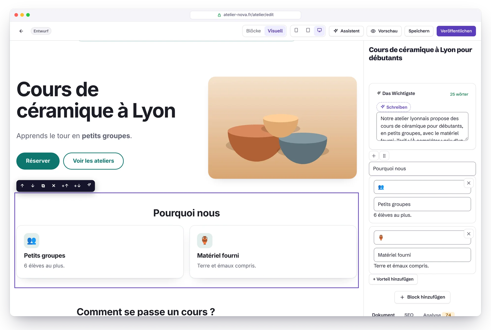
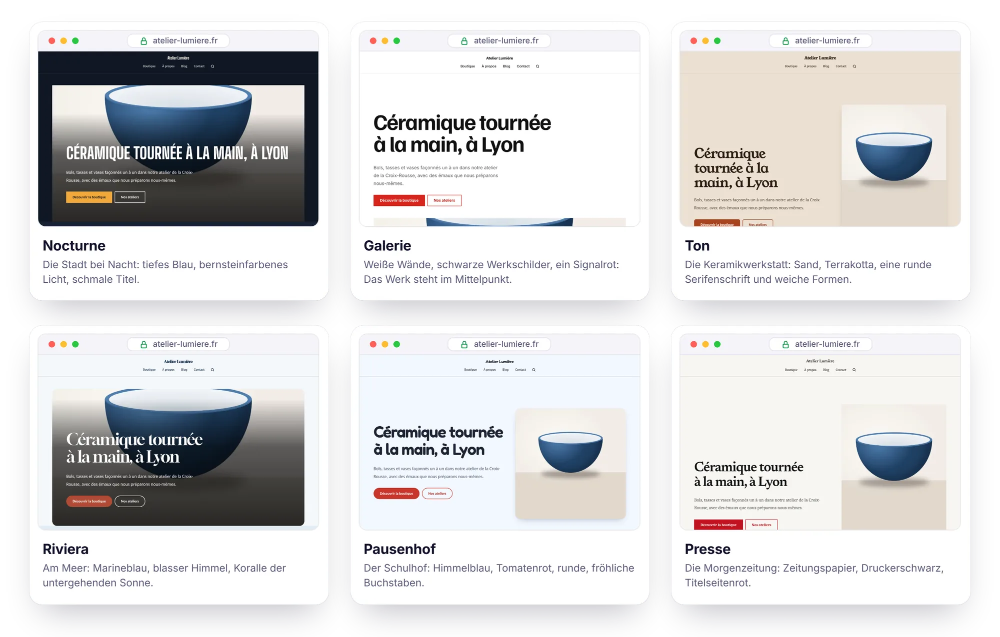
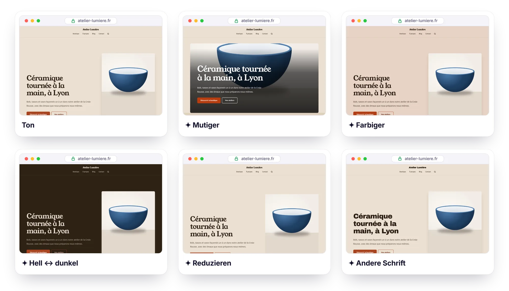
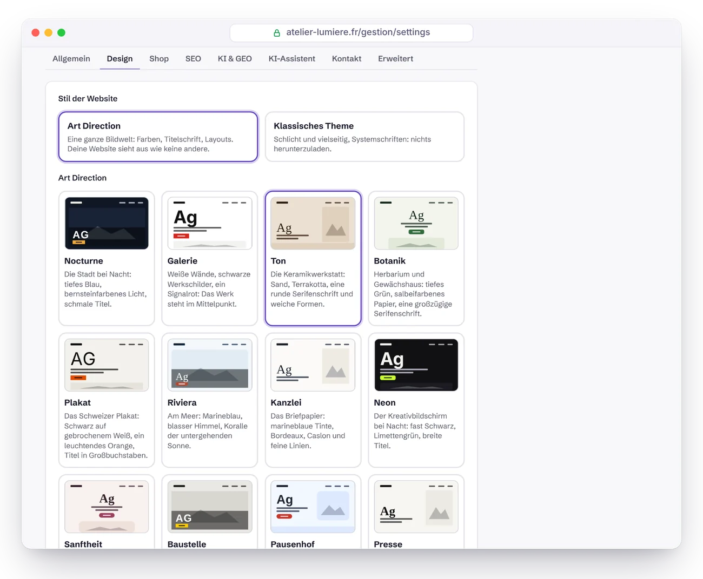

<p align="center">
  <a href="GUIDE.md">Français</a> · <a href="GUIDE.en.md">English</a> · <a href="GUIDE.es.md">Español</a> · <b>Deutsch</b> · <a href="GUIDE.it.md">Italiano</a> · <a href="GUIDE.pt-BR.md">Português</a> · <a href="GUIDE.zh-CN.md">简体中文</a>
</p>

# Handbuch zu Éclair CMS

Alles, was du wissen musst, um Éclair zu installieren, zu nutzen, abzusichern und zu pflegen. Zur Übersicht geht es zurück zum [README](../README.de.md).

## Inhalt

1. [Installation](#installation)
2. [Funktionen im Detail](#funktionen-im-detail)
3. [Éclair im Alltag](#éclair-im-alltag)
4. [Visueller Modus](#visueller-modus)
5. [Art Directions](#art-directions) (inklusive [Feinschliff mit einem Klick](#feinschliff-mit-einem-klick), [Meine Richtung mit KI entwerfen](#meine-richtung-mit-ki-entwerfen) und dem [Design-Score](#design-score))
6. [Themes](#themes)
7. [Shop](#shop)
8. [KI-Assistent](#ki-assistent) (inklusive [Eine Seite mit KI erstellen](#eine-seite-mit-ki-erstellen), [Redaktionsplan](#redaktionsplan), [Alte Website](#alte-website-wayback-machine), [Affiliate-Links](#affiliate-links) und [Google Discover](#google-discover))
9. [MCP-Connector (Claude und ChatGPT)](#mcp-connector-claude-und-chatgpt)
10. [Sicherheit](#sicherheit)
11. [Aktualisieren, sichern, umziehen](#aktualisieren-sichern-umziehen) (inklusive [Update mit einem Klick](#update-mit-einem-klick) und [Backups auf Google Drive](#backups-auf-google-drive))
12. [Fehlerbehebung](#fehlerbehebung) (inklusive [Nginx](#nginx))
13. [Für Entwickler](#für-entwickler)

---

## Installation

### Voraussetzungen

- **PHP 8.1 oder neuer** (8.3 empfohlen) mit den Erweiterungen `mbstring`, `json`, `dom`, `session` und `zlib` (fast überall standardmäßig aktiv).
- Empfohlen: `gd` (WebP-Bilder), `zip` (Backups mit einem Klick), `curl` (IndexNow, KI-Assistent, Schrift der Art Directions).
- Ein **Apache- oder LiteSpeed-Server** (praktisch jedes Shared Hosting: Hostinger, IONOS, OVHcloud …). Für Nginx siehe [weiter unten](#nginx).
- Ein HTTPS-Zertifikat (bei fast allen Hostern kostenlos über Let's Encrypt).

Der Assistent prüft all das für dich und erklärt, was zu tun ist.

### Schritte

1. Lade das Archiv [`eclair-cms-2.1.0.zip`](https://github.com/Jacckisback/eclair-cms/raw/main/dist/eclair-cms-2.1.0.zip) (875 KB) herunter und entpacke es.
2. Lade **den Inhalt des Ordners `eclair`** in den öffentlichen Ordner deines Webspace hoch (`public_html`, `www` …), mit deinem FTP-Programm (FileZilla …) oder dem Dateimanager deines Hosters.
   > ⚠️ `.htaccess`-Dateien sind versteckt: Aktiviere „Versteckte Dateien anzeigen“, damit sie sicher mit hochgeladen werden.
3. Öffne die Adresse deiner Website: **Der Installationsassistent startet** (in 7 Sprachen, darunter Deutsch).
4. Beantworte 4 Fragen (deine Website, dein Konto, deine Sichtbarkeit, die Adresse deiner Verwaltung). Konfetti 🎉: Deine Website ist online, mit ersten Seiten und einem Beispielartikel.

> 🔒 Aus Sicherheitsgründen muss die Installation **innerhalb von 2 Stunden** nach dem ersten Aufruf abgeschlossen werden (sonst könnte jeder eine hochgeladene und dann vergessene Website übernehmen). Danach lösche die Datei `data/install-window.php` per FTP und lade die Seite neu.

Installation in einem Unterordner (`beispiel.de/website/`): Lade die Dateien einfach in diesen Unterordner hoch, alles wird automatisch erkannt.

### Die 7 Website-Typen

| Typ (im Assistenten) | Was angelegt wird |
|---|---|
| 🏢 Unternehmenswebsite | Startseite (Hero, Vorteile, neueste Artikel), Leistungen (mit FAQ), Über uns, Kontakt, Blog, Impressum, Datenschutzerklärung |
| ✍️ Blog | Startseite = neueste Artikel, Über uns, Kontakt, Kategorie „Guides“, rechtliche Seiten |
| 🧑‍💻 Freelancer / Portfolio | Startseite mit deinem Namen, Kompetenzen, Über mich, Blog, Kontakt, rechtliche Seiten |
| 🎯 Landingpage | Eine Verkaufsseite (Hero, Vorteile, FAQ, Formular) + rechtliche Seiten, ohne Blog |
| 🧭 Magazin / Google Discover | Wie ein Blog (Startseite = neueste Artikel, Über uns, Kontakt, rechtliche Seiten); das Dashboard stellt Discover, die Trends des Tages und die Werbung nach vorn |
| 🛍️ Affiliate | Wie ein Blog; das Dashboard stellt deine Affiliate-Links und die von der KI geschriebenen Artikel nach vorn |
| 🕰️ Eine alte Website neu starten | Wie ein Blog; das Dashboard beginnt damit, die alten Adressen deiner Domain zu finden (Alte Website) |

Die Startinhalte gibt es auf Französisch, Spanisch und Englisch: Eine Website auf Deutsch startet mit den englischen Texten, die du dann übersetzt. Die rechtlichen Seiten enthalten ein Gerüst nach französischem (LCEN) und spanischem Recht (LSSI) sowie der DSGVO; die Pflichtangaben deines Landes (zum Beispiel das Impressum) musst du selbst ergänzen.

Der gewählte Typ wird zum **Zweck der Website** (Einstellungen › Allgemein, jederzeit änderbar): Das Dashboard öffnet sich mit einer Karte, die die Werkzeuge dieses Zwecks und ihren Stand zusammenfasst. Auf der öffentlichen Website ändert sich nichts.

### Direkt nach der Installation

Das Dashboard zeigt eine Checkliste „Erste Schritte“: Logo und Farbe, Startseite, erster Artikel, Autorenprofil, Zwei-Faktor-Authentifizierung, rechtliche Angaben, Google Search Console. Der nächste Schritt ist gelb markiert, und jeder sagt in einem Satz, wozu er dient. Bei einem Magazin, einer Affiliate-Website oder einer alten Website beginnt sie mit dem Schritt, der zu diesem Zweck gehört.

---

## Funktionen im Detail

### ⚡ Geschwindigkeit

- **Automatischer statischer Cache**: Jede Seite wird einmal erzeugt und dann ausgeliefert, ohne die Anwendung zu laden. Bei jeder Änderung leert sich der Cache von selbst (und zum geplanten Zeitpunkt eines geplanten Artikels).
- **CSS direkt in der Seite** (17 bis 23 KB je nach Theme und Shop, 5 bis 6 KB komprimiert), Systemschriften: keine blockierenden Anfragen, keine Layoutverschiebungen. Mit einer Art Direction kommt eine einzige Titelschrift hinzu (12 bis 27 KB), von deiner Website ausgeliefert und vorab geladen.
- **Bilder beim Hochladen optimiert**: verkleinert (maximal 2000 px), als **responsives WebP** bereitgestellt (480, 800, 1200, 1600 px), feste Abmessungen, Lazy Loading, Priorität für das Hauptbild.
- ETag und `304 Not Modified`-Antworten, Brotli-/Gzip-Komprimierung und ein Jahr Browser-Cache für statische Dateien (per `.htaccess`).

### 🔎 SEO

- Saubere URLs, **automatische 301-Weiterleitung**, wenn sich eine Adresse ändert, Weiterleitungsmanager (praktisch, um eine alte WordPress- oder Wix-Website zu übernehmen).
  - Adressen unter `/.well-known/`, `/_eclair/` und `/__eclair/` lassen sich nicht weiterleiten. Ausnahme: Ein Administrator kann eine `/.well-known/…`-Adresse wie `change-password` weiterleiten, aber nie `acme-challenge` oder `pki-validation`. Alte Weiterleitungen von diesen Adressen sind als „Deaktiviert“ markiert und lassen sich löschen (ein Administrator kann die erlaubten neu anlegen).
  - Weiterleitungen bremsen die Website nicht mehr aus, und die Zahl der Aufrufe bleibt sichtbar.
- **Umzug einer ganzen WordPress-Website** (Funktion „WordPress-Import“): installiere das Plugin [Eclair Export](https://github.com/Jacckisback/eclair-export) auf der WordPress-Website und lade sein Paket hier hoch (oder lege es per FTP in `data/import/` ab). Inhalte, Bilder, PDF-Dokumente, SEO (Yoast, Rank Math, AIOSEO), Menüs und Weiterleitungen werden übernommen, jede Adresse bleibt erhalten oder wird per 301 weitergeleitet, interne Links werden umgeschrieben. **Simulieren** zeigt, was angelegt wird, ohne etwas zu schreiben. Per SSH: `php app/bundled/wordpress/lib/cli.php import paket.zip [--dry-run]`.
- Titel, Meta-Beschreibung und **Live-Vorschau in Google** im Editor, mit Zeichenzählern.
- **SEO-Analyse in Echtzeit** mit Score: Länge von Titel und Beschreibung, Fokus-Keyphrase (Titel, URL, Einleitung, Zwischenüberschriften, Dichte), Wortanzahl, Struktur, Alternativtexte, interne Verlinkung, Beitragsbild …
- Vollständige **strukturierte Daten in JSON-LD**: WebSite (+ Suche), Organization / Person / LocalBusiness (Adresse, Öffnungszeiten, Social-Media-Profile, Rückgabebedingungen), WebPage / AboutPage / ContactPage, BlogPosting (Autor, Daten, Rubrik), BreadcrumbList, FAQPage, ProfilePage sowie für den Shop Product / ProductGroup / Offer (Preis, Lagerbestand, Versand).
- XML-Sitemap mit Bildern und `hreflang`, robots.txt, vollständiger RSS-Feed, Open Graph und Twitter Cards (**Vorschaubild 1200×630, automatisch erzeugt**), Breadcrumbs, kanonische URLs.
- Eine einzige Adresse pro Inhalt: Weiterleitungen für HTTPS, mit/ohne www, abschließenden Schrägstrich, Großbuchstaben, `index.php`.
- **IndexNow**: Bing, Yandex, Seznam … werden bei jeder Veröffentlichung benachrichtigt.
- Verifizierung für Google Search Console und Bing Webmaster Tools (füge das `<meta>`-Tag ein, Éclair liest den Code aus).
- Mehrsprachig: Sprache pro Inhalt, verknüpfte Übersetzungen und automatische `hreflang`-Tags.
- Automatische französische Typografie für französische Inhalte (geschützte Leerzeichen vor `: ; ! ?` und in « »-Anführungszeichen).

### 🤖 GEO (KI-Antwortmaschinen)

- **`/llms.txt`** (Standard llmstxt.org) und **`/llms-full.txt`** werden automatisch erzeugt.
- **Markdown-Version jeder Seite**: Hänge `.md` an eine beliebige URL an (mit Metadaten-Kopf, `noindex` und kanonischer URL, damit kein Duplicate Content entsteht).
- **KI-Bot-Regeln mit einem Klick**: offen (empfohlen, um zitiert zu werden), nur Zitate (Antwortmaschinen erlaubt, Training untersagt) oder gesperrt. Berücksichtigt GPTBot, OAI-SearchBot, ChatGPT-User, ClaudeBot, Claude-SearchBot, Claude-User, PerplexityBot, Google-Extended, Applebot-Extended, CCBot, Meta-ExternalAgent … Optional mit `Content-Signal`-Direktive.
- Block **„Das Wichtigste“**: die Zusammenfassung, die KI gern zitiert, am Anfang des Artikels.
- **GEO-Score** im Editor: Zusammenfassung, direkte Einleitung, FAQ, Zwischenüberschriften als Fragen, Listen und Tabellen, konkrete Zahlen, externe Quellen, erkennbarer Autor (E-E-A-T), kurze Absätze, Aktualität.
- Autorenseiten mit Biografie und Profilen (`sameAs`), sichtbare Veröffentlichungs- und Aktualisierungsdaten.
- **KI-Bots** (Menü der Verwaltung): welche KIs deine Seiten lesen (ChatGPT-User, Claude-User, OAI-SearchBot, PerplexityBot, GPTBot, ClaudeBot …), welche Seiten und wozu: Abruf auf Anfrage (jemand hat eine Frage gestellt, ein mögliches Zitat), Indexierung durch eine Antwortmaschine oder Training. Besuche pro Tag, pro Bot und pro Seite, Abrufe der robots.txt, veröffentlichte Seiten, die noch nie gelesen wurden, samt Tipps, ein Hinweis, wenn Trainings-Bots trotz robots.txt kommen, und eine Karte im Dashboard. `index.php` notiert nur Uhrzeit, Bot und Adresse, nie eine IP-Adresse oder menschliche Besucher; das Protokoll ist auf 4 MB pro Monat begrenzt und wird nach 13 Monaten gelöscht; die Messung lässt sich unter Einstellungen › KI & GEO abschalten. Die Identität ist die, die der Bot selbst angibt.

### ✍️ Block-Editor

- 18 Blöcke: Text, Zwischenüberschrift (H2–H4), Liste, Zitat, Bild, Hinweisbox, FAQ, Tabelle, Button, YouTube-/Vimeo-Video (ohne Cookies vor dem Klick), Code, Trennlinie, Hero, Vorteile, Team (Porträts, Funktionen, Kurzvorstellungen), neueste Artikel, Produkte (Schaufenster des Shops), Kontaktformular.
- Tippe **`/`** in eine leere Zeile, um einen Block auszuwählen, Drag-and-drop, Formatierungsleiste (fett, kursiv, Link, Code, Hervorhebung).
- **Unterstützte interne Links**: Während du einen Link eingibst, schlägt der Editor deine Seiten und Artikel vor (interne Verlinkung in 2 Sekunden).
- **Intelligentes Einfügen** aus Word, Google Docs oder einer Webseite: Überschriften, Listen, Tabellen und Fettdruck werden zu sauberen Blöcken.
- Speichern mit `Strg+S`, lokaler Sicherungsentwurf (nichts geht verloren, wenn die Verbindung abbricht), echte Vorschau vor dem Veröffentlichen, **Verlauf der letzten 20 Versionen**, geplante Veröffentlichung.
  - Dieser Sicherungsentwurf gehört zum angemeldeten Konto und wird beim Abmelden gelöscht: Einem anderen Konto im selben Browser wird er nie angeboten. Entwürfe aus 1.10.2 zu bereits gespeicherten Inhalten bleiben auf einer Website mit nur einem Konto erhalten; die zu neuen, nie gespeicherten Inhalten, bei mehreren Konten alle, werden nach dem Update gelöscht: Speichere offene Änderungen, bevor du aktualisierst.
- **Visueller Modus**: die Seite so, wie sie in deinem Theme aussieht, direkt dort bearbeitbar ([Details](#visueller-modus)).
- **Rückgängig und Wiederholen**: `Strg+Z` (`Cmd+Z` auf dem Mac) und `Strg+Umschalt+Z` oder `Strg+Y`, oder die Schaltflächen ↶ ↷ in der Leiste, im Modus Blöcke wie im visuellen Modus (60 Schritte). Im Feld, in dem du gerade schreibst, bleibt `Strg+Z` das des Browsers, Buchstabe für Buchstabe. Ein gelöschter Block oder ein gelöschtes Element (FAQ-Frage, Vorteil, Teammitglied, Variante, Menülink) kommt auch mit einem Klick in der Meldung zurück. Was sich nicht rückgängig machen lässt (eine Seite, ein Bild, ein Konto löschen), fragt in einem Fenster nach, in dem „Abbrechen“ den Fokus hat: `Enter` löscht nie versehentlich etwas.

### 🧩 Alles Weitere

Mediathek (Drag-and-drop, Alternativtexte, Erkennung verwendeter Bilder), Menüs per Drag-and-drop (Kopf- und Fußzeile), „Säulen“-Kategorien für ein Themencluster, Suche auf der Website, Kontaktformular gegen Spam **ohne Captcha** (Honeypot-Feld, Token, Limits pro Netzwerk und pro Tag) mit Posteingang, Konten für Administratoren und Redakteure, 6 Themes und 12 Art Directions mit Live-Vorschau, automatischer Dark Mode, 6 Systemschriften, Hauptfarbe mit garantiertem WCAG-Kontrast, Verwaltung in 7 Sprachen (Deutsch, Englisch, Französisch, Spanisch, Italienisch, Portugiesisch, Chinesisch), öffentliche Website in 6 Sprachen (fr, es, en, de, it, pt).

---

## Éclair im Alltag

| Ich möchte … | Wo |
|---|---|
| Einen Beitrag schreiben | Dashboard › **Beitrag schreiben** |
| Die KI um einen Beitrag, eine Seite oder ein Bild bitten | Feld **„Was möchtest du heute erstellen?“** im Dashboard oder **✨ KI-Assistent** (`Strg+J`) |
| Die KI eine komplette Seite gestalten lassen | Neue Seite › **✨ Mit KI erstellen** |
| Eine Seite so bearbeiten, wie sie aussieht | Editor › **Visuell** |
| Eine Seite direkt auf der Website bearbeiten | Schaltfläche **✏️ Bearbeiten** (nur sichtbar, wenn du angemeldet bist) |
| Theme, Logo, Farbe, Schriften ändern | Einstellungen › Design |
| Eigenes CSS hinzufügen | Einstellungen › Design › Eigenes CSS |
| Mikroanimationen ein- oder ausschalten | Einstellungen › Design › Mikroanimationen (Website) · Mein Profil › Oberfläche (Verwaltung) |
| Sehen, welche KIs meine Website lesen | **KI-Bots** |
| Meine Artikel planen, von der KI vorschlagen und schreiben lassen | **Planung** |
| Den alten Adressen meiner Domain wieder eine Seite geben | **Alte Website** |
| Meine Affiliate-Links verwalten und mit der KI einen Artikel daraus machen | **Affiliate-Links** |
| Meine Artikel für Google Discover vorbereiten, Ideen in den Trends des Tages finden | **Discover** |
| AdSense-Werbung auf meinen Artikeln zeigen | **Discover** › Werbung |
| Das Dashboard an meinen Zweck anpassen | Einstellungen › Allgemein › Zweck der Website |
| Den Shop öffnen | Einstellungen › Shop |
| Ein Produkt hinzufügen | Inhalte › **+ Produkt** |
| Die Startseite festlegen | Einstellungen › Allgemein |
| KI zulassen oder sperren | Einstellungen › KI & GEO |
| Den KI-Assistenten aktivieren | Einstellungen › KI-Assistent |
| Google Search Console verbinden | Einstellungen › SEO |
| Einen Link zum Menü hinzufügen | Menüs |
| Eine alte URL weiterleiten | Weiterleitungen |
| Zwei-Faktor-Authentifizierung aktivieren | Mein Profil › Zwei-Faktor-Authentifizierung |
| Ein Backup herunterladen | Sicherheit › Backup |

Tastenkürzel im Editor: `/` Block einfügen · `Strg+S` speichern · `Strg+K` Link · `Strg+B` fett · `Strg+I` kursiv · `Enter` neuer Absatz · `Umschalt+Enter` Zeilenumbruch · `Strg+J` KI-Assistent · `Strg+Z` rückgängig · `Strg+Umschalt+Z` oder `Strg+Y` wiederholen (`Cmd` auf dem Mac).

---

## Visueller Modus

<p align="center">
  
</p>

Der visuelle Modus zeigt deine Seite im echten Theme der Website, genau so, wie deine Besucher sie sehen werden, und du bearbeitest sie direkt dort. Wechsle oben im Editor zwischen **Blöcke** und **Visuell**: Deine Wahl wird für das nächste Mal gespeichert.

- **Schreiben**: Klicke auf eine Überschrift, einen Absatz, eine FAQ-Frage, den Text eines Buttons … und tippe los. `Strg+B` fett, `Strg+I` kursiv, `Strg+K` Link (die Seitensuche des Editors öffnet sich). `Enter` bestätigt ein einzeiliges Feld; in einem Absatz legt es den nächsten Absatz an (`Umschalt+Enter` für einen einfachen Zeilenumbruch). Eingefügt wird immer als reiner Text.
- **Anordnen**: Ein Klick auf einen Block umrahmt ihn und zeigt seine Leiste: zwei Pfeile zum Verschieben, zwei Schaltflächen, um einen Block darüber oder darunter hinzuzufügen, eine zum Duplizieren und, abgesetzt am Ende der Leiste, das Kreuz ✕ zum Löschen (es wird beim Überfahren rot). Die Leiste lässt sich auch per Tastatur bedienen (`Tab`, dann `Enter`); nach `Esc` löscht `Entf` den ausgewählten Block.
- **Bilder**: Klicke auf ein Bild (Hero, Bildblock, Teamporträt, Beitragsbild), um in der Mediathek ein anderes auszuwählen.
- **Block-Einstellungen**: Der rechte Bereich zeigt das Formular des ausgewählten Blocks (Link eines Buttons, Anzahl der Beiträge, neue FAQ-Frage …), darunter die Tabs „Dokument“, „SEO“ und „Analyse“.
- **✨ Feinschliff mit KI** (wenn der Assistent aktiviert ist): den Text des Blocks verbessern, korrigieren, kürzen, ausbauen, vereinfachen, im Tonfall anpassen oder übersetzen.
- **Rückgängig und Wiederholen**: `Strg+Z` (`Cmd+Z` auf dem Mac) oder die Schaltfläche ↶ geht zurück, `Strg+Umschalt+Z` oder `Strg+Y` (Schaltfläche ↷) wiederholt, Schritt für Schritt (bis zu 60 Schritte, gemeinsam für den Modus Blöcke und den visuellen Modus).
- **Breite**: 📱 390 px, ▭ 768 px oder 🖥 volle Breite, um die Darstellung auf Smartphone und Tablet zu prüfen.

Alles läuft über den gewohnten Editor: Speichern (`Strg+S` funktioniert auch in der Seite), lokaler Sicherungsentwurf, Versionsverlauf, SEO- und GEO-Analyse in Echtzeit. Links, Buttons und Formulare der Seite reagieren während der Bearbeitung nicht. Ein Block, der auf der Website unsichtbar ist (Bild noch nicht ausgewählt, Shop geschlossen …), erscheint als gestrichelter Rahmen, den du im rechten Bereich ausfüllst.

> [!NOTE]
> Den visuellen Modus gibt es nur in der Vorschau der Verwaltung: Anmeldung, Sicherheitstoken und Schreibrecht sind erforderlich, und die Seite wird nie gecacht oder indexiert. Deine öffentlichen Seiten tragen keine Spur davon: Sie bleiben bis aufs Byte identisch.

---

## Art Directions

<p align="center">
  
</p>

Ein Theme ändert die Farben; eine **Art Direction** verändert die ganze Bildwelt der Website, ausgehend von einer konkreten Idee: die Stadt bei Nacht, die Keramikwerkstatt, die Morgenzeitung. Wähle unter **Einstellungen › Design** die Option **Art Direction** (statt **Klassisches Theme**), klicke auf eine der 12 Karten und sieh dir die Live-Vorschau an: deine echte Website, in der Desktop- oder Mobilansicht. Nichts wird veröffentlicht, bevor du speicherst.

| Richtung | Bildwelt | Titelschrift |
|---|---|---|
| **Nocturne** | Die Stadt bei Nacht: tiefes Blau, bernsteinfarbenes Licht | Big Shoulders Display, in Großbuchstaben |
| **Galerie** | Weiße Wände, schwarze Werkschilder, ein Signalrot | Familjen Grotesk |
| **Ton** | Die Keramikwerkstatt: Sand, Terrakotta, weiche Formen | Young Serif |
| **Botanik** | Herbarium und Gewächshaus: tiefes Grün, salbeifarbenes Papier | DM Serif Display |
| **Plakat** | Das Schweizer Plakat: Schwarz auf gebrochenem Weiß, leuchtendes Orange | Archivo Black, in Großbuchstaben |
| **Riviera** | Am Meer: Marineblau, blasser Himmel, Koralle | Gloock |
| **Kanzlei** | Das Briefpapier: marineblaue Tinte, Bordeaux, feine Linien | Libre Caslon Display |
| **Neon** | Der Kreativbildschirm bei Nacht: fast Schwarz, Limettengrün | Unbounded |
| **Sanftheit** | Die Praxis: Puderrosa, Pflaume, viel Luft | Cormorant Garamond |
| **Baustelle** | Beton, Sicherheitsgelb, schmale Beschilderung | Barlow Condensed, in Großbuchstaben |
| **Pausenhof** | Der Schulhof: Himmelblau, Tomatenrot, runde Buchstaben | Fredoka |
| **Presse** | Die Morgenzeitung: Zeitungspapier, Titelseitenrot | Newsreader |

**Anpassen**: Unter den Karten öffnet **Richtung anpassen** alle Einstellungen, frei kombinierbar:

- **5 Farben**: Hintergrund, Bänder und Karten, Text, Sekundärtext, Akzent (Buttons und Links).
- **Schriftart für Überschriften**: 18 Schriften, ausgewählt wegen ihres Charakters (keine von denen, die man überall sieht), oder eine Systemschrift. **Schriftart für Fließtext**: eine Systemschrift, ohne Download.
- **Schreibweise der Überschriften** (normal oder Großbuchstaben), **Größe der Überschriften** (dezent, ausgewogen, spektakulär), **Ecken** (eckig, abgerundet, rund), **Abstände** (kompakt, normal, luftig).
- **Karten**: feine Linie, Farbfläche oder Schlagschatten.
- **Startbanner**: Text und Bild nebeneinander, Bild links, Plakat (sehr großer Titel), randloses Vollbild (der Titel auf dem Foto), Editorial (Hochformatbild), zentriert oder gerahmt (Text und Bild auf einer farbigen Fläche).
- **Block „Vorteile“**: Karten, Zeilen, Spalten mit Linie oder nummeriert (01, 02 …). **Abschnitte**: einfarbiger Hintergrund, Farbbänder oder Linien zwischen den Abschnitten. **Symbole der Vorteile**: gezeichnete Symbole (65 Liniensymbole, erkannt anhand gängiger Emojis: ☕ 🚗 🐶 ✂️ 🎓 💼 🌸 …), ohne Symbol oder Emojis.
- **Buttons**: gefüllt, mit Umriss oder als unterstrichene Links (mit Pfeil).

Header, Beitragslisten, Logo, Website-Icon, Fußzeile und eigenes CSS stellst du wie bisher ein. Um zum klassischen Theme zurückzukehren, wähle **Klassisches Theme** und speichere: Seine Einstellungen warten unverändert auf dich.

**Immer lesbar**: Ganz gleich, welche Farben du wählst, Éclair passt automatisch den Text (Kontrast **7:1** zum Hintergrund), den Sekundärtext, die Links und die Buttons (4,5:1) an, auch auf Hintergründen, die mit der Akzentfarbe getönt sind (Badges, Menü, Hervorhebungen). Eine Farbe, die für Text auf hellem Hintergrund zu blass ist, wird also genau so weit abgedunkelt wie nötig.

**Immer schnell**: Die Titelschrift wird **nur einmal von deinem Server heruntergeladen** (von Fontsource, unter der SIL Open Font License), in `media/fonts/` abgelegt, dann von deiner Website ausgeliefert und mit `font-display: optional` vorab geladen: keine Anfragen an Drittanbieter für deine Besucher, keine Layoutverschiebungen. Nur die CSS-Regeln, die deine Richtung braucht, werden in die Seite eingefügt, und der automatische Dark Mode überlässt der hellen oder dunklen Wahl der Richtung das Feld. Mit Lighthouse gemessen: 100 in allen vier Kategorien mit Nocturne, Riviera, Presse und Plakat sowie mit den neuen Layouts (Banner mit Bild links oder gerahmt, nummerierte Vorteile, Linien zwischen den Abschnitten, Buttons mit Umriss oder als unterstrichene Links).

> [!TIP]
> Wenn dein Hoster ausgehende Verbindungen blockiert, kann die Schrift nicht heruntergeladen werden: Eine Meldung weist dich darauf hin, und bis dahin nutzt die Website eine Ersatzschrift aus derselben Familie (mit Serifen, schmal …). Versuche es später erneut, indem du noch einmal speicherst.

### Feinschliff mit einem Klick

<p align="center">
  
</p>

Unter den Karten verwandeln sechs Buttons die gewählte Richtung mit einem einzigen Klick, und die Vorschau folgt sofort:

| Feinschliff | Was sich ändert |
|---|---|
| **Mutiger** | größere Überschriften, mehr Luft, spektakuläreres Banner (Plakat, dann randloses Vollbild), Farbbänder, kräftigerer Akzent, gefüllte Buttons |
| **Schlichter** | dezentere Überschriften, normale Schreibweise, feine Linien statt Schatten, ruhigeres Banner, gedämpfter Akzent |
| **Farbiger** | Hintergrund und Bänder mit der Akzentfarbe getönt, Farbbänder, kräftigerer Akzent |
| **Reduzieren** | feine Linien, keine Symbole, einfarbiger Hintergrund, mehr Luft, weniger abgerundete Ecken, Vorteile in Spalten |
| **Hell ↔ dunkel** | kehrt die Helligkeit von Hintergrund, Bändern und Text um und behält ihre Farbtöne bei |
| **Andere Schrift** | springt zur nächsten Titelschrift, im Wechsel zwischen den Schriftfamilien (mit Serifen, Grotesk, schmal …) |

Du kannst mehrere Schritte aneinanderreihen; **Feinschliff rückgängig machen** geht jeweils einen Schritt zurück. Die Kontraste bleiben bei jedem Schritt garantiert, und nichts wird veröffentlicht, bevor du speicherst.

### Meine Richtung mit KI entwerfen

<p align="center">
  
</p>

Wenn der [KI-Assistent](#ki-assistent) aktiviert ist, erscheint unter den Karten **Meine Richtung mit KI entwerfen**. Beschreibe in ein oder zwei Sätzen dein Geschäft, deine Zielgruppe und die gewünschte Stimmung („Bio-Bäckerei im Viertel in Freiburg, Familien als Kundschaft, warm, aber modern“) und klicke dann auf **3 Richtungen vorschlagen**. Die KI liest auch die Beschreibung deiner Website und dein Redaktionsprofil und folgt der Methode von [Impeccable](https://github.com/pbakaus/impeccable):

1. von der konkreten Welt des Geschäfts ausgehen (Orte, Materialien, Gegenstände, Licht) statt von Adjektiven;
2. jedem Vorschlag **eine präzise Referenz** geben („die Emailleschilder einer Bäckerei aus den 50er-Jahren“) und daraus Farben, Schrift und Layouts ableiten;
3. drei **wirklich unterschiedliche** Richtungen vorschlagen (hell oder dunkel, warm oder kühl, mit oder ohne Serifen);
4. die Standardwahl der Branche vermeiden (Marineblau und Gold für eine Anwaltskanzlei …), ebenso ihr vorhersehbares Gegenteil und die Marotten von „KI-generiertem Design“.

Die drei Vorschläge erscheinen vor den Karten, mit ✦ markiert: Klicke auf einen, um ihn in der Vorschau zu sehen, passe ihn an und speichere den, der dir gefällt. Die KI wählt nur aus den Einstellungen von Éclair (Farben, Schriften aus der Liste, Layouts) und schreibt nie CSS: Jeder Vorschlag wird geprüft und seine Kontraste werden korrigiert, bevor er auf deiner Website landet. Die geschätzten Kosten stehen unter dem Button (≈ 0,03 $ mit Claude Sonnet 5.5) und werden vom Budget des Assistenten abgezogen. Nur für Administratoren.

### Design-Score

Im Editor zeigt der Tab **Analyse** einen dritten Ring, **Design**, neben SEO und GEO. Er prüft, ob die Seite optisch überzeugt:

- **Zwischenüberschriften**: Hierarchie ohne Sprünge (H2, dann H3, dann H4), kurz, ohne dekoratives Emoji;
- **Banner**: kurzer Titel (höchstens 8 Wörter, 6 in Großbuchstaben), Aktionsbutton, Bild, wenn deine Richtung es verlangt (randloses Vollbild, Editorial);
- maßvolle **Handlungsaufforderungen** (höchstens 3 Buttons);
- **Block „Vorteile“** mit 3 bis 6 beschriebenen Elementen und Symbolen, die eine gezeichnete Entsprechung haben;
- **Text**: keine Sätze in GROSSBUCHSTABEN, keine hohlen Floskeln („revolutionär“, „bahnbrechend“, „seamless“ … je nach Sprache der Seite), keine gehäuften Geviertstriche, keine wortgleich wiederholten Passagen, keine Textwand mit mehr als 350 Wörtern ohne Zwischenüberschrift, Bild oder Liste;
- eine für die Website gewählte **Art Direction**.

Der Wert am Tab „Analyse“ ist jetzt der Durchschnitt der drei Ringe.

---

## Themes

Éclair enthält **6 Themes**. Wähle eines unter **Einstellungen › Design** aus: Die **Live-Vorschau** zeigt deine echte Website (Startseite, Blog, einen Beitrag, den Shop, ein Produkt) in der Desktop- oder Mobilansicht, und nichts wird veröffentlicht, bevor du speicherst. Du kannst in der Vorschau navigieren: Links bleiben in der Vorschau.

| Theme | Stil | Für wen |
|---|---|---|
| **Éclair** | Klar, modern und vielseitig: das Original-Theme | Alle Websites |
| **Editorial** | Magazin-Look: Serifenschrift, feine Linien, Initiale, hervorgehobener Beitrag | Blogs, Medien, Autoren |
| **Atelier** | Warm und handgemacht: Creme- und Terrakottatöne, weiche Formen | Handwerksbetriebe, Restaurants, Wellness |
| **Studio** | Minimalistisches Portfolio: Schwarz-Weiß, große Überschriften, Bilder ohne Rahmen | Fotografen, Designer, Agenturen |
| **Shop** | Zum Verkaufen gemacht: quadratische Fotos, fixierter Header, markante Buttons | Shops, Kreative |
| **Kontrast** | Maximale Lesbarkeit: große Schrift, starke Kontraste, unterstrichene Links | Öffentliche Einrichtungen, Vereine, Senioren |

Wenn du ein Theme auswählst, werden seine Farbe und seine empfohlenen Schriftarten übernommen: Du kannst sie danach ändern. Zwei Layout-Einstellungen ergänzen das Theme: der **Header** (Logo links und Menü rechts oder alles zentriert) und die **Beitrags- und Produktlisten** (Kartenraster oder Liste mit dem Bild links).

**Warum das leicht bleibt**: Ein Éclair-Theme ist nur ein Stylesheet von 1,5 bis 3 KB, das zum Basis-Stylesheet hinzukommt. Das HTML ändert sich von Theme zu Theme nicht: Geschwindigkeit, Barrierefreiheit, strukturierte Daten und SEO bleiben gleich. Nur das aktive Theme wird in die Seite eingefügt, und der automatische Dark Mode funktioniert mit jedem Theme.

**Eigenes CSS**: Um über das Theme hinauszugehen (Farbe eines Buttons, Abstände, Stil eines Blocks), füge deine Regeln unter **Einstellungen › Design › Eigenes CSS** ein. Sie werden auf jeder Seite nach dem Theme eingefügt und haben daher Vorrang, und sie werden mit deinen Daten (`data/`) gespeichert: **Éclair-Updates behalten sie bei**. Auch die Markierungen `/*dark*/ … /*/dark*/` funktionieren: Ihre Regeln entfallen, wenn der Dunkelmodus auf „Immer hell“ steht. Aus Sicherheitsgründen werden das Zeichen `<` und `@import`-Regeln entfernt; maximal 64 KB.

**Mikroanimationen** (Einstellungen › Design): Karten, Vorteile, FAQ-Fragen, Hinweisboxen und Bilder gleiten beim Scrollen herein, und Schaltflächen und Bilder reagieren beim Überfahren mit der Maus. Das ist reines CSS (unter 1 KB zusätzlich auf der Seite, kein Skript): Die Elemente gleiten, ohne je durchsichtig zu werden, also keine Layoutverschiebung, kein verblasster Text, nichts wird beim Laden animiert, und der Text bleibt für Google und KI in der Seite. Gemessen: 100 in allen vier Lighthouse-Kategorien, mit und ohne. Für Besucher, die auf ihrem Gerät weniger Bewegung eingestellt haben, und beim Drucken sind sie abgeschaltet. Aktiv auf Websites, die mit 1.11 installiert wurden; auf einer älteren Website bleiben die Seiten bytegenau gleich, bis du sie einschaltest. Die Animationen der Verwaltung schaltest du unter **Mein Profil › Oberfläche** ab (gilt nur für diesen Browser).

---

## Shop

Der **schlanke Shop-Modus** ist dafür gedacht, ein paar Dutzend Produkte ohne den Ballast eines klassischen Onlineshops zu verkaufen: kein Warenkorb, keine Kundenkonten, keine Datenbank, keine Bankdaten auf deinem Server. Jedes Produkt hat seine eigene Seite, optimiert für Google und KI, und sein **Kauf-Button** führt zu einem **Zahlungslink von Stripe, PayPal oder Revolut Business**: Dein Zahlungsanbieter wickelt die Zahlung ab, verschickt die Belege und kümmert sich um Rückerstattungen.

### Shop öffnen

1. **Veröffentliche dein Impressum** (die Installation hat dafür ein Gerüst angelegt, das du ergänzen musst) **und deine Allgemeinen Geschäftsbedingungen (AGB)**. Ohne sie lässt sich der Shop nicht öffnen: Lass sie prüfen, denn als Verkäufer haftest du für ihren Inhalt.
2. Unter **Einstellungen › Shop**: Wähle diese beiden Seiten aus und lege die Währung, die Versandkosten und Lieferzeiten, die Lieferländer und die Rückgabefrist fest (beim Fernabsatz in der EU gilt ein Widerrufsrecht von mindestens 14 Tagen, mit Ausnahmen wie personalisierten Produkten).
3. Klicke auf **Danke-Seite erstellen**: Dorthin kann Stripe deine Kunden nach der Zahlung weiterleiten.
4. Aktiviere **Shop geöffnet**, speichere und füge den Shop dann zum Menü hinzu (Menüs › Shop).

Der Katalog liegt unter der Adresse `/shop` (`/boutique`, `/tienda`, `/negozio` oder `/loja` je nach Sprache der Website) und lässt sich ändern; wenn du sie änderst, werden die alten Adressen weitergeleitet.

### Eine Produktseite erstellen

Inhalte › **+ Produkt**. Ganz oben im Editor stehen die Angaben der Produktseite:

- **Preis** und **Streichpreis** (optional: Der Rabatt wird in Prozent angezeigt), **Verfügbarkeit** (auf Lager, ausverkauft, Vorbestellung).
- **Zahlungslink**: der Link des Produkts von Stripe, PayPal oder Revolut Business.
- **Fotos**: Das erste ist das Hauptfoto (Google, soziale Netzwerke); Ziel sind mindestens 3 Ansichten.
- **Varianten** (Größe, Farbe …): Jede Variante kann einen eigenen Preis und Link haben. Auf der Website funktioniert die Auswahl ohne JavaScript.
- **Details für Google Shopping**: Marke, Artikelnummer, Barcode (GTIN/EAN), Zustand (neu, gebraucht, generalüberholt), digitales Produkt oder Dienstleistung (kein Versand).

Darunter beschreibst du das Produkt mit den gewohnten Blöcken und ordnest es einer **Produktkategorie** zu (Kategorien › „Sie enthält: Produkte (Shop)“). Die SEO-Analyse prüft zusätzlich Preis, Zahlungslink, Anzahl der Fotos und Produktkennungen. Um Produkte auf einer Seite hervorzuheben, füge den Block **Produkte** hinzu.

Mit dem KI-Assistenten: Hänge ein Foto an und schreibe „Erstelle eine Produktseite zum angehängten Foto. Preis: 29,90 €“. Er schreibt einen vollständigen Entwurf, **erfindet aber nie einen Preis, einen Rabatt oder einen Zahlungslink**: Was fehlt, ergänzt du selbst.

### Stripe verbinden (Payment Links)

1. Öffne in Stripe **Payment Links** und erstelle einen Link: Produkt, Preis und bei Bedarf die Erfassung der Lieferadresse.
2. Lege auf dem Tab **After the payment** fest, dass Kunden auf deine Danke-Seite weitergeleitet werden (ihre Adresse wird unter Einstellungen › Shop angezeigt).
3. Aktiviere in den Stripe-Einstellungen (**Customer emails**) die Belege für erfolgreiche Zahlungen.
4. Kopiere den Link und füge ihn in die Produktseite ein. Éclair hängt die Produktreferenz an (`client_reference_id`): Bei jeder Zahlung siehst du, was gekauft wurde.

Jede Bestellung kommt in Stripe an (und per E-Mail, wenn du das aktiviert hast): Du verpackst und versendest, Stripe kümmert sich bei Bedarf um die Rückerstattung. Ein anderer Zahlungsanbieter funktioniert ebenfalls, solange sein Zahlungslink mit `https://` beginnt.

### Oder PayPal bzw. Revolut Business verbinden

Gleiches Prinzip: ein Zahlungslink mit festem Preis pro Produkt (oder pro Variante mit anderem Preis), eingefügt in die Produktseite. Éclair erkennt diese Links und zeigt unter dem Kauf-Button „Sichere Zahlung über PayPal“ bzw. „über Revolut“ an.

- **PayPal**: Öffne in deinem Geschäftskonto **Zahlungslinks und -buttons**, erstelle für dein Produkt einen Link mit festem Preis und kopiere ihn (er beginnt mit `https://www.paypal.com/`). Deine Kunden zahlen mit ihrem PayPal-Konto oder per Karte.
- **Revolut Business**: Du brauchst ein Händlerkonto. Erstelle unter **Händler › Zahlungslink** (Merchant › Payment link) einen Link mit dem Betrag des Produkts und kopiere ihn (`https://checkout.revolut.com/…`). Deine Kunden zahlen auf der Zahlungsseite von Revolut.

Zwei Unterschiede zu Stripe: Nach der Zahlung bleibt der Kunde auf der Bestätigungsseite des Anbieters (keine automatische Rückkehr zu deiner Danke-Seite), und die Produktreferenz wird nicht an die Zahlung angehängt: Gib jedem Link einen eindeutigen Namen, damit du deine Bestellungen erkennst.

### Was Éclair für Google und KI tut

- **Strukturierte Daten** Product und Offer auf jeder Produktseite (ProductGroup für Varianten): Preis, Währung, Lagerbestand, Zustand, Marke, Versandkosten und Lieferzeiten sowie die **Rückgabebedingungen** auf Ebene deines Unternehmens. Das sind die Informationen, die Google in seinen Produktergebnissen anzeigt.
- **Produktfeed** `/products.xml` im Format von Google Merchant Center: Füge ihn im Merchant Center als Produktquelle hinzu, um kostenlos auf dem Tab „Shopping“ zu erscheinen.
- Produktkategorien als „Säulen“-Seiten, Sitemap mit allen Fotos, Breadcrumbs.
- Für KI: Preis und Verfügbarkeit jedes Produkts in `llms.txt` und in der Markdown-Version jeder Produktseite (hänge `.md` an ihre Adresse an).

### Was kostet das?

Éclair selbst kostet nichts. Stripe verlangt weder ein Abo noch eine Einrichtungsgebühr, und Zahlungslinks sind inklusive: Du zahlst nur eine Gebühr pro Zahlung, zum Beispiel **1,5 % + 0,25 €** für eine Standardkarte aus dem Europäischen Wirtschaftsraum (2,8 % + 0,25 € für eine Premiumkarte, 3,15 % + 0,25 € für eine Karte von außerhalb des EWR, plus 2 % bei einer Währungsumrechnung). Das sind die Preise von Stripe in Frankreich laut [stripe.com/fr/pricing](https://stripe.com/fr/pricing), Stand: 30. Oktober 2026; sie können sich ändern.

Mit **Revolut Business** beträgt die Gebühr **1 % + 0,20 €** für eine Privatkundenkarte aus dem Europäischen Wirtschaftsraum (2,8 % + 0,20 € für eine Karte von außerhalb des EWR), Zahlungslinks inklusive ([Revolut-Hilfe](https://help.revolut.com/en-ES/business/help/merchant-accounts/fees/how-much-does-it-cost-to-accept-card-payments/), [Revolut-Preise](https://www.revolut.com/en-IE/business/accept-payments-pricing/)). Mit **PayPal** in Frankreich sind es **1,2 % + 0,35 €** für eine Kartenzahlung und **2,9 % + 0,35 €** mit PayPal-Konto, plus 1,99 % außerhalb des EWR (1,29 % aus dem Vereinigten Königreich) ([PayPal-Gebühren](https://www.paypal.com/fr/business/paypal-business-fees), Stand: 15. Juli 2026). Preise geprüft am 31. Oktober 2026.

### Was der Shop nicht kann

Kein Warenkorb für mehrere Produkte, keine Rabattcodes, keine Kundenkonten und keine automatische Lagerverwaltung: Die Idee ist, einfach zu bleiben. Wenn du Hunderte Artikel verkaufst oder diese Funktionen brauchst, ist ein vollwertiger Onlineshop (Shopify, WooCommerce, PrestaShop) besser geeignet. Angezeigt werden die Preise, die du eingibst: Gib sie inklusive Mehrwertsteuer an, wenn du an Privatkunden verkaufst.

---

## KI-Assistent

Der Assistent schreibt Entwürfe, verbessert deine Texte und erstellt Bilder **im Ton deiner Website**. Du sprichst mit ihm in natürlicher Sprache, wie mit einem Kollegen: „Schreib einen Artikel über die Wahl der Markenfarben, mit einem Bild.“ Er prüft zuerst, ob es zum Thema schon einen Artikel gibt, erstellt das Bild, schreibt den vollständigen Entwurf (Titel, „Das Wichtigste“, Zwischenüberschriften, Listen oder Tabellen, FAQ, Meta-Beschreibung, interne Links) und legt ihn dir dann mit seinen SEO- und GEO-Scores vor. **Nichts wird ohne deinen Klick veröffentlicht.**

Er funktioniert mit **Claude** (Anthropic) oder **ChatGPT** (OpenAI) und deinem eigenen API-Schlüssel: kein Éclair-Abo, du bezahlst direkt beim Anbieter, und zwar nur deinen tatsächlichen Verbrauch. Du arbeitest lieber mit deinem Claude- oder ChatGPT-Abo? Dann nutze den [MCP-Connector](#mcp-connector-claude-und-chatgpt).

### Den Assistenten aktivieren (5 Minuten)

1. Erstelle beim gewählten Anbieter einen API-Schlüssel: [console.anthropic.com](https://console.anthropic.com/settings/keys) für Claude, [platform.openai.com](https://platform.openai.com/api-keys) für ChatGPT, und lade ein paar Dollar Guthaben auf.
2. Wähle unter **Einstellungen › KI-Assistent** den Anbieter, füge den Schlüssel ein, wähle das Modell und klicke dann auf **Verbindung testen** (kostenlos: Es wird kein Text erzeugt).
3. Wähle für Bilder einen Bildgenerator: **GPT Image 2.5** (derselbe Schlüssel wie für ChatGPT), **FLUX 3** ([dashboard.bfl.ai](https://dashboard.bfl.ai)) oder **Ideogram 3** ([ideogram.ai](https://ideogram.ai/manage-api), ideal für Grafiken mit Text). Ohne Bildgenerator nutzt der Assistent deine Mediathek und die Fotos, die du ihm anhängst.
4. Klicke auf **Mein Profil aus meiner Website entwerfen**, lies den Entwurf durch, passe ihn an und speichere.

Danach erscheint der Assistent im Menü (**✨ KI-Assistent**, `Strg+J`), im Editor und im Dashboard. Redakteure können ihn nutzen, wenn du es erlaubst.

**Claude oder ChatGPT, nach Wahl**: Speichere beide Schlüssel, dann erscheint oben im Assistenten eine Auswahl, mit der du die KI für jede Unterhaltung festlegst. Éclair merkt sich deine Entscheidung für dein Konto, Feinschliff im Editor inklusive; der in den Einstellungen gewählte Anbieter bleibt voreingestellt.

### Das Redaktionsprofil

Damit schreibt die KI **wie du**: wer du bist und was du anbietest, für wen du schreibst, Ton und Stil (duzen oder siezen, Satzlänge, Humor), Werte, Regeln, an die sie sich halten soll („immer ein Link zur Kontaktseite“, „nie Preise nennen“), und der Bildstil. Ein Klick entwirft das Profil aus deinen Seiten und Artikeln; das letzte Wort hast du. Bei jeder Anfrage folgt der Assistent außerdem den Analyseregeln von Éclair: Seine Entwürfe zielen von Anfang an auf hohe SEO- und GEO-Scores.

### Worum du ihn bitten kannst

- „Schreib einen Artikel über die Wartung eines E-Bikes im Frühling, mit einem Bild.“
- „Füge Léa Martin, Art Director, mit dem angehängten Foto zur Teamseite hinzu.“ (das Foto hängst du mit 📎, per Drag-and-drop oder durch Einfügen an)
- „Erstelle eine Seite ‚Unsere Leistungen‘, die unsere drei Pakete vorstellt.“
- „Schlag mir 5 Artikelideen vor, mit denen ich neue Kunden gewinne.“
- „Lies meine Startseite durch und schlag Verbesserungen vor.“
- Im Editor: „Füge diesem Artikel eine FAQ hinzu“, „Mach die Einleitung packender“.

Jede Aktion erzeugt unter der Antwort eine **Karte**:

| Karte | Was passiert ist | Deine Schaltflächen |
|---|---|---|
| 📝 Entwurf | Neuer Beitrag oder neue Seite, nicht veröffentlicht | Öffnen · Vorschau · Jetzt veröffentlichen oder planen |
| ✏️ Vorgeschlagene Änderung | Bei einem **veröffentlichten** Inhalt: Nichts ändert sich ohne deine Zustimmung | Vorschau · Übernehmen · Verwerfen, danach bei Bedarf Abbrechen |
| ✅ Aktualisiert | Ein **Entwurf** wurde direkt geändert | Öffnen · Vorschau · Abbrechen |
| ✅ Im Editor geändert | Der geöffnete Inhalt wurde im Editor geändert | Abbrechen (danach speicherst du) |
| 🖼️ Bild | Bild erstellt, optimiert (WebP) und in der Mediathek abgelegt | Beitragsbild (im Editor) |

„Abbrechen“ macht eine Änderung rückgängig, solange niemand den Inhalt seitdem bearbeitet hat; andernfalls findest du frühere Versionen im **Versionsverlauf** des Editors. Der Assistent bewahrt deine letzten 30 Unterhaltungen auf. Er erfindet nie Fakten über dein Unternehmen (Preise, Öffnungszeiten, Zahlen, Kundenstimmen): Fehlt eine Information, setzt er einen sichtbaren Platzhalter wie **[Zu ergänzen: Preis]** und weist dich darauf hin; der Tab „Analyse“ zählt diese Platzhalter, solange noch welche übrig sind.

### Eine Seite mit KI erstellen

In einem neuen Inhalt (Seite, Beitrag oder Produkt) stellt der Bereich **✨ Mit KI erstellen** mit einem einzigen Aufruf einen vollständigen Entwurf zusammen:

1. Wähle Typ und Sprache und beschreibe dann in ein oder zwei Sätzen, was du möchtest. Wenn du willst, ergänze das **Ziel** („Angebotsanfragen gewinnen“), die **Zielgruppe**, den **Tonfall** und die gewünschten **Abschnitte** („Banner, Vorteile, Preise, FAQ, Kontakt“).
2. Die **geschätzten Kosten** werden vor dem Start angezeigt (≈ 0,08 $ mit Claude Sonnet 5.5, ≈ 0,16 $ mit Claude Opus 5.5); sie werden vom Budget des Assistenten abgezogen. Wenn du beide Schlüssel gespeichert hast, wählst du Claude oder ChatGPT.
3. Nach 20 bis 60 Sekunden öffnet sich der Entwurf im **visuellen Modus**: Titel, Adresse, SEO-Titel und Meta-Beschreibung, „Das Wichtigste“, Fokus-Keyphrase und ein Layout aus Abschnitten (Hero, Vorteile, Zwischenüberschriften, Listen, Hinweisboxen, FAQ, Buttons, Team, Kontaktformular, neueste Beiträge oder Produkte), mit einer einzigen H1: dem Titel des Hero-Blocks.

Die KI stützt sich auf dein Redaktionsprofil, die Liste deiner veröffentlichten Seiten und Beiträge (damit die Links auf Seiten zeigen, die es wirklich gibt) und deine 30 neuesten Bilder. Sie erfindet keine Fakten: Fehlende Preise, Zahlen, Namen oder Öffnungszeiten bleiben als **„[Zu ergänzen: …]“** stehen und werden vom Tab „Analyse“ gezählt, bis du sie ausfüllst. Der Entwurf wird nie veröffentlicht: Lies ihn durch, ergänze ihn und veröffentliche ihn dann. Hat die Website bereits 500 Entwürfe, bittet dich der Bereich zuerst, einige zu veröffentlichen oder zu löschen, bevor etwas ausgegeben wird.

### Redaktionsplan

Menü **Planung**: deine nächsten Artikel in einem Monatskalender (veröffentlicht, eingeplant, Entwürfe, Ideen) und eine Liste „Demnächst“.

- **Idee hinzufügen** von Hand: Titel, geplantes Datum, Keyword, Kategorie, Blickwinkel und Notizen zum Schreiben.
- **Ideen mit KI vorschlagen**: 4 bis 12 Ideen anhand deiner Website (Tätigkeit, Kategorien, bereits geschriebene Artikel, von KIs meistgelesene Seiten unter KI-Bots) und eines optionalen Themas. Sie werden auf die nächsten freien Tage verteilt, im gewählten Rhythmus (1 bis 5 pro Woche). Nichts wird veröffentlicht.
- **Schreiben**: Die KI schreibt die Idee als vollständigen Entwurf, mit derselben Technik wie „Mit KI erstellen“, dann öffnet sich der Editor. Prüfe ihn, fülle die „[Zu ergänzen: …]“-Stellen aus, plane ihn ein.
- **Kosten**: Jede Schaltfläche zeigt die geschätzten Kosten (≈ 0,035 $ pro Ideenserie und ≈ 0,08 $ pro Artikel mit Claude Sonnet 5.5); danach werden die verbrauchten Tokens und Dollar bei der Idee und in der Summe der Planung notiert und auf das Budget des Assistenten angerechnet.
- **Automatisches Schreiben** (Administratoren, standardmäßig aus): Die KI schreibt die fällige Idee 1 bis 14 Tage vor ihrem Datum, eine nach der anderen, im Rahmen des Budgets, wenn ein Administrator die Verwaltung öffnet. Um davon unabhängig zu sein, lass die angezeigte geheime Adresse stündlich aufrufen (Cron deines Hosters, cron-job.org …). „Ohne Prüfung einplanen“ gibt es, ist aber nicht empfohlen: Google bestraft massenhaft veröffentlichte Texte ohne menschliche Prüfung, und ein Artikel, der noch „Zu ergänzen“ enthält, wartet immer auf deine Prüfung.

### Alte Website (Wayback Machine)

Menü **Alte Website** (Administratoren): Wenn du eine Domain übernimmst, die schon eine Website hatte, zeigen noch Links auf ihre alten Adressen. Éclair findet sie in der Wayback Machine und gibt ihnen wieder eine Seite.

- **Suchen**: Éclair fragt den Index der Wayback Machine nur für die Domain der Website ab (www inklusive), bis zum gewählten Datum. Startseite, Adressen mit Parametern (`?p=12`), andere Domains und `.php`-Adressen (vom `.htaccess` abgewiesen) werden ausgelassen; Listenseiten (Schlagwörter, Kategorien, Seitennummern…) sind zunächst nicht angehakt.
- **Neu aufbauen**: Für jede angehakte Adresse schreibt die KI eine **neue** Seite oder einen **neuen** Artikel, nur anhand des Titels der alten Seite. Weder ihr Text noch ihre Bilder werden kopiert, und die alte Marke wird nicht übernommen. Eine Adresse nach der anderen, mit Stopp-Taste; ein neues Titelbild ist optional.
- **Adressen**: Die Seite behält die alte Adresse, wenn Éclair sie unverändert ausliefern kann; sonst leitet die alte Adresse auf die neue weiter (301). Eine Adresse, die deine Website schon ausliefert, wird nie ersetzt.
- **Veröffentlichen**: Alles beginnt als Entwurf. „Geprüfte Entwürfe veröffentlichen“ veröffentlicht sie auf einmal, außer denen, die noch „[Zu ergänzen: …]“ enthalten.
- **Kosten**: vorher angezeigt (pro Seite) und nachher (Tokens und Dollar, pro Adresse und insgesamt), im Budget des Assistenten.

> ⚠️ Google bestraft abgelaufene Domains voller Seiten ohne Nutzen für Besucher ([Spam-Richtlinien](https://developers.google.com/search/docs/essentials/spam-policies#expired-domains)): Prüfe und ergänze jede Seite, bevor du sie veröffentlichst.

### Affiliate-Links

Menü **Affiliate-Links**: deine Affiliate-Links an einem Ort, mit deinen Notizen zu jedem Produkt.

- **Automatischer Werbehinweis**: Auf jeder Seite mit einem Affiliate-Link und im RSS-Feed zeigt Éclair den Hinweis „Affiliate-Links“ in der Sprache der Seite (oder deinen eigenen Text), direkt nach dem Eröffnungsbanner. Werbung muss klar als solche erkennbar sein: [LCEN, Art. 20](https://www.legifrance.gouv.fr/loda/article_lc/LEGIARTI000018048180) in Frankreich, [LSSI, Art. 20](https://www.boe.es/buscar/act.php?id=BOE-A-2002-13758) in Spanien.
- **Amazon**: Bei einem Amazon-Link wird der vom Amazon-Partnerprogramm verlangte Satz in der Sprache des Shops ergänzt („Als Amazon-Partner verdiene ich an qualifizierten Verkäufen.“ für amazon.de). Amazon-Links mit deiner Partner-ID (`tag=`) und amzn.to-Kurzlinks werden erkannt, auch wenn sie nicht in der Liste stehen.
- **Für Google**: Jeder Affiliate-Link wird mit `rel="sponsored nofollow"` gekennzeichnet. Keine verschleierten Links, keine Weiterleitungen: Die Links führen direkt zum Händler.
- **Einen Artikel mit der KI schreiben**: Wähle Links aus und entscheide dich für einen Vergleich (2 bis 10 Links), eine Produktvorstellung oder eine Kaufberatung. Die KI schreibt nur anhand der Namen und deiner Notizen: Sie erfindet weder Preise noch Bewertungen noch Testergebnisse und setzt „[Zu ergänzen: …]“ dort, wo deine Meinung zählt. Der Entwurf öffnet sich im Editor; nichts wird veröffentlicht.

Solange du keinen Link speicherst, ändert sich auf deiner Website nichts.

### Google Discover

Menü **Discover**: was deinen Artikeln hilft, im Discover-Feed von Google zu erscheinen, die Trends des Tages und die Werbung. Google bietet keine Einstellung, um sich in Discover zu „platzieren“: Ein indexierter Artikel ist automatisch berechtigt ([Empfehlungen von Google](https://developers.google.com/search/docs/appearance/google-discover?hl=de)).

- **Bereit für Discover**: Geprüft werden die Website (für Suchmaschinen geöffnet, HTTPS, Logo, Seiten „Über uns“ und „Kontakt“) und deine 100 neuesten Artikel: Bild mit mindestens 1200 px Breite (nie das Logo), Titel ohne Sensationsmache (Großbuchstaben, „!!“), vorgestellter Autor, Länge. Ein Link „Beheben“ für jeden Punkt. Die strukturierten Daten liefern das große Originalbild, unbeschnitten.
- **Trends des Tages**: die Suchanfragen, die bei Google im gewählten Land steigen (öffentlicher Feed von Google Trends, höchstens einmal pro Stunde abgerufen), mit den Schlagzeilen der Presse. „Zur Planung hinzufügen“ macht daraus eine Idee mit dem heutigen Datum. Mit dem KI-Assistenten behält „Ideen für meine Website vorschlagen“ nur die Trends, die dein Thema betreffen (oft keine), und schlägt höchstens 4 nützliche, dauerhafte Artikel vor, nie einen Nachrichtenartikel.
- **Werbung (Google AdSense)**, Administratoren: deine Publisher-ID, automatische Anzeigen und/oder ein Anzeigenblock, den Éclair zwischen zwei Textblöcke setzt (nach dem 2. Absatz, in der Mitte langer Artikel, am Ende), mit der von Google verlangten Kennzeichnung „Werbung“ und reserviertem Platz. Nur auf Artikeln, nie auf Seiten oder in der Vorschau; Kästchen „Keine Werbung in diesem Artikel“ im Editor.
- **Einwilligung**: Die Werbung lässt sich erst aktivieren, wenn die Mitteilung „Europäische Vorschriften“ in AdSense › Datenschutz und Mitteilungen veröffentlicht ist. Google verlangt für europäische Besucher eine zertifizierte Einwilligungsplattform ([AdSense-Hilfe](https://support.google.com/adsense/answer/13554116?hl=de)); die eigene wird über den AdSense-Code angezeigt.
- **ads.txt**: Sobald die ID gespeichert ist, veröffentlicht Éclair `/ads.txt` und das Tag, mit dem Google deine Website bestätigt.

> ⚠️ Die Skripte von Google verlangsamen Seiten mit Werbung (Lighthouse zeigt dort keine 100 mehr): Éclair reserviert den Platz der Anzeigen und lädt auf den anderen Seiten nichts. Klicke nie auf deine eigenen Anzeigen: Google verbietet das.

### Feinschliff im Editor

- **Markiere eine Textstelle** und klicke dann in der Formatierungsleiste auf ✨: Verbessern, Fehler korrigieren, Kürzen, Ausbauen, Vereinfachen, Herzlicher, Professioneller, Übersetzen. Ein Klick auf „Abbrechen“ stellt den vorherigen Text wieder her.
- **Das Wichtigste**: Schaltfläche „Schreiben“.
- **Tab „SEO“**: SEO-Titel und Beschreibung, Fokus-Keyphrase, Titelideen.
- **Tab „Analyse“**: FAQ hinzufügen, fehlende Alternativtexte, „Mit dem Assistenten verbessern“.
- **Beitragsbild**: „Mit KI erstellen“ (bei Beiträgen).
- **Mediathek**: „Mit KI beschreiben“ sieht sich ein Bild an und schreibt seinen Alternativtext.

### Was kostet das?

Du bezahlst den Anbieter nach tatsächlicher Nutzung. Éclair berechnet jede Ausgabe anhand der abgerechneten Tokens und zeigt sie unter Einstellungen › KI-Assistent an. Schätzung für einen vollständigen Artikel (etwa 25.000 gelesene und 7.000 geschriebene Tokens, Recherchen und Prüfungen inklusive):

| Modell | Preis pro 1 Million Tokens (gelesen / geschrieben) | Vollständiger Artikel |
|---|---|---|
| Claude Opus 5.5 (das leistungsstärkste) | 4 $ / 20 $ | ≈ 0,24 $ |
| Claude Sonnet 5.5 | 2 $ / 10 $ | ≈ 0,12 $ |
| Claude Haiku 5.5 | 0,10 $ / 0,50 $ | < 0,01 $ |
| GPT-6 Astra | 10 $ / 50 $ | ≈ 0,60 $ |
| GPT-6.1 Sol | 2 $ / 10 $ | ≈ 0,12 $ |
| GPT-6.1 Terra | 1 $ / 5 $ | ≈ 0,06 $ |
| GPT-6 Luna | 0,10 $ / 0,50 $ | < 0,01 $ |

Ein Bild kostet etwa 0,05 $ (FLUX 3 mit 1 Megapixel: 0,048 $). Öffentliche Preise laut den offiziellen Seiten von [Anthropic](https://platform.claude.com/docs/en/about-claude/pricing), [OpenAI](https://developers.openai.com/api/docs/pricing) und [Black Forest Labs](https://docs.bfl.ml/release-notes), Stand: 29. Oktober 2026; sie können sich ändern. Die festen Anweisungen des Assistenten werden beim Anbieter zwischengespeichert, was die Kosten der folgenden Anfragen senkt.

**Leitplanken**: ein maximales Monatsbudget (standardmäßig 10 $), das vor jedem Schritt einer Anfrage geprüft wird: Ist es erreicht, pausiert der Assistent bis zum nächsten Monat. Dazu kommen ein Limit für Anfragen pro Person und Tag (standardmäßig 60) und höchstens zwei gleichzeitige Anfragen pro Person. Sobald die Website 500 Entwürfe hat, erstellt die KI keine weiteren: Sie bittet dich zuerst, einige zu veröffentlichen oder zu löschen. Budget und Tageslimit stellst du unter Einstellungen › KI-Assistent ein.

### Sicherheit und Datenschutz

- **Die KI bereitet vor, du entscheidest**: Sie kann deine Inhalte durchsuchen und lesen, Entwürfe erstellen, einen Entwurf ändern (lässt sich rückgängig machen), eine Änderung an einem veröffentlichten Inhalt vorschlagen und Bilder erstellen. Sie kann **weder veröffentlichen noch löschen noch Einstellungen, Menüs oder Konten ändern**. Veröffentlichen bleibt der Klick eines Menschen.
- **Entwürfe und Vorschläge geprüft**: Die KI ändert einen Inhalt nur direkt, solange er noch ein Entwurf ist; wurde er inzwischen veröffentlicht, bereitet sie stattdessen einen Vorschlag vor. Ein Vorschlag veraltet, sobald sich der Inhalt ändert, selbst in derselben Sekunde, und seine Übernahme ändert nie, ob der Inhalt veröffentlicht ist.
- **Zugriff während der Anfrage erneut geprüft**: Der Assistent bricht mitten in einer Anfrage ab, wenn das Konto gelöscht, sein Passwort zurückgesetzt oder sein KI-Zugang entzogen wird.
- **Verschlüsselte API-Schlüssel** auf deinem Server (libsodium oder AES-256-GCM), nie an den Browser gesendet, nie angezeigt (nur ein Hinweis wie „sk-ant…ab12“), und wie der Unterhaltungsverlauf **von Backups ausgeschlossen**. Für stärkeren Schutz füge `define('ECLAIR_SECRET', 'ein-langer-geheimer-satz');` in `eclair-config.php` ein (und zwar bevor du deine Schlüssel speicherst).
- **Was an den Anbieter geht**: deine Anfrage, die Bilder, die du anhängst, das Redaktionsprofil und der nötige Kontext (Liste deiner Seiten und Artikel, der im Editor geöffnete Inhalt). Gib deshalb keine sensiblen Daten ein. Laut ihren Bedingungen (geprüft am 29. Oktober 2026) trainiert [Anthropic](https://www.anthropic.com/legal/commercial-terms) seine Modelle nicht mit Daten, die per API gesendet werden, und [OpenAI](https://help.openai.com/en/articles/5722486-api-data-usage-policies) standardmäßig ebenfalls nicht.
- **Bereinigte Inhalte**: Alles, was die KI schreibt, durchläuft dieselbe Allowlist wie der Editor, und ihre Überarbeitungen betreffen nur den sichtbaren Text (nie die Adresse eines Links). Erzeugte Bilder werden per HTTPS von einer geprüften öffentlichen Adresse heruntergeladen und dann wie ein Upload neu kodiert.
- **Prompt-Injections**: Inhalte, die die KI liest, werden als Daten behandelt, nie als Befehle; und selbst wenn eine präparierte Seite versuchen würde, sie umzulenken, könnte sie nur einen Entwurf oder einen Vorschlag vorbereiten, den du siehst, bevor irgendetwas passiert.

### Wenn der Assistent nicht antwortet

- **„API-Schlüssel von … abgelehnt“**: Der Schlüssel wurde unvollständig kopiert oder widerrufen. Füge ihn erneut ein und teste die Verbindung.
- **„Guthaben bei … aufgebraucht“**: Lade dein Konto beim Anbieter auf.
- **„KI-Budget für diesen Monat aufgebraucht“**: Erhöhe das Budget unter Einstellungen › KI-Assistent oder warte bis zum nächsten Monat.
- **Die Antwort erscheint auf einmal statt nach und nach**: Ein Puffer deines Hosters hält den Datenstrom zurück. Alles funktioniert, nur ohne den „Live“-Effekt. Füge unter Nginx `fastcgi_buffering off;` in den PHP-Block ein.
- **„… ist nicht erreichbar“**: Dein Hoster blockiert ausgehende Verbindungen. Bitte ihn, `api.anthropic.com` bzw. `api.openai.com` (und den gewählten Bildgenerator) freizugeben.
- **Der Assistent wird nicht angezeigt**: Er braucht die PHP-Erweiterung cURL und Verschlüsselung (sodium oder openssl), die fast alle Hoster bereitstellen; der Installationsassistent prüft das.

---

## MCP-Connector (Claude und ChatGPT)

Du arbeitest lieber in **Claude** oder **ChatGPT**, mit dem Abo, das du schon hast? Der MCP-Connector (*Model Context Protocol*, der offene Standard, der KI mit Werkzeugen verbindet) öffnet ihnen deine Website: Sie lesen deine Inhalte, schreiben Entwürfe in deinem Ton und bereiten Änderungen vor. **Kein API-Schlüssel, keine Kosten für die Website**: Die Arbeit erledigt dein Abo. Wie beim integrierten Assistenten wird ohne dich **nichts veröffentlicht oder gelöscht**.

### Den Connector aktivieren (3 Minuten)

1. Deine Website muss über **HTTPS** laufen: Claude und ChatGPT lehnen andere Adressen ab.
2. Aktiviere unter **Einstellungen › KI-Assistent** unten auf der Seite **MCP-Verbindungen erlauben**, speichere und kopiere dann die **Adresse des Connectors** (`https://beispiel.de/_eclair/mcp`).
3. Füge sie in deiner KI hinzu:
   - **Claude** (Web und Desktop-App): *Anpassen › Connectors › Hinzufügen › Benutzerdefinierten Connector hinzufügen*, gib einen Namen ein („Meine Website“), füge die Adresse ein, klicke auf **Weiter**, übernimm die erkannten Authentifizierungseinstellungen und klicke dann auf **Hinzufügen**. Bei den Tarifen Team und Enterprise fügt ihn ein Inhaber der Organisation hinzu; die Mitglieder klicken danach auf **Verbinden**.
   - **ChatGPT** (im Web): *Plugins › + › Benutzerdefinierten MCP-Server hinzufügen*, gib einen Namen ein, füge die Adresse unter **Verbindung** ein, wähle die Authentifizierung **OAuth**, akzeptiere den Warnhinweis und erstelle dann das Plugin.
4. Eine Seite deiner Website öffnet sich: Melde dich bei Bedarf an (Zwei-Faktor-Authentifizierung inklusive), prüfe die App und ihre Rücksprungadresse (`claude.ai` oder `chatgpt.com`) und klicke dann auf **Erlauben**. Diese Schaltfläche ist zunächst ausgegraut: Sie wird nach einem Moment aktiv, sobald du die Maus bewegst, den Bildschirm berührst oder die Tastatur benutzt (auf einem Touchscreen aktiviert das erste Tippen sie, das zweite erteilt die Erlaubnis).

Fertig. Frag zum Beispiel: „Sieh dir meine Website an und schlag mir 5 Artikelideen vor“, „Schreib als Entwurf einen Artikel über die Wartung eines E-Bikes“ oder „Lies meine Startseite durch und schlag einen direkteren Aufhänger vor“.

**Kompatible Tarife** (geprüft am 30. Oktober 2026):

| Tarif | Website lesen | Entwürfe und Vorschläge |
|---|---|---|
| **Claude** Free, Pro, Max, Team, Enterprise | ✅ | ✅ (Free: nur ein benutzerdefinierter Connector) |
| **ChatGPT** Business, Enterprise, Edu | ✅ | ✅ |
| **ChatGPT** Pro | ✅ | ❌ (nur Lesezugriff) |
| **ChatGPT**, andere Tarife | in der Hilfe von OpenAI nicht vorgesehen | |

Quellen: [Claude-Hilfe zu benutzerdefinierten Connectors](https://support.claude.com/en/articles/11175166-getting-started-with-custom-connectors-using-remote-mcp), [OpenAI-Hilfe zu benutzerdefinierten MCP-Servern](https://help.openai.com/en/articles/12584461-connecting-custom-mcp-servers-in-chatgpt) und [OpenAI-Dokumentation](https://developers.openai.com/api/docs/guides/custom-mcp-server). Diese Tarife ändern sich schnell: Prüfe das in deiner App.

### Was die KI tun kann

Sie beginnt mit `get_site` und nutzt dann die Werkzeuge des integrierten Assistenten, außer der Bilderstellung (bezahlt mit dem Schlüssel der Website):

| Werkzeug | Aufgabe |
|---|---|
| `get_site` | Inventar der Website (Seiten, Beiträge, Produkte, Kategorien und ihre IDs), Redaktionsprofil, SEO- und GEO-Regeln |
| `search_content` · `get_content` | einen Inhalt suchen und als Markdown lesen |
| `find_media` | ein Bild in der Mediathek suchen |
| `create_draft` | einen Beitrag, eine Seite oder eine Produktseite **als Entwurf** erstellen, in Markdown oder in Layout-Abschnitten (Hero, Vorteile, FAQ …) |
| `update_content` | einen Entwurf ändern; bei einem veröffentlichten Inhalt einen **Vorschlag** vorbereiten |

Jeder Entwurf kommt mit einem Link zurück, um ihn **in Éclair zu öffnen**; jeder Vorschlag mit einem Link, der ihn **im Editor übernimmt**, ohne ihn zu speichern: Du prüfst und speicherst dann (oder du schließt den Editor, und nichts ändert sich). Claude und ChatGPT fragen außerdem vor jeder Schreibaktion nach deiner Zustimmung, je nach ihren eigenen Einstellungen.

### Sicherheit des Connectors

- **Standardmäßig deaktiviert**: Solange er es ist, antwortet keine seiner Adressen.
- **OAuth 2.1**: PKCE verpflichtend, automatische Registrierung der App, ohne etwas zu speichern, Rücksprungadresse auf exakte Übereinstimmung geprüft.
- **Deine ausdrückliche Zustimmung**, nachdem du dich bei deinem Konto angemeldet hast (Zwei-Faktor-Authentifizierung inklusive), auf einer Seite, die die Adresse deiner Verwaltung nie verrät. Bei Claude und ChatGPT erinnert sie dich daran, nur zuzustimmen, wenn du die Verbindung gerade selbst gestartet hast. Bei jeder anderen App wird immer dein Passwort verlangt, auch direkt nach der Anmeldung: Meldest du dich auf dieser Seite an, gibst du es also zweimal ein. **Ablehnen** verlangt nie das Passwort.
- **Geschützte Schaltfläche „Erlauben“**: Auf jeder Zustimmungsseite ist sie anfangs ausgegraut, wird erst nach einem Moment und einer Geste auf der Seite aktiv und deaktiviert sich, sobald das Fenster in den Hintergrund rückt. Ohne JavaScript ist keine Erlaubnis möglich, und die Seite sagt das.
- **Tokens mit einer Stunde Gültigkeit**, automatisch erneuert und bei jeder Erneuerung ersetzt; nach 60 Tagen ohne Nutzung musst du erneut zustimmen. Gespeichert werden nur ihre Hashes, von Backups ausgeschlossen.
- **Zugriff entziehen**: eine Schaltfläche pro App unter Einstellungen › KI-Assistent. Wenn du den Connector deaktivierst, verlieren alle Apps den Zugriff; ebenso, wenn du dein Passwort änderst oder alle deine Geräte abmeldest.
- **Dieselben Rechte wie der integrierte Assistent**: Redakteure haben nur Zugriff, wenn „Redakteure dürfen den Assistenten nutzen“ aktiviert ist; höchstens 60 Änderungen pro Stunde und App, gegen Endlosschleifen (ein strenges Limit, das sich nicht mehr nach 15 Minuten wieder auffüllt); Suchanfragen sind auf 200 Zeichen begrenzt.
- **Was an Anthropic oder OpenAI geht**: die Inhalte, die die KI liest, um dir zu antworten, gemäß den Bedingungen deines Abos.

### Wenn die Verbindung scheitert

- **Die KI erreicht die Website nicht, oder die Autorisierung scheitert**: Prüfe, ob die Website über HTTPS läuft und die Adresse auf `/_eclair/mcp` endet. Halte unter Apache die `.htaccess` von Éclair aktuell: Sie leitet den Autorisierungs-Header weiter, den manche Hoster entfernen.
- **Éclair ist in einem Unterordner installiert**: Manche Apps suchen die Autorisierung im Stammverzeichnis der Domain. Installiere Éclair besser im Stammverzeichnis einer Domain oder Subdomain.
- **Firewall oder Bot-Schutz** (Cloudflare …): Lass `/_eclair/` und `/.well-known/` durch.
- **Ein Vorschlag lässt sich nicht mehr übernehmen**: Der Inhalt hat sich inzwischen geändert; bitte die KI erneut um die Änderung.

---

## Sicherheit

Éclair ist für eine feindliche Umgebung gebaut (Shared Hosting, Bots, die rund um die Uhr Passwörter ausprobieren). Es hat ein offensives Sicherheitsaudit durchlaufen (Race Conditions, Brute Force, Weiterleitungen, Injections, präparierte Dateien): Jede gefundene Lücke wurde geschlossen und der Angriff anschließend wiederholt, um das zu beweisen (`tests/run.php`).

**Daten und Server**
- **Keine Datenbank**: SQL-Injection ist unmöglich.
- **Doppelt geschützte Daten**: Die Ordner `data/`, `app/` und `cache/` sind per `.htaccess` gesperrt; jede Datendatei beginnt mit `<?php exit; ?>` (selbst wenn ein Server `.htaccess`-Dateien ignorieren würde, wird nichts angezeigt), und keine `<?php`-Sequenz kann hineingeschrieben werden. Private Dateien (Rechte 0600), atomare Schreibvorgänge.
- **Schreiben immer mit Sperre**: Kann der Server seine Daten nicht sperren (`data/.lock` unbrauchbar), verweigert Éclair das Speichern mit einer klaren Meldung, statt ohne Schutz zu schreiben; die öffentlichen Seiten bleiben online. Eine unbrauchbare Sperrdatei, die ein Umzug oder eine Wiederherstellung hinterlassen hat, wird nach Möglichkeit automatisch neu angelegt.
- **Backups ohne Geheimnisse**: Sie enthalten nie den verschlüsselten Tresor (API-Schlüssel, Google-Drive-Token), die Sitzungen, die Limits oder den Update-Status, auch wenn `ECLAIR_DATA` mit einem abschließenden Schrägstrich geschrieben ist. Die ZIP-Dateien der Backups sind privat (Rechte 0600).
- **Signierte Updates**: Die Ankündigung jeder Version trägt eine Ed25519-Signatur des Maintainers, die mit dem in Éclair hinterlegten öffentlichen Schlüssel geprüft wird, dazu eine ebenfalls signierte Seriennummer und ein Ablaufdatum. Eine ältere, erneut eingespielte Ankündigung wird abgelehnt und gemeldet; eine Ankündigung, die 180 Tage lang nicht erneuert wurde, zeigt eine Warnung; „Du hast die neueste Version von Éclair“ erscheint nur nach einer erfolgreichen Prüfung. Das Archiv wird vor jeder Änderung kontrolliert (Fingerabdruck, Pfade, Manifest, PHP-Syntax), und das Update macht sich von selbst rückgängig, wenn die Website nicht mehr antwortet (Details im Abschnitt [Update mit einem Klick](#update-mit-einem-klick)).
- **Geschützte Installation**: Sie ist nur innerhalb von 2 Stunden nach dem ersten Aufruf möglich, und die Adresse der Website wird erst dann für Weiterleitungen genutzt, wenn sie **vom Server selbst geprüft** wurde (eine falsche oder manipulierte Adresse leitet nichts um).

**Anmeldung**
- **Passwörter** mit Argon2id gehasht (19 MiB, 2 Durchläufe: sicher und auf Shared Hosting gut tragbar; bcrypt als Ausweichlösung), mindestens 10 Zeichen, gängige Passwörter werden abgelehnt.
- **Brute-Force-Schutz**: Jeder Versuch wird reserviert, bevor er geprüft wird, und jedes Limit ist streng: nie mehr Versuche pro Zeitraum, auch nicht parallel oder nach einer Sperre; Limits pro Netzwerk (IPv4-Adresse bzw. /64-Block bei IPv6) und pro angegriffenem Konto. **Dein gewohntes Gerät wird nie ausgesperrt**, auch nicht von einem Angreifer, der absichtlich falsche Passwörter eingibt. Höchstens zwei Passwortprüfungen gleichzeitig für unbekannte Geräte, dazu ein Platz, der deinen gewohnten Geräten und angemeldeten Personen vorbehalten ist: Eine Flut von Anfragen kann den Speicher nicht erschöpfen und dich nicht mehr aussperren.
- **Gewohnte Geräte**: Ein neues Passwort, „Meine anderen Geräte abmelden“ oder „Alle abmelden“, eine Passwort-Zurücksetzung durch einen Administrator und die Notfall-Zurücksetzung per FTP lassen das Konto seine gewohnten Geräte vergessen; der Browser, der die Änderung vornimmt, wird weiterhin erkannt. Nach dem Update auf 1.10.3 wird jedes Gerät bei seiner nächsten erfolgreichen Anmeldung wieder zum gewohnten Gerät.
- **Zwei-Faktor-Authentifizierung per TOTP** (Google Authenticator, 1Password, Bitwarden …) mit QR-Code und 8 Wiederherstellungscodes, die nur einmal angezeigt werden; jeder Code funktioniert nur einmal, auch bei parallelen Anfragen; nach 10 falschen Codes wird die 2FA des Kontos 15 Minuten lang gesperrt und der Inhaber per E-Mail benachrichtigt. Solange sie aktiv ist, lässt sie sich im Profil nicht mehr neu einrichten: Um das Smartphone zu wechseln, deaktiviere sie mit deinem aktuellen Passwort und aktiviere sie dann wieder. Beim Aktivieren wird das Passwort erneut abgefragt, wenn deine Anmeldung mehr als 15 Minuten zurückliegt, und falsche Einrichtungscodes sind auf 10 pro 15 Minuten begrenzt. Unter **Benutzer** kann ein Administrator seine **eigene** 2FA nicht mehr deaktivieren: Er nutzt dafür **Mein Profil**, das das aktuelle Passwort verlangt.
- **Konten werden atomar geändert**: Eine laufende Anmeldung kann niemals eine Passwortänderung, eine allgemeine Abmeldung, die Aktivierung der 2FA, eine Herabstufung oder eine Löschung rückgängig machen. Zwei Administratoren, die sich im selben Moment gegenseitig löschen oder herabstufen, können die Website nicht mehr ohne Administrator zurücklassen, und zwei Konten können nie dieselbe Anmelde-E-Mail haben.
- **Erneute Passwortabfrage** bei sensiblen Aktionen (Backup, Verbindung mit Google Drive, Update, Kontoverwaltung, erweiterte Einstellungen, Änderung der E-Mail-Adresse), wenn die Anmeldung mehr als 15 Minuten zurückliegt. Ein falsches aktuelles Passwort zählt überall zum selben Limit (Passwortänderung im Profil, Deaktivieren der 2FA, neue Backup-Codes, Bestätigung sensibler Aktionen): 10 Versuche pro 15 Minuten. Vorläufige Passwörter müssen bei der ersten Anmeldung ersetzt werden.
- **Gehärtete Sitzungen**: keine Sitzung vor der Anmeldung (Bots können die Festplatte nicht füllen), Cookies mit `HttpOnly`, `Secure`, `SameSite=Strict`, Neuerzeugung bei der Anmeldung, Abmeldung bei Inaktivität, an den Browser gebunden, „Meine anderen Geräte abmelden“ und „Alle abmelden“. Diese beiden Schaltflächen starten weder die Passwortbestätigung (15 Minuten) noch die Lebensdauer der Sitzung (48 Stunden) neu, und eine noch laufende Anfrage kann eine Abmeldung nicht mehr rückgängig machen. Die Verwaltung wird auf HTTPS gezwungen, sobald die Website es nutzt.
- **CSRF-Token** bei allen Aktionen und Prüfung der Herkunft der Anfragen.

**Öffentliche Website**
- **Strenge Header**: Content-Security-Policy (keine Inline-Skripte, SHA-256-Hash für das Stylesheet), Clickjacking-Schutz, `nosniff`, `Referrer-Policy`, `Permissions-Policy`, HSTS optional. Sie hängen von den Einstellungen ab, nie von der Anfrage: Der Cache kann nicht vergiftet werden.
- **Keine offenen Weiterleitungen**: Präparierte Adressen (`/\beispiel.de`, Steuerzeichen …) ergeben einen 404-Fehler.
- **Inhalte per Allowlist bereinigt** (das HTML wird analysiert und dann vollständig neu geschrieben); `javascript:`- und `data:`-Links sind unmöglich, auch getarnt (`javascript&colon;`). Die Markdown-, `llms.txt`- und RSS-Versionen bleiben harmlos: In den Markdown-Kopien (`.md`, `llms.txt`, `llms-full.txt`) wird eingegebener Text nie zu einem Link, einem Bild oder HTML. Seine Markdown-Zeichen werden dort maskiert (in der Rohdatei siehst du zum Beispiel `\[`), und echte Links behalten ihre geprüfte Adresse.
- **Seiten und Cache**: Eine Seite, die gerade erzeugt wird, während du die Veröffentlichung eines Inhalts aufhebst, wird danach nie aus dem Cache ausgeliefert. Öffentliche Seiten, `.md`-Versionen, der RSS-Feed, `llms-full.txt`, die Sitemap und der Produktfeed zeigen nie einen Inhalt, der als Entwurf oder geplant gespeichert ist. Ein Konto zu löschen oder seinen angezeigten Namen oder seine Profilangaben zu ändern, aktualisiert die zwischengespeicherten Seiten. Eine Autorenseite gibt es nur für ein Konto mit mindestens einem veröffentlichten Beitrag.
- **Kontaktformular** ohne Captcha: Honeypot-Feld, Token, 5 Nachrichten pro Netzwerk alle 10 Minuten und 100 pro Tag für die ganze Website. Diese Limits sind streng: Sind die 100 Nachrichten erreicht, lehnt das Formular alle ab, bis 24 Stunden seit der ersten davon vergangen sind (vor 1.10.3 öffnete es nach 6 Stunden wieder). Der Posteingang ist auf 500 Nachrichten begrenzt (Spam wird zuerst entfernt) und seitenweise aufgeteilt. Eine Adresse mit doppelten Anführungszeichen, Backslashes, Leerzeichen oder Zeilenumbrüchen wird abgelehnt, hier und überall, wo eine E-Mail-Adresse eingegeben wird.
- **Bilder werden beim Hochladen neu kodiert** (entfernt versteckte Nutzlasten sowie EXIF-/GPS-Daten); animierte GIFs werden Block für Block neu geschrieben; jedes Bild mit Code wird abgelehnt; maximal 40 Megapixel; SVGs werden abgelehnt, keine Skripte und keine Dateilisten in `/media`.

**Verwaltung**
- **Anpassbare Adresse der Verwaltung** (weniger Bots), Rollen Administrator / Redakteur; die Schaltfläche „Bearbeiten“ der Website verrät diese Adresse nicht.
- **Abgeschottete Backups auf Google Drive**: Zugriff nur auf die von Éclair erstellten Dateien, verschlüsseltes und widerrufbares Token, das nie in einem Backup landet; das Verbinden erfordert die Bestätigung des Passworts und ist an die Sitzung des Administrators gebunden, der es startet: Der Code erscheint nur dort, und nur innerhalb von 15 Minuten nach ihrem Start. Die Seite „Sicherheit“ zeigt, wer die Verbindung hergestellt hat. Wird dieses Konto gelöscht oder ist es kein Administrator mehr, stoppen die Backups, die Verbindung wird entfernt und die Administratoren werden gebeten, sie neu herzustellen.
- **KI-Assistent mit festen Grenzen**: nur Entwürfe und Vorschläge, verschlüsselte API-Schlüssel, die von Backups ausgeschlossen sind, Monatsbudget und Tageslimit (Details im Abschnitt [KI-Assistent](#sicherheit-und-datenschutz)).
- **Begrenzte Protokolle** (gekürzte Felder, höchstens 2 MB pro Protokoll): Sie lassen sich nicht aufblähen. Ein volles Protokoll wird zum vorherigen Segment (`*-1.php`), statt seine ältere Hälfte zu verlieren; gespeicherte E-Mail-Adressen und Browserangaben werden nach 100 Zeichen abgeschnitten. Anonyme Fehlanmeldungen haben ihre eigene Datei, `data/logs/login-failures.php`: Eine Flut von Versuchen verdrängt die echten Ereignisse nicht mehr aus dem Sicherheitsprotokoll. Die Seite „Sicherheit“ zeigt die letzten echten Ereignisse und die letzten anonymen Fehlanmeldungen.
- **Großzügige Limits**, damit eine außer Kontrolle geratene KI, ein Connector oder ein Konto die Website nie überfüllt: höchstens 3.000 Inhalte (Entwürfe inklusive); die KI (Assistent, MCP-Connector, „Mit KI erstellen“) erstellt keine Entwürfe mehr, sobald die Website 500 hat; 16 MB veröffentlichter Text in der Suche (mehr als 1.500 lange Beiträge); 5.000 Weiterleitungen mit Adressen von höchstens 1.000 Zeichen; 10.000 Bilder; 1.000 Kategorien. Bestehende Inhalte bleiben immer bearbeitbar, und eine klare Meldung sagt, was zu löschen ist.
- **Integritätsprüfung**: Vergleicht jede Datei mit ihrem ursprünglichen Fingerabdruck und erkennt verdächtige Dateien, auch eine `.php`-Datei ohne Schutzzeile in `data/` oder `cache/`.
- **Live-Schutztest**: Die Seite „Sicherheit“ prüft aus deinem Browser heraus, ob interne Dateien wirklich unzugänglich sind und ob die Adresse der Website verifiziert ist.

---

## Aktualisieren, sichern, umziehen

### Update mit einem Klick

Seit Version 1.10 schaut Éclair zweimal täglich auf GitHub nach, ob es eine neue Version gibt. Wenn ja, erscheint im Dashboard ein Banner und am Menüeintrag **Updates** eine Markierung (nur für Administratoren). Nichts wird ohne deine Zustimmung installiert.

1. Öffne **Updates**: Dort siehst du die verfügbare Version und den Link zu ihren Neuerungen.
2. **Erstelle ein Backup**: per Schaltfläche auf derselben Seite oder über Google Drive, falls du es verbunden hast.
3. Setze das Häkchen bei „Ich habe ein aktuelles Backup meiner Website“, bestätige dein Passwort, falls du danach gefragt wirst, und klicke dann auf **Auf … aktualisieren**. Das dauert etwa zehn Sekunden.

Währenddessen geht Éclair so vor:

- Es prüft die **Signatur** der erhaltenen Ankündigung erneut und lädt dann das Archiv von GitHub herunter: Jede Version wird mit dem privaten Schlüssel des Maintainers signiert (Ed25519), der nie auf GitHub liegt. Ein gehacktes Repository reicht also nicht aus, um Code in deine Website einzuschleusen. Die signierte Ankündigung trägt außerdem eine Seriennummer und ein Ablaufdatum:
  - Eine ältere, vom Kanal erneut eingespielte Ankündigung wird abgelehnt: Éclair protokolliert das und meldet es auf der Seite **Updates**.
  - Eine Ankündigung, die 180 Tage lang nicht erneuert wurde, zeigt eine Warnung, die Installation bleibt aber möglich.
  - „Du hast die neueste Version von Éclair“ erscheint nur nach einer erfolgreichen Prüfung einer signierten, noch gültigen Ankündigung.
- Es prüft den Fingerabdruck des Archivs, jede einzelne Datei und ob deine PHP-Version jede PHP-Datei lesen kann, **bevor es irgendetwas anrührt**.
- Es legt die alte Version beiseite (`cache/update/previous`) und installiert die neue in einem Augenblick: Nur `app/`, `assets/`, `index.php` und `.htaccess` ändern sich. Deine Inhalte, Bilder, Konten, Einstellungen und dein eigenes CSS (`data/`, `media/`) bleiben unangetastet.
- Es prüft, ob deine Website, deine Verwaltung und die neue Version wie vorher antworten; falls nicht, **kehrt es von selbst** zur alten Version zurück.

Danach holt **Zur vorherigen Version zurückkehren** (auf derselben Seite) die alte Version mit einem Klick zurück.

Gut zu wissen:

- Eine `.htaccess`, die du geändert hast (oder die dein Hoster ergänzt hat), **bleibt erhalten**; die neue Vorlage wird unter `cache/update/htaccess-<version>.txt` abgelegt, damit du vergleichen kannst. Ebenso behält **Zur vorherigen Version zurückkehren** eine seit dem Update geänderte `.htaccess` oder Ordnerschutzdatei: Ihre vorherige Version wird in `cache/update/` abgelegt, und die Seite weist dich darauf hin.
- Von Hand geänderte Dateien von Éclair (Theme …) werden durch ihre neue Version ersetzt: Die Seite „Updates“ listet sie vor der Installation auf. Für dauerhafte Anpassungen nimm **Eigenes CSS** (Einstellungen › Design).
- Wenn dein Hoster verhindert, dass sich der Server selbst aufruft, installiert Éclair das Update, ohne es kontrollieren zu können, und sagt dir das: Öffne deine Website, um sie zu prüfen, und kehre bei Bedarf zur vorherigen Version zurück.
- Konnte die automatische Rückkehr nicht vollständig abgeschlossen werden, sagt die Seite das („Wiederherstellung unvollständig“) und bittet dich, den Inhalt von `cache/update/previous` per FTP an seinen Platz zurückzukopieren (siehe [Fehlerbehebung](#fehlerbehebung)).
- Das Update mit einem Klick braucht die PHP-Erweiterungen `sodium`, `zip` und `curl` sowie Ordner, in die PHP schreiben darf. Andernfalls erklärt die Seite, was zu tun ist, und das Update per FTP bleibt möglich.
- Die automatische Prüfung lässt sich unter Einstellungen › Erweitert abschalten (die Schaltfläche „Jetzt prüfen“ bleibt verfügbar).

**Per FTP aktualisieren** (Server ohne Update mit einem Klick oder Wechsel von einer Version vor 1.10):
1. Erstelle ein Backup.
2. **Lösche** per FTP die Ordner `app/` und `assets/` und lade dann die der neuen Version zusammen mit `index.php` und `.htaccess` hoch (durch das vorherige Löschen bleiben keine alten Dateien zurück, die die Integritätsprüfung melden würde).
3. **Lass** `data/` (Inhalte, Einstellungen, Konten, eigenes CSS) und `media/` (Bilder) **unverändert**.
4. Der Cache leert sich beim ersten Aufruf von selbst (sonst: Einstellungen › Erweitert › Cache leeren).

### Sichern

**Backup herunterladen**: Sicherheit › Backup herunterladen oder über die Seite „Updates“. Das ZIP-Archiv enthält `data/` (Inhalte, Einstellungen, Konten, Nachrichten) und `media/` (Bilder). Der verschlüsselte Tresor (API-Schlüssel, Verbindung zu Google Drive), die Sitzungen und die Limits sind nie darin enthalten, und die ZIP-Datei ist auf dem Server privat (Rechte 0600). Ohne die Erweiterung zip kopierst du diese beiden Ordner per FTP.

### Backups auf Google Drive

Sicherheit › **Backups auf Google Drive** legt eine Kopie deiner Website in deinem Google Drive ab, täglich, wöchentlich oder wann immer du willst.

**Beim ersten Mal: deine Google-App.** Um auf dein Drive zuzugreifen, braucht deine Website eine Google-App auf deinen Namen: kostenlos, einmalig in etwa zehn Minuten erstellt, und nur deine Website nutzt sie. Die Karte Google Drive zeigt die Schritt-für-Schritt-Anleitung mit einem Link zu jedem Bildschirm:

- Erstelle ein Projekt in der [Google Cloud Console](https://console.cloud.google.com/projectcreate) und aktiviere die **Google Drive API**.
- In **Google Auth Platform**: App-Name und deine E-Mail-Adresse (Zielgruppe „External“), der Bereich `…/auth/drive.file`, dann **Publish app** (im Testmodus sperrt Google den Zugriff nach 7 Tagen).
- Erstelle einen Client vom Typ **TVs and Limited Input devices** und füge seine **Client-ID** und seinen **Clientschlüssel** in die Karte ein. Der Schlüssel wird auf deinem Server verschlüsselt.

Danach verbindest du dein Drive so:

1. Klicke auf **Google Drive verbinden** (eventuell wirst du erneut nach deinem Passwort gefragt).
2. Éclair zeigt einen Code an, nur in der Sitzung, die auf **Google Drive verbinden** geklickt hat, und nur während der 15 Minuten nach dem Start der Verbindung (sonst starte sie neu). Öffne **google.com/device** auf deinem Computer oder Smartphone, gib den Code ein, wähle dein Google-Konto und erlaube Éclair den Zugriff. Andere Administratoren sehen, dass eine Verbindung läuft, aber nicht den Code.
3. Die Seite aktualisiert sich von selbst: Die Verbindung steht. Wähle die Häufigkeit (täglich, wöchentlich oder deaktiviert) und wie viele Backups behalten werden sollen.

- Éclair hat **nur Zugriff auf die Dateien, die es selbst erstellt** (Google-Berechtigung „drive.file“): Alles andere in deinem Drive sieht es nicht. Die Backups landen in einem Ordner „Éclair – Name der Website“.
- Über die gewählte Anzahl hinaus (standardmäßig 8) wandern die ältesten Backups in den **Papierkorb** von Google Drive.
- **Jetzt sichern** startet sofort einen Upload. Große Websites werden in Teilen von 4 MB hochgeladen: Begrenzt der Hoster die Ausführungszeit, wird der Upload dort fortgesetzt, wo er unterbrochen wurde (lass die Seite geöffnet, sie macht von selbst weiter).
- Automatische Backups starten, wenn ein Administrator die Verwaltung öffnet. Damit sie auch ohne Besuch starten, kopiere die **Adresse für die geplante Aufgabe** (Sicherheit › Backups auf Google Drive › Backups zu festen Zeiten) in eine geplante Aufgabe (Cronjob) deines Hosters oder auf [cron-job.org](https://cron-job.org), mit stündlicher Ausführung: Die Adresse startet nur dann ein Backup, wenn eines fällig ist. Behalte sie für dich.
- Die Karte zeigt, wer das Konto verbunden hat („verbunden von …“). Wird dieser Administrator gelöscht oder herabgestuft, wird die Verbindung entfernt, und die Backups stoppen, bis ein Administrator Google Drive neu verbindet. Eine Passwortänderung trennt nichts. Eine Verbindung von vor 1.10.3 (oder von einer früheren Version neu eingerichtet) wird ebenso entfernt, weil Éclair nicht weiß, welcher Administrator sie eingerichtet hat: Die Backups stoppen, bis ein Administrator Google Drive neu verbindet, wodurch sein Konto vermerkt wird.
- Das Zugriffstoken wird auf deinem Server verschlüsselt gespeichert. **Google Drive trennen** widerruft es, und eine neue Verbindung widerruft die alte; du kannst den Zugriff auch in deinem Google-Konto entziehen ([myaccount.google.com/connections](https://myaccount.google.com/connections)). Bereits hochgeladene Backups bleiben in deinem Drive.

### Ein Backup wiederherstellen

Entpacke das Archiv und ersetze dann per FTP die Ordner `data/` und `media/` deiner Installation durch die aus dem Archiv. Gib deine API-Schlüssel (KI-Assistent) erneut ein und verbinde Google Drive neu, falls du es genutzt hast.

### Umziehen

Zu einem anderen Hoster oder einer anderen Domain: Kopiere den ganzen Ordner und ändere dann die Adresse unter Einstellungen › Allgemein. Interne Links passen sich automatisch an, auch in einem Unterordner.

---

## Fehlerbehebung

**Passwort vergessen (oder 2FA-Smartphone verloren) und kein anderer Administrator?**
Lege per FTP eine Datei `data/reset.php` mit genau diesen drei Zeilen an:

```
<?php exit; ?>
deine-adresse@beispiel.de
DeinNeuesPasswort2026
```

Ersetze das Beispiel in der dritten Zeile durch dein eigenes neues Passwort (mindestens 10 Zeichen): Das Beispiel selbst wird abgelehnt.

Melde dich innerhalb von 24 Stunden **mit dieser E-Mail-Adresse und diesem neuen Passwort an**: Das Passwort wird ersetzt, die Zwei-Faktor-Authentifizierung dieses Kontos deaktiviert, deine anderen Sitzungen werden beendet und die Datei wird automatisch gelöscht. Niemand sonst kann das auslösen (man müsste ihren Inhalt kennen); eine Datei ohne die erste Zeile oder mit einem Datum, das mehr als eine Stunde in der Zukunft liegt, wird abgelehnt und gelöscht.

**„Der Server ist stark ausgelastet“ bei jeder Anmeldung**: Erscheint die Meldung weiterhin, obwohl niemand deine Website angreift, ist vielleicht eine der Dateien `data/.login-N.lock` unbrauchbar: Lösche sie per FTP (Éclair legt sie neu an).

**Die Verwaltung wird nach einem Update nicht mehr angezeigt** (selten: Éclair kehrt von selbst zur alten Version zurück, wenn es die Website kontrollieren kann): Ersetze per FTP die Ordner `app/` und `assets/` durch die aus `cache/update/previous/` und kopiere dann `cache/update/previous/index.php.txt` unter dem Namen `index.php` ins Stammverzeichnis.

**„Update mit einem Klick auf diesem Server nicht möglich“**: Die Seite „Updates“ nennt den Grund (fehlende PHP-Erweiterung, nicht beschreibbarer Ordner, zu alte PHP-Version). Behebe das bei deinem Hoster oder aktualisiere per FTP.

**„Update-Ankündigung abgelaufen“ oder „Update-Ankündigung älter … ignoriert“ (Seite „Updates“)**: Die Website ist in Ordnung; sie behält die neueste Ankündigung, die sie kennt. Hält das länger als einen Tag an, sieh auf der [Projektseite bei GitHub](https://github.com/Jacckisback/eclair-cms) nach.

**Google Drive: „Zugriff auf Google Drive entzogen“**: Die Berechtigung wurde im Google-Konto entzogen (oder ist abgelaufen). Klicke auf **Google Drive verbinden**: Derselbe Ordner wird weiterverwendet.

**„Installation gesperrt“**: Das Zeitfenster von 2 Stunden nach dem ersten Aufruf ist abgelaufen, oder die Website war schon installiert und `data/site.php` ist verschwunden (eine Neuinstallation verlangt immer FTP-Zugang; deine Konten, Schlüssel und Inhalte bleiben erhalten). Lösche `data/install-window.php` per FTP und lade die Seite neu.

**Adresse der Website nicht verifiziert (Seite „Sicherheit“)**: Dein Server kann sich unter der Adresse der Website nicht selbst aufrufen (Firewall des Hosters, DNS noch nicht verbreitet …). Die Website funktioniert normal, aber ohne Weiterleitung auf die offizielle Adresse (mit/ohne www). Klicke auf „Adresse der Website verifizieren“, sobald die Domain eingerichtet ist.

**Fehler 404 auf allen Seiten außer der Startseite**: Die Datei `.htaccess` wurde nicht hochgeladen (versteckte Datei) oder die URL-Umschreibung ist deaktiviert. Falls dein Hoster es verlangt, entferne das Kommentarzeichen vor der Zeile `RewriteBase /` in der `.htaccess`.

**Fehler 500 direkt nach dem Hochladen**: Dein Hoster lehnt eine Direktive der `.htaccess` ab (sehr selten: Es werden nur Direktiven verwendet, die überall zulässig sind). Entferne den betreffenden Block oder wende dich an deinen Hoster.

**„Speichern nicht möglich: Die Datensperre (data/.lock) funktioniert nicht …“**: Lösche `data/.lock` per FTP (Éclair legt sie neu an) oder frage deinen Hoster, ob Dateisperren (flock) verfügbar sind. Der Ordner `data/` muss auf einem lokalen Speicher liegen, auf dem Dateisperren funktionieren.

**„Fichier des clés data/keys.php illisible“** (diese technische Meldung ist auf Französisch: Die Schlüsseldatei ist nicht lesbar): Korrigiere ihre Rechte per FTP. Lösche sie nicht, es sei denn, du nimmst in Kauf, deine API-Schlüssel neu einzugeben und Google Drive neu zu verbinden: Das Löschen meldet außerdem alle ab und lässt die gewohnten Geräte vergessen.

**Bilder werden nicht in WebP umgewandelt**: Die Erweiterung GD (oder ihre WebP-Unterstützung) fehlt. Aktiviere sie im PHP-Bereich deines Hosters; bis dahin bleiben die Bilder im JPG-/PNG-Format.

**Ich erhalte die E-Mails des Kontaktformulars nicht**: Die Nachrichten werden auch in der Verwaltung gespeichert (Nachrichten). Prüfe die Adresse unter Einstellungen › Kontakt; manche Hoster verlangen, dass der Absender zur Domain gehört.

**Debug-Modus**: Lege im Stammverzeichnis eine Datei `eclair-config.php` an (siehe `eclair-config.exemple.php`) mit `define('ECLAIR_DEBUG', true);` und lösche sie wieder, sobald das Problem behoben ist.

### Nginx

Unter Nginx braucht Éclair keine `.htaccess`, diese Regeln müssen aber nachgebildet werden:

```nginx
location ~ ^/(app|data|cache)(/|$) { return 404; }
location ~ /\.(?!well-known/) { return 404; }
location ^~ /media/ {
    location ~* \.(php\d?|phtml|phar|inc|pl|py|cgi|sh|asp|aspx|jsp|s?html?|xht(ml)?|svgz?|xml|m?js)$ { return 404; }
    add_header X-Content-Type-Options nosniff;
    expires 1y;
}
location ~* \.(webp|avif|jpe?g|png|gif|ico|css|js|woff2)$ { expires 1y; add_header Cache-Control "public, immutable"; }
location / { try_files $uri /index.php$is_args$args; }
location = /index.php {
    include fastcgi_params;
    fastcgi_param SCRIPT_FILENAME $document_root/index.php;
    fastcgi_pass unix:/run/php/php-fpm.sock;
}
location ~ \.php$ { return 404; }
```

---

## Für Entwickler

```
eclair/                  ← das kommt auf den Webspace
├── index.php            Front Controller (liefert den Cache aus, ohne die Anwendung zu laden)
├── .htaccess            Umschreibung, Schutzregeln, Komprimierung, Browser-Cache
├── app/lib/             Code (Klassen Eclair\…): Content, Blocks, Seo, Analyzer, Media, Auth …
├── app/admin/views/     Bildschirme der Verwaltung (im Archiv als .php.gz komprimiert)
├── app/theme/           Vorlagen der öffentlichen Website + theme.css (in jede Seite eingefügt)
├── app/theme/themes/    die 5 optionalen Themes (je eine CSS-Datei, die theme.css ergänzt)
├── app/theme/directions.css  CSS-Bausteine der Art Directions (nur die der gewählten Richtung kommen in die Seite)
├── app/lang/            Übersetzungen der Verwaltung (6 Sprachen, komprimiertes JSON); der französische Text dient als Schlüssel
├── assets/admin/        CSS und JavaScript der Verwaltung (keine Abhängigkeiten)
├── assets/site/site.js  das einzige öffentliche Skript (2,4 KB, 1,2 KB komprimiert)
├── data/                Inhalte, Einstellungen, Konten (bei der Installation angelegt, nie öffentlich)
├── cache/               erzeugte Seiten
└── media/               hochgeladene Bilder (und media/fonts/: die Schrift der Art Direction)
i18n/                    lesbare Quellen der Übersetzungen (kompiliert von tools/i18n.php)
tests/run.php            Unit-Tests + HTTP-Integration (einschließlich der Angriffe aus dem Sicherheitsaudit)
tests/fake-ai.php        simulierte KI-Anbieter (Claude, ChatGPT, Bilder): Der Assistent wird ohne Schlüssel und ohne Kosten getestet
tests/shop.php           Themes und Shop (Produktseiten, Stripe, PayPal, Revolut, JSON-LD, Merchant-Center-Feed)
tests/mcp.php            MCP-Connector (OAuth, PKCE, Protokoll, Widerruf) und Wahl der KI
tests/design.php         Art Directions (Kontraste, CSS, Schriften, präparierte Einstellungen, KI) und Design-Score
tests/ux.php             Bedienbarkeit von 1.11 (Rückgängig/Wiederholen, Bestätigungsfenster, Leiste des visuellen Modus, Mikroanimationen)
tests/ai-visits.php      KI-Bots von 1.12 (Erkennung, Protokoll von index.php ohne IP, Obergrenze, Seite und Karte)
tests/plan.php           Redaktionsplan von 1.12 (Termine, Ideen und Texte der KI, Kosten, automatisches Schreiben, geplante Aufgabe)
tests/wayback.php        alte Website in 1.13 (simulierte Wayback Machine: Adressen der Domain, Einordnung, neue Seite durch die KI, Weiterleitungen, Veröffentlichung)
tests/affiliate.php      Affiliate-Links in 1.13 (Werbehinweis, Amazon-Satz, rel="sponsored", von der KI geschriebener Artikel)
tests/discover.php       Google Discover in 1.14 (bereit für Discover; AdSense-Werbung: Einwilligung, ads.txt, Kennzeichnung, Nonce; simuliertes Google Trends, Ideen der KI)
tests/usage.php          Website-Zwecke in 1.14 (Website-Typen, angepasstes Dashboard, Einstellung)
tests/update.php         Update mit einem Klick (simulierter signierter Kanal: Signatur, präpariertes Archiv, Syntax, automatische und manuelle Rückkehr)
tests/drive.php          Backups auf Google Drive (tests/fake-google.php: simuliertes OAuth und simuliertes Drive, Upload in Teilen, Wiederaufnahme)
tests/sec-*.php          Sicherheits-Regressionstests von 1.10.3
tests/fixtures/          Referenz-Websites und Fingerabdruck ihrer öffentlichen Ausgabe (eine neue Version ändert kein einziges Byte der Website)
tools/router.php         Router für den eingebauten PHP-Server (Entwicklung)
tools/capture.php        Referenzaufnahme der öffentlichen Ausgabe und Lighthouse-Messungen (--lighthouse)
tools/build.php          Integritäts-Fingerabdrücke + Archiv dist/eclair-cms-<Version>.zip (PHP kompaktiert, Views der Verwaltung komprimiert, JS und CSS der Verwaltung verschlankt) + signierte Ankündigung dist/latest.json
tools/announce.php       signiert und prüft die Update-Ankündigung (genutzt von build.php und den Tests)
```

```bash
PHP_CLI_SERVER_WORKERS=4 php -S localhost:8000 -t eclair tools/router.php   # Entwicklungsserver
php tests/run.php                                  # Tests (Unit + HTTP); ECLAIR_TEST_ROOT=… zum Testen eines entpackten Archivs
php tools/build.php                                # Archiv zum Verteilen
```

**Tests.** Die vollständige Suite dauert etwa 50 Sekunden. Starte nie zwei Suiten gleichzeitig auf demselben Rechner.

**Eine Version veröffentlichen.** `tools/build.php` signiert die Ankündigung `dist/latest.json` (Version, Adresse, Größe und SHA-256 des Archivs) mit dem privaten Ed25519-Schlüssel des Maintainers, den es aus der Umgebungsvariable `ECLAIR_SIGNING_KEY` liest (Base64, 64 Bytes); einen Schlüssel, der nicht zum öffentlichen Schlüssel in `app/lib/Update.php` passt, lehnt es ab. Die Zugangsdaten der Google-App für die Backups werden aus `ECLAIR_GOOGLE_CLIENT_ID` und `ECLAIR_GOOGLE_CLIENT_SECRET` ins Archiv geschrieben (Client-Typ „TVs and Limited Input devices“ in der Google-Cloud-Konsole, Berechtigung `drive.file`). Keiner dieser Werte liegt im Repository.

Die Ankündigung trägt zwei Signaturen desselben Schlüssels: die ursprüngliche, die Websites mit 1.10.0 bis 1.10.2 lesen, und eine „v2“-Signatur, die zusätzlich eine Seriennummer und ein Ablaufdatum in 180 Tagen abdeckt. Vor dem Ablauf, auch ohne neue Version, signiert der Maintainer den Kanal mit einem einzigen Befehl neu:

```bash
ECLAIR_SIGNING_KEY=… php tools/build.php --resign
```

Um eine Version zurückzuziehen, wird ein älteres Archiv (bereits in `dist/`) mit einer höheren Seriennummer erneut angekündigt:

```bash
ECLAIR_SIGNING_KEY=… php tools/build.php --resign=<Version>
```

Das Archiv muss das bereits für diese Version signierte sein: SHA-256 und Größe müssen zu einer Ankündigung dieser Version in der Git-Historie von `dist/latest.json` passen (mit dem öffentlichen Schlüssel geprüft). Sonst wird nichts signiert, außer du gibst den erwarteten Fingerabdruck an, den du bei der Veröffentlichung notiert hast: `ECLAIR_EXPECT_SHA256=<sha256>`.

Eine signierte Version lässt sich nur in einem Git-Checkout bauen und enthält nur versionierte Dateien; der Quell-Commit wird im Manifest vermerkt. Die Übersetzungsquellen (`i18n/*.php`) müssen einfache Arrays aus literalen Texten bleiben: Sie werden als Daten gelesen, nie ausgeführt.

**Fork oder eigenständige Installation.** In `eclair-config.php`: `ECLAIR_UPDATE_URL` und `ECLAIR_UPDATE_KEY` (Base64) für deinen eigenen signierten Update-Kanal; `ECLAIR_GOOGLE_CLIENT_ID` und `ECLAIR_GOOGLE_CLIENT_SECRET` für deine eigene Google-App. Dein Kanal muss Ankündigungen veröffentlichen, die mit dem `tools/build.php` von 1.10.3 oder neuer erstellt wurden: Sonst halten deine Websites mit 1.10.3 sie für eine Wiederholung und ignorieren sie.

`PHP_CLI_SERVER_WORKERS` erlaubt der Website, sich selbst aufzurufen (zur Prüfung ihrer Adresse): Mit nur einem Prozess schlägt die Prüfung einfach fehl, und Weiterleitungen auf die offizielle Adresse bleiben deaktiviert.

Für reine Stiländerungen nimm lieber **Eigenes CSS** (Einstellungen › Design): Es übersteht Updates. Für mehr lege ein Theme der Website in `site/themes/<id>/` an (siehe [Theme-Vertrag](THEME-CONTRACT.md)) oder importiere es unter **Themes**: Updates verändern es nie. Bearbeite `app/theme/` nicht mehr, ein Update ersetzt es. Im Archiv ist der PHP-Code kompaktiert (`php -w`, ohne Kommentare), die Views der Verwaltung sind komprimiert (per zlib gelesen), und JavaScript und CSS der Verwaltung sind verschlankt (das Archiv kommt auf etwa 875 KB): Die kommentierten Quellen liegen auf GitHub. Die Dateien der öffentlichen Website (Themes, `site.js`) werden unverändert ausgeliefert.

---

Éclair steht unter der [Lizenz AGPL-3.0-only](../LICENSE) (siehe [`NOTICE`](../NOTICE)). Ein Teil der Icons der Verwaltung basiert auf [Lucide](https://lucide.dev) (ISC-Lizenz): siehe [`THIRD-PARTY-NOTICES.txt`](../THIRD-PARTY-NOTICES.txt).
