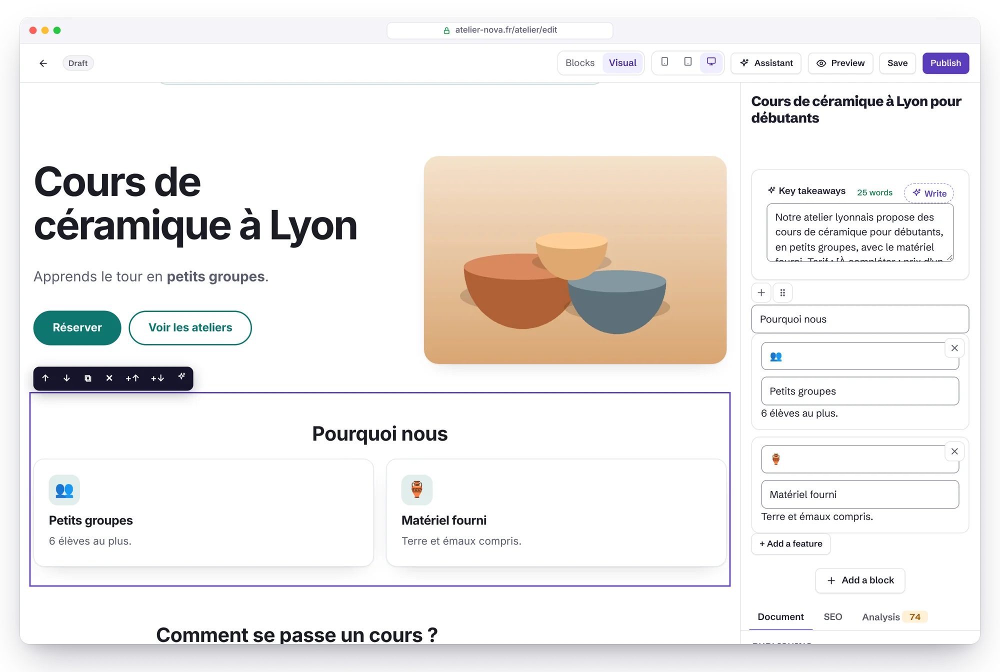
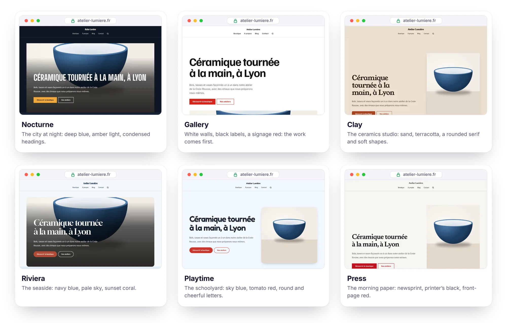
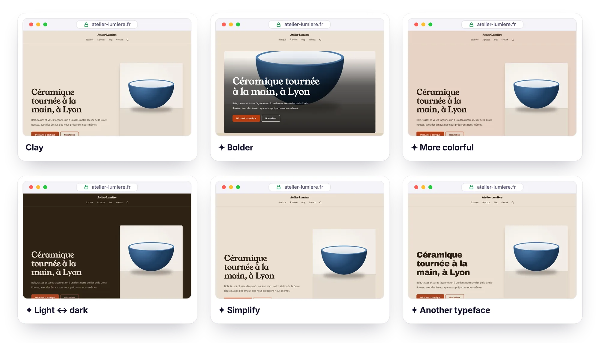
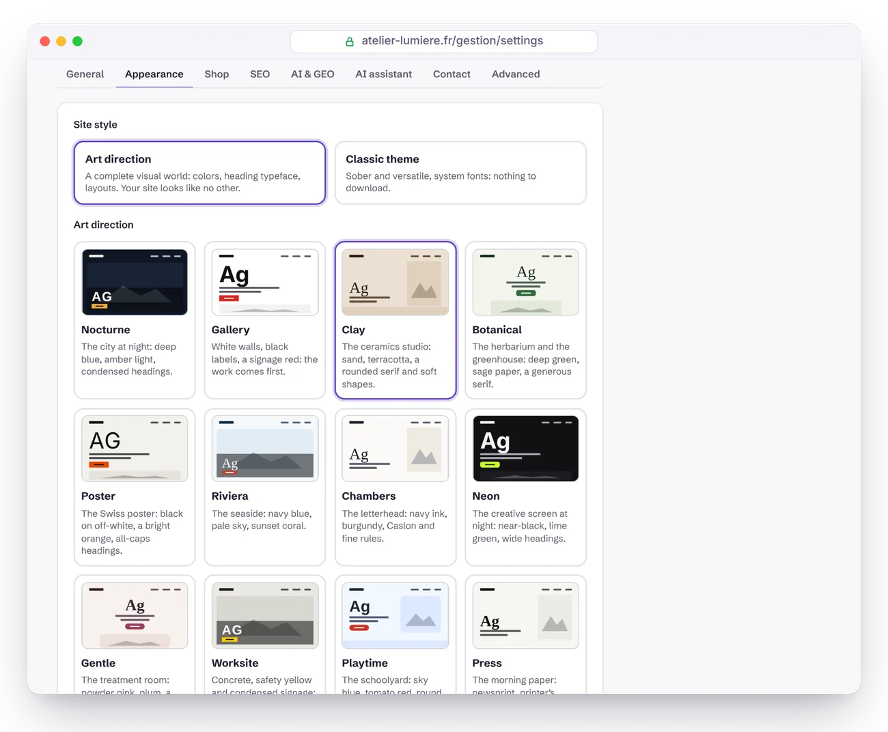

<p align="center">
  <a href="GUIDE.md">Français</a> · <b>English</b> · <a href="GUIDE.es.md">Español</a> · <a href="GUIDE.de.md">Deutsch</a> · <a href="GUIDE.it.md">Italiano</a> · <a href="GUIDE.pt-BR.md">Português</a> · <a href="GUIDE.zh-CN.md">简体中文</a>
</p>

# Éclair CMS guide

Everything you need to know to install, use, secure and maintain Éclair. For the overview, go back to the [README](../README.en.md).

## Contents

1. [Installation](#installation)
2. [Features in detail](#features-in-detail)
3. [Everyday use](#everyday-use)
4. [Visual mode](#visual-mode)
5. [Art directions](#art-directions) (including [One-click tweaks](#one-click-tweaks), [Imagine my direction with AI](#imagine-my-direction-with-ai) and the [Design score](#design-score))
6. [Themes](#themes)
7. [Shop](#shop)
8. [AI assistant](#ai-assistant) (including [Create a page with AI](#create-a-page-with-ai))
9. [MCP connector (Claude and ChatGPT)](#mcp-connector-claude-and-chatgpt)
10. [Security](#security)
11. [Updating, backing up, moving](#updating-backing-up-moving) (including [One-click update](#one-click-update) and [Google Drive backups](#google-drive-backups))
12. [Troubleshooting](#troubleshooting) (including [Nginx](#nginx))
13. [For developers](#for-developers)

---

## Installation

### Requirements

- **PHP 8.1 or later** (8.3 recommended), with the `mbstring`, `json`, `dom`, `session` and `zlib` extensions (enabled by default almost everywhere).
- Recommended: `gd` (WebP images), `zip` (one-click backups), `curl` (IndexNow, AI assistant, art direction fonts).
- An **Apache or LiteSpeed** server (virtually every shared host: Hostinger, IONOS, OVHcloud…). For Nginx, see [below](#nginx).
- An HTTPS certificate (free with Let's Encrypt at almost every host).

The wizard checks all of this for you and explains what to fix.

### Steps

1. Download the [`eclair-cms-1.10.2.zip`](https://github.com/Jacckisback/eclair-cms/raw/main/dist/eclair-cms-1.10.2.zip) archive (602 KB) and unzip it.
2. Upload **the contents of the `eclair` folder** to your hosting's public folder (`public_html`, `www`…) with your FTP client (FileZilla…) or your host's file manager.
   > ⚠️ `.htaccess` files are hidden: turn on “Show hidden files” to make sure they get uploaded.
3. Open your site's URL: **the setup wizard starts** (in 7 languages).
4. Answer 4 questions (your site, your account, your visibility, your admin URL). Confetti 🎉: your site is live, with pages and a sample post.

> 🔒 For security, the installation must be completed **within 2 hours** of the first visit (otherwise anyone could take over a site that was uploaded and then forgotten). After that, delete the `data/install-window.php` file via FTP and reload the page.

Installing in a subfolder (`example.com/site/`): just upload the files to that subfolder, everything is detected automatically.

### The 4 site types

| Type | What gets created |
|---|---|
| 🏢 Business website | Home (hero, features, latest posts), Services (with FAQ), About, Contact, Blog, legal notice, privacy policy |
| ✍️ Blog | Home = latest posts, About, Contact, a “Guides” category, legal pages |
| 🧑‍💻 Freelancer / portfolio | Home in your name, skills, About, Blog, Contact, legal pages |
| 🎯 Landing page | A sales page (hero, features, FAQ, form) + legal pages, no blog |

Starter content is available in English, French and Spanish; a site in German, Italian or Portuguese starts with the English content. The legal pages contain an outline to complete (French LCEN, Spanish LSSI, GDPR).

### Right after installation

The dashboard shows a “Getting started” checklist: logo and color, home page, first post, author profile, two-factor authentication, legal notice, Google Search Console. The next step is highlighted in yellow, and each one says in a sentence why it matters.

---

## Features in detail

### ⚡ Speed

- **Automatic static cache**: each page is generated once, then served without loading the application. The cache clears itself on every change (and at the scheduled time for a scheduled post).
- **CSS inlined in the page** (17 to 23 KB depending on the theme and whether the shop is open, 5 to 6 KB compressed), system fonts: no render-blocking requests, no layout shift. With an art direction, a single heading font is added on top (12 to 27 KB), served by your site and preloaded.
- **Images optimized on upload**: resized (2000 px max), available as **responsive WebP** (480, 800, 1200, 1600 px), explicit dimensions, lazy loading, priority given to the main image.
- ETag and `304 Not Modified` responses, Brotli/Gzip compression and one-year browser caching for static files (via `.htaccess`).

### 🔎 SEO

- Clean URLs, **automatic 301 redirect** when an address changes, redirect manager (handy for taking over an old WordPress or Wix site).
- Title, meta description and **live Google preview** in the editor, with counters.
- **Real-time SEO analysis** with a score: title and description length, keyphrase (title, URL, introduction, subheadings, density), word count, structure, alt text, internal linking, featured image…
- Complete **JSON-LD structured data**: WebSite (+ search), Organization / Person / LocalBusiness (address, opening hours, social profiles, return policy), WebPage / AboutPage / ContactPage, BlogPosting (author, dates, section), BreadcrumbList, FAQPage, ProfilePage, and for the shop, Product / ProductGroup / Offer (price, stock, shipping).
- XML sitemap with images and `hreflang`, robots.txt, full RSS feed, Open Graph and Twitter Cards (**1200×630 share image generated automatically**), breadcrumbs, canonical URLs.
- One address per piece of content: redirects for HTTPS, www/non-www, trailing slash, uppercase, `index.php`.
- **IndexNow**: Bing, Yandex, Seznam… are notified every time you publish.
- Google Search Console and Bing Webmaster Tools verification (paste the `<meta>` tag, Éclair extracts the code).
- Multilingual: language per piece of content, linked translations and automatic `hreflang` tags.
- Automatic French typography for French content (non-breaking spaces before `: ; ! ?` and inside « » quotes).

### 🤖 GEO (AI answer engines)

- **`/llms.txt`** (llmstxt.org standard) and **`/llms-full.txt`** generated automatically.
- **A Markdown version of every page**: add `.md` to any URL (with a metadata header, `noindex` and a canonical URL so it never creates duplicate content).
- **One-click AI bot policy**: open (recommended to get cited), citations only (answer engines allowed, training refused) or closed. Covers GPTBot, OAI-SearchBot, ChatGPT-User, ClaudeBot, Claude-SearchBot, Claude-User, PerplexityBot, Google-Extended, Applebot-Extended, CCBot, Meta-ExternalAgent… Optional `Content-Signal` directive.
- **“Key takeaways”** block: the summary AI likes to quote, shown at the top of the article.
- **GEO score** in the editor: summary, direct introduction, FAQ, question-style subheadings, lists and tables, concrete figures, external sources, identified author (E-E-A-T), short paragraphs, freshness.
- Author pages with a bio and profiles (`sameAs`), visible publication and update dates.

### ✍️ Block editor

- 18 blocks: text, subheading (H2-H4), list, quote, image, callout, FAQ, table, button, YouTube/Vimeo video (no cookies until clicked), code, separator, hero, features, team (portraits, roles, bios), latest posts, products (shop showcase), contact form.
- Type **`/`** on an empty line to pick a block, drag and drop, formatting toolbar (bold, italic, link, code, highlight).
- **Assisted internal links**: as you type a link, the editor suggests your pages and posts (internal linking in 2 seconds).
- **Smart paste** from Word, Google Docs or a web page: headings, lists, tables and bold text become clean blocks.
- `Ctrl+S` to save, local backup draft (nothing is lost if the connection drops), real preview before publishing, **history of the last 20 versions**, scheduled publishing.
- **Visual mode**: the page as it actually looks with your theme, editable right there ([details](#visual-mode)).

### 🧩 Everything else

Media library (drag and drop, alt text, detection of images in use), drag-and-drop menus (header and footer), “pillar” categories for a topic cluster, site search, spam-proof contact form **without a captcha** (honeypot field, token, limits per network and per day) with an inbox, administrator and editor accounts, 6 themes and 12 art directions with live preview, automatic dark mode, 6 system font stacks, main color with guaranteed WCAG contrast, admin in 7 languages (English, French, Spanish, German, Italian, Portuguese, Chinese), public site in 6 languages (fr, es, en, de, it, pt).

---

## Everyday use

| I want to… | Where |
|---|---|
| Write a post | Dashboard › **Write a post** |
| Ask the AI for a post, a page, an image | **“What do you want to create today?”** field on the dashboard, or **✨ AI assistant** (`Ctrl+J`) |
| Have the AI compose a complete page | New page › **✨ Create with AI** |
| Edit a page as it actually looks | Editor › **Visual** |
| Edit a page from the site | **✏️ Edit** button (visible only when you're logged in) |
| Change the theme, logo, color, fonts | Settings › Appearance |
| Add my own CSS | Settings › Appearance › Custom CSS |
| Open the shop | Settings › Shop |
| Add a product | Content › **+ Product** |
| Choose the home page | Settings › General |
| Allow or block AI | Settings › AI & GEO |
| Turn on the AI assistant | Settings › AI assistant |
| Connect Google Search Console | Settings › SEO |
| Add a link to the menu | Menus |
| Redirect an old URL | Redirects |
| Turn on two-factor authentication | My profile › Two-factor authentication |
| Download a backup | Security › Backup |

Editor shortcuts: `/` insert a block · `Ctrl+S` save · `Ctrl+K` link · `Ctrl+B` bold · `Ctrl+I` italic · `Enter` new paragraph · `Shift+Enter` line break · `Ctrl+J` AI assistant.

---

## Visual mode

<p align="center">
  
</p>

Visual mode displays your page with the site's real theme, exactly as your visitors will see it, and lets you edit it right there. Switch between **Blocks** and **Visual** at the top of the editor: your choice is remembered for next time.

- **Write**: click a heading, a paragraph, a FAQ question, a button's text… and type. `Ctrl+B` bold, `Ctrl+I` italic, `Ctrl+K` link (the editor's page search opens). `Enter` confirms a single-line field; in a paragraph, it creates the next paragraph (`Shift+Enter` for a simple line break). Pasted content comes in as plain text.
- **Arrange**: clicking a block outlines it and shows its toolbar: ↑ ↓ to move it, ⧉ to duplicate it, ✕ to delete it, +↑ and +↓ to add a block above or below. The toolbar also works with the keyboard (`Tab`, then `Enter`).
- **Images**: click an image (hero, image block, team portrait, a post's featured image) to choose another one from the media library.
- **Block settings**: the right-hand panel shows the selected block's form (a button's link, number of posts, new FAQ question…), followed by the Document, SEO and Analysis tabs.
- **✨ AI touch-ups** (if the assistant is turned on): improve, fix, shorten, expand, simplify, change the tone or translate the block's text.
- **Undo**: `Ctrl+Z` (`Cmd+Z` on a Mac) goes back one step at a time (up to 50 steps).
- **Width**: 📱 390 px, ▭ 768 px or 🖥 full width, to check how it looks on mobile and tablet.

Everything goes through the usual editor: saving (`Ctrl+S` also works inside the page), local backup draft, version history, live SEO and GEO analysis. The page's links, buttons and forms don't respond while you're editing. A block that's invisible on the site (image not chosen yet, shop closed…) appears as a dotted frame, which you fill in from the panel.

> [!NOTE]
> Visual mode only exists in the admin preview: login, security token and write permission required, and the page is never cached or indexed. Your public pages bear no trace of it: they stay identical down to the byte.

---

## Art directions

<p align="center">
  
</p>

A theme changes colors; an **art direction** changes the site's entire visual world, starting from a concrete idea: the city at night, the ceramics studio, the morning paper. In **Settings › Appearance**, choose **Art direction** (instead of **Classic theme**), click one of the 12 cards and watch the live preview: your real site, on desktop or mobile. Nothing is published until you save.

| Direction | Visual world | Heading typeface |
|---|---|---|
| **Nocturne** | The city at night: deep blue, amber light | Big Shoulders Display, all caps |
| **Gallery** | White walls, black labels, a signage red | Familjen Grotesk |
| **Clay** | The ceramics studio: sand, terracotta, soft shapes | Young Serif |
| **Botanical** | The herbarium and the greenhouse: deep green, sage paper | DM Serif Display |
| **Poster** | The Swiss poster: black on off-white, bright orange | Archivo Black, all caps |
| **Riviera** | The seaside: navy blue, pale sky, coral | Gloock |
| **Chambers** | The letterhead: navy ink, burgundy, fine rules | Libre Caslon Display |
| **Neon** | The creative screen at night: near-black, lime green | Unbounded |
| **Gentle** | The treatment room: powder pink, plum, plenty of air | Cormorant Garamond |
| **Worksite** | Concrete, safety yellow, condensed signage | Barlow Condensed, all caps |
| **Playtime** | The schoolyard: sky blue, tomato red, round letters | Fredoka |
| **Press** | The morning paper: newsprint, front-page red | Newsreader |

**Adjust**: below the cards, **Adjust the direction** opens every setting, to mix and match freely:

- **5 colors**: background, bands and cards, text, secondary text, accent (buttons and links).
- **Heading font**: 18 typefaces chosen for their personality (none of the ones you see everywhere), or a system font. **Body font**: a system font, nothing to download.
- **Heading case** (normal or capitals), **heading size** (subtle, balanced, dramatic), **corners** (square, softened, round), **spacing** (compact, normal, airy).
- **Cards**: thin border, flat color or drop shadow.
- **Home banner**: text and image side by side, image on the left, poster (very large title), full-bleed image (the title over the photo), editorial (portrait image), centered or framed (text and image in a colored panel).
- **“Features” block**: cards, rows, ruled columns or numbered (01, 02…). **Sections**: plain background, color bands or rules between sections. **Feature icons**: line icons (65 line-drawn icons, recognized from common emoji: ☕ 🚗 🐶 ✂️ 🎓 💼 🌸…), no icon, or emoji.
- **Buttons**: solid, outline or underlined links (with an arrow).

The header, post lists, logo, site icon, footer and Custom CSS are set just as before. To go back to the classic theme, choose **Classic theme** and save: its settings are waiting for you, untouched.

**Always readable**: whatever colors you choose, Éclair automatically adjusts the text (**7:1** contrast against the background), the secondary text, links and buttons (4.5:1), including on backgrounds tinted with the accent color (badges, menu, highlighting). So a color that's too pale for text on a light background gets darkened just enough.

**Always fast**: the heading font is **downloaded only once, by your server** (from Fontsource, under the SIL Open Font License), stored in `media/fonts/`, then served by your site and preloaded with `font-display: optional`: no requests to a third-party service for your visitors, no layout shift. Only the CSS rules your direction needs are inlined in the page, and the automatic dark mode gives way to the direction's own light or dark choice. Measured with Lighthouse: 100 in all four categories with Nocturne, Riviera, Press and Poster, and with the new layouts (banner with the image on the left or framed, numbered features, rules between sections, outline or underlined-link buttons).

> [!TIP]
> If your host blocks outgoing connections, the font can't be downloaded: a message lets you know, and in the meantime the site uses a fallback font from the same family (serif, condensed…). Try again later by saving again.

### One-click tweaks

<p align="center">
  
</p>

Below the cards, six buttons transform the chosen direction in a single click, and the preview updates instantly:

| Tweak | What changes |
|---|---|
| **Bolder** | larger headings, more air, a more dramatic banner (poster, then full-bleed image), color bands, a more vivid accent, solid buttons |
| **Quieter** | subtler headings, normal case, thin borders instead of shadows, a calmer banner, a softer accent |
| **More colorful** | background and bands tinted with the accent color, color bands, a more vivid accent |
| **Simplify** | thin borders, no icons, plain background, more air, squarer corners, features in columns |
| **Light ↔ dark** | inverts the lightness of the background, bands and text, keeping their hues |
| **Another typeface** | moves to the next heading typeface, alternating families (serif, grotesque, condensed…) |

Tweaks stack up; **Undo tweak** goes back one step at a time. Contrast stays guaranteed at every step, and nothing is published until you save.

### Imagine my direction with AI

<p align="center">
  
</p>

When the [AI assistant](#ai-assistant) is turned on, **Imagine my direction with AI** appears below the cards. Describe your business, your audience and the mood you're after in one or two sentences (“organic neighborhood bakery in Lyon, family customers, warm but modern”), then click **Suggest 3 directions**. The AI also reads your site's description and your editorial profile, and follows the method of [Impeccable](https://github.com/pbakaus/impeccable):

1. start from the concrete world of the business (places, materials, objects, light) rather than from adjectives;
2. give each suggestion **a precise reference** (“the enamel signs of a 1950s bakery”) and derive the colors, typeface and layouts from it;
3. suggest three **genuinely different** directions (light or dark, warm or cool, serif or sans serif);
4. avoid the category's default choice (navy and gold for a lawyer…), its predictable opposite and the tics of “AI-generated design”.

The three suggestions appear first among the cards, marked ✦: click one to see it in the preview, adjust it, then save the one you like. The AI only picks from Éclair's settings (colors, fonts from the list, layouts) and never writes CSS: each suggestion is checked and its contrast corrected before it reaches your site. The estimated cost is shown below the button (≈ $0.03 with Claude Sonnet 5.5) and is taken from the assistant's budget. Administrators only.

### Design score

In the editor, the **Analysis** tab shows a third ring, **Design**, next to SEO and GEO. It checks that the page holds up visually:

- **subheadings**: a hierarchy without gaps (H2, then H3, then H4), short, no decorative emoji;
- **banner**: a short title (8 words at most, 6 in all caps), a call-to-action button, an image if your direction requires one (full-bleed, editorial);
- measured **calls to action** (3 buttons at most);
- a **“Features” block** with 3 to 6 described items, and icons that have a line-drawn equivalent;
- **text**: no sentences in ALL CAPS, no empty buzzwords (“seamless”, “cutting-edge”, “clé en main”… depending on the page's language), no overuse of em dashes, no passage repeated word for word, no wall of more than 350 words without a subheading, image or list;
- an **art direction** chosen for the site.

The Analysis tab's score is now the average of the three rings.

---

## Themes

Éclair comes with **6 themes**. Pick one in **Settings › Appearance**: the **live preview** shows your real site (home page, blog, a post, the shop, a product) on desktop or mobile, and nothing is published until you save. You can click around in the preview: links stay inside the preview.

| Theme | Look and feel | Best for |
|---|---|---|
| **Éclair** | Clean, modern and versatile: the original theme | Any kind of site |
| **Editorial** | Magazine style: serif typography, fine rules, drop cap, featured post | Blogs, media outlets, authors |
| **Atelier** | Warm and handcrafted: cream and terracotta tones, soft shapes | Craftspeople, restaurants, wellness |
| **Studio** | Minimalist portfolio: black and white, big headlines, frameless images | Photographers, designers, agencies |
| **Shop** | Built to sell: square photos, sticky header, bold buttons | Shops, makers |
| **Contrast** | Maximum readability: large text, strong contrast, underlined links | Public services, nonprofits, seniors |

Choosing a theme applies its recommended color and fonts: you can change them later. Two layout settings round out the theme: the **header** (logo on the left and menu on the right, or everything centered) and the **post and product lists** (card grid, or a list with the image on the left).

**Why it stays light**: an Éclair theme is just a 1.5 to 3 KB stylesheet, added to the base one. The HTML doesn't change from one theme to another: speed, accessibility, structured data and SEO stay exactly the same. Only the active theme is inlined in the page, and the automatic dark mode works with each of them.

**Custom CSS**: to go further than the theme (a button color, spacing, a block style), paste your rules into **Settings › Appearance › Custom CSS**. They are added after the theme on every page, so they take precedence, and they are stored with your data (`data/`): **Éclair updates keep them**. The `/*dark*/ … /*/dark*/` markers work too: their rules disappear when dark mode is set to “Always light”. For safety, the `<` character and `@import` rules are removed; 64 KB max.

---

## Shop

The **lightweight shop mode** lets you sell a few dozen products without the overhead of a full e-commerce platform: no cart, no customer accounts, no database, no payment details on your server. Each product gets its own page, optimized for Google and AI, and its **Buy now** button leads to a **Stripe, PayPal or Revolut Business payment link**: your payment provider collects payments, sends receipts and handles refunds.

### Open the shop

1. **Publish your legal notice** (the installation created an outline for you to complete) **and your terms of sale**. The shop won't open without them. Have them reviewed: as the seller, you're legally responsible for them.
2. In **Settings › Shop**: select these two pages, then set the currency, the shipping cost and delivery time, the shipping countries and the return window (in the EU, distance selling comes with a withdrawal period of at least 14 days, with some exceptions such as personalized products).
3. Click **Create the thank-you page**: Stripe can send your customers back there after payment.
4. Turn on **Shop open**, save, then add the shop to the menu (Menus › Shop).

The catalog is at `/shop` (`/boutique`, `/tienda`, `/negozio` or `/loja` depending on the site's language), and you can change it; if you do, old URLs are redirected.

### Create a product page

Content › **+ Product**. The product page fields are at the top of the editor:

- **Price** and **compare-at price** (optional: the discount is shown as a percentage), **availability** (in stock, sold out, pre-order).
- **Payment link**: the product's Stripe, PayPal or Revolut Business link.
- **Photos**: the first one is the main one (Google, social media); aim for at least 3 views.
- **Variants** (size, color…): each one can have its own price and link. On the site, choosing a variant works without JavaScript.
- **Google Shopping details**: brand, SKU, barcode (GTIN/EAN), condition (new, used, refurbished), digital product or service (no shipping).

Below that, describe the product with the usual blocks, and file it in a **product category** (Categories › “It contains: Products (shop)”). The SEO analysis also checks the price, the payment link, the number of photos and the identifiers. To feature products on a page, add the **Products** block.

With the AI assistant: attach a photo and ask “Create a product page from the attached photo. Price: €29.90.” It writes a complete draft, but **never makes up a price, a discount or a payment link**: you fill in whatever is missing.

### Connect Stripe (Payment Links)

1. In Stripe, open **Payment Links** and create a link: product, price, and shipping address collection if needed.
2. In the **After the payment** tab, choose to redirect customers to your thank-you page (its URL is shown in Settings › Shop).
3. In Stripe's settings (**Customer emails**), turn on receipts for successful payments.
4. Copy the link and paste it into the product page. Éclair adds the product reference to it (`client_reference_id`): each payment shows what was bought.

You receive each order in Stripe (and by email, if you've turned that on): you pack and ship, and Stripe handles refunds if needed. Another payment provider works too, as long as its payment link starts with `https://`.

### Or connect PayPal or Revolut Business

Same idea: one fixed-price payment link per product (or per variant with a different price), pasted into the product page. Éclair recognizes these links and shows “Secure payment with PayPal” or “with Revolut” under the buy button.

- **PayPal**: in your business account, open **Payment links and buttons**, create a fixed-price link for your product, then copy it (it starts with `https://www.paypal.com/`). Your customer pays with their PayPal account or by card.
- **Revolut Business**: you need a merchant account. In **Merchant › Payment link**, create a link with the product's amount, then copy it (`https://checkout.revolut.com/…`). Your customer pays on Revolut's payment page.

Two differences from Stripe: after paying, the customer stays on the provider's confirmation page (no automatic return to your thank-you page), and the product reference isn't added to the payment: give each link a clear name so you can recognize your orders.

### What's built in for Google and AI

- Product and Offer **structured data** on every product page (ProductGroup for variants): price, currency, stock, condition, brand, shipping cost and delivery time, and a **return policy** set for your whole business. This is the information Google shows in product results.
- **Product feed** `/products.xml` in Google Merchant Center format: add it as a product source in Merchant Center to appear for free in the Shopping tab.
- Product categories as pillar pages, a sitemap with every photo, breadcrumbs.
- For AI: each product's price and availability in `llms.txt`, and in the Markdown version of each product page (add `.md` to its URL).

### How much does it cost?

Nothing on Éclair's side. Stripe charges no subscription or setup fee, and Payment Links are included: you only pay a fee per payment, for example **1.5% + €0.25** for a standard card from the European Economic Area (2.8% + €0.25 for a premium card, 3.15% + €0.25 for a card from outside the EEA, plus 2% if a currency conversion is needed). These are Stripe's prices in France, taken from [stripe.com/fr/pricing](https://stripe.com/fr/pricing) on October 30, 2026; they may change.

With **Revolut Business**, the fee is **1% + €0.20** for a consumer card from the European Economic Area (2.8% + €0.20 for a card from outside the EEA), payment links included ([Revolut help](https://help.revolut.com/en-ES/business/help/merchant-accounts/fees/how-much-does-it-cost-to-accept-card-payments/), [Revolut pricing](https://www.revolut.com/en-IE/business/accept-payments-pricing/)). With **PayPal** in France, it's **1.2% + €0.35** for a card payment and **2.9% + €0.35** with a PayPal account, plus 1.99% outside the EEA (1.29% from the UK) ([PayPal fees](https://www.paypal.com/fr/business/paypal-business-fees), updated July 15, 2026). Prices checked on October 31, 2026.

### What the shop doesn't do

No multi-product cart, discount codes, customer accounts or automatic inventory management: the idea is to keep things simple. If you sell hundreds of products or need those features, a full e-commerce platform (Shopify, WooCommerce, PrestaShop) will be a better fit. The prices shown are the ones you enter: display them with taxes included if you sell to consumers.

---

## AI assistant

The assistant writes drafts, improves your texts and creates images **in your site's voice**. You talk to it in plain language, as you would to a colleague: “Write an article about choosing brand colors, with an image.” It first checks whether the topic has already been covered, creates the image, writes the complete draft (title, Key takeaways, subheadings, lists or tables, FAQ, meta description, internal links), then shows it to you with its SEO and GEO scores. **Nothing is published without your click.**

It works with **Claude** (Anthropic) or **ChatGPT** (OpenAI), using your own API key: no Éclair subscription, you pay the provider directly, for what you actually use. Would you rather use your Claude or ChatGPT subscription? Go through the [MCP connector](#mcp-connector-claude-and-chatgpt).

### Turn on the assistant (5 minutes)

1. Create an API key with the provider of your choice: [console.anthropic.com](https://console.anthropic.com/settings/keys) for Claude, [platform.openai.com](https://platform.openai.com/api-keys) for ChatGPT, and add a few dollars of credit.
2. In **Settings › AI assistant**, choose the provider, paste the key, choose the model, then click **Test the connection** (free: no text is generated).
3. For images, choose a generator: **GPT Image 2.5** (same key as ChatGPT), **FLUX 3** ([dashboard.bfl.ai](https://dashboard.bfl.ai)) or **Ideogram 3** ([ideogram.ai](https://ideogram.ai/manage-api), ideal for visuals that include text). Without a generator, the assistant uses your media library and the photos you attach.
4. Click **Draft my profile from my site**, then review it, adjust it and save.

The assistant then appears in the menu (**✨ AI assistant**, `Ctrl+J`), in the editor and on the dashboard. Editors can use it too, if you allow it.

**Claude or ChatGPT, your choice**: save both keys and a selector appears at the top of the assistant so you can choose the AI for each conversation. Your choice is remembered for your account, editor touch-ups included; the provider chosen in the settings remains the default.

### The editorial profile

This is what makes the AI write **like you**: who you are and what you offer, who you're writing for, tone and style (formal or casual, sentence length, humor), values, rules to follow (“always link to the contact page”, “never mention prices”) and image style. One click drafts it from your pages and posts; you have the final say. With every request, the assistant also follows Éclair's analysis rules: its drafts aim for a high SEO and GEO score right from the start.

### What you can ask

- “Write an article about servicing an e-bike in spring, with an image.”
- “Add Léa Martin, art director, to the team page with the attached photo.” (attach the photo with 📎, by drag and drop or by pasting it)
- “Create an ‘Our services’ page that presents our three packages.”
- “Give me 5 article ideas to attract new customers.”
- “Review my home page and suggest improvements.”
- In the editor: “Add a FAQ to this article”, “Make the introduction punchier”.

Each action produces a **card** below the reply:

| Card | What happened | Your buttons |
|---|---|---|
| 📝 Draft | New post or new page, never published | Open · Preview · Publish now or schedule |
| ✏️ Suggested change | For **published** content: nothing changes until you approve | Preview · Apply · Dismiss, then Cancel if needed |
| ✅ Updated | A **draft** changed directly | Open · Preview · Cancel |
| ✅ Changed in the editor | The content you have open is changed in the editor | Cancel (then you save) |
| 🖼️ Image | Image created, optimized (WebP) and added to the media library | Featured image (in the editor) |

“Cancel” works as long as nobody has edited the content since; otherwise, its earlier versions are still in the editor's **Version history**. The assistant's history keeps your last 30 conversations. The assistant never makes up facts about your business (prices, opening hours, figures, testimonials): when information is missing, it leaves a visible placeholder such as **[To complete: price]** and points it out to you; the Analysis tab counts them as long as any remain.

### Create a page with AI

In a new piece of content (page, post or product), the **✨ Create with AI** box composes a complete draft in a single call:

1. Choose the type and the language, then describe what you want in one or two sentences. If you like, add the **goal** (“get quote requests”), the **audience**, the **tone** and the **sections** you want (“banner, benefits, pricing, FAQ, contact”).
2. The **estimated cost** is shown before you start (≈ $0.08 with Claude Sonnet 5.5, ≈ $0.16 with Claude Opus 5.5); it's taken from the assistant's budget. If you've saved both keys, you choose Claude or ChatGPT.
3. After 20 to 60 seconds, the draft opens in **Visual mode**: title, URL, SEO title and meta description, “Key takeaways”, focus keyphrase and a layout in sections (hero, features, subheadings, lists, callouts, FAQ, buttons, team, contact form, latest posts or products), with a single H1: the hero's title.

The AI relies on your editorial profile, the list of your published pages and posts (so that links point to pages that exist) and your 30 latest images. It makes up no facts: missing prices, figures, names or opening hours stay in the form **“[To complete: …]”**, counted by the Analysis tab until you fill them in. The draft is never published: review it, complete it, then publish it.

### Touch-ups in the editor

- **Select a passage**, then click ✨ in the formatting toolbar: improve, fix mistakes, shorten, expand, simplify, warmer, more professional, translate. A click on “Cancel” restores the text.
- **Key takeaways**: “Write” button.
- **SEO tab**: SEO title and description, focus keyphrase, title ideas.
- **Analysis tab**: add a FAQ, missing alt texts, “Improve with the assistant”.
- **Featured image**: “Create with AI” (posts).
- **Media library**: “Describe with AI” writes an image's alt text by looking at it.

### How much does it cost?

You pay the provider for what you actually use. Éclair calculates each expense from the billed tokens and shows it in Settings › AI assistant. Estimate for a full post (about 25,000 input tokens and 7,000 output tokens, searches and checks included):

| Model | Price per million tokens (input / output) | Full post |
|---|---|---|
| Claude Opus 5.5 (the most capable) | $4 / $20 | ≈ $0.24 |
| Claude Sonnet 5.5 | $2 / $10 | ≈ $0.12 |
| Claude Haiku 5.5 | $0.10 / $0.50 | < $0.01 |
| GPT-6 Astra | $10 / $50 | ≈ $0.60 |
| GPT-6.1 Sol | $2 / $10 | ≈ $0.12 |
| GPT-6.1 Terra | $1 / $5 | ≈ $0.06 |
| GPT-6 Luna | $0.10 / $0.50 | < $0.01 |

An image costs about $0.05 (FLUX 3 at 1 megapixel: $0.048). Public prices taken from the official pages of [Anthropic](https://platform.claude.com/docs/en/about-claude/pricing), [OpenAI](https://developers.openai.com/api/docs/pricing) and [Black Forest Labs](https://docs.bfl.ml/release-notes) on October 29, 2026; they may change. The assistant's fixed instructions are cached by the provider, which lowers the cost of follow-up requests.

**Safeguards**: a maximum monthly budget ($10 by default), checked before each step of a request: once it's reached, the assistant stops until the following month. There's also a limit on requests per person per day (60 by default), and each person can run at most two requests at a time. The budget and quota are set in Settings › AI assistant.

### Security and privacy

- **The AI prepares, you decide**: it can search and read your content, create drafts, edit a draft (undoable), suggest a change to published content and create images. It **cannot publish, delete, or touch the settings, menus or accounts**. Publishing always takes a human click.
- **Encrypted keys** on your server (libsodium, or AES-256-GCM), never sent to the browser, never displayed (only a hint like “sk-ant…ab12” is shown), **excluded from backups**, as is the conversation history. For stronger protection, add `define('ECLAIR_SECRET', 'a-long-secret-phrase');` to `eclair-config.php` (do this before saving your keys).
- **What goes to the provider**: your request, the images you attach, the editorial profile and the relevant context (the list of your pages and posts, the content open in the editor). Don't include sensitive data. According to their terms (checked on October 29, 2026), [Anthropic](https://www.anthropic.com/legal/commercial-terms) doesn't train its models on data sent through the API, and neither does [OpenAI](https://help.openai.com/en/articles/5722486-api-data-usage-policies) by default.
- **Sanitized content**: everything the AI writes goes through the same allowlist as the editor, and its edits only touch the visible text (never a link's URL). Generated images are downloaded over HTTPS from a verified public address, then re-encoded just like an upload.
- **Prompt injection**: content the AI reads is treated as data, never as instructions; and even if a booby-trapped page tried to hijack it, it could only prepare a draft or a suggestion, which you would see before anything takes effect.

### If the assistant doesn't respond

- **“API key rejected”**: the key was copied incompletely or has been revoked; paste it again and test the connection.
- **“Out of credit”**: top up your account with the provider.
- **“This month's AI budget is used up”**: raise the budget in Settings › AI assistant, or wait until next month.
- **The reply arrives all at once instead of streaming in**: your host's buffering is holding back the stream. Everything works, just without the “live” effect. On Nginx, add `fastcgi_buffering off;` to the PHP block.
- **“Can't reach…”**: your host blocks outgoing connections. Ask them to allow `api.anthropic.com` or `api.openai.com` (and the image generator you chose).
- **The assistant doesn't appear**: it needs the PHP cURL extension and encryption (sodium or openssl), available at almost every host; the setup wizard checks for them.

---

## MCP connector (Claude and ChatGPT)

Would you rather work in **Claude** or **ChatGPT**, with the subscription you already have? The MCP connector (*Model Context Protocol*, the open standard that connects AI assistants to tools) opens your site to them: they read your content, write drafts in your voice and prepare changes. **No API key, no cost for the site**: your subscription does the work. Just like with the built-in assistant, **nothing is published or deleted** without you.

### Turn on the connector (3 minutes)

1. Your site must use **HTTPS**: Claude and ChatGPT refuse any other URL.
2. In **Settings › AI assistant**, at the bottom of the page, turn on **Allow MCP connections**, save, then copy the **Connector URL** (`https://example.com/_eclair/mcp`).
3. Add it to your AI:
   - **Claude** (web and desktop app): *Customize › Connectors › Add › Add custom connector*, give it a name (“My site”), paste the URL, click **Continue**, keep the detected authentication settings, then click **Add**. On Team and Enterprise plans, an organization owner adds it; members then click **Connect**.
   - **ChatGPT** (on the web): *Plugins › + › Add custom MCP server*, give it a name, paste the URL under **Connection**, choose **OAuth** authentication, accept the warning, then click **Create as a plugin**.
4. A page on your site opens: log in if needed (two-factor authentication included), check the app and its return URL (`claude.ai` or `chatgpt.com`), then click **Allow**.

You're all set. Ask, for example: “Look at my site and give me 5 article ideas”, “Write a draft article about servicing an e-bike” or “Review my home page and suggest a more direct tagline”.

**Compatible plans** (checked on October 30, 2026):

| Plan | Read the site | Drafts and suggestions |
|---|---|---|
| **Claude** Free, Pro, Max, Team, Enterprise | ✅ | ✅ (Free: only one custom connector) |
| **ChatGPT** Business, Enterprise, Edu | ✅ | ✅ |
| **ChatGPT** Pro | ✅ | ❌ (read-only) |
| **ChatGPT**, other plans | not listed in OpenAI's help | |

Sources: [Claude help on custom connectors](https://support.claude.com/en/articles/11175166-getting-started-with-custom-connectors-using-remote-mcp), [OpenAI help on custom MCP servers](https://help.openai.com/en/articles/12584461-connecting-custom-mcp-servers-in-chatgpt) and [OpenAI documentation](https://developers.openai.com/api/docs/guides/custom-mcp-server). These plans change quickly: check in your app.

### What the AI can do

It starts with `get_site`, then uses the built-in assistant's tools, except image generation (paid with the site's key):

| Tool | What it does |
|---|---|
| `get_site` | site inventory (pages, posts, products, categories and their IDs), editorial profile, SEO and GEO rules |
| `search_content` · `get_content` | search for content, read it in Markdown |
| `find_media` | search for an image in the media library |
| `create_draft` | create a post, a page or a product page **as a draft**, in Markdown or in layout sections (hero, features, FAQ…) |
| `update_content` | edit a draft; for published content, prepare a **suggestion** |

Each draft comes back with a link to **open it in Éclair**; each suggestion, with a link that **applies it in the editor** without saving it: you review it, then you save (or you close it, and nothing changes). Claude and ChatGPT also ask for your approval before each write action, depending on their own settings.

### Connector security

- **Disabled by default**: as long as it is, none of its URLs respond.
- **OAuth 2.1**: PKCE required, automatic app registration without storing anything, return URL checked for an exact match.
- **Your explicit approval**, after you log in to your account (two-factor authentication included), on a page that never reveals your admin URL.
- **One-hour tokens**, renewed automatically and replaced at each renewal; after 60 days without use, you have to give your approval again. Only their hashes are stored, excluded from backups.
- **Revoke access**: one button per app in Settings › AI assistant. Turning off the connector cuts off all apps; so does changing your password or logging out all your devices.
- **Same permissions as the built-in assistant**: editors only have access if “Editors can use the assistant” is checked; at most 60 changes per hour per app, to prevent loops.
- **What goes to Anthropic or OpenAI**: the content the AI reads to answer you, under the terms of your subscription.

### If the connection fails

- **The AI can't reach the site, or authorization fails**: check that the site uses HTTPS and that the URL ends with `/_eclair/mcp`. On Apache, keep Éclair's `.htaccess` up to date: it passes along the authorization header, which some hosts strip.
- **Éclair is installed in a subfolder**: some apps look for authorization at the root of the domain. Install Éclair at the root of a domain or subdomain instead.
- **Firewall or bot protection** (Cloudflare…): let `/_eclair/` and `/.well-known/` through.
- **A suggestion no longer applies**: the content has changed since; ask the AI for the change again.

---

## Security

Éclair is built for a hostile environment (shared hosting, bots trying passwords around the clock). It went through an offensive security review (race conditions, brute force, redirects, injections, booby-trapped files): every vulnerability found was fixed, then the attack was replayed to prove it (`tests/run.php`).

**Data and server**
- **No database**: SQL injection is impossible.
- **Doubly protected data**: the `data/`, `app/` and `cache/` folders are blocked by `.htaccess`; every data file starts with `<?php exit; ?>` (even if a server ignored `.htaccess` files, nothing would be displayed) and no `<?php` sequence can ever be written into it. Private files (0600 permissions), atomic writes.
- **Signed updates**: each version's announcement carries an Ed25519 signature from the maintainer, verified with the public key built into Éclair; the archive is checked (fingerprint, paths, manifest, PHP syntax) before anything changes, and the update undoes itself if the site stops responding (details in [One-click update](#one-click-update)).
- **Protected installation**: it is only possible within 2 hours of the first visit, and the site address is only used to redirect visitors once it has been **verified by the server itself** (a wrong or tampered address hijacks nothing).

**Login**
- **Passwords** hashed with Argon2id (19 MiB, 2 passes: secure and bearable on shared hosting; bcrypt as a fallback), 10 characters minimum, common passwords refused.
- **Brute-force protection**: each attempt is reserved before it is checked (the limit cannot be exceeded with parallel requests); limits per network (IPv4 address or /64 block in IPv6) and per targeted account. **Your usual device is never locked out** by an attacker who fails on purpose. At most two password checks at a time: a flood of requests cannot exhaust the memory.
- **TOTP two-factor authentication** (Google Authenticator, 1Password, Bitwarden…) with a QR code and 8 recovery codes shown only once; each code works only once, even when sent in parallel; after 10 wrong codes, the account's 2FA is locked for 15 minutes and its owner is notified by email.
- **Accounts updated atomically**: a login in progress can never undo a password change, a global logout, enabling 2FA, a demotion or a deletion.
- **Password re-prompt** for sensitive actions (backups, connecting Google Drive, updates, account management, advanced settings, email change) more than 15 minutes after logging in. Temporary passwords must be replaced at first login.
- **Hardened sessions**: no session before login (bots can't fill the disk), `HttpOnly`, `Secure`, `SameSite=Strict` cookies, regenerated at login, logout after inactivity, bound to the browser, “Log out my other devices”. The admin is forced onto HTTPS as soon as the site uses it.
- **CSRF tokens** on every action and origin checks on requests.

**Public site**
- **Strict headers**: Content-Security-Policy (no inline scripts, SHA-256 hash for the style), anti-clickjacking, `nosniff`, `Referrer-Policy`, `Permissions-Policy`, optional HSTS. They depend on the settings, never on the request: the cache cannot be poisoned.
- **No open redirects**: crafted addresses (`/\example.com`, control characters…) return a 404.
- **Content sanitized** with an allowlist (the HTML is parsed and then entirely rewritten); `javascript:` and `data:` links are impossible, even disguised (`javascript&colon;`). The Markdown, `llms.txt` and RSS versions stay inert.
- **Contact form** without a captcha: honeypot field, token, 5 messages per network every 10 minutes and 100 per day for the whole site; the inbox is capped at 500 messages (spam goes first) and paginated.
- **Images re-encoded on upload** (removes hidden payloads and EXIF/GPS data); animated GIFs rewritten block by block; any image containing code is refused; 40 megapixels maximum; SVGs refused, no scripts or file listing in `/media`.

**Admin**
- **Customizable admin URL** (fewer bots), administrator / editor roles; the site's “Edit” button doesn't reveal that URL.
- **Tightly scoped Google Drive backups**: access limited to the files created by Éclair, encrypted and revocable token, never included in a backup; connecting requires confirming your password.
- **Bounded AI assistant**: drafts and suggestions only, API keys encrypted and excluded from backups, monthly budget and daily quota (details in [AI assistant](#security-and-privacy)).
- **Bounded logs** (truncated fields, 1 MB maximum): they can't be inflated.
- **Integrity check**: compares every file with its original fingerprint and flags suspicious files, including a `.php` file without the protection line in `data/` or `cache/`.
- **Live protection test**: the Security page checks from your browser that internal files really are inaccessible, and that the site address is verified.

---

## Updating, backing up, moving

### One-click update

Starting with version 1.10, Éclair checks GitHub twice a day for a new version. When there is one, a banner appears on the dashboard and a badge on **Updates** in the menu (administrators only). Nothing is installed without your approval.

1. Open **Updates**: you'll see the available version and a link to what's new in it.
2. **Make a backup**: use the button on the same page, or Google Drive if you've connected it.
3. Check “I have a recent backup of my site”, confirm your password if asked, then click **Update to …**. It takes about ten seconds.

Meanwhile, Éclair:

- downloads the archive from GitHub and verifies the **signature** of its announcement: every version is signed with the maintainer's private key (Ed25519), which is never on GitHub. So a hacked repository isn't enough to push code to your site;
- checks the archive's fingerprint, every file, and that your PHP version can read every PHP file, **before touching anything**;
- sets the old version aside (`cache/update/previous`) and installs the new one in an instant: only `app/`, `assets/`, `index.php` and `.htaccess` change. Your content, images, accounts, settings and custom CSS (`data/`, `media/`) stay untouched;
- checks that your site, your admin and the new version respond as before; if not, **it goes back on its own** to the old version.

Afterwards, **Roll back to the previous version** (same page) restores the old version in one click.

Good to know:

- A `.htaccess` that you've modified (or that your host has added to) is **kept**; the new template is saved in `cache/update/htaccess-<version>.txt` so you can compare them.
- Éclair files edited by hand (theme…) are replaced by their new version: the Updates page lists them before installing. For a lasting tweak, use **Custom CSS** (Settings › Appearance).
- If your host prevents the server from calling itself, Éclair installs the update without being able to check it, and tells you so: open your site to check it, and roll back if needed.
- One-click updates require the `sodium`, `zip` and `curl` PHP extensions, and folders that PHP can write to. Otherwise, the page explains what to fix, and you can still update via FTP.
- The automatic check can be turned off in Settings › Advanced (the “Check now” button stays available).

**Update via FTP** (server without one-click updates, or upgrading from a version older than 1.10):
1. Make a backup.
2. Via FTP, **delete** the `app/` and `assets/` folders, then upload the ones from the new version along with `index.php` and `.htaccess` (deleting first avoids leaving old files behind, which the integrity check would flag).
3. **Don't touch** `data/` (content, settings, accounts, custom CSS) or `media/` (images).
4. The cache clears itself on the first visit (otherwise: Settings › Advanced › Clear cache).

### Back up

**Download a backup**: Security › Download a backup, or from the Updates page. The ZIP archive contains `data/` (content, settings, accounts, messages) and `media/` (images). API keys and the Google Drive connection are never included. Without the zip extension, copy these two folders via FTP.

### Google Drive backups

Security › **Google Drive backups** sends a copy of your site to your Google Drive, every day, every week or whenever you like.

**The first time: your Google app.** To reach your Drive, your site needs a Google app in your name: it's free, takes about ten minutes to create, once, and only your site uses it. The Google Drive card shows the step-by-step guide, with a link to each screen:

- Create a project in the [Google Cloud console](https://console.cloud.google.com/projectcreate) and enable the **Google Drive API**.
- In **Google Auth Platform**: app name and your email address (audience “External”), the `…/auth/drive.file` scope, then **Publish app** (in testing mode, Google cuts off access after 7 days).
- Create a client of type **TVs and Limited Input devices**, then paste its **client ID** and **client secret** into the card. The secret is encrypted on your server.

Then, to connect your Drive:

1. Click **Connect Google Drive** (you may be asked for your password again).
2. Éclair shows a code. Open **google.com/device** on your computer or phone, enter the code, choose your Google account and authorize Éclair.
3. The page updates by itself: you're connected. Choose the frequency (every day, every week, or off) and how many backups to keep.

- Éclair only has access **to the files it creates** (Google's “drive.file” permission): it can't see anything else in your Drive. Backups go into a folder named “Éclair – site name”.
- Beyond the number you chose (8 by default), the oldest ones go to your Drive's **trash**.
- **Back up now** starts an upload right away. Large sites are sent in 4 MB chunks: if your host limits execution time, the upload resumes where it left off (keep the page open, it carries on by itself).
- Automatic backups run when an administrator opens the admin. To have them run even without a visit, copy the **scheduled task URL** (Security › Google Drive backups › Backups on a fixed schedule) into your host's scheduled task (cron) or into [cron-job.org](https://cron-job.org), to run every hour: it only starts a backup when one is due. Keep this URL to yourself.
- The access token is encrypted on your server. **Disconnect Google Drive** revokes it; you can also remove access from your Google account ([myaccount.google.com/connections](https://myaccount.google.com/connections)). Backups already sent stay in your Drive.

### Restore a backup

Unzip the archive, then via FTP replace your installation's `data/` and `media/` folders with the ones from the archive. Enter your API keys again (AI assistant) and reconnect Google Drive if you were using it.

### Move

To another host or domain: copy the whole folder, then change the address in Settings › General. Internal links adapt automatically, including in a subfolder.

---

## Troubleshooting

**Forgot your password (or lost your 2FA phone) and no other administrator?**
Via FTP, create a `data/reset.php` file containing exactly these three lines:

```
<?php exit; ?>
your-address@example.com
YourNewPassword2026
```

Within 24 hours, **log in with that email and that new password**: the password is replaced, two-factor authentication for that account is turned off, your other sessions are closed and the file is deleted automatically. Nobody else can trigger it (they would need to know its contents); a file without the first line is refused and deleted.

**The admin no longer loads after an update** (rare: Éclair goes back on its own when it can check the site): via FTP, replace the `app/` and `assets/` folders with the ones in `cache/update/previous/`, then copy `cache/update/previous/index.php.txt` to the root under the name `index.php`.

**“One-click update isn’t possible on this server”**: the Updates page says why (missing PHP extension, folder not writable, PHP version too old). Fix this with your host, or update via FTP.

**Google Drive: “Google Drive access revoked”**: the authorization was withdrawn from the Google account (or has expired). Click **Connect Google Drive**: the same folder is reused.

**“Installation locked”**: the 2-hour window after the first visit has passed. Delete `data/install-window.php` via FTP and reload the page.

**Site address not verified (Security page)**: your server can't call itself on the site's address (host firewall, DNS not propagated yet…). The site works normally, but without redirects to the official address (www / non-www). Click “Verify the site address” once the domain is in place.

**404 error on every page except the home page**: the `.htaccess` file wasn't uploaded (hidden file) or URL rewriting is disabled. If your host requires it, uncomment the `RewriteBase /` line in `.htaccess`.

**500 error right after uploading**: your host rejects a `.htaccess` directive (very rare: only directives accepted everywhere are used). Remove the block in question or contact your host.

**Images aren't converted to WebP**: the GD extension (or its WebP support) is missing. Enable it in your host's PHP panel; in the meantime, images stay in JPG/PNG.

**I don't receive emails from the contact form**: messages are also saved in the admin (Messages). Check the address in Settings › Contact; some hosts require the sender to belong to the domain.

**Debug mode**: create an `eclair-config.php` file at the root (see `eclair-config.exemple.php`) with `define('ECLAIR_DEBUG', true);`, then delete it once the problem is solved.

### Nginx

Éclair doesn't need `.htaccess` on Nginx, but these rules must be reproduced:

```nginx
location ~ ^/(app|data|cache)(/|$) { return 404; }
location ~ /\.(?!well-known/) { return 404; }
location ^~ /media/ {
    location ~* \.(php\d?|phtml|phar|s?html?|svgz?|xml|js)$ { return 404; }
    add_header X-Content-Type-Options nosniff;
    expires 1y;
}
location ~* \.(webp|avif|jpe?g|png|gif|ico|css|js|woff2)$ { expires 1y; add_header Cache-Control "public, immutable"; }
location / { try_files $uri /index.php$is_args$args; }
location = /index.php {
    include fastcgi_params;
    fastcgi_param SCRIPT_FILENAME $document_root/index.php;
    fastcgi_pass unix:/run/php/php-fpm.sock;
}
location ~ \.php$ { return 404; }
```

---

## For developers

```
eclair/                  ← upload this to your hosting
├── index.php            front controller (serves the cache without loading the application)
├── .htaccess            rewriting, protections, compression, browser caching
├── app/lib/             code (Eclair\… classes): Content, Blocks, Seo, Analyzer, Media, Auth…
├── app/admin/views/     admin screens (compressed as .php.gz in the archive)
├── app/theme/           public site templates + theme.css (inlined in every page)
├── app/theme/themes/    the 5 optional themes (one CSS file each, added to theme.css)
├── app/theme/directions.css  art direction CSS snippets (only those of the chosen direction go into the page)
├── app/lang/            admin translations (6 languages, compressed JSON) — the French text is the key
├── assets/admin/        admin CSS and JavaScript (no dependencies)
├── assets/site/site.js  the only public script (2.4 KB, 1.2 KB compressed)
├── data/                content, settings, accounts (created at installation, never public)
├── cache/               generated pages
└── media/               uploaded images (and media/fonts/: the art direction's font)
i18n/                    human-readable translation sources (compiled by tools/i18n.php)
tests/run.php            unit tests + HTTP integration (including the attacks from the security review)
tests/fake-ai.php        fake AI providers (Claude, ChatGPT, images): the assistant is tested with no key and no spending
tests/shop.php           themes and shop (product pages, Stripe, PayPal, Revolut, JSON-LD, Merchant Center feed)
tests/mcp.php            MCP connector (OAuth, PKCE, protocol, revocation) and choosing the AI
tests/design.php         art directions (contrast, CSS, fonts, booby-trapped settings, AI) and Design score
tests/update.php         one-click update (fake signed channel: signature, booby-trapped archive, syntax, automatic and manual rollback)
tests/drive.php          Google Drive backups (tests/fake-google.php: fake OAuth and fake Drive, chunked upload, resume)
tests/fixtures/          reference sites and a fingerprint of their public rendering (a new version doesn't change a single byte of the site)
tools/router.php         router for PHP's built-in server (development)
tools/capture.php        reference capture of the public rendering, and Lighthouse measurements (--lighthouse)
tools/build.php          integrity fingerprints + dist/eclair-cms-<version>.zip archive (compacted PHP, compressed admin views, minified admin JS and CSS) + signed dist/latest.json announcement
```

```bash
PHP_CLI_SERVER_WORKERS=4 php -S localhost:8000 -t eclair tools/router.php   # development server
php tests/run.php                                  # 609 unit and HTTP checks; ECLAIR_TEST_ROOT=… to test an unzipped archive
php tools/build.php                                # ready-to-ship archive
```

**Publishing a release.** `tools/build.php` signs the `dist/latest.json` announcement (version, URL, size and SHA-256 of the archive) with the maintainer's Ed25519 private key, read from the `ECLAIR_SIGNING_KEY` environment variable (base64, 64 bytes); it refuses a key that doesn't match the public key in `app/lib/Update.php`. The credentials of the Google app used for backups are written into the archive from `ECLAIR_GOOGLE_CLIENT_ID` and `ECLAIR_GOOGLE_CLIENT_SECRET` (client type “TVs and Limited Input devices” in the Google Cloud console, `drive.file` scope). None of these values are in the repository.

**Fork or self-hosted install.** In `eclair-config.php`: `ECLAIR_UPDATE_URL` and `ECLAIR_UPDATE_KEY` (base64) for your own signed update channel; `ECLAIR_GOOGLE_CLIENT_ID` and `ECLAIR_GOOGLE_CLIENT_SECRET` for your own Google app.

`PHP_CLI_SERVER_WORKERS` lets the site call itself (to verify its address): with a single process, the check simply fails and redirects to the official address stay disabled.

For a style change, prefer **Custom CSS** (Settings › Appearance): it survives updates. To go further, customize the theme by editing `app/theme/*.php`, `app/theme/theme.css` and `app/theme/themes/*.css` (keep a copy: the integrity check flags these files as modified, and an update replaces them; the Updates page lists them before it does). In the archive, the PHP is compacted (`php -w`, comments removed), the admin views are compressed (read through zlib) and the admin JavaScript and CSS are minified (the archive comes to about 530 KB): the commented sources are on GitHub. The public site's files (themes, `site.js`) ship as is.

---

Éclair is released under the [AGPL-3.0-only license](../LICENSE) (see [`NOTICE`](../NOTICE)). Some admin icons are derived from [Lucide](https://lucide.dev) (ISC license): see [`THIRD-PARTY-NOTICES.txt`](../THIRD-PARTY-NOTICES.txt).
