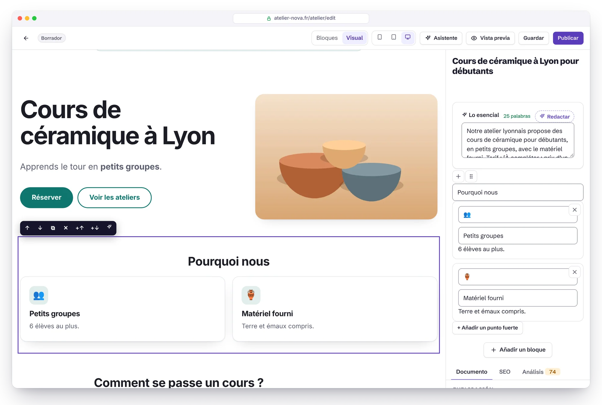
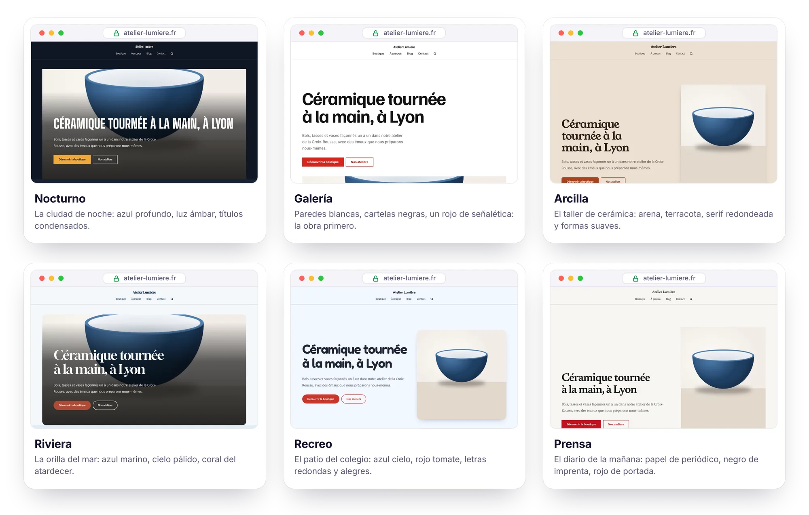
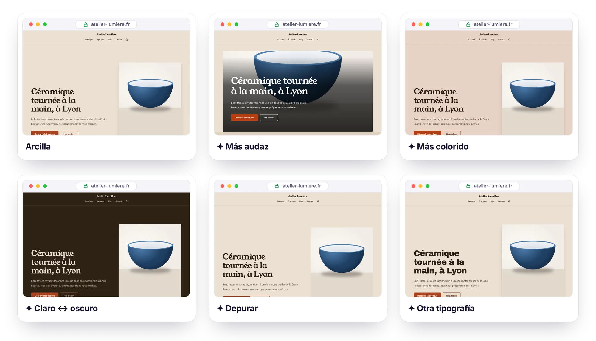
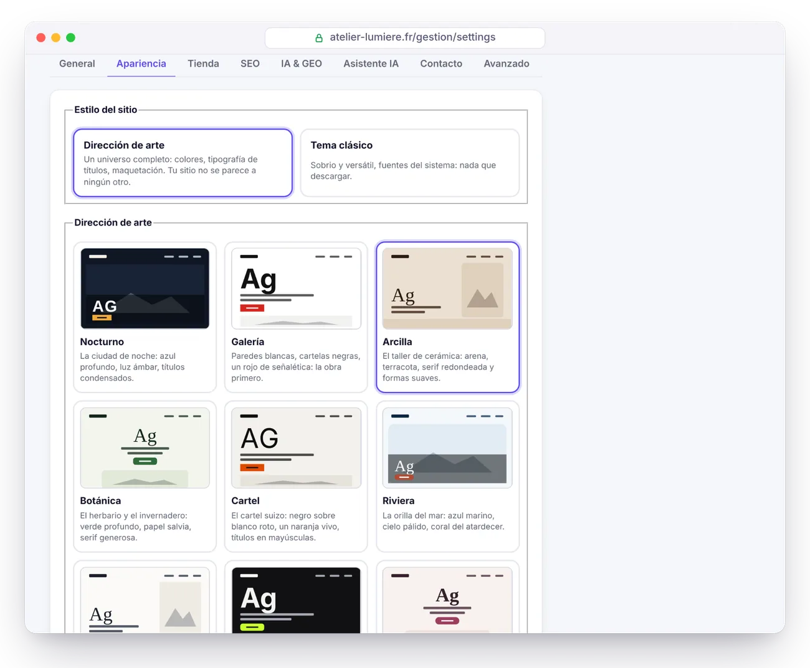

<p align="center">
  <a href="GUIDE.md">Français</a> · <a href="GUIDE.en.md">English</a> · <b>Español</b> · <a href="GUIDE.de.md">Deutsch</a> · <a href="GUIDE.it.md">Italiano</a> · <a href="GUIDE.pt-BR.md">Português</a> · <a href="GUIDE.zh-CN.md">简体中文</a>
</p>

# Guía de Éclair CMS

Todo lo que necesitas saber para instalar, usar, proteger y mantener Éclair. Para la presentación, vuelve al [README](../README.es.md).

## Índice

1. [Instalación](#instalación)
2. [Funciones en detalle](#funciones-en-detalle)
3. [Uso diario](#uso-diario)
4. [Modo Visual](#modo-visual)
5. [Direcciones de arte](#direcciones-de-arte) (incluidos los [Retoques en un clic](#retoques-en-un-clic), [Imagina mi dirección con la IA](#imagina-mi-dirección-con-la-ia) y la [Puntuación de diseño](#puntuación-de-diseño))
6. [Temas](#temas)
7. [Tienda](#tienda)
8. [Asistente IA](#asistente-ia) (incluido [Crear una página con IA](#crear-una-página-con-ia), el [Calendario editorial](#calendario-editorial), el [Sitio antiguo](#sitio-antiguo-wayback-machine), la [Afiliación](#afiliación) y [Google Discover](#google-discover))
9. [Conector MCP (Claude y ChatGPT)](#conector-mcp-claude-y-chatgpt)
10. [Seguridad](#seguridad)
11. [Actualizar, hacer copias de seguridad, mudarse](#actualizar-hacer-copias-de-seguridad-mudarse) (incluidas la [Actualización en un clic](#actualización-en-un-clic) y las [Copias de seguridad en Google Drive](#copias-de-seguridad-en-google-drive))
12. [Solución de problemas](#solución-de-problemas) (incluido [Nginx](#nginx))
13. [Para desarrolladores](#para-desarrolladores)

---

## Instalación

### Requisitos

- **PHP 8.1 o superior** (se recomienda 8.3), con las extensiones `mbstring`, `json`, `dom`, `session` y `zlib` (activadas por defecto casi en todas partes).
- Recomendado: `gd` (imágenes WebP), `zip` (copias de seguridad en un clic), `curl` (IndexNow, asistente IA, tipografía de las direcciones de arte).
- Un servidor **Apache o LiteSpeed** (casi todos los hostings compartidos: Hostinger, IONOS, OVHcloud…). Para Nginx, consulta [más abajo](#nginx).
- Un certificado HTTPS (gratuito con Let's Encrypt en casi todos los proveedores).

El asistente lo comprueba todo por ti y te explica qué corregir.

### Pasos

1. Descarga el archivo [`eclair-cms-2.1.0.zip`](https://github.com/Jacckisback/eclair-cms/raw/main/dist/eclair-cms-2.1.0.zip) (833 KB) y descomprímelo.
2. Sube **el contenido de la carpeta `eclair`** a la carpeta pública de tu hosting (`public_html`, `www`…) con tu programa FTP (FileZilla…) o con el gestor de archivos de tu proveedor.
   > ⚠️ Los archivos `.htaccess` están ocultos: activa «Mostrar archivos ocultos» para asegurarte de subirlos.
3. Abre la dirección de tu sitio: **arranca el asistente de instalación** (en 7 idiomas).
4. Responde 4 preguntas (tu sitio, tu cuenta, tu visibilidad, la dirección de tu panel). Confeti 🎉: tu sitio está en línea, con páginas y un artículo de ejemplo.

> 🔒 Por seguridad, la instalación debe hacerse **en las 2 horas** siguientes a la primera visita (si no, cualquiera podría apropiarse de un sitio subido y olvidado). Pasado ese plazo, borra el archivo `data/install-window.php` por FTP y recarga la página.

Instalación en una subcarpeta (`ejemplo.es/sitio/`): basta con subir los archivos a esa subcarpeta, todo se detecta automáticamente.

### Los 7 tipos de sitio

| Tipo | Lo que se crea |
|---|---|
| 🏢 Web corporativa | Inicio (portada, ventajas, últimos artículos), Servicios (con FAQ), Sobre nosotros, Contacto, Blog, aviso legal, política de privacidad |
| ✍️ Blog | Inicio = últimos artículos, Sobre nosotros, Contacto, categoría «Guías», páginas legales |
| 🧑‍💻 Freelance / portfolio | Inicio con tu nombre, habilidades, Sobre nosotros, Blog, Contacto, páginas legales |
| 🎯 Página única | Una página de venta (portada, ventajas, FAQ, formulario) + páginas legales, sin blog |
| 🧭 Medio / Google Discover | Como un blog (inicio = últimos artículos, Sobre nosotros, Contacto, páginas legales); el panel destaca Discover, las tendencias del día y la publicidad |
| 🛍️ Afiliación | Como un blog; el panel destaca tus enlaces de afiliado y los artículos redactados por la IA |
| 🕰️ Relanzar un sitio antiguo | Como un blog; el panel empieza por recuperar las direcciones antiguas de tu dominio (Sitio antiguo) |

Los contenidos iniciales existen en español, francés e inglés. Las páginas legales incluyen un esqueleto que completar (LSSI en España, LCEN en Francia, RGPD).

El tipo elegido se convierte en el **uso del sitio** (Ajustes › General, modificable en cualquier momento): el panel se abre con una tarjeta que reúne las herramientas de ese uso y su estado. No cambia nada en el sitio público.

### Justo después de la instalación

El panel muestra una lista de «Primeros pasos»: logo y color, página de inicio, primer artículo, perfil de autor, verificación en dos pasos, aviso legal, Google Search Console. El siguiente paso aparece resaltado en amarillo, y cada uno explica en una frase para qué sirve. Para un medio, un sitio de afiliación o un sitio antiguo, empieza por el paso propio de ese uso.

---

## Funciones en detalle

### ⚡ Velocidad

- **Caché estática automática**: cada página se genera una vez y después se sirve sin cargar la aplicación. La caché se vacía sola con cada cambio (y a la hora prevista para un artículo programado).
- **CSS integrado en la página** (de 17 a 23 KB según el tema y la tienda, de 5 a 6 KB comprimido), fuentes del sistema: ninguna petición bloqueante, ningún salto de diseño. Con una dirección de arte se añade una sola tipografía de títulos (de 12 a 27 KB), servida por tu sitio y precargada.
- **Imágenes optimizadas al subirlas**: redimensionadas (2000 px como máximo), disponibles en **WebP adaptable** (480, 800, 1200, 1600 px), dimensiones explícitas, carga diferida y prioridad para la imagen principal.
- ETag y respuestas `304 Not Modified`, compresión Brotli/Gzip y caché del navegador de un año para los archivos estáticos (mediante `.htaccess`).

### 🔎 SEO

- URL limpias, **redirección 301 automática** cuando cambia una dirección, gestor de redirecciones (práctico para migrar una web antigua en WordPress o Wix).
  - Las direcciones bajo `/.well-known/`, `/_eclair/` y `/__eclair/` no se pueden redirigir. Excepción: un administrador puede redirigir una dirección `/.well-known/…` como `change-password`, pero nunca `acme-challenge` ni `pki-validation`. Las redirecciones antiguas desde esas direcciones aparecen marcadas como «Desactivada» y se pueden eliminar (un administrador puede volver a crear las que están permitidas).
  - Seguir una redirección ya no ralentiza el sitio, y el número de usos sigue visible.
- **Traslado de un sitio WordPress completo** (función «Importar WordPress»): instala el plugin [Eclair Export](https://github.com/Jacckisback/eclair-export) en el sitio WordPress y sube aquí su paquete (o déjalo por FTP en `data/import/`). Se recuperan contenidos, imágenes, documentos PDF, SEO (Yoast, Rank Math, AIOSEO), menús y redirecciones; cada dirección se conserva o se redirige con un 301 y los enlaces internos se reescriben. **Simular** muestra lo que se creará sin escribir nada. Por SSH: `php app/bundled/wordpress/lib/cli.php import paquete.zip [--dry-run]`.
- Título, metadescripción y **vista previa de Google en directo** en el editor, con contadores.
- **Análisis SEO en tiempo real** con puntuación: longitud del título y de la descripción, frase clave (título, URL, introducción, subtítulos, densidad), número de palabras, estructura, textos alternativos, enlazado interno, imagen destacada…
- **Datos estructurados JSON-LD** completos: WebSite (+ búsqueda), Organization / Person / LocalBusiness (dirección, horario, perfiles sociales, política de devoluciones), WebPage / AboutPage / ContactPage, BlogPosting (autor, fechas, sección), BreadcrumbList, FAQPage, ProfilePage y, para la tienda, Product / ProductGroup / Offer (precio, stock, envío).
- Sitemap XML con imágenes y `hreflang`, robots.txt, feed RSS completo, Open Graph y Twitter Cards (**imagen para compartir de 1200×630 generada automáticamente**), migas de pan, URL canónicas.
- Una sola dirección por contenido: redirecciones de HTTPS, con o sin www, barra final, mayúsculas, `index.php`.
- **IndexNow**: Bing, Yandex, Seznam… reciben un aviso en cada publicación.
- Verificación de Google Search Console y Bing Webmaster Tools (pega la etiqueta `<meta>` y Éclair extrae el código).
- Multilingüe: idioma por contenido, enlace entre traducciones y etiquetas `hreflang` automáticas.
- Tipografía francesa automática para los contenidos en francés (espacios de no separación antes de `: ; ! ?` y dentro de las comillas « »).

### 🤖 GEO (motores de respuesta IA)

- **`/llms.txt`** (estándar llmstxt.org) y **`/llms-full.txt`** generados automáticamente.
- **Versión Markdown de cada página**: añade `.md` a cualquier URL (con cabecera de metadatos, `noindex` y URL canónica para no crear contenido duplicado).
- **Política de robots de IA en un clic**: abierto (recomendado para que te citen), solo citas (motores de respuesta permitidos, entrenamiento rechazado) o cerrado. Gestiona GPTBot, OAI-SearchBot, ChatGPT-User, ClaudeBot, Claude-SearchBot, Claude-User, PerplexityBot, Google-Extended, Applebot-Extended, CCBot, Meta-ExternalAgent… Directiva `Content-Signal` opcional.
- Bloque **«Lo esencial»**: el resumen que las IA citan con gusto, mostrado al principio del artículo.
- **Puntuación GEO** en el editor: resumen, introducción directa, FAQ, subtítulos en forma de pregunta, listas y tablas, cifras concretas, fuentes externas, autor identificado (E-E-A-T), párrafos cortos, actualidad.
- Páginas de autor con biografía y perfiles (`sameAs`), fechas de publicación y de actualización visibles.
- **Robots IA** (menú de la administración): qué IA leen tus páginas (ChatGPT-User, Claude-User, OAI-SearchBot, PerplexityBot, GPTBot, ClaudeBot…), cuáles y para qué: consulta a demanda (alguien hizo una pregunta, una cita en potencia), indexación de un motor de respuesta o entrenamiento. Visitas por día, por robot y por página, lecturas del robots.txt, páginas publicadas nunca leídas y qué hacer con ellas, aviso si los robots de entrenamiento pasan pese al robots.txt, y una tarjeta en el panel. `index.php` solo anota la hora, el robot y la dirección, nunca la IP ni visitantes humanos; registro limitado a 4 MB al mes y borrado tras 13 meses; medición desactivable en Ajustes › IA y GEO. La identidad es la que declara el robot.

### ✍️ Editor de bloques

- 18 bloques: texto, subtítulo (H2-H4), lista, cita, imagen, recuadro, FAQ, tabla, botón, vídeo de YouTube/Vimeo (sin cookies antes del clic), código, separador, portada, ventajas, equipo (retratos, cargos, presentaciones), últimos artículos, productos (escaparate de la tienda), formulario de contacto.
- Escribe **`/`** en una línea vacía para elegir un bloque, arrastrar y soltar, barra de formato (negrita, cursiva, enlace, código, resaltado).
- **Enlaces internos asistidos**: mientras escribes un enlace, el editor te propone tus páginas y artículos (enlazado interno en 2 segundos).
- **Pegado inteligente** desde Word, Google Docs o una página web: títulos, listas, tablas y negritas se convierten en bloques limpios.
- Guardado con `Ctrl+S`, borrador local de respaldo (no se pierde nada si se corta la conexión), vista previa real antes de publicar, **historial de las 20 últimas versiones**, publicación programada.
  - Este borrador de respaldo pertenece a la cuenta con la sesión iniciada y se borra al cerrar sesión: nunca se ofrece a otra cuenta que use el mismo navegador. Los de la 1.10.2 de un contenido ya guardado se conservan en un sitio con una sola cuenta; los de un contenido nuevo nunca guardado, o todos si hay varias cuentas, se borran después de la actualización: guarda los cambios en curso antes de actualizar.
- **Modo Visual**: la página tal como se ve con tu tema, editable ahí mismo ([detalles](#modo-visual)).
- **Deshacer y rehacer**: `Ctrl+Z` (`Cmd+Z` en Mac) y `Ctrl+Mayús+Z` o `Ctrl+Y`, o los botones ↶ ↷ de la barra, en modo Bloques igual que en modo Visual (60 pasos). En el campo donde escribes, `Ctrl+Z` sigue siendo el del navegador, letra a letra. Un bloque o un elemento eliminado (pregunta de FAQ, ventaja, miembro del equipo, variante, enlace del menú) también vuelve con un clic en el aviso. Lo que no se puede deshacer (eliminar una página, una imagen, una cuenta) pide confirmación en una ventana donde «Cancelar» tiene el foco: `Intro` nunca elimina nada por error.

### 🧩 Todo lo demás

Biblioteca de medios (arrastrar y soltar, textos alternativos, detección de las imágenes en uso), menús con arrastrar y soltar (cabecera y pie de página), categorías «pilar» para un clúster temático, buscador interno, formulario de contacto antispam **sin captcha** (campo trampa, token, límites por red y por día) con bandeja de entrada, cuentas de administrador y redactor, 6 temas y 12 direcciones de arte con vista previa en directo, modo oscuro automático, 6 fuentes del sistema, color principal con contraste WCAG garantizado, panel en 7 idiomas (español, francés, inglés, alemán, italiano, portugués, chino), sitio público en 6 idiomas (fr, es, en, de, it, pt).

---

## Uso diario

| Quiero… | Dónde |
|---|---|
| Escribir un artículo | Panel › **Escribir un artículo** |
| Pedirle a la IA un artículo, una página o una imagen | Campo **«¿Qué quieres crear hoy?»** del panel, o **✨ Asistente IA** (`Ctrl+J`) |
| Hacer que la IA componga una página completa | Nueva página › **✨ Crear con IA** |
| Editar una página tal como se ve | Editor › **Visual** |
| Editar una página desde el sitio | Botón **✏️ Editar** (visible solo cuando has iniciado sesión) |
| Cambiar el tema, el logo, el color, las fuentes | Ajustes › Apariencia |
| Añadir mi propio CSS | Ajustes › Apariencia › CSS personalizado |
| Activar o desactivar las microanimaciones | Ajustes › Apariencia › Microanimaciones (sitio) · Mi perfil › Interfaz (administración) |
| Ver qué IA leen mi sitio | **Robots IA** |
| Planificar mis artículos y que la IA los proponga y redacte | **Planificación** |
| Devolver una página a las direcciones antiguas de mi dominio | **Sitio antiguo** |
| Gestionar mis enlaces de afiliado y sacar de ellos un artículo con la IA | **Afiliación** |
| Preparar mis artículos para Google Discover, encontrar ideas en las tendencias del día | **Discover** |
| Mostrar publicidad de AdSense en mis artículos | **Discover** › Publicidad |
| Adaptar el panel a mi uso | Ajustes › General › Uso del sitio |
| Abrir la tienda | Ajustes › Tienda |
| Añadir un producto | Contenidos › **+ Producto** |
| Elegir la página de inicio | Ajustes › General |
| Permitir o bloquear las IA | Ajustes › IA & GEO |
| Activar el asistente IA | Ajustes › Asistente IA |
| Conectar Google Search Console | Ajustes › SEO |
| Añadir un enlace al menú | Menús |
| Redirigir una URL antigua | Redirecciones |
| Activar la verificación en dos pasos | Mi perfil › Verificación en dos pasos |
| Descargar una copia de seguridad | Seguridad › Copia de seguridad |

Atajos del editor: `/` insertar un bloque · `Ctrl+S` guardar · `Ctrl+K` enlace · `Ctrl+B` negrita · `Ctrl+I` cursiva · `Intro` nuevo párrafo · `Mayús+Intro` salto de línea · `Ctrl+J` asistente IA · `Ctrl+Z` deshacer · `Ctrl+Mayús+Z` o `Ctrl+Y` rehacer (`Cmd` en Mac).

---

## Modo Visual

<p align="center">
  
</p>

El modo Visual muestra tu página con el tema real del sitio, exactamente como la verán tus visitantes, y te permite editarla ahí mismo. Cambia entre **Bloques** y **Visual** en la parte superior del editor: tu elección se recuerda para la próxima vez.

- **Escribir**: haz clic en un título, un párrafo, una pregunta de las FAQ, el texto de un botón… y escribe. `Ctrl+B` negrita, `Ctrl+I` cursiva, `Ctrl+K` enlace (se abre el buscador de páginas del editor). `Intro` valida un campo de una sola línea; en un párrafo, crea el párrafo siguiente (`Mayús+Intro` para un simple salto de línea). El contenido pegado se inserta como texto sin formato.
- **Organizar**: un clic en un bloque lo enmarca y muestra su barra: dos flechas para moverlo, dos botones para añadir un bloque encima o debajo, uno para duplicarlo y, aparte al final de la barra, la cruz ✕ para eliminarlo (se vuelve roja al pasar el ratón). La barra también se maneja con el teclado (`Tab` y luego `Intro`); tras `Esc`, `Supr` elimina el bloque seleccionado.
- **Imágenes**: haz clic en una imagen (portada, bloque de imagen, retrato del equipo, imagen destacada de un artículo) para elegir otra en la biblioteca de medios.
- **Ajustes del bloque**: el panel de la derecha muestra el formulario del bloque elegido (enlace de un botón, número de artículos, nueva pregunta de las FAQ…) y, a continuación, las pestañas Documento, SEO y Análisis.
- **✨ Retoques con IA** (si el asistente está activado): mejorar, corregir, acortar, desarrollar, simplificar, cambiar el tono o traducir el texto del bloque.
- **Deshacer y rehacer**: `Ctrl+Z` (`Cmd+Z` en Mac) o el botón ↶ vuelve atrás, `Ctrl+Mayús+Z` o `Ctrl+Y` (botón ↷) rehace, paso a paso (hasta 60 pasos, comunes a los modos Bloques y Visual).
- **Ancho**: 📱 390 px, ▭ 768 px o 🖥 ancho completo, para comprobar cómo se ve en móvil y en tableta.

Todo pasa por el editor de siempre: guardado (`Ctrl+S` también funciona dentro de la página), borrador local de respaldo, historial de versiones, análisis SEO y GEO en directo. Los enlaces, botones y formularios de la página no reaccionan mientras editas. Un bloque invisible en el sitio (imagen aún sin elegir, tienda cerrada…) aparece como un marco punteado, que puedes completar desde el panel de la derecha.

> [!NOTE]
> El modo Visual solo existe en la vista previa del panel: exige haber iniciado sesión, un token de seguridad y permiso de escritura, y la página nunca se guarda en caché ni se indexa. Tus páginas públicas no llevan ningún rastro de él: siguen idénticas hasta el último byte.

---

## Direcciones de arte

<p align="center">
  
</p>

Un tema cambia los colores; una **dirección de arte** cambia todo el universo del sitio, a partir de una idea concreta: la ciudad de noche, el taller de cerámica, el diario de la mañana. En **Ajustes › Apariencia**, elige **Dirección de arte** (en lugar de **Tema clásico**), haz clic en una de las 12 tarjetas y mira la vista previa en directo: tu sitio real, en ordenador o en móvil. No se publica nada hasta que guardes.

| Dirección | Universo | Tipografía de los títulos |
|---|---|---|
| **Nocturno** | La ciudad de noche: azul profundo, luz ámbar | Big Shoulders Display, en mayúsculas |
| **Galería** | Paredes blancas, cartelas negras, un rojo de señalética | Familjen Grotesk |
| **Arcilla** | El taller de cerámica: arena, terracota, formas suaves | Young Serif |
| **Botánica** | El herbario y el invernadero: verde profundo, papel salvia | DM Serif Display |
| **Cartel** | El cartel suizo: negro sobre blanco roto, naranja vivo | Archivo Black, en mayúsculas |
| **Riviera** | La orilla del mar: azul marino, cielo pálido, coral | Gloock |
| **Despacho** | El papel con membrete: tinta azul marino, burdeos, filetes finos | Libre Caslon Display |
| **Neón** | La pantalla creativa de noche: casi negro, verde lima | Unbounded |
| **Dulzura** | La consulta de cuidados: rosa empolvado, ciruela, mucho aire | Cormorant Garamond |
| **Obra** | Hormigón, amarillo de seguridad, señalética condensada | Barlow Condensed, en mayúsculas |
| **Recreo** | El patio del colegio: azul cielo, rojo tomate, letras redondas | Fredoka |
| **Prensa** | El diario de la mañana: papel de periódico, rojo de portada | Newsreader |

**Ajustar**: debajo de las tarjetas, **Ajustar la dirección** abre todos los ajustes, que puedes combinar libremente:

- **5 colores**: fondo, franjas y tarjetas, texto, texto secundario, acento (botones y enlaces).
- **Fuente de los títulos**: 18 tipografías elegidas por su personalidad (ninguna de las que se ven por todas partes) o una fuente del sistema. **Fuente del texto**: una fuente del sistema, sin descarga.
- **Mayúsculas en los títulos** (normal o mayúsculas), **tamaño de los títulos** (discreto, equilibrado, espectacular), **esquinas** (rectas, suavizadas, redondas), **espaciado** (compacto, normal, amplio).
- **Tarjetas**: borde fino, color plano o sombra.
- **Banner de inicio**: texto e imagen lado a lado, imagen a la izquierda, cartel (título muy grande), imagen a sangre (el título sobre la foto), editorial (imagen vertical), centrado o enmarcado (texto e imagen en un panel de color).
- **Bloque «Puntos fuertes»**: tarjetas, filas, columnas con filete o numerados (01, 02…). **Secciones**: fondo liso, franjas de color o líneas entre secciones. **Iconos de los puntos fuertes**: iconos dibujados (65 iconos de trazo, reconocidos a partir de los emojis más habituales: ☕ 🚗 🐶 ✂️ 🎓 💼 🌸…), sin icono o emojis.
- **Botones**: rellenos, con contorno o como enlaces subrayados (con una flecha).

La cabecera, las listas de artículos, el logo, el icono, el pie de página y el CSS personalizado se ajustan como antes. Para volver al tema clásico, elige **Tema clásico** y guarda: sus ajustes te esperan, intactos.

**Siempre legible**: sean cuales sean los colores elegidos, Éclair ajusta automáticamente el texto (contraste de **7:1** sobre el fondo), el texto secundario, los enlaces y los botones (4,5:1), también sobre los fondos tintados con el color de acento (etiquetas, menú, resaltado). Así, un color demasiado pálido para un texto sobre fondo claro se oscurece justo lo necesario.

**Siempre rápido**: tu servidor **descarga la tipografía de los títulos una sola vez** (desde Fontsource, licencia SIL Open Font License), la guarda en `media/fonts/` y después la sirve tu propio sitio, precargada con `font-display: optional`: ninguna petición a un servicio de terceros para tus visitantes, ningún salto de diseño. Solo se insertan en la página las reglas CSS que necesita tu dirección, y el modo oscuro automático cede el paso a la elección clara u oscura de la dirección. Medido con Lighthouse: 100 en las cuatro categorías con Nocturno, Riviera, Prensa y Cartel, y con las nuevas composiciones (banner con la imagen a la izquierda o enmarcado, puntos fuertes numerados, líneas entre secciones, botones con contorno o como enlaces subrayados).

> [!TIP]
> Si tu proveedor de hosting bloquea las conexiones salientes, la tipografía no se puede descargar: un mensaje te avisa y, mientras tanto, el sitio usa una fuente de reserva de la misma familia (con serifa, condensada…). Vuelve a intentarlo más tarde guardando de nuevo.

### Retoques en un clic

<p align="center">
  
</p>

Debajo de las tarjetas, seis botones transforman la dirección elegida con un solo clic, y la vista previa se actualiza al instante:

| Retoque | Qué cambia |
|---|---|
| **Más audaz** | títulos más grandes, más aire, banner más espectacular (cartel y, después, imagen a sangre), franjas de color, acento más vivo, botones rellenos |
| **Más sobrio** | títulos más discretos, sin mayúsculas, bordes finos en lugar de sombras, banner más tranquilo, acento suavizado |
| **Más colorido** | fondo y franjas tintados con el color de acento, franjas de color, acento más vivo |
| **Depurar** | bordes finos, ningún icono, fondo liso, más aire, esquinas más rectas, puntos fuertes en columnas |
| **Claro ↔ oscuro** | invierte la luminosidad del fondo, las franjas y el texto, conservando sus tonos |
| **Otra tipografía** | pasa a la siguiente tipografía de los títulos, alternando las familias (con serifa, grotesca, condensada…) |

Los retoques se encadenan; **Deshacer el retoque** vuelve atrás de uno en uno. Los contrastes siguen garantizados en cada paso, y no se publica nada hasta que guardes.

### Imagina mi dirección con la IA

<p align="center">
  
</p>

Cuando el [asistente IA](#asistente-ia) está activado, **Imagina mi dirección con la IA** aparece debajo de las tarjetas. Describe tu actividad, tu público y el ambiente que buscas en una o dos frases («panadería ecológica de barrio en Valencia, clientela familiar, cálido pero moderno») y haz clic en **Proponer 3 direcciones**. La IA lee también la presentación de tu sitio y tu perfil editorial, y sigue el método de [Impeccable](https://github.com/pbakaus/impeccable):

1. partir del mundo concreto de la actividad (lugares, materiales, objetos, luz) en lugar de adjetivos;
2. dar a cada propuesta **una referencia precisa** («los rótulos esmaltados de una panadería de los años 50») y sacar de ella los colores, la tipografía y las composiciones;
3. proponer tres direcciones **realmente distintas** (clara u oscura, cálida o fría, con o sin serifa);
4. evitar la elección por defecto del sector (azul marino y dorado para un abogado…), su contrario previsible y los tics del «diseño generado por IA».

Las tres propuestas se añaden al principio de las tarjetas, marcadas con ✦: haz clic en una para verla en la vista previa, ajústala y guarda la que te guste. La IA solo elige entre los ajustes de Éclair (colores, tipografías de la lista, composiciones) y nunca escribe CSS: cada propuesta se comprueba y sus contrastes se corrigen antes de llegar a tu sitio. El coste orientativo aparece debajo del botón (≈ 0,03 $ con Claude Sonnet 5.5) y se descuenta del presupuesto del asistente. Solo para administradores.

### Puntuación de diseño

En el editor, la pestaña **Análisis** muestra un tercer anillo, **Diseño**, junto al SEO y al GEO. Comprueba que la página se sostiene a nivel visual:

- **subtítulos**: jerarquía sin saltos (H2, luego H3, luego H4), cortos, sin emoji decorativo;
- **banner**: título corto (8 palabras como máximo, 6 en mayúsculas), botón de acción, imagen si tu dirección lo exige (imagen a sangre, editorial);
- **llamadas a la acción** medidas (3 botones como máximo);
- **bloque «Puntos fuertes»** de 3 a 6 elementos descritos, con iconos que tengan su equivalente dibujado;
- **texto**: nada de frases en MAYÚSCULAS, de fórmulas huecas («revolucionario», «llave en mano», «seamless»… según el idioma de la página), de abuso de rayas, de fragmentos repetidos de forma idéntica ni de muros de más de 350 palabras sin subtítulo, imagen o lista;
- **dirección de arte** elegida para el sitio.

La nota de la pestaña Análisis es ahora la media de los tres anillos.

---

## Temas

Éclair incluye **6 temas**. Elige uno en **Ajustes › Apariencia**: la **vista previa en directo** muestra tu sitio real (inicio, blog, un artículo, la tienda, un producto) en ordenador o en móvil, y no se publica nada hasta que guardes. Puedes navegar por la vista previa: los enlaces se quedan dentro de ella.

| Tema | Estilo | Para quién |
|---|---|---|
| **Éclair** | Claro, moderno y versátil: el tema original | Todo tipo de sitios |
| **Editorial** | Estilo revista: tipografía con serifa, líneas finas, letra capitular, artículo destacado | Blogs, medios, autores |
| **Taller** | Cálido y artesanal: tonos crema y terracota, formas suaves | Artesanos, restaurantes, bienestar |
| **Estudio** | Portfolio minimalista: blanco y negro, títulos grandes, imágenes sin marco | Fotógrafos, diseñadores, agencias |
| **Tienda** | Pensado para vender: fotos cuadradas, cabecera fija, botones bien visibles | Tiendas, creadores |
| **Contraste** | Máxima legibilidad: texto grande, contrastes fuertes, enlaces subrayados | Servicios públicos, asociaciones, personas mayores |

Al elegir un tema se aplican su color y sus fuentes recomendadas: puedes cambiarlos después. Dos ajustes de diseño completan el tema: la **cabecera** (logo a la izquierda y menú a la derecha, o todo centrado) y las **listas de artículos y productos** (cuadrícula de tarjetas, o lista con la imagen a la izquierda).

**Por qué es ligero**: un tema de Éclair es solo una hoja de estilos de 1,5 a 3 KB que se añade a la hoja base. El HTML no cambia de un tema a otro: la velocidad, la accesibilidad, los datos estructurados y el posicionamiento siguen siendo idénticos. Solo se inserta en la página el tema activo, y el modo oscuro automático funciona con todos.

**CSS personalizado**: para ir más allá del tema (el color de un botón, los espaciados, el estilo de un bloque), pega tus reglas en **Ajustes › Apariencia › CSS personalizado**. Se añaden después del tema en cada página, así que tienen prioridad, y se guardan con tus datos (`data/`): **las actualizaciones de Éclair las conservan**. Los marcadores `/*dark*/ … /*/dark*/` también funcionan: sus reglas desaparecen cuando el modo oscuro está en «Siempre claro». Por seguridad, se eliminan el carácter `<` y las reglas `@import`; 64 KB como máximo.

**Microanimaciones** (Ajustes › Apariencia): tarjetas, ventajas, preguntas de FAQ, recuadros e imágenes aparecen deslizándose al desplazarse, y los botones y las imágenes reaccionan al pasar el ratón. Es solo CSS (menos de 1 KB añadido a la página, sin scripts): los elementos se deslizan sin volverse nunca transparentes, así que no hay desplazamientos del diseño ni texto desvaído, nada se anima al cargar y el texto sigue en la página para Google y las IA. Medido: 100 en las cuatro categorías de Lighthouse, con o sin ellas. Se desactivan para los visitantes que han pedido menos movimiento a su dispositivo, y al imprimir. Activadas en los sitios instalados con la 1.11; en un sitio anterior, las páginas siguen idénticas byte a byte mientras no las actives. Las animaciones de la administración se desactivan en **Mi perfil › Interfaz** (ajuste propio de este navegador).

---

## Tienda

El **modo tienda ligera** sirve para vender unas decenas de productos sin el peso de un e-commerce: sin carrito, sin cuentas de cliente, sin base de datos, ningún dato bancario en tu servidor. Cada producto tiene su ficha, optimizada para Google y las IA, y su botón **Comprar** lleva a un **enlace de pago de Stripe, PayPal o Revolut Business**: tu proveedor de pagos cobra, envía los recibos y gestiona los reembolsos.

### Abrir la tienda

1. **Publica tu aviso legal** (la instalación creó un esqueleto que completar) **y tus condiciones generales de venta**. La tienda no se abre sin estas dos páginas: haz que las revisen, te comprometen legalmente como vendedor.
2. En **Ajustes › Tienda**: elige esas dos páginas, la moneda, los gastos de envío y el plazo de entrega, los países de envío y el plazo de devolución (en la UE, la venta a distancia da un plazo de desistimiento de 14 días como mínimo, salvo excepciones como un producto personalizado).
3. Haz clic en **Crear la página de agradecimiento**: Stripe puede redirigir allí a tus clientes después del pago.
4. Activa **Tienda abierta**, guarda y añade la tienda al menú (Menús › Tienda).

El catálogo está en la dirección `/tienda` (`/boutique`, `/shop`, `/negozio` o `/loja` según el idioma del sitio), que puedes cambiar; si la cambias, las direcciones antiguas se redirigen.

### Crear una ficha de producto

Contenidos › **+ Producto**. En la parte superior del editor, la ficha de producto:

- **Precio** y **precio tachado** (opcional: el descuento se muestra en porcentaje), **disponibilidad** (en stock, agotado, reserva).
- **Enlace de pago**: el enlace de Stripe, PayPal o Revolut Business del producto.
- **Fotos**: la primera es la principal (Google, redes sociales); procura tener al menos 3 vistas.
- **Variantes** (talla, color…): cada una puede tener su precio y su enlace. En el sitio, la elección se hace sin JavaScript.
- **Detalles para Google Shopping**: marca, referencia, código de barras (GTIN/EAN), estado (nuevo, usado, reacondicionado), producto digital o servicio (sin envío).

Debajo, describe el producto con los bloques de siempre y clasifícalo en una **categoría de productos** (Categorías › «Agrupa: Productos (tienda)»). El análisis SEO comprueba además el precio, el enlace de pago, el número de fotos y los identificadores. Para destacar productos en una página, añade el bloque **Productos**.

Con el asistente IA: adjunta una foto y pide «Crea la ficha del producto de la foto adjunta. Precio: 29,90 €». Redacta un borrador completo, pero **nunca se inventa un precio, un descuento ni un enlace de pago**: lo que falte, lo completas tú.

### Conectar Stripe (Payment Links)

1. En Stripe, abre **Payment Links** y crea un enlace: producto, precio y, si hace falta, la recogida de la dirección de envío.
2. En la pestaña **After the payment**, elige redirigir al cliente a tu página de agradecimiento (su dirección aparece en Ajustes › Tienda).
3. En la configuración de Stripe (**Customer emails**), activa los recibos de los pagos realizados correctamente.
4. Copia el enlace y pégalo en la ficha del producto. Éclair le añade la referencia del producto (`client_reference_id`): cada pago indica qué se ha comprado.

Cada pedido te llega a Stripe (y por correo electrónico si lo has activado): tú lo preparas y lo envías, y Stripe gestiona el reembolso si hace falta. Otro proveedor de pagos también sirve, siempre que su enlace de pago empiece por `https://`.

### O conectar PayPal o Revolut Business

El mismo principio: un enlace de pago con precio fijo por producto (o por variante con otro precio), pegado en la ficha del producto. Éclair reconoce estos enlaces y muestra «Pago seguro con PayPal» o «con Revolut» bajo el botón de compra.

- **PayPal**: en tu cuenta profesional, abre **Enlaces y botones de pago**, crea un enlace con precio fijo para tu producto y cópialo (empieza por `https://www.paypal.com/`). Tu cliente paga con su cuenta PayPal o con tarjeta.
- **Revolut Business**: necesitas una cuenta de comerciante. En **Comerciante › Enlace de pago** (Merchant › Payment link), crea un enlace con el importe del producto y cópialo (`https://checkout.revolut.com/…`). Tu cliente paga en la página de pago de Revolut.

Dos diferencias con Stripe: tras el pago, el cliente se queda en la página de confirmación del proveedor (sin volver automáticamente a tu página de agradecimiento), y la referencia del producto no se añade al pago: pon a cada enlace un nombre claro para reconocer tus pedidos.

### Lo que Éclair hace para Google y las IA

- **Datos estructurados** Product y Offer en cada ficha (ProductGroup para las variantes): precio, moneda, stock, estado, marca, gastos y plazos de envío, y una **política de devoluciones** común a toda tu empresa. Es la información que Google muestra en los resultados de productos.
- **Feed de productos** `/products.xml` en formato Google Merchant Center: añádelo como fuente de productos en Merchant Center para aparecer gratis en la pestaña Shopping.
- Categorías de productos como páginas pilar, sitemap con todas las fotos, migas de pan.
- Para las IA: precio y disponibilidad de cada producto en `llms.txt` y en la versión Markdown de cada ficha (añade `.md` a su dirección).

### ¿Cuánto cuesta?

Nada por parte de Éclair. Stripe no cobra ni suscripción ni gastos de configuración, y los enlaces de pago están incluidos: solo pagas una comisión por cada pago, por ejemplo **1,5 % + 0,25 €** con una tarjeta estándar del Espacio Económico Europeo (2,8 % + 0,25 € con una tarjeta premium, 3,15 % + 0,25 € con una tarjeta de fuera del EEE, y un 2 % más si hay conversión de divisas). Tarifas de Stripe en España consultadas el 30 de octubre de 2026 en [stripe.com/es/pricing](https://stripe.com/es/pricing); pueden cambiar.

Con **Revolut Business**, la comisión es de **1 % + 0,20 €** para una tarjeta de particular del Espacio Económico Europeo (2,8 % + 0,20 € para una tarjeta de fuera del EEE), enlaces de pago incluidos ([ayuda de Revolut](https://help.revolut.com/en-ES/business/help/merchant-accounts/fees/how-much-does-it-cost-to-accept-card-payments/), [tarifas de Revolut](https://www.revolut.com/en-IE/business/accept-payments-pricing/)). Con **PayPal** en Francia, es de **1,2 % + 0,35 €** para un pago con tarjeta y de **2,9 % + 0,35 €** con una cuenta PayPal, más un 1,99 % fuera del EEE (1,29 % desde el Reino Unido) ([tarifas de PayPal](https://www.paypal.com/fr/business/paypal-business-fees), actualizadas el 15 de julio de 2026). Tarifas consultadas el 31 de octubre de 2026.

### Lo que la tienda no hace

No hay carrito con varios productos, ni códigos promocionales, ni cuentas de cliente, ni gestión automática del stock: la idea es que siga siendo sencillo. Si vendes cientos de referencias o necesitas esas funciones, te convendrá más un e-commerce completo (Shopify, WooCommerce, PrestaShop). Los precios que se muestran son los que introduces: muéstralos con IVA incluido si vendes a particulares.

---

## Asistente IA

El asistente redacta borradores, mejora tus textos y crea imágenes **con el tono de tu sitio**. Le das instrucciones en lenguaje natural, como a un compañero: «Escribe un artículo sobre cómo elegir los colores de una marca, con una imagen». Primero comprueba si el tema ya existe, crea la imagen, redacta el borrador completo (título, Lo esencial, subtítulos, listas o tablas, FAQ, metadescripción, enlaces internos) y te lo presenta con sus puntuaciones SEO y GEO. **No se publica nada sin tu clic.**

Funciona con **Claude** (Anthropic) o **ChatGPT** (OpenAI), con tu propia clave de API: sin suscripción a Éclair; pagas directamente al proveedor, según el consumo real. ¿Prefieres usar tu suscripción a Claude o ChatGPT? Hazlo con el [conector MCP](#conector-mcp-claude-y-chatgpt).

### Activar el asistente (5 minutos)

1. Crea una clave de API en el proveedor que elijas: [console.anthropic.com](https://console.anthropic.com/settings/keys) para Claude, [platform.openai.com](https://platform.openai.com/api-keys) para ChatGPT, y añade unos cuantos dólares de crédito.
2. En **Ajustes › Asistente IA**, elige el proveedor, pega la clave, elige el modelo y haz clic en **Probar la conexión** (gratis: no se genera ningún texto).
3. Para las imágenes, elige un generador: **GPT Image 2.5** (la misma clave que ChatGPT), **FLUX 3** ([dashboard.bfl.ai](https://dashboard.bfl.ai)) o **Ideogram 3** ([ideogram.ai](https://ideogram.ai/manage-api), ideal para imágenes con texto). Sin generador, el asistente usa tu biblioteca de medios y las fotos que le adjuntas.
4. Haz clic en **Redactar mi perfil a partir de mi sitio**, revísalo, ajústalo y guárdalo.

A partir de ahí, el asistente aparece en el menú (**✨ Asistente IA**, `Ctrl+J`), en el editor y en el panel. Los redactores también pueden usarlo si lo permites.

**Claude o ChatGPT, como prefieras**: guarda las dos claves y aparecerá un selector en la parte superior del asistente para elegir la IA en cada conversación. Tu elección se recuerda en tu cuenta, retoques en el editor incluidos; el proveedor elegido en los ajustes sigue siendo el predeterminado.

### El perfil editorial

Es lo que hace que la IA escriba **como tú**: quién eres y qué ofreces, para quién escribes, tono y estilo (tuteo o trato de usted, longitud de las frases, humor), valores, reglas que respetar («siempre un enlace a la página de contacto», «nunca precios») y estilo de las imágenes. Un clic basta para redactarlo a partir de tus páginas y artículos; la última palabra es tuya. En cada solicitud, el asistente sigue además las reglas de análisis de Éclair: sus borradores apuntan a una puntuación SEO y GEO alta desde el principio.

### Qué puedes pedirle

- «Escribe un artículo sobre el mantenimiento de una bici eléctrica en primavera, con una imagen».
- «Añade a Léa Martin, directora artística, a la página del equipo con la foto adjunta» (adjunta la foto con 📎, arrastrándola o pegándola).
- «Crea una página “Nuestros servicios” que presente nuestros tres planes».
- «Propónme 5 ideas de artículos para atraer nuevos clientes».
- «Revisa mi página de inicio y propón mejoras».
- En el editor: «Añade unas FAQ a este artículo», «Haz la introducción más impactante».

Cada acción genera una **tarjeta** debajo de la respuesta:

| Tarjeta | Qué ha pasado | Tus botones |
|---|---|---|
| 📝 Borrador | Artículo o página nuevos, sin publicar | Abrir · Vista previa · Publicar ahora o programar |
| ✏️ Cambio propuesto | En un contenido **publicado**: nada cambia sin tu aprobación | Vista previa · Aplicar · Descartar, y después Cancelar si hace falta |
| ✅ Actualizado | Un **borrador** modificado directamente | Abrir · Vista previa · Cancelar |
| ✅ En el editor | El contenido abierto se modifica en el editor | Cancelar (y después guardas) |
| 🖼️ Imagen | Imagen creada, optimizada (WebP) y guardada en la biblioteca de medios | Imagen destacada (en el editor) |

«Cancelar» sigue disponible mientras nadie haya retocado el contenido desde entonces; si no, sus versiones anteriores siguen en el **historial de versiones** del editor. El historial de conversaciones guarda las 30 últimas. El asistente nunca se inventa datos sobre tu actividad (precios, horarios, cifras, testimonios): cuando falta un dato, deja una marca visible como **[A completar: precio]** y te lo indica; la pestaña Análisis cuenta estas marcas mientras queden.

### Crear una página con IA

En un contenido nuevo (página, artículo o producto), el cuadro **✨ Crear con IA** compone un borrador completo en una sola llamada:

1. Elige el tipo y el idioma, y describe lo que quieres en una o dos frases. Opcionalmente, añade el **objetivo** («conseguir solicitudes de presupuesto»), el **público**, el **tono** y las **secciones** que te interesan («portada, ventajas, precios, FAQ, contacto»).
2. El **coste estimado** se muestra antes de lanzarlo (≈ 0,08 $ con Claude Sonnet 5.5, ≈ 0,16 $ con Claude Opus 5.5); se descuenta del presupuesto del asistente. Si tienes las dos claves, eliges entre Claude y ChatGPT.
3. Al cabo de 20 a 60 segundos, el borrador se abre en **modo Visual**: título, dirección, título SEO y metadescripción, «Lo esencial», frase clave y una maquetación por secciones (portada, ventajas, subtítulos, listas, recuadros, FAQ, botones, equipo, formulario de contacto, últimos artículos o productos), con un único H1: el título de la portada.

La IA se apoya en tu perfil editorial, en la lista de tus páginas y artículos publicados (para que los enlaces lleven a páginas que existen) y en tus 30 últimas imágenes. No se inventa ningún dato: los precios, cifras, nombres u horarios que faltan quedan con la forma **«[A completar: …]»**, y la pestaña Análisis los cuenta hasta que los rellenes. El borrador nunca se publica: revísalo, complétalo y luego publícalo. Si el sitio ya tiene 500 borradores, el cuadro te pide primero que publiques o elimines algunos, antes de gastar nada.

### Calendario editorial

Menú **Planificación**: tus próximos artículos en un calendario mensual (publicados, programados, borradores, ideas) y una lista «Próximamente».

- **Añadir una idea** a mano: título, fecha prevista, palabra clave, categoría, enfoque y notas para la redacción.
- **Proponer ideas con la IA**: de 4 a 12 ideas a partir de tu sitio (actividad, categorías, artículos ya escritos, páginas que más leen las IA en Robots IA) y un tema opcional. Se colocan en los próximos días libres, al ritmo elegido (de 1 a 5 por semana). No se publica nada.
- **Redactar**: la IA escribe la idea como borrador completo, con el mismo motor que «Crear con IA», y se abre el editor. Revisa, completa los «[A completar: …]» y programa.
- **Coste**: cada botón muestra el coste estimado (≈ 0,035 $ por serie de ideas y ≈ 0,08 $ por artículo con Claude Sonnet 5.5); después, los tokens y los dólares gastados se anotan en la idea y en el total de la planificación, y cuentan en el presupuesto del asistente.
- **Redacción automática** (administradores, desactivada por defecto): la IA redacta la idea pendiente de 1 a 14 días antes de su fecha, una cada vez, dentro del presupuesto, cuando un administrador abre la administración. Para no depender de ello, haz que se llame cada hora a la dirección secreta indicada (cron del alojamiento, cron-job.org…). «Programar sin revisión» existe, pero no se recomienda: Google penaliza los textos publicados en serie sin revisión humana, y un artículo que aún contiene «A completar» siempre espera tu revisión.

### Sitio antiguo (Wayback Machine)

Menú **Sitio antiguo** (administradores): cuando retomas un dominio que ya tuvo un sitio, todavía hay enlaces que apuntan a sus direcciones antiguas. Éclair las encuentra en la Wayback Machine y les devuelve una página.

- **Buscar**: Éclair consulta el índice de la Wayback Machine solo para el dominio del sitio (www incluido), hasta la fecha que elijas. Se descartan la página de inicio, las direcciones con parámetros (`?p=12`), los demás dominios y las direcciones `.php` (rechazadas por el `.htaccess`); las páginas de listado (etiquetas, categorías, paginación…) llegan sin marcar.
- **Reconstruir**: para cada dirección marcada, la IA escribe una página o un artículo **nuevo** solo a partir del título de la página antigua. No se copia ni su texto ni sus imágenes, y no se reutiliza la marca anterior. Una dirección cada vez, con un botón para detener; imagen de portada nueva opcional.
- **Direcciones**: la página conserva la dirección antigua cuando Éclair puede servirla tal cual; si no, la antigua redirige a la nueva (301). Una dirección que tu sitio ya sirve nunca se reemplaza.
- **Publicar**: todo empieza como borrador. «Publicar los borradores revisados» los publica de una vez, salvo los que aún contienen «[A completar: …]».
- **Coste**: se muestra antes (por página) y después (tokens y dólares, por dirección y en total), dentro del presupuesto del asistente.

> ⚠️ Google penaliza los dominios caducados llenos de páginas sin valor para el visitante ([políticas contra el spam](https://developers.google.com/search/docs/essentials/spam-policies#expired-domains)): revisa y enriquece cada página antes de publicarla.

### Afiliación

Menú **Afiliación**: tus enlaces de afiliado en un solo lugar, con tus notas sobre cada producto.

- **Aviso publicitario automático**: en cada página que contiene un enlace de afiliado, y en el feed RSS, Éclair muestra el aviso «Enlaces de afiliado» en el idioma de la página (o tu propio texto), justo después del bloque de apertura. La publicidad debe ser claramente identificable como tal: [LSSI, art. 20](https://www.boe.es/buscar/act.php?id=BOE-A-2002-13758) en España, [LCEN, art. 20](https://www.legifrance.gouv.fr/loda/article_lc/LEGIARTI000018048180) en Francia.
- **Amazon**: para un enlace de Amazon, se añade la frase exigida por el Programa de Afiliados de Amazon en el idioma de la tienda («En calidad de Afiliado de Amazon, obtengo ingresos por las compras adscritas que cumplen los requisitos aplicables.» para amazon.es). Los enlaces de Amazon con tu identificador (`tag=`) y los enlaces cortos amzn.to se reconocen aunque no estén en la lista.
- **Para Google**: cada enlace de afiliado se marca con `rel="sponsored nofollow"`. Ningún enlace oculto ni redirección: los enlaces llevan directamente al comerciante.
- **Escribir un artículo con la IA**: marca enlaces y elige una comparativa (de 2 a 10 enlaces), una presentación de producto o una guía de compra. La IA escribe solo a partir de los nombres y de tus notas: no inventa precios, opiniones ni resultados de pruebas, y deja «[A completar: …]» donde tu opinión cuenta. El borrador se abre en el editor; no se publica nada.

Mientras no guardes ningún enlace, nada cambia en tu sitio.

### Google Discover

Menú **Discover**: lo que ayuda a que tus artículos aparezcan en el feed Discover de Google, las tendencias del día y la publicidad. Google no ofrece ningún ajuste para «posicionarse» en Discover: un artículo indexado es apto automáticamente ([recomendaciones de Google](https://developers.google.com/search/docs/appearance/google-discover?hl=es)).

- **Listo para Discover**: se revisan el sitio (abierto a los buscadores, HTTPS, logotipo, páginas «Sobre nosotros» y «Contacto») y tus 100 últimos artículos: imagen de al menos 1200 px de ancho (nunca el logotipo), título sin sensacionalismo (mayúsculas, «!!»), autor presentado, extensión. Un enlace «Corregir» para cada punto. Los datos estructurados dan la imagen grande original, sin recortar.
- **Tendencias del día**: las búsquedas que suben en Google en el país elegido (feed público de Google Trends, leído como mucho una vez por hora), con los titulares de prensa. «Añadir a la planificación» crea una idea con la fecha de hoy. Con el asistente de IA, «Proponer ideas para mi sitio» solo conserva las tendencias que tocan tu tema (a menudo ninguna) y propone como máximo 4 artículos útiles y duraderos, nunca una noticia.
- **Publicidad (Google AdSense)**, administradores: tu ID de editor, los anuncios automáticos o un bloque de anuncios que Éclair coloca entre dos bloques del texto (después del 2.º párrafo, en medio de los artículos largos, al final), con la etiqueta «Anuncios» que exige Google y su espacio reservado. Solo en los artículos, nunca en las páginas ni en la vista previa; casilla «Sin publicidad en este artículo» en el editor.
- **Consentimiento**: la publicidad solo se activa cuando el mensaje «Normativas europeas» está publicado en AdSense › Privacidad y mensajes. Google exige una plataforma de consentimiento certificada para los visitantes europeos ([ayuda de AdSense](https://support.google.com/adsense/answer/13554116?hl=es)); la suya se muestra con el código de AdSense.
- **ads.txt**: en cuanto se guarda el ID, Éclair publica `/ads.txt` y la etiqueta que permite a Google validar tu sitio.

> ⚠️ Los scripts de Google ralentizan las páginas con publicidad (Lighthouse ya no dará 100 en ellas): Éclair reserva el espacio de los anuncios y no carga nada en las demás páginas. Nunca hagas clic en tus propios anuncios: Google lo prohíbe.

### Retoques en el editor

- **Selecciona un fragmento** y pulsa ✨ en la barra de formato: mejorar, corregir errores, acortar, desarrollar, simplificar, más cercano, más profesional, traducir. Un clic en «Cancelar» restablece el texto.
- **Lo esencial**: botón «Redactar».
- **Pestaña SEO**: título SEO y metadescripción, frase clave, ideas de títulos.
- **Pestaña Análisis**: añadir unas FAQ, textos alternativos que faltan, «Mejorar con el asistente».
- **Imagen destacada**: «Crear con IA» (artículos).
- **Biblioteca de medios**: «Describir con IA» escribe el texto alternativo de una imagen mirándola.

### ¿Cuánto cuesta?

Pagas al proveedor según el uso real. Éclair calcula cada gasto a partir de los tokens facturados y lo muestra en Ajustes › Asistente IA. Estimación para un artículo completo (unos 25.000 tokens leídos y 7.000 escritos, búsquedas y comprobaciones incluidas):

| Modelo | Precio por 1 millón de tokens (leídos / escritos) | Artículo completo |
|---|---|---|
| Claude Opus 5.5 (el más capaz) | 4 $ / 20 $ | ≈ 0,24 $ |
| Claude Sonnet 5.5 | 2 $ / 10 $ | ≈ 0,12 $ |
| Claude Haiku 5.5 | 0,10 $ / 0,50 $ | < 0,01 $ |
| GPT-6 Astra | 10 $ / 50 $ | ≈ 0,60 $ |
| GPT-6.1 Sol | 2 $ / 10 $ | ≈ 0,12 $ |
| GPT-6.1 Terra | 1 $ / 5 $ | ≈ 0,06 $ |
| GPT-6 Luna | 0,10 $ / 0,50 $ | < 0,01 $ |

Una imagen cuesta unos 0,05 $ (FLUX 3 a 1 megapíxel: 0,048 $). Tarifas públicas consultadas el 29 de octubre de 2026 en las páginas oficiales de [Anthropic](https://platform.claude.com/docs/en/about-claude/pricing), [OpenAI](https://developers.openai.com/api/docs/pricing) y [Black Forest Labs](https://docs.bfl.ml/release-notes); pueden cambiar. Las instrucciones fijas del asistente quedan en la caché del proveedor, lo que reduce el coste de las solicitudes siguientes.

**Salvaguardas**: presupuesto mensual máximo (10 $ por defecto), comprobado antes de cada paso de una solicitud: una vez alcanzado, el asistente se detiene hasta el mes siguiente. A eso se suman un número de solicitudes por persona y por día (60 por defecto) y un máximo de dos solicitudes a la vez por persona. Cuando el sitio tiene 500 borradores, la IA deja de crearlos: te pide primero que publiques o elimines algunos. El presupuesto y la cuota se configuran en Ajustes › Asistente IA.

### Seguridad y privacidad

- **La IA prepara, tú decides**: puede buscar y leer tus contenidos, crear borradores, modificar un borrador (se puede deshacer), proponer un cambio en un contenido publicado y crear imágenes. **No puede ni publicar, ni eliminar, ni tocar los ajustes, los menús o las cuentas**. Publicar sigue siendo un clic humano.
- **Borradores y propuestas verificados**: la IA solo modifica directamente un contenido que sigue siendo borrador; si se ha publicado entretanto, prepara una propuesta en su lugar. Una propuesta queda desfasada en cuanto el contenido cambia, aunque sea en el mismo segundo, y aplicarla nunca publica ni despublica el contenido.
- **Acceso comprobado durante la solicitud**: el asistente se detiene en mitad de una solicitud si la cuenta se elimina, se restablece su contraseña o se le retira el acceso a la IA.
- **Claves cifradas** en tu servidor (libsodium o AES-256-GCM): nunca se envían al navegador ni se muestran (solo aparece una pista como «sk-ant…ab12») y **quedan excluidas de las copias de seguridad**, igual que el historial de conversaciones. Para una protección reforzada, añade `define('ECLAIR_SECRET', 'una-frase-secreta-larga');` en `eclair-config.php` (hazlo antes de guardar tus claves).
- **Lo que se envía al proveedor**: tu solicitud, las imágenes que adjuntas, el perfil editorial y el contexto útil (lista de tus páginas y artículos, contenido abierto en el editor). No incluyas datos sensibles. Según sus condiciones (comprobadas el 29 de octubre de 2026), [Anthropic](https://www.anthropic.com/legal/commercial-terms) no entrena sus modelos con los datos enviados por API, y [OpenAI](https://help.openai.com/en/articles/5722486-api-data-usage-policies) tampoco, por defecto.
- **Contenido saneado**: todo lo que escribe la IA pasa por la misma lista blanca que el editor, y sus retoques solo afectan al texto visible (nunca a la dirección de un enlace). Las imágenes generadas se descargan por HTTPS desde una dirección pública verificada y después se recodifican como cualquier imagen subida.
- **Inyección de instrucciones**: los contenidos que lee la IA se tratan como datos, nunca como órdenes; e incluso si una página trampa intentara desviarla, solo podría preparar un borrador o una propuesta, que verías antes de que tuviera ningún efecto.

### Si el asistente no responde

- **«Clave de API rechazada»**: la clave se copió incompleta o se ha revocado. Vuelve a pegarla y prueba la conexión.
- **«Crédito agotado»**: recarga tu cuenta en el proveedor.
- **«Presupuesto de IA del mes agotado»**: aumenta el presupuesto en Ajustes › Asistente IA o espera al mes siguiente.
- **La respuesta llega de golpe en lugar de ir apareciendo poco a poco**: un búfer de tu hosting retiene el flujo. Todo funciona, pero sin el efecto «en directo». En Nginx, añade `fastcgi_buffering off;` en el bloque PHP.
- **«No se puede conectar con…»**: tu proveedor de hosting bloquea las conexiones salientes. Pídele que autorice `api.anthropic.com` o `api.openai.com` (y el generador de imágenes elegido).
- **El asistente no aparece**: hacen falta la extensión cURL de PHP y una extensión de cifrado (sodium u openssl), disponibles en casi todos los hostings; el asistente de instalación las comprueba.

---

## Conector MCP (Claude y ChatGPT)

¿Prefieres trabajar en **Claude** o **ChatGPT**, con la suscripción que ya tienes? El conector MCP (*Model Context Protocol*, el estándar abierto que conecta las IA con herramientas) les da acceso a tu sitio: leen tus contenidos, redactan borradores con tu tono y preparan cambios. **Sin clave de API ni coste para el sitio**: es tu suscripción la que trabaja. Igual que con el asistente integrado, **no se publica ni se elimina nada** sin ti.

### Activar el conector (3 minutos)

1. Tu sitio debe estar en **HTTPS**: Claude y ChatGPT rechazan cualquier otra dirección.
2. En **Ajustes › Asistente IA**, al final de la página, activa **Permitir conexiones MCP**, guarda y copia la **dirección del conector** (`https://ejemplo.es/_eclair/mcp`).
3. Añádela en tu IA:
   - **Claude** (web y aplicación de escritorio): *Personalizar › Conectores › Añadir › Añadir conector personalizado*, ponle un nombre («Mi sitio»), pega la dirección, **Continuar**, conserva los ajustes de autenticación detectados y luego **Añadir**. En los planes Team y Enterprise, es un propietario de la organización quien lo añade; después, los miembros hacen clic en **Conectar**.
   - **ChatGPT** (en la web): *Plugins › + › Añadir servidor MCP personalizado*, ponle un nombre, pega la dirección en **Conexión**, elige la autenticación **OAuth**, acepta la advertencia y después crea el plugin.
4. Se abre una página de tu sitio: inicia sesión si hace falta (verificación en dos pasos incluida), comprueba la aplicación y su dirección de retorno (`claude.ai` o `chatgpt.com`) y haz clic en **Permitir**. Este botón aparece primero en gris: se activa al cabo de un instante, cuando mueves el ratón, tocas la pantalla o usas el teclado (en una pantalla táctil, un primer toque lo activa y el segundo autoriza).

Ya está. Pide, por ejemplo: «Mira mi sitio y proponme 5 ideas de artículos», «Escribe un borrador de artículo sobre el mantenimiento de una bici eléctrica» o «Revisa mi página de inicio y propón un titular más directo».

**Planes compatibles** (comprobados el 30 de octubre de 2026):

| Plan | Leer el sitio | Borradores y propuestas |
|---|---|---|
| **Claude** Free, Pro, Max, Team, Enterprise | ✅ | ✅ (Free: un solo conector personalizado) |
| **ChatGPT** Business, Enterprise, Edu | ✅ | ✅ |
| **ChatGPT** Pro | ✅ | ❌ (solo lectura) |
| **ChatGPT**, otros planes | no contemplado en la ayuda de OpenAI | |

Fuentes: [ayuda de Claude sobre los conectores personalizados](https://support.claude.com/en/articles/11175166-getting-started-with-custom-connectors-using-remote-mcp), [ayuda de OpenAI sobre los servidores MCP personalizados](https://help.openai.com/en/articles/12584461-connecting-custom-mcp-servers-in-chatgpt) y [documentación de OpenAI](https://developers.openai.com/api/docs/guides/custom-mcp-server). Estos planes cambian rápido: compruébalo en tu aplicación.

### Qué puede hacer la IA

Empieza por `get_site` y después usa las herramientas del asistente integrado, salvo la creación de imágenes (pagada con la clave del sitio):

| Herramienta | Función |
|---|---|
| `get_site` | inventario del sitio (páginas, artículos, productos, categorías y sus identificadores), perfil editorial, reglas SEO y GEO |
| `search_content` · `get_content` | buscar un contenido, leerlo en Markdown |
| `find_media` | buscar una imagen en la biblioteca de medios |
| `create_draft` | crear un artículo, una página o una ficha de producto **como borrador**, en Markdown o en secciones de maquetación (portada, ventajas, FAQ…) |
| `update_content` | modificar un borrador; en un contenido publicado, preparar una **propuesta** |

Cada borrador vuelve con un enlace para **abrirlo en Éclair**; cada propuesta, con un enlace que la **aplica en el editor** sin guardarla: la revisas y la guardas (o cierras, y no cambia nada). Además, Claude y ChatGPT te piden permiso antes de cada acción de escritura, según sus propios ajustes.

### Seguridad del conector

- **Desactivado por defecto**: mientras lo esté, ninguna de sus direcciones responde.
- **OAuth 2.1**: PKCE obligatorio, registro automático de la aplicación sin guardar nada, dirección de retorno verificada con coincidencia exacta.
- **Tu permiso explícito**, después de iniciar sesión en tu cuenta (verificación en dos pasos incluida), en una página que nunca revela la dirección de tu panel. Para Claude y ChatGPT, te recuerda que solo aceptes si acabas de iniciar tú la conexión. Para cualquier otra aplicación, siempre se pide tu contraseña, incluso justo después de iniciar sesión: si inicias sesión en esa página, la escribes dos veces. **Rechazar** nunca pide la contraseña.
- **Botón Permitir protegido**: en cada página de permiso aparece en gris al principio, solo se activa tras un instante y un gesto en la página, y se desactiva en cuanto la ventana pasa a segundo plano. Sin JavaScript es imposible autorizar, y la página lo indica.
- **Tokens de una hora**, renovados automáticamente y sustituidos en cada renovación; tras 60 días sin uso, tienes que volver a dar tu permiso. Solo se guardan sus huellas, excluidas de las copias de seguridad.
- **Revocar el acceso**: un botón por aplicación en Ajustes › Asistente IA. Desactivar el conector revoca el acceso de todas las aplicaciones; cambiar la contraseña o cerrar la sesión en todos tus dispositivos, también.
- **Los mismos permisos que el asistente integrado**: los redactores solo tienen acceso si está marcada la opción «Los redactores pueden usar el asistente»; como máximo 60 cambios por hora y por aplicación, para evitar bucles (un límite estricto, que ya no se recarga a los 15 minutos); búsquedas limitadas a 200 caracteres.
- **Lo que se envía a Anthropic u OpenAI**: los contenidos que la IA lee para responderte, según las condiciones de tu suscripción.

### Si la conexión falla

- **La IA no consigue conectar con el sitio, o la autorización falla**: comprueba que el sitio está en HTTPS y que la dirección termina en `/_eclair/mcp`. En Apache, mantén actualizado el `.htaccess` de Éclair: transmite la cabecera de autorización que algunos hostings eliminan.
- **Éclair está instalado en una subcarpeta**: algunas aplicaciones buscan la autorización en la raíz del dominio. Instala Éclair preferiblemente en la raíz de un dominio o de un subdominio.
- **Cortafuegos o protección contra robots** (Cloudflare…): deja pasar `/_eclair/` y `/.well-known/`.
- **Una propuesta ya no se aplica**: el contenido ha cambiado desde entonces; vuelve a pedirle el cambio a la IA.

---

## Seguridad

Éclair está pensado para un entorno hostil (hosting compartido, robots probando contraseñas sin descanso). Ha pasado una auditoría de seguridad ofensiva (condiciones de carrera, fuerza bruta, redirecciones, inyecciones, archivos trampa): cada vulnerabilidad encontrada se corrigió y después se repitió el ataque para demostrarlo (`tests/run.php`).

**Datos y servidor**
- **Sin base de datos**: no hay inyección SQL posible.
- **Datos con doble protección**: las carpetas `data/`, `app/` y `cache/` están bloqueadas por `.htaccess`; cada archivo de datos empieza por `<?php exit; ?>` (aunque un servidor ignorara los `.htaccess`, no se mostraría nada) y no se puede escribir en él ninguna secuencia `<?php`. Archivos privados (permisos 0600), escrituras atómicas.
- **Escrituras siempre con bloqueo**: si el servidor no puede bloquear sus datos (`data/.lock` inutilizable), Éclair se niega a guardar, con un mensaje claro, en lugar de escribir sin protección; las páginas públicas siguen en línea. Un archivo de bloqueo inutilizable que haya dejado una mudanza o una restauración se vuelve a crear automáticamente cuando es posible.
- **Copias de seguridad sin secretos**: nunca contienen el almacén cifrado (claves de API, token de Google Drive), las sesiones, los límites ni el estado de las actualizaciones, aunque `ECLAIR_DATA` se escriba con una barra final. Los archivos ZIP de las copias son privados (permisos 0600).
- **Actualizaciones firmadas**: el anuncio de cada versión lleva una firma Ed25519 del mantenedor, verificada con la clave pública incluida en Éclair, además de un número de serie y una fecha de caducidad también firmados. Un anuncio más antiguo, reenviado, se rechaza y se señala; un anuncio que no se renueva en 180 días muestra un aviso; el sitio solo dice «Tienes la última versión de Éclair» tras una comprobación correcta. El archivo descargado se comprueba (huella, rutas, manifiesto, sintaxis PHP) antes de cualquier cambio, y la actualización se anula sola si el sitio deja de responder (detalles en [Actualización en un clic](#actualización-en-un-clic)).
- **Instalación protegida**: solo es posible en las 2 horas siguientes a la primera visita, y la dirección del sitio solo se usa para redirigir a los visitantes después de haber sido **verificada por el propio servidor** (una dirección errónea o manipulada no desvía nada).

**Inicio de sesión**
- **Contraseñas** cifradas con Argon2id (19 MiB, 2 pasadas: seguro y llevadero en un hosting compartido; bcrypt como alternativa), 10 caracteres como mínimo, contraseñas habituales rechazadas.
- **Protección contra fuerza bruta**: cada intento se reserva antes de comprobarse, y cada límite es estricto: nunca más intentos por periodo, ni con peticiones en paralelo ni después de un bloqueo; límite por red (dirección IPv4 o bloque /64 en IPv6) y por cuenta atacada. **Tu dispositivo habitual nunca queda bloqueado** por un atacante que falla a propósito. Como máximo, dos comprobaciones de contraseña a la vez para los dispositivos desconocidos, más una plaza reservada a tus dispositivos habituales y a las personas con la sesión iniciada: una avalancha de peticiones no agota la memoria ni puede impedirte entrar.
- **Dispositivos habituales**: una contraseña nueva, «Cerrar sesión en mis otros dispositivos» o «Cerrar la sesión de todos», un restablecimiento de la contraseña por parte de un administrador y la recuperación por FTP hacen que la cuenta olvide sus dispositivos habituales; el navegador que hace el cambio sigue reconocido. Después de actualizar a la 1.10.3, cada dispositivo vuelve a ser habitual en su siguiente inicio de sesión correcto.
- **Verificación en dos pasos TOTP** (Google Authenticator, 1Password, Bitwarden…) con código QR y 8 códigos de recuperación que se muestran una sola vez; cada código solo sirve una vez, aunque se envíe en paralelo; tras 10 códigos erróneos, la verificación en dos pasos de la cuenta se bloquea 15 minutos y se avisa a su titular por correo electrónico. Mientras está activa, ya no se puede volver a configurar desde el perfil: para cambiar de móvil, desactívala con tu contraseña actual y vuelve a activarla. Activarla vuelve a pedir la contraseña si iniciaste sesión hace más de 15 minutos, y los códigos de configuración erróneos se limitan a 10 cada 15 minutos. En **Usuarios**, un administrador ya no puede desactivar su **propia** verificación en dos pasos: lo hace desde **Mi perfil**, que pide la contraseña actual.
- **Cuentas modificadas de forma atómica**: un inicio de sesión en curso nunca puede anular un cambio de contraseña, un cierre de sesión general, la activación de la verificación en dos pasos, una bajada de rol o una eliminación. Dos administradores que se eliminan o se bajan de rol mutuamente en el mismo momento ya no pueden dejar el sitio sin administrador, y dos cuentas nunca pueden compartir el mismo correo de acceso.
- **Contraseña solicitada de nuevo** para las acciones sensibles (copia de seguridad, conexión de Google Drive, actualización, gestión de cuentas, ajustes avanzados, cambio de correo) pasados 15 minutos desde el inicio de sesión. Una contraseña actual errónea cuenta en el mismo límite en todas partes (cambio de contraseña en el perfil, desactivación de la verificación en dos pasos, nuevos códigos de recuperación, confirmación de las acciones sensibles): 10 intentos cada 15 minutos. Las contraseñas temporales deben cambiarse en el primer inicio de sesión.
- **Sesiones reforzadas**: ninguna sesión antes de iniciar sesión (los robots no llenan el disco), cookies `HttpOnly`, `Secure`, `SameSite=Strict`, regeneradas al iniciar sesión, cierre tras inactividad, vinculadas al navegador, «Cerrar sesión en mis otros dispositivos» y «Cerrar la sesión de todos». Estos dos botones ya no renuevan ni la confirmación de la contraseña (15 minutos) ni la duración de la sesión (48 horas), y una petición aún en curso ya no puede anular un cierre de sesión. El panel se fuerza a HTTPS en cuanto el sitio lo usa.
- **Tokens CSRF** en todas las acciones y verificación del origen de las peticiones.

**Sitio público**
- **Cabeceras estrictas**: Content-Security-Policy (ningún script en línea, huella SHA-256 para el estilo), protección contra clickjacking, `nosniff`, `Referrer-Policy`, `Permissions-Policy`, HSTS opcional. Dependen de los ajustes, nunca de la petición: la caché no puede envenenarse.
- **Ninguna redirección abierta**: las direcciones manipuladas (`/\ejemplo.com`, caracteres de control…) devuelven un 404.
- **Contenido saneado** mediante lista blanca (el HTML se analiza y después se reescribe por completo); los enlaces `javascript:` y `data:` son imposibles, incluso disfrazados (`javascript&colon;`). Las versiones Markdown, `llms.txt` y RSS siguen siendo inertes: en las copias Markdown (`.md`, `llms.txt`, `llms-full.txt`), un texto escrito nunca se convierte en un enlace, una imagen o HTML. Sus caracteres Markdown se escapan (puedes ver `\[` en el archivo sin procesar), y los enlaces reales conservan su dirección verificada.
- **Páginas y caché**: una página que se está generando mientras despublicas un contenido nunca se sirve después desde la caché. Las páginas públicas, las versiones `.md`, el feed RSS, `llms-full.txt`, el sitemap y el feed de productos nunca muestran un contenido guardado como borrador o programado. Eliminar una cuenta, o cambiar su nombre público o su presentación, actualiza las páginas en caché. Una página de autor solo existe para una cuenta con al menos un artículo publicado.
- **Formulario de contacto** sin captcha: campo trampa, token, 5 mensajes por red cada 10 minutos y 100 al día para todo el sitio. Estos límites son estrictos: una vez alcanzados los 100 mensajes, el formulario rechaza a todo el mundo hasta 24 horas después del primero de ellos (antes de la 1.10.3, volvía a abrirse a las 6 horas). Bandeja limitada a 500 mensajes (el spam se elimina primero) y paginada. Una dirección que contenga comillas dobles, barras invertidas, espacios o saltos de línea se rechaza, aquí y en cualquier lugar donde se escriba un correo.
- **Imágenes recodificadas al subirlas** (elimina las cargas ocultas y los datos EXIF/GPS); GIF animados reescritos bloque a bloque; cualquier imagen que contenga código se rechaza; 40 megapíxeles como máximo; SVG rechazados, ningún script ni listado de archivos en `/media`.

**Panel de administración**
- **Dirección del panel personalizable** (menos robots), roles de administrador y redactor; el botón «Editar» del sitio no revela esa dirección.
- **Copias de seguridad en Google Drive compartimentadas**: acceso limitado a los archivos creados por Éclair, token cifrado y revocable, nunca incluido en una copia de seguridad; la conexión exige confirmar la contraseña y queda ligada a la sesión del administrador que la inicia: el código solo aparece allí, y solo en los 15 minutos siguientes a su inicio. La página Seguridad indica quién la conectó. Si esa cuenta se elimina o deja de ser administradora, las copias se detienen, la conexión se retira y se pide a los administradores que vuelvan a conectarla.
- **Asistente IA acotado**: solo borradores y propuestas, claves de API cifradas y excluidas de las copias de seguridad, presupuesto mensual y cuota diaria (detalles en [Asistente IA](#seguridad-y-privacidad)).
- **Registros acotados** (campos truncados, 2 MB como máximo por registro): imposible inflarlos. Un registro lleno pasa a ser el segmento anterior (`*-1.php`) en lugar de perder su mitad más antigua; los correos y navegadores guardados se cortan a 100 caracteres. Los fallos de inicio de sesión anónimos tienen su propio archivo, `data/logs/login-failures.php`: una avalancha de intentos ya no expulsa los eventos reales del registro de seguridad. La página Seguridad muestra los últimos eventos reales y los últimos fallos anónimos.
- **Límites generosos**, para que una IA, un conector o una cuenta desbocados nunca llenen el sitio: 3.000 contenidos como máximo (borradores incluidos); la IA (asistente, conector MCP, «Crear con IA») deja de crear borradores en cuanto el sitio tiene 500; 16 MB de texto publicado en la búsqueda (más de 1.500 artículos largos); 5.000 redirecciones, con direcciones de hasta 1.000 caracteres; 10.000 imágenes; 1.000 categorías. Los contenidos existentes siempre se pueden editar, y un mensaje claro indica qué eliminar.
- **Control de integridad**: compara cada archivo con su huella original y detecta los archivos sospechosos, incluido un `.php` sin línea de protección en `data/` o `cache/`.
- **Prueba de protección en directo**: la página Seguridad comprueba desde tu navegador que los archivos internos son inaccesibles y que la dirección del sitio está verificada.

---

## Actualizar, hacer copias de seguridad, mudarse

### Actualización en un clic

Desde la versión 1.10, Éclair consulta GitHub dos veces al día para ver si hay una nueva versión. Cuando la hay, aparece un aviso en el panel y un indicador en **Actualizaciones**, en el menú (solo para administradores). No se instala nada sin tu permiso.

1. Abre **Actualizaciones**: verás la versión disponible y el enlace a sus novedades.
2. **Haz una copia de seguridad**: con el botón de la misma página, o en Google Drive si lo has conectado.
3. Marca «Tengo una copia de seguridad reciente de mi sitio», confirma tu contraseña si te la pide y haz clic en **Actualizar a…**. Tarda unos diez segundos.

Mientras tanto, Éclair:

- vuelve a verificar la **firma** del anuncio recibido y después descarga el archivo desde GitHub: cada versión se firma con la clave privada del mantenedor (Ed25519), que nunca está en GitHub. Así, un repositorio comprometido no basta para introducir código en tu sitio. El anuncio firmado lleva también un número de serie y una fecha de caducidad:
  - un anuncio más antiguo, reenviado por el canal, se rechaza: Éclair lo anota en el registro y lo indica en la página **Actualizaciones**;
  - un anuncio que no se ha renovado en 180 días muestra un aviso, pero la instalación sigue siendo posible;
  - «Tienes la última versión de Éclair» solo aparece tras una comprobación correcta de un anuncio firmado aún válido;
- comprueba la huella del archivo descargado, cada uno de los archivos que contiene y que tu versión de PHP puede leer cada archivo PHP, **antes de tocar nada**;
- aparta la versión antigua (`cache/update/previous`) e instala la nueva en un instante: solo cambian `app/`, `assets/`, `index.php` y `.htaccess`. Tus contenidos, imágenes, cuentas, ajustes y tu CSS personalizado (`data/`, `media/`) se quedan como están;
- comprueba que tu sitio, tu panel y la nueva versión responden como antes; si no, **vuelve solo** a la versión antigua.

Después, **Volver a la versión anterior** (en la misma página) restaura la versión antigua con un clic.

Conviene saber:

- Si has modificado el `.htaccess` (o tu proveedor lo ha completado), **se conserva**; la nueva plantilla se guarda en `cache/update/htaccess-<version>.txt` para que puedas compararlos. Del mismo modo, **Volver a la versión anterior** conserva un `.htaccess` o una protección de carpeta modificados desde la actualización: su versión anterior se guarda en `cache/update/` y la página te lo indica.
- Los archivos de Éclair modificados a mano (tema…) se sustituyen por su nueva versión: la página Actualizaciones los enumera antes de la instalación. Para un retoque duradero, usa el **CSS personalizado** (Ajustes › Apariencia).
- Si tu proveedor de hosting impide que el servidor se llame a sí mismo, Éclair instala la actualización sin poder comprobarla y te lo indica: abre tu sitio para comprobarlo y vuelve atrás si hace falta.
- Si la vuelta atrás automática no se ha podido completar, la página lo indica («Vuelta atrás incompleta») y te pide que vuelvas a colocar por FTP el contenido de `cache/update/previous` (consulta [Solución de problemas](#solución-de-problemas)).
- La actualización en un clic necesita las extensiones PHP `sodium`, `zip` y `curl`, y carpetas en las que PHP pueda escribir. Si no, la página te explica qué corregir, y siempre puedes actualizar por FTP.
- La comprobación automática se desactiva en Ajustes › Avanzado (el botón «Comprobar ahora» sigue disponible).

**Actualizar por FTP** (servidor sin actualización en un clic, o paso desde una versión anterior a la 1.10):
1. Haz una copia de seguridad.
2. Por FTP, **borra** las carpetas `app/` y `assets/` y después sube las de la nueva versión junto con `index.php` y `.htaccess` (borrar primero evita que queden archivos antiguos, que el control de integridad señalaría).
3. **No toques** `data/` (contenidos, ajustes, cuentas, CSS personalizado) ni `media/` (imágenes).
4. La caché se vacía sola en la primera visita (si no: Ajustes › Avanzado › Vaciar la caché).

### Hacer una copia de seguridad

**Descargar una copia de seguridad**: Seguridad › Descargar una copia de seguridad, o desde la página Actualizaciones. El archivo ZIP contiene `data/` (contenidos, ajustes, cuentas, mensajes) y `media/` (imágenes). El almacén cifrado (claves de API, conexión con Google Drive), las sesiones y los límites nunca se incluyen, y el archivo ZIP es privado en el servidor (permisos 0600). Sin la extensión zip, copia esas dos carpetas por FTP.

### Copias de seguridad en Google Drive

Seguridad › **Copias de seguridad en Google Drive** envía una copia de tu sitio a tu Google Drive cada día, cada semana o cuando quieras.

**La primera vez: tu aplicación de Google.** Para acceder a tu Drive, tu sitio necesita una aplicación de Google a tu nombre: es gratuita, se crea una sola vez en unos diez minutos y solo la usa tu sitio. La tarjeta Google Drive muestra la guía paso a paso, con un enlace a cada pantalla:

- Crea un proyecto en la [consola de Google Cloud](https://console.cloud.google.com/projectcreate) y activa la **API de Google Drive**.
- En **Google Auth Platform**: nombre de la aplicación y tu correo electrónico (audiencia «External»), el permiso `…/auth/drive.file` y luego **Publish app** (en modo de prueba, Google corta el acceso a los 7 días).
- Crea un cliente de tipo **TVs and Limited Input devices** y pega su **ID de cliente** y su **secreto** en la tarjeta. El secreto se cifra en tu servidor.

Después, para conectar tu Drive:

1. Haz clic en **Conectar Google Drive** (puede que se te vuelva a pedir la contraseña).
2. Éclair muestra un código, solo en la sesión que hizo clic en **Conectar Google Drive** y durante los 15 minutos siguientes al inicio de la conexión (si no, vuelve a iniciarla). Abre **google.com/device** en tu ordenador o en tu móvil, introduce el código, elige tu cuenta de Google y autoriza a Éclair. Los demás administradores ven que hay una conexión en curso, sin el código.
3. La página se actualiza sola: ya está conectado. Elige la frecuencia (cada día, cada semana o desactivadas) y el número de copias que quieres conservar.

- Éclair solo tiene acceso **a los archivos que crea** (permiso de Google «drive.file»): no ve nada más de tu Drive. Las copias se guardan en una carpeta «Éclair – nombre del sitio».
- Por encima del número elegido (8 por defecto), las más antiguas van a la **papelera** de tu Drive.
- **Hacer copia de seguridad ahora** lanza un envío inmediato. Los sitios grandes se envían en partes de 4 MB: si tu proveedor limita el tiempo de ejecución, el envío se retoma donde se quedó (deja la página abierta, sigue sola).
- Las copias automáticas se hacen cuando un administrador abre el panel. Para que se hagan aunque nadie entre, copia la **dirección de la tarea programada** (Seguridad › Copias de seguridad en Google Drive › Copias de seguridad a hora fija) en la tarea programada (cron) de tu proveedor o en [cron-job.org](https://cron-job.org), cada hora: solo lanza una copia cuando toca. No compartas esta dirección.
- La tarjeta indica quién conectó la cuenta («conectado por …»). Si se elimina a ese administrador o se le baja de rol, la conexión se retira y las copias se detienen hasta que un administrador vuelva a conectar Google Drive. Un cambio de contraseña no desconecta nada. Una conexión hecha antes de la 1.10.3 (o rehecha por una versión anterior) se retira del mismo modo, porque Éclair no sabe qué administrador la estableció: las copias se detienen hasta que un administrador vuelva a conectar Google Drive, lo que registra su cuenta.
- El token de acceso está cifrado en tu servidor. **Desconectar Google Drive** lo revoca, y una nueva conexión revoca la anterior; también puedes retirar el acceso desde tu cuenta de Google ([myaccount.google.com/connections](https://myaccount.google.com/connections)). Las copias ya enviadas se quedan en tu Drive.

### Restaurar una copia de seguridad

Descomprime el archivo y, por FTP, sustituye las carpetas `data/` y `media/` de tu instalación por las del archivo. Vuelve a introducir tus claves de API (asistente IA) y vuelve a conectar Google Drive si lo usabas.

### Mudarse

A otro hosting o dominio: copia toda la carpeta y después cambia la dirección en Ajustes › General. Los enlaces internos se adaptan automáticamente, también en una subcarpeta.

---

## Solución de problemas

**¿Has olvidado tu contraseña (o perdido el móvil de la verificación en dos pasos) y no hay otro administrador?**
Crea por FTP un archivo `data/reset.php` que contenga exactamente estas tres líneas:

```
<?php exit; ?>
tu-direccion@ejemplo.es
TuNuevaClave2026
```

Sustituye el ejemplo de la tercera línea por tu propia contraseña nueva (10 caracteres como mínimo): copiado tal cual, se rechaza.

En las 24 horas siguientes, **inicia sesión con ese correo y esa nueva contraseña**: la contraseña se sustituye, la verificación en dos pasos de esa cuenta se desactiva, tus demás sesiones se cierran y el archivo se borra automáticamente. Nadie más puede activarlo (hay que conocer su contenido); un archivo sin la primera línea, o con fecha de más de una hora en el futuro, se rechaza y se borra.

**«El servidor está muy solicitado» en cada inicio de sesión**: si el mensaje persiste aunque nadie ataque tu sitio, puede que uno de los archivos `data/.login-N.lock` esté inutilizable: bórralos por FTP (Éclair los vuelve a crear).

**El panel ya no se muestra después de una actualización** (poco habitual: Éclair vuelve atrás solo cuando puede comprobar el sitio): por FTP, sustituye las carpetas `app/` y `assets/` por las de `cache/update/previous/` y después copia `cache/update/previous/index.php.txt` en la raíz con el nombre `index.php`.

**«La actualización en un clic no es posible en este servidor»**: la página Actualizaciones explica por qué (falta una extensión PHP, una carpeta no se puede modificar, la versión de PHP es demasiado antigua). Corrígelo con tu proveedor o actualiza por FTP.

**«Aviso de actualización caducado» o «aviso de actualización más antiguo… ignorado» (página Actualizaciones)**: el sitio está bien; conserva el anuncio más reciente que conoce. Si dura más de un día, consulta la [página del proyecto en GitHub](https://github.com/Jacckisback/eclair-cms).

**Google Drive: «Acceso a Google Drive revocado»**: la autorización se retiró desde la cuenta de Google (o ha caducado). Haz clic en **Conectar Google Drive**: se reutiliza la misma carpeta.

**«Instalación bloqueada»**: ya ha pasado el plazo de 2 horas desde la primera visita, o el sitio ya estaba instalado y `data/site.php` ha desaparecido (reinstalar siempre exige acceso FTP; tus cuentas, claves y contenidos se conservan). Borra `data/install-window.php` por FTP y recarga la página.

**Dirección del sitio sin verificar (página Seguridad)**: tu servidor no consigue llamarse a sí mismo en la dirección del sitio (cortafuegos del proveedor, DNS aún sin propagar…). El sitio funciona con normalidad, pero sin redirección a la dirección oficial (con o sin www). Haz clic en «Verificar la dirección del sitio» cuando el dominio esté listo.

**Error 404 en todas las páginas salvo la de inicio**: el archivo `.htaccess` no se ha subido (archivo oculto) o la reescritura de URL está desactivada. Si tu proveedor lo exige, quita el comentario de la línea `RewriteBase /` del `.htaccess`.

**Error 500 justo después de subir los archivos**: tu proveedor rechaza una directiva del `.htaccess` (muy raro: solo se usan directivas admitidas en todas partes). Elimina el bloque en cuestión o contacta con tu proveedor.

**«No se puede guardar: el bloqueo de los datos (data/.lock) no funciona…»**: borra `data/.lock` por FTP (Éclair lo vuelve a crear) o pregunta a tu proveedor si el bloqueo de archivos (flock) está disponible. La carpeta `data/` debe estar en un almacenamiento local donde ese bloqueo funcione.

**«Fichier des clés data/keys.php illisible»** (este mensaje técnico está en francés: el archivo de claves no se puede leer): corrige sus permisos por FTP. No lo borres, salvo que aceptes volver a introducir tus claves de API y reconectar Google Drive: borrarlo también cierra la sesión de todos y olvida los dispositivos habituales.

**Las imágenes no se convierten a WebP**: falta la extensión GD (o su soporte WebP). Actívala en el panel PHP de tu proveedor; mientras tanto, las imágenes se quedan en JPG/PNG.

**No recibo los correos del formulario**: los mensajes también se guardan en el panel (Mensajes). Revisa la dirección en Ajustes › Contacto; algunos proveedores exigen que el remitente pertenezca al dominio.

**Modo de depuración**: crea un archivo `eclair-config.php` en la raíz (consulta `eclair-config.exemple.php`) con `define('ECLAIR_DEBUG', true);` y bórralo cuando hayas resuelto el problema.

### Nginx

Éclair no necesita `.htaccess` con Nginx, pero hay que reproducir estas reglas:

```nginx
location ~ ^/(app|data|cache)(/|$) { return 404; }
location ~ /\.(?!well-known/) { return 404; }
location ^~ /media/ {
    location ~* \.(php\d?|phtml|phar|inc|pl|py|cgi|sh|asp|aspx|jsp|s?html?|xht(ml)?|svgz?|xml|m?js)$ { return 404; }
    add_header X-Content-Type-Options nosniff;
    expires 1y;
}
location ~* \.(webp|avif|jpe?g|png|gif|ico|css|js|woff2)$ { expires 1y; add_header Cache-Control "public, immutable"; }
location / { try_files $uri /index.php$is_args$args; }
location = /index.php {
    include fastcgi_params;
    fastcgi_param SCRIPT_FILENAME $document_root/index.php;
    fastcgi_pass unix:/run/php/php-fpm.sock;
}
location ~ \.php$ { return 404; }
```

---

## Para desarrolladores

```
eclair/                  ← lo que se sube al hosting
├── index.php            controlador frontal (sirve la caché sin cargar la aplicación)
├── .htaccess            reescritura, protecciones, compresión, caché del navegador
├── app/lib/             código (clases Eclair\…): Content, Blocks, Seo, Analyzer, Media, Auth…
├── app/admin/views/     pantallas del panel (comprimidas en .php.gz en el archivo de descarga)
├── app/theme/           plantillas del sitio público + theme.css (insertado en cada página)
├── app/theme/themes/    los 5 temas opcionales (una hoja CSS cada uno, que se añade a theme.css)
├── app/theme/directions.css  fragmentos CSS de las direcciones de arte (solo los de la dirección elegida van a la página)
├── app/lang/            traducciones del panel (6 idiomas, JSON comprimido); el texto francés sirve de clave
├── assets/admin/        CSS y JavaScript del panel (sin dependencias)
├── assets/site/site.js  el único script público (2,4 KB, 1,2 KB comprimido)
├── data/                contenidos, ajustes, cuentas (se crea al instalar, nunca es público)
├── cache/               páginas generadas
└── media/               imágenes subidas (y media/fonts/: la tipografía de la dirección de arte)
i18n/                    fuentes legibles de las traducciones (compiladas por tools/i18n.php)
tests/run.php            pruebas unitarias + integración HTTP (incluidos los ataques de la auditoría de seguridad)
tests/fake-ai.php        proveedores de IA simulados (Claude, ChatGPT, imágenes): el asistente se prueba sin clave ni gasto
tests/shop.php           temas y tienda (fichas, Stripe, PayPal, Revolut, JSON-LD, feed de Merchant Center)
tests/mcp.php            conector MCP (OAuth, PKCE, protocolo, revocación) y elección de la IA
tests/design.php         direcciones de arte (contrastes, CSS, tipografías, ajustes trampa, IA) y puntuación de diseño
tests/ux.php             ergonomía de la 1.11 (deshacer/rehacer, ventanas de confirmación, barra del modo Visual, microanimaciones)
tests/ai-visits.php      robots IA de la 1.12 (detección, registro anotado por index.php sin IP, límite, página y tarjeta)
tests/plan.php           calendario editorial de la 1.12 (huecos, ideas y redacción con IA, coste, redacción automática, tarea programada)
tests/wayback.php        sitio antiguo de la 1.13 (Wayback Machine simulada: direcciones del dominio, clasificación, página nueva por la IA, redirecciones, publicación)
tests/affiliate.php      afiliación de la 1.13 (aviso publicitario, frase de Amazon, rel="sponsored", artículo redactado por la IA)
tests/discover.php       Google Discover de la 1.14 (listo para Discover; publicidad de AdSense: consentimiento, ads.txt, etiqueta, nonce; Google Trends simulado, ideas de la IA)
tests/usage.php          usos de la 1.14 (tipos de sitio, panel adaptado, ajuste)
tests/update.php         actualización en un clic (canal firmado simulado: firma, archivo trampa, sintaxis, vuelta atrás automática y manual)
tests/drive.php          copias de seguridad en Google Drive (tests/fake-google.php: OAuth y Drive simulados, envío por partes, reanudación)
tests/sec-*.php          pruebas de no regresión de la seguridad de la 1.10.3
tests/fixtures/          sitios de referencia y huella de su renderizado público (una nueva versión no cambia ni un byte del sitio)
tools/router.php         enrutador para el servidor integrado de PHP (desarrollo)
tools/capture.php        captura de referencia del renderizado público y mediciones de Lighthouse (--lighthouse)
tools/build.php          huellas de integridad + archivo dist/eclair-cms-<versión>.zip (PHP compactado, vistas del panel comprimidas, JS y CSS del panel aligerados) + anuncio firmado dist/latest.json
tools/announce.php       firma y verifica el anuncio de actualización (lo usan build.php y las pruebas)
```

```bash
PHP_CLI_SERVER_WORKERS=4 php -S localhost:8000 -t eclair tools/router.php   # servidor de desarrollo
php tests/run.php                                  # pruebas (unitarias + HTTP); ECLAIR_TEST_ROOT=… para probar un archivo descomprimido
php tools/build.php                                # archivo listo para distribuir
```

**Pruebas.** La suite completa tarda unos 50 segundos. No lances dos suites a la vez en la misma máquina.

**Publicar una versión.** `tools/build.php` firma el anuncio `dist/latest.json` (versión, dirección, tamaño y SHA-256 del archivo) con la clave privada Ed25519 del mantenedor, que lee de la variable de entorno `ECLAIR_SIGNING_KEY` (base64, 64 bytes); rechaza una clave que no corresponda a la clave pública de `app/lib/Update.php`. Las credenciales de la aplicación de Google para las copias de seguridad se incorporan al archivo desde `ECLAIR_GOOGLE_CLIENT_ID` y `ECLAIR_GOOGLE_CLIENT_SECRET` (tipo de cliente «TVs and Limited Input devices» en la consola de Google Cloud, permiso `drive.file`). Ninguno de estos valores está en el repositorio.

El anuncio lleva dos firmas de la misma clave: la original, que leen los sitios en 1.10.0 a 1.10.2, y una firma «v2» que cubre además un número de serie y una fecha de caducidad a 180 días. Antes de que caduque, incluso sin nueva versión, el mantenedor vuelve a firmar el canal con un solo comando:

```bash
ECLAIR_SIGNING_KEY=… php tools/build.php --resign
```

Para retirar una versión, se anuncia de nuevo un archivo más antiguo (ya presente en `dist/`) con un número de serie mayor:

```bash
ECLAIR_SIGNING_KEY=… php tools/build.php --resign=<versión>
```

El archivo debe ser el ya firmado para esa versión: su SHA-256 y su tamaño deben coincidir con un anuncio de esa versión en el historial Git de `dist/latest.json` (verificado con la clave pública). Si no, no se firma nada, salvo que indiques su huella esperada, anotada al publicarla: `ECLAIR_EXPECT_SHA256=<sha256>`.

Una versión firmada solo se construye en un repositorio Git e incluye solo los archivos versionados; el commit de origen se anota en el manifiesto. Las fuentes de las traducciones (`i18n/*.php`) deben seguir siendo simples arrays de textos literales: se leen como datos, nunca se ejecutan.

**Fork o instalación independiente.** En `eclair-config.php`: `ECLAIR_UPDATE_URL` y `ECLAIR_UPDATE_KEY` (base64) para tu propio canal de actualizaciones firmado; `ECLAIR_GOOGLE_CLIENT_ID` y `ECLAIR_GOOGLE_CLIENT_SECRET` para tu propia aplicación de Google. Tu canal debe publicar anuncios hechos con el `tools/build.php` de la 1.10.3 o posterior: si no, tus sitios en 1.10.3 los toman por una repetición y los ignoran.

`PHP_CLI_SERVER_WORKERS` permite que el sitio se llame a sí mismo (verificación de su dirección): con un solo proceso, la verificación simplemente falla y las redirecciones a la dirección oficial siguen desactivadas.

Para un cambio de estilo, mejor el **CSS personalizado** (Ajustes › Apariencia): sobrevive a las actualizaciones. Para ir más lejos, crea un tema del sitio en `site/themes/<id>/` (ver [el contrato de temas](THEME-CONTRACT.md)) o impórtalo en **Temas**: las actualizaciones nunca lo tocan. No modifiques ya `app/theme/`, que una actualización reemplaza. En el archivo de descarga, el PHP está compactado (`php -w`, sin comentarios), las vistas del panel están comprimidas (se leen con zlib) y el JavaScript y el CSS del panel están aligerados (el archivo ocupa unos 833 KB): el código fuente comentado está en GitHub. Los archivos del sitio público (temas, `site.js`) se entregan tal cual.

---

Éclair se distribuye con [licencia AGPL-3.0-only](../LICENSE) (consulta [`NOTICE`](../NOTICE)). Parte de los iconos del panel deriva de [Lucide](https://lucide.dev) (licencia ISC): consulta [`THIRD-PARTY-NOTICES.txt`](../THIRD-PARTY-NOTICES.txt).
