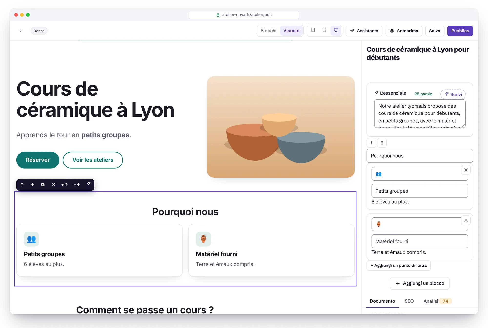
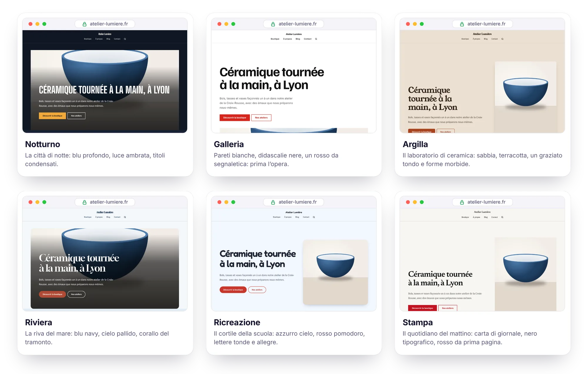
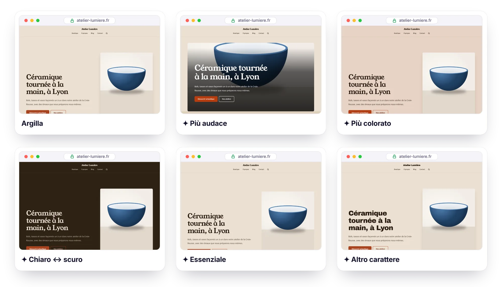
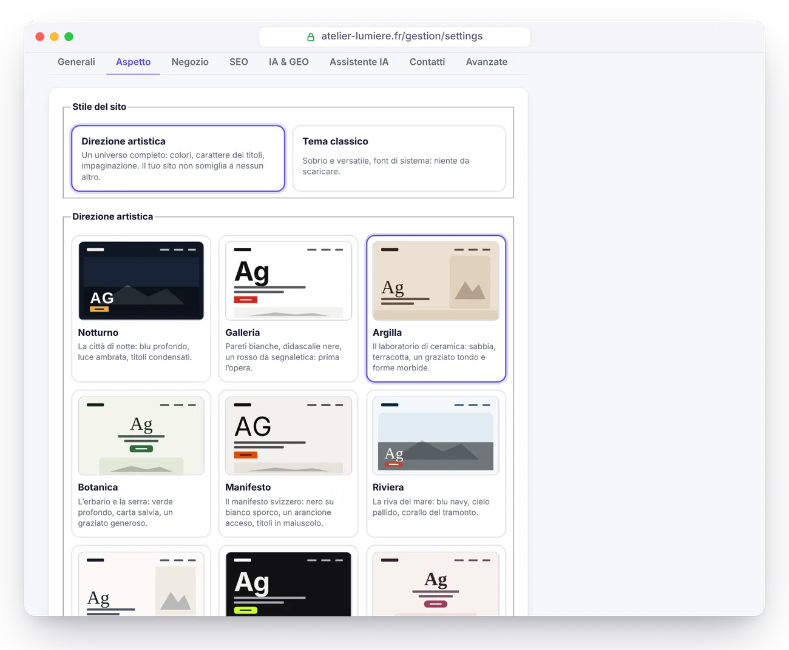

<p align="center">
  <a href="GUIDE.md">Français</a> · <a href="GUIDE.en.md">English</a> · <a href="GUIDE.es.md">Español</a> · <a href="GUIDE.de.md">Deutsch</a> · <b>Italiano</b> · <a href="GUIDE.pt-BR.md">Português</a> · <a href="GUIDE.zh-CN.md">简体中文</a>
</p>

# Guida di Éclair CMS

Tutto quello che c’è da sapere per installare, usare, proteggere e mantenere Éclair. Per la presentazione, torna al [README](../README.it.md).

## Indice

1. [Installazione](#installazione)
2. [Funzionalità in dettaglio](#funzionalità-in-dettaglio)
3. [Uso quotidiano](#uso-quotidiano)
4. [Modalità Visuale](#modalità-visuale)
5. [Direzioni artistiche](#direzioni-artistiche) (compresi i [Ritocchi in un clic](#ritocchi-in-un-clic), [Immagina la mia direzione con l’IA](#immagina-la-mia-direzione-con-lia) e il [Punteggio Design](#punteggio-design))
6. [Temi](#temi)
7. [Negozio](#negozio)
8. [Assistente IA](#assistente-ia) (compreso [Creare una pagina con l’IA](#creare-una-pagina-con-lia), il [Piano editoriale](#piano-editoriale), il [Vecchio sito](#vecchio-sito-wayback-machine), l’[Affiliazione](#affiliazione) e [Google Discover](#google-discover))
9. [Connettore MCP (Claude e ChatGPT)](#connettore-mcp-claude-e-chatgpt)
10. [Sicurezza](#sicurezza)
11. [Aggiornare, fare backup, traslocare](#aggiornare-fare-backup-traslocare) (compresi l’[Aggiornamento in un clic](#aggiornamento-in-un-clic) e i [Backup su Google Drive](#backup-su-google-drive))
12. [Risoluzione dei problemi](#risoluzione-dei-problemi) (compreso [Nginx](#nginx))
13. [Per sviluppatori](#per-sviluppatori)

---

## Installazione

### Requisiti

- **PHP 8.1 o successivo** (consigliato 8.3), con le estensioni `mbstring`, `json`, `dom`, `session` e `zlib` (attive di default quasi ovunque).
- Consigliate: `gd` (immagini WebP), `zip` (backup in un clic), `curl` (IndexNow, assistente IA, carattere delle direzioni artistiche).
- Un server **Apache o LiteSpeed** (praticamente tutti gli hosting condivisi: Hostinger, IONOS, OVHcloud…). Per Nginx, vedi [più sotto](#nginx).
- Un certificato HTTPS (gratuito con Let's Encrypt presso quasi tutti i provider).

La procedura guidata controlla tutto questo per te e spiega cosa correggere.

### Passaggi

1. Scarica l’archivio [`eclair-cms-2.2.0.zip`](https://github.com/Jacckisback/eclair-cms/raw/main/dist/eclair-cms-2.2.0.zip) (883 KB) ed estrailo.
2. Carica **il contenuto della cartella `eclair`** nella cartella pubblica del tuo hosting (`public_html`, `www`…) con il tuo programma FTP (FileZilla…) o con il file manager del tuo provider.
   > ⚠️ I file `.htaccess` sono nascosti: attiva «Mostra file nascosti» per essere sicuro di caricarli.
3. Apri l’indirizzo del tuo sito: **parte la procedura guidata di installazione** (in 7 lingue, italiano compreso).
4. Rispondi a 4 domande (il tuo sito, il tuo account, la tua visibilità, l’indirizzo del pannello). Coriandoli 🎉: il tuo sito è online, con alcune pagine e un articolo di esempio.

> 🔒 Per sicurezza, l’installazione va completata **entro 2 ore** dalla prima visita (altrimenti chiunque potrebbe impadronirsi di un sito caricato e poi dimenticato). Scaduto il tempo, elimina il file `data/install-window.php` via FTP e ricarica la pagina.

Installazione in una sottocartella (`esempio.it/sito/`): basta caricare i file in quella sottocartella, tutto viene rilevato automaticamente.

### I 7 tipi di sito

| Tipo (nella procedura guidata) | Cosa viene creato |
|---|---|
| 🏢 Sito vetrina | Home (banner, punti di forza, ultimi articoli), Servizi (con FAQ), Chi siamo, Contatti, Blog, note legali, privacy policy |
| ✍️ Blog | Home = ultimi articoli, Chi siamo, Contatti, categoria «Guides», pagine legali |
| 🧑‍💻 Freelance / portfolio | Home a tuo nome, competenze, Chi sono, Blog, Contatti, pagine legali |
| 🎯 Pagina unica | Una pagina di vendita (banner, punti di forza, FAQ, modulo) + pagine legali, senza blog |
| 🧭 Magazine / Google Discover | Come un blog (home = ultimi articoli, Chi siamo, Contatti, pagine legali); la bacheca mette in primo piano Discover, le tendenze del giorno e la pubblicità |
| 🛍️ Affiliazione | Come un blog; la bacheca mette in primo piano i tuoi link di affiliazione e gli articoli scritti dall’IA |
| 🕰️ Rilanciare un vecchio sito | Come un blog; la bacheca comincia dal ritrovare i vecchi indirizzi del tuo dominio (Vecchio sito) |

I contenuti iniziali esistono in francese, spagnolo e inglese: un sito in italiano parte dai testi inglesi, da tradurre. Le pagine legali contengono uno schema basato sul diritto francese (LCEN), spagnolo (LSSI) e sul GDPR; gli obblighi specifici del tuo Paese vanno aggiunti da te.

Il tipo scelto diventa l’**uso del sito** (Impostazioni › Generale, modificabile in qualsiasi momento): la bacheca si apre con una scheda che riunisce gli strumenti di quell’uso e il loro stato. Sul sito pubblico non cambia nulla.

### Subito dopo l’installazione

La bacheca mostra una checklist «Primi passi»: logo e colore, home page, primo articolo, profilo dell’autore, autenticazione a due fattori, note legali, Google Search Console. Il passo successivo è evidenziato in giallo e ognuno spiega in una frase a cosa serve. Per un magazine, un sito di affiliazione o un vecchio sito, comincia dal passo proprio di quell’uso.

---

## Funzionalità in dettaglio

### ⚡ Velocità

- **Cache statica automatica**: ogni pagina viene generata una volta, poi servita senza caricare l’applicazione. La cache si svuota da sola a ogni modifica (e all’ora prevista per un articolo programmato).
- **CSS incorporato nella pagina** (da 17 a 23 KB a seconda del tema e del negozio, da 5 a 6 KB compresso), font di sistema: nessuna richiesta bloccante, nessuno spostamento del layout. Con una direzione artistica si aggiunge un solo carattere per i titoli (da 12 a 27 KB), servito dal tuo sito e precaricato.
- **Immagini ottimizzate al caricamento**: ridimensionate (massimo 2000 px), disponibili in **WebP responsive** (480, 800, 1200, 1600 px), dimensioni esplicite, caricamento differito, priorità all’immagine principale.
- ETag e risposte `304 Not Modified`, compressione Brotli/Gzip e cache del browser di un anno per i file statici (tramite `.htaccess`).

### 🔎 SEO

- URL pulite, **reindirizzamento 301 automatico** quando un indirizzo cambia, gestore dei reindirizzamenti (comodo per migrare un vecchio sito WordPress o Wix).
  - Gli indirizzi sotto `/.well-known/`, `/_eclair/` e `/__eclair/` non possono essere reindirizzati. Eccezione: un amministratore può reindirizzare un indirizzo `/.well-known/…` come `change-password`, ma mai `acme-challenge` né `pki-validation`. I vecchi reindirizzamenti da questi indirizzi sono contrassegnati come «Disattivata» e si possono eliminare (un amministratore può ricreare quelli consentiti).
  - Seguire un reindirizzamento non rallenta più il sito, e il numero di utilizzi resta visibile.
- **Trasferimento di un intero sito WordPress** (funzione «Importa WordPress»): installa il plugin [Eclair Export](https://github.com/Jacckisback/eclair-export) sul sito WordPress, poi carica qui il suo pacchetto (o mettilo via FTP in `data/import/`). Contenuti, immagini, documenti PDF, SEO (Yoast, Rank Math, AIOSEO), menu e reindirizzamenti vengono ripresi, ogni indirizzo è mantenuto o reindirizzato con un 301, i link interni vengono riscritti. **Simula** mostra cosa verrà creato senza scrivere nulla. Via SSH: `php app/bundled/wordpress/lib/cli.php import pacchetto.zip [--dry-run]`.
- Titolo, meta description e **anteprima Google in tempo reale** nell’editor, con contatori.
- **Analisi SEO in tempo reale** con punteggio: lunghezza di titolo e descrizione, frase chiave (titolo, URL, introduzione, sottotitoli, densità), numero di parole, struttura, testi alternativi, link interni, immagine in evidenza…
- **Dati strutturati JSON-LD** completi: WebSite (+ ricerca), Organization / Person / LocalBusiness (indirizzo, orari, profili social, politica di reso), WebPage / AboutPage / ContactPage, BlogPosting (autore, date, sezione), BreadcrumbList, FAQPage, ProfilePage e, per il negozio, Product / ProductGroup / Offer (prezzo, disponibilità, spedizione).
- Sitemap XML con immagini e `hreflang`, robots.txt, feed RSS completo, Open Graph e Twitter Cards (**immagine di condivisione 1200×630 generata automaticamente**), breadcrumb, URL canonici.
- Un solo indirizzo per contenuto: reindirizzamenti per HTTPS, con/senza www, slash finale, maiuscole, `index.php`.
- **IndexNow**: Bing, Yandex, Seznam… vengono avvisati a ogni pubblicazione.
- Verifica di Google Search Console e Bing Webmaster Tools (incolla il tag `<meta>`, Éclair estrae il codice).
- Multilingue: lingua per contenuto, collegamento tra le traduzioni e tag `hreflang` automatici.
- Tipografia francese automatica per i contenuti in francese (spazi indivisibili prima di `: ; ! ?` e dentro le virgolette « »).

### 🤖 GEO (motori di risposta IA)

- **`/llms.txt`** (standard llmstxt.org) e **`/llms-full.txt`** generati automaticamente.
- **Versione Markdown di ogni pagina**: aggiungi `.md` a qualsiasi URL (con intestazione di metadati, `noindex` e URL canonico per non creare contenuti duplicati).
- **Regole per i bot IA in un clic**: aperto (consigliato per essere citati), solo citazioni (motori di risposta ammessi, addestramento vietato) o chiuso. Gestisce GPTBot, OAI-SearchBot, ChatGPT-User, ClaudeBot, Claude-SearchBot, Claude-User, PerplexityBot, Google-Extended, Applebot-Extended, CCBot, Meta-ExternalAgent… Direttiva `Content-Signal` facoltativa.
- Blocco **«In breve»**: il riassunto che le IA citano volentieri, mostrato in apertura dell’articolo.
- **Punteggio GEO** nell’editor: riassunto, introduzione diretta, FAQ, sottotitoli in forma di domanda, elenchi e tabelle, dati concreti, fonti esterne, autore identificato (E-E-A-T), paragrafi brevi, aggiornamento.
- Pagine autore con biografia e profili (`sameAs`), date di pubblicazione e di aggiornamento visibili.
- **Bot IA** (menu dell’amministrazione): quali IA leggono le tue pagine (ChatGPT-User, Claude-User, OAI-SearchBot, PerplexityBot, GPTBot, ClaudeBot…), quali pagine e per quale scopo: consultazione su richiesta (qualcuno ha fatto una domanda, una citazione in potenza), indicizzazione di un motore di risposta o addestramento. Visite al giorno, per bot e per pagina, letture del robots.txt, pagine pubblicate mai lette con cosa fare, avviso se i bot di addestramento passano nonostante il robots.txt, e una scheda nella bacheca. `index.php` annota solo l’ora, il bot e l’indirizzo, mai l’IP né i visitatori umani; registro limitato a 4 MB al mese e cancellato dopo 13 mesi; misurazione disattivabile in Impostazioni › IA e GEO. L’identità è quella dichiarata dal bot.

### ✍️ Editor a blocchi

- 18 blocchi: testo, sottotitolo (H2-H4), elenco, citazione, immagine, riquadro, FAQ, tabella, pulsante, video YouTube/Vimeo (senza cookie prima del clic), codice, separatore, banner, punti di forza, team (ritratti, ruoli, presentazioni), ultimi articoli, prodotti (vetrina del negozio), modulo di contatto.
- Digita **`/`** su una riga vuota per scegliere un blocco, trascina e rilascia, barra di formattazione (grassetto, corsivo, link, codice, evidenziatore).
- **Link interni assistiti**: mentre scrivi un link, l’editor ti propone le tue pagine e i tuoi articoli (link interni in 2 secondi).
- **Incolla intelligente** da Word, Google Docs o una pagina web: titoli, elenchi, tabelle e grassetti diventano blocchi puliti.
- Salvataggio con `Ctrl+S`, bozza locale di riserva (non si perde nulla se cade la connessione), anteprima reale prima della pubblicazione, **cronologia delle ultime 20 versioni**, pubblicazione programmata.
  - Questa bozza di riserva appartiene all’account connesso e viene cancellata quando esci: non viene mai proposta a un altro account che usa lo stesso browser. Quelle della 1.10.2 relative a un contenuto già salvato vengono mantenute su un sito con un solo account; quelle di un nuovo contenuto mai salvato, o tutte con più account, vengono cancellate dopo l’aggiornamento: salva le modifiche in corso prima di aggiornare.
- **Modalità Visuale**: la pagina così come appare con il tuo tema, modificabile direttamente lì ([dettagli](#modalità-visuale)).
- **Annullare e ripetere**: `Ctrl+Z` (`Cmd+Z` su Mac) e `Ctrl+Maiusc+Z` o `Ctrl+Y`, oppure i pulsanti ↶ ↷ della barra, in modalità Blocchi come in modalità Visuale (60 passi). Nel campo in cui stai scrivendo, `Ctrl+Z` resta quello del browser, lettera per lettera. Un blocco o un elemento eliminato (domanda della FAQ, punto di forza, membro del team, variante, link del menu) torna anche con un clic nell’avviso. Ciò che non si può annullare (eliminare una pagina, un’immagine, un account) chiede conferma in una finestra in cui «Annulla» ha il focus: `Invio` non elimina mai nulla per errore.

### 🧩 Tutto il resto

Libreria media (trascina e rilascia, testi alternativi, rilevamento delle immagini in uso), menu con trascina e rilascia (intestazione e piè di pagina), categorie «pilastro» per un cluster tematico, ricerca nel sito, modulo di contatto antispam **senza captcha** (campo trappola, token, limiti per rete e per giorno) con casella di posta, account amministratore e redattore, 6 temi e 12 direzioni artistiche con anteprima in tempo reale, modalità scura automatica, 6 font di sistema, colore principale con contrasto WCAG garantito, pannello in 7 lingue (italiano, inglese, francese, spagnolo, tedesco, portoghese, cinese), sito pubblico in 6 lingue (fr, es, en, de, it, pt).

---

## Uso quotidiano

| Voglio… | Dove |
|---|---|
| Scrivere un articolo | Bacheca › **Scrivi un articolo** |
| Chiedere all’IA un articolo, una pagina, un’immagine | Campo **«Cosa vuoi creare oggi?»** della bacheca, oppure **✨ Assistente IA** (`Ctrl+J`) |
| Far comporre all’IA una pagina completa | Nuova pagina › **✨ Crea con l’IA** |
| Modificare una pagina così come appare | Editor › **Visuale** |
| Modificare una pagina dal sito | Pulsante **✏️ Modifica** (visibile solo quando hai effettuato l’accesso) |
| Cambiare tema, logo, colore, font | Impostazioni › Aspetto |
| Aggiungere il mio CSS | Impostazioni › Aspetto › CSS personalizzato |
| Attivare o disattivare le micro-animazioni | Impostazioni › Aspetto › Micro-animazioni (sito) · Il mio profilo › Interfaccia (amministrazione) |
| Vedere quali IA leggono il mio sito | **Bot IA** |
| Pianificare i miei articoli, farli proporre e scrivere dall’IA | **Pianificazione** |
| Ridare una pagina ai vecchi indirizzi del mio dominio | **Vecchio sito** |
| Gestire i miei link di affiliazione e ricavarne un articolo con l’IA | **Affiliazione** |
| Preparare i miei articoli per Google Discover, trovare idee nelle tendenze del giorno | **Discover** |
| Mostrare pubblicità AdSense sui miei articoli | **Discover** › Pubblicità |
| Adattare la bacheca al mio uso | Impostazioni › Generale › Uso del sito |
| Aprire il negozio | Impostazioni › Negozio |
| Aggiungere un prodotto | Contenuti › **+ Prodotto** |
| Scegliere la home page | Impostazioni › Generali |
| Consentire o bloccare le IA | Impostazioni › IA & GEO |
| Attivare l’assistente IA | Impostazioni › Assistente IA |
| Collegare Google Search Console | Impostazioni › SEO |
| Aggiungere un link al menu | Menu |
| Reindirizzare un vecchio URL | Reindirizzamenti |
| Attivare l’autenticazione a due fattori | Il mio profilo › Autenticazione a due fattori |
| Scaricare un backup | Sicurezza › Backup |

Scorciatoie dell’editor: `/` inserisci un blocco · `Ctrl+S` salva · `Ctrl+K` link · `Ctrl+B` grassetto · `Ctrl+I` corsivo · `Invio` nuovo paragrafo · `Maiusc+Invio` a capo · `Ctrl+J` assistente IA · `Ctrl+Z` annulla · `Ctrl+Maiusc+Z` o `Ctrl+Y` ripeti (`Cmd` su Mac).

---

## Modalità Visuale

<p align="center">
  
</p>

La modalità Visuale mostra la tua pagina con il vero tema del sito, esattamente come la vedranno i tuoi visitatori, e ti permette di modificarla direttamente lì. Passa da **Blocchi** a **Visuale** (e viceversa) in cima all’editor: la tua scelta viene ricordata per la volta successiva.

- **Scrivere**: clicca su un titolo, un paragrafo, una domanda delle FAQ, il testo di un pulsante… e scrivi. `Ctrl+B` grassetto, `Ctrl+I` corsivo, `Ctrl+K` link (si apre la ricerca delle pagine dell’editor). `Invio` conferma un campo di una sola riga; in un paragrafo, crea il paragrafo successivo (`Maiusc+Invio` per andare semplicemente a capo). Il testo incollato arriva sempre come testo semplice.
- **Organizzare**: un clic su un blocco lo evidenzia con un bordo e mostra la sua barra: due frecce per spostarlo, due pulsanti per aggiungere un blocco sopra o sotto, uno per duplicarlo e, a parte in fondo alla barra, la croce ✕ per eliminarlo (diventa rossa al passaggio del mouse). La barra si usa anche da tastiera (`Tab`, poi `Invio`); dopo `Esc`, `Canc` elimina il blocco selezionato.
- **Immagini**: clicca su un’immagine (banner, blocco immagine, ritratto del team, immagine in evidenza di un articolo) per sceglierne un’altra nella libreria media.
- **Impostazioni del blocco**: il pannello a destra mostra il modulo del blocco scelto (link di un pulsante, numero di articoli, nuova domanda delle FAQ…), poi le schede Documento, SEO e Analisi.
- **✨ Ritocchi con l’IA** (se l’assistente è attivo): migliorare, correggere, accorciare, sviluppare, semplificare, cambiare il tono o tradurre il testo del blocco.
- **Annullare e ripetere**: `Ctrl+Z` (`Cmd+Z` su Mac) o il pulsante ↶ torna indietro, `Ctrl+Maiusc+Z` o `Ctrl+Y` (pulsante ↷) ripete, un passo alla volta (fino a 60 passi, comuni alle modalità Blocchi e Visuale).
- **Larghezza**: 📱 390 px, ▭ 768 px o 🖥 larghezza piena, per controllare la resa su smartphone e tablet.

Tutto passa dall’editor di sempre: salvataggio (`Ctrl+S` funziona anche dentro la pagina), bozza locale di riserva, cronologia delle versioni, analisi SEO e GEO in tempo reale. Link, pulsanti e moduli della pagina non reagiscono durante la modifica. Un blocco invisibile sul sito (immagine non ancora scelta, negozio chiuso…) appare come una cornice tratteggiata, da completare dal pannello a destra.

> [!NOTE]
> La modalità Visuale esiste solo nell’anteprima del pannello: servono l’accesso, un token di sicurezza e il permesso di scrittura, e la pagina non viene mai messa in cache né indicizzata. Le tue pagine pubbliche non ne portano traccia: restano identiche fino all’ultimo byte.

---

## Direzioni artistiche

<p align="center">
  
</p>

Un tema cambia i colori; una **direzione artistica** cambia l’intero universo del sito, a partire da un’idea concreta: la città di notte, il laboratorio di ceramica, il quotidiano del mattino. In **Impostazioni › Aspetto**, scegli **Direzione artistica** (invece di **Tema classico**), clicca su una delle 12 schede e guarda l’anteprima in tempo reale: il tuo vero sito, su computer o su smartphone. Non si pubblica nulla finché non salvi.

| Direzione | Universo | Carattere dei titoli |
|---|---|---|
| **Notturno** | La città di notte: blu profondo, luce ambrata | Big Shoulders Display, in maiuscolo |
| **Galleria** | Pareti bianche, didascalie nere, un rosso da segnaletica | Familjen Grotesk |
| **Argilla** | Il laboratorio di ceramica: sabbia, terracotta, forme morbide | Young Serif |
| **Botanica** | L’erbario e la serra: verde profondo, carta salvia | DM Serif Display |
| **Manifesto** | Il manifesto svizzero: nero su bianco sporco, arancione acceso | Archivo Black, in maiuscolo |
| **Riviera** | La riva del mare: blu navy, cielo pallido, corallo | Gloock |
| **Carta intestata** | Lo studio professionale: inchiostro blu navy, bordeaux, filetti sottili | Libre Caslon Display |
| **Neon** | Lo schermo creativo di notte: quasi nero, verde lime | Unbounded |
| **Dolcezza** | Lo studio di benessere: rosa cipria, prugna, tanta aria | Cormorant Garamond |
| **Cantiere** | Cemento, giallo di sicurezza, segnaletica condensata | Barlow Condensed, in maiuscolo |
| **Ricreazione** | Il cortile della scuola: azzurro cielo, rosso pomodoro, lettere tonde | Fredoka |
| **Stampa** | Il quotidiano del mattino: carta di giornale, rosso da prima pagina | Newsreader |

**Regolare**: sotto le schede, **Regola la direzione** apre tutte le impostazioni, da combinare liberamente:

- **5 colori**: sfondo, fasce e schede, testo, testo secondario, accento (pulsanti e link).
- **Font dei titoli**: 18 caratteri tipografici scelti per la loro personalità (nessuno di quelli che si vedono ovunque), oppure un font di sistema. **Font del testo**: un font di sistema, senza download.
- **Maiuscole nei titoli** (normale o maiuscole), **dimensione dei titoli** (discreta, equilibrata, spettacolare), **angoli** (squadrati, smussati, arrotondati), **spaziatura** (compatta, normale, ariosa).
- **Schede**: filetto sottile, campitura di colore o ombra portata.
- **Banner di apertura**: testo e immagine affiancati, immagine a sinistra, manifesto (titolo molto grande), immagine a tutta pagina (il titolo sulla foto), editoriale (immagine verticale), centrato o incorniciato (testo e immagine in un pannello colorato).
- **Blocco «Punti di forza»**: schede, righe, colonne con filetto o numerati (01, 02…). **Sezioni**: sfondo uniforme, fasce di colore o filetti tra le sezioni. **Icone dei punti di forza**: icone disegnate (65 icone al tratto, riconosciute a partire dalle emoji più comuni: ☕ 🚗 🐶 ✂️ 🎓 💼 🌸…), senza icona o emoji.
- **Pulsanti**: pieni, con contorno o come link sottolineati (con una freccia).

Intestazione, elenchi di articoli, logo, icona, piè di pagina e CSS personalizzato si regolano come prima. Per tornare al tema classico, scegli **Tema classico** e salva: le sue impostazioni ti aspettano intatte.

**Sempre leggibile**: qualunque siano i colori scelti, Éclair regola automaticamente il testo (contrasto **7:1** sullo sfondo), il testo secondario, i link e i pulsanti (4,5:1), anche sugli sfondi tinti con il colore d’accento (etichette, menu, evidenziazione). Un colore troppo pallido per un testo su sfondo chiaro viene quindi scurito quanto basta.

**Sempre veloce**: il carattere dei titoli viene **scaricato una sola volta dal tuo server** (da Fontsource, licenza SIL Open Font License), salvato in `media/fonts/`, poi servito dal tuo sito e precaricato con `font-display: optional`: nessuna richiesta a un servizio di terzi per i tuoi visitatori, nessuno spostamento del layout. Nella pagina vengono inserite solo le regole CSS utili alla tua direzione, e la modalità scura automatica lascia il posto alla scelta chiara o scura della direzione. Misurato con Lighthouse: 100 in tutte e quattro le categorie con Notturno, Riviera, Stampa e Manifesto, e con le nuove composizioni (banner con l’immagine a sinistra o incorniciato, punti di forza numerati, filetti tra le sezioni, pulsanti con contorno o come link sottolineati).

> [!TIP]
> Se il tuo provider blocca le connessioni in uscita, il carattere non può essere scaricato: un messaggio ti avvisa e, nel frattempo, il sito usa un font di riserva della stessa famiglia (con grazie, condensato…). Riprova più tardi salvando di nuovo.

### Ritocchi in un clic

<p align="center">
  
</p>

Sotto le schede, sei pulsanti trasformano la direzione scelta con un solo clic, e l’anteprima si aggiorna subito:

| Ritocco | Cosa cambia |
|---|---|
| **Più audace** | titoli più grandi, più aria, banner più spettacolare (manifesto, poi immagine a tutta pagina), fasce di colore, accento più vivace, pulsanti pieni |
| **Più sobrio** | titoli più discreti, niente maiuscolo, filetti sottili al posto delle ombre, banner più calmo, accento attenuato |
| **Più colorato** | sfondo e fasce tinti con il colore d’accento, fasce di colore, accento più vivace |
| **Essenziale** | filetti sottili, nessuna icona, sfondo uniforme, più aria, angoli più squadrati, punti di forza in colonne |
| **Chiaro ↔ scuro** | inverte la luminosità di sfondo, fasce e testo, mantenendone le tinte |
| **Altro carattere** | passa al carattere dei titoli successivo, alternando le famiglie (con grazie, grottesco, condensato…) |

I ritocchi si possono concatenare; **Annulla il ritocco** torna indietro di un passo alla volta. I contrasti restano garantiti a ogni passo, e non si pubblica nulla finché non salvi.

### Immagina la mia direzione con l’IA

<p align="center">
  
</p>

Quando l’[assistente IA](#assistente-ia) è attivo, sotto le schede compare **Immagina la mia direzione con l’IA**. Descrivi la tua attività, il tuo pubblico e l’atmosfera che cerchi in una o due frasi («panetteria bio di quartiere a Bologna, clientela familiare, calda ma moderna»), poi clicca su **Proponi 3 direzioni**. L’IA legge anche la presentazione del tuo sito e il tuo profilo editoriale, e segue il metodo di [Impeccable](https://github.com/pbakaus/impeccable):

1. partire dal mondo concreto dell’attività (luoghi, materiali, oggetti, luce) anziché da aggettivi;
2. dare a ogni proposta **un riferimento preciso** («le insegne smaltate di una panetteria degli anni ’50») e ricavarne colori, carattere e composizioni;
3. proporre tre direzioni **davvero diverse** (chiara o scura, calda o fredda, con o senza grazie);
4. evitare la scelta predefinita del settore (blu navy e oro per un avvocato…), il suo opposto prevedibile e i tic del «design generato dall’IA».

Le tre proposte si aggiungono in testa alle schede, contrassegnate da ✦: clicca su una per vederla nell’anteprima, regolala, poi salva quella che ti piace. L’IA sceglie solo tra le impostazioni di Éclair (colori, caratteri dell’elenco, composizioni) e non scrive mai CSS: ogni proposta viene verificata e i suoi contrasti corretti prima di arrivare sul tuo sito. Il costo indicativo compare sotto il pulsante (≈ 0,03 $ con Claude Sonnet 5.5) e viene detratto dal budget dell’assistente. Riservato agli amministratori.

### Punteggio Design

Nell’editor, la scheda **Analisi** mostra un terzo anello, **Design**, accanto a SEO e GEO. Verifica che la pagina regga dal punto di vista visivo:

- **sottotitoli**: gerarchia senza salti (H2, poi H3, poi H4), brevi, senza emoji decorative;
- **banner**: titolo breve (al massimo 8 parole, 6 in maiuscolo), pulsante d’azione, immagine se la tua direzione la richiede (a tutta pagina, editoriale);
- **inviti all’azione** misurati (al massimo 3 pulsanti);
- **blocco «Punti di forza»** da 3 a 6 elementi descritti, con icone che abbiano il loro equivalente disegnato;
- **testo**: niente frasi in MAIUSCOLO, niente formule vuote («rivoluzionario», «chiavi in mano», «seamless»… a seconda della lingua della pagina), niente abuso di lineette lunghe, niente passaggi ripetuti identici, niente muri di oltre 350 parole senza sottotitolo, immagine o elenco;
- **direzione artistica** scelta per il sito.

Il voto della scheda Analisi è ora la media dei tre anelli.

---

## Temi

Éclair include **6 temi**. Scegline uno in **Impostazioni › Aspetto**: l’**anteprima in tempo reale** mostra il tuo vero sito (home, blog, un articolo, il negozio, un prodotto) su computer o su smartphone, e non si pubblica nulla finché non salvi. Puoi navigare nell’anteprima: i link restano nell’anteprima.

| Tema | Stile | Per chi |
|---|---|---|
| **Éclair** | Chiaro, moderno e versatile: il tema originale | Tutti i siti |
| **Editoriale** | Stile rivista: caratteri con grazie, filetti sottili, capolettera, articolo in evidenza | Blog, media, autori |
| **Atelier** | Caldo e artigianale: toni crema e terracotta, forme morbide | Artigiani, ristoranti, benessere |
| **Studio** | Portfolio minimalista: bianco e nero, titoli grandi, immagini al vivo | Fotografi, designer, agenzie |
| **Negozio** | Pensato per vendere: foto quadrate, intestazione fissa, pulsanti decisi | Negozi, creativi |
| **Contrasto** | Massima leggibilità: testo grande, contrasti forti, link sottolineati | Servizi pubblici, associazioni, anziani |

Scegliendo un tema ne applichi il colore e i font consigliati: puoi cambiarli in seguito. Due impostazioni di layout completano il tema: l’**intestazione** (logo a sinistra e menu a destra, oppure tutto centrato) e gli **elenchi di articoli e prodotti** (griglia di card, oppure elenco con l’immagine a sinistra).

**Perché è leggero**: un tema di Éclair è solo un foglio di stile da 1,5 a 3 KB, che si aggiunge a quello di base. Il codice HTML non cambia da un tema all’altro: velocità, accessibilità, dati strutturati e posizionamento restano identici. Nella pagina viene inserito solo il tema attivo, e la modalità scura automatica funziona con ognuno.

**CSS personalizzato**: per andare oltre il tema (il colore di un pulsante, le spaziature, lo stile di un blocco), incolla le tue regole in **Impostazioni › Aspetto › CSS personalizzato**. Vengono aggiunte dopo il tema in ogni pagina, quindi hanno la precedenza, e sono salvate con i tuoi dati (`data/`): **gli aggiornamenti di Éclair le conservano**. Funzionano anche i segnaposto `/*dark*/ … /*/dark*/`: le loro regole scompaiono quando la modalità scura è impostata su «Sempre chiaro». Per sicurezza, il carattere `<` e le regole `@import` vengono rimossi; massimo 64 KB.

**Micro-animazioni** (Impostazioni › Aspetto): schede, punti di forza, domande della FAQ, riquadri e immagini compaiono scivolando durante lo scorrimento, e pulsanti e immagini reagiscono al passaggio del mouse. È solo CSS (meno di 1 KB aggiunto alla pagina, nessuno script): gli elementi scivolano senza mai diventare trasparenti, quindi nessuno spostamento del layout, nessun testo sbiadito, niente di animato al caricamento, e il testo resta nella pagina per Google e le IA. Misurato: 100 in tutte e quattro le categorie di Lighthouse, con o senza. Sono disattivate per i visitatori che hanno chiesto meno movimento al proprio dispositivo, e in stampa. Attive sui siti installati con la 1.11; su un sito precedente, le pagine restano identiche al byte finché non le attivi. Le animazioni dell’amministrazione si disattivano in **Il mio profilo › Interfaccia** (impostazione valida solo per questo browser).

---

## Negozio

Il **negozio leggero** serve a vendere qualche decina di prodotti senza la pesantezza di un e-commerce: niente carrello, niente account clienti, niente database, nessun dato bancario sul tuo server. Ogni prodotto ha la sua scheda, ottimizzata per Google e le IA, e il suo pulsante **Acquista** porta a un **link di pagamento Stripe, PayPal o Revolut Business**: il tuo fornitore di pagamenti incassa, invia le ricevute e gestisce i rimborsi.

### Aprire il negozio

1. **Pubblica le tue note legali** (l’installazione ne ha creato uno schema da completare) **e le tue condizioni generali di vendita**. Il negozio non si apre senza queste pagine: falle controllare, ne sei responsabile come venditore.
2. In **Impostazioni › Negozio**: scegli queste due pagine, la valuta, le spese e i tempi di consegna, i paesi di spedizione e il periodo di reso (nell’UE, la vendita a distanza prevede un diritto di recesso di almeno 14 giorni, salvo eccezioni come un prodotto personalizzato).
3. Clicca su **Crea la pagina di ringraziamento**: è lì che Stripe può reindirizzare i tuoi clienti dopo il pagamento.
4. Attiva **Negozio aperto**, salva, poi aggiungi il negozio al menu (Menu › Negozio).

Il catalogo si trova all’indirizzo `/negozio` (`/boutique`, `/tienda`, `/shop` o `/loja` a seconda della lingua del sito), modificabile: se lo cambi, i vecchi indirizzi vengono reindirizzati.

### Creare una scheda prodotto

Contenuti › **+ Prodotto**. In cima all’editor, la scheda prodotto:

- **Prezzo** e **prezzo barrato** (facoltativo: lo sconto viene mostrato in percentuale), **disponibilità** (disponibile, esaurito, preordine).
- **Link di pagamento**: il link Stripe, PayPal o Revolut Business del prodotto.
- **Foto**: la prima è quella principale (Google, social); punta ad almeno 3 angolazioni.
- **Varianti** (taglia, colore…): ognuna può avere il suo prezzo e il suo link. Sul sito, la scelta avviene senza JavaScript.
- **Dettagli per Google Shopping**: marca, codice articolo, codice a barre (GTIN/EAN), condizione (nuovo, usato, ricondizionato), prodotto digitale o servizio (senza spedizione).

Sotto, descrivi il prodotto con i soliti blocchi e assegnalo a una **categoria di prodotti** (Categorie › «Raggruppa: Prodotti (negozio)»). L’analisi SEO controlla anche il prezzo, il link di pagamento, il numero di foto e gli identificativi. Per mettere in evidenza dei prodotti in una pagina, aggiungi il blocco **Prodotti**.

Con l’assistente IA: allega una foto e chiedi «Crea la scheda prodotto dalla foto allegata. Prezzo: 29,90 €». Scrive una bozza completa, ma **non inventa mai un prezzo, uno sconto o un link di pagamento**: quello che manca lo completi tu.

### Collegare Stripe (Payment Links)

1. In Stripe, apri **Payment Links** e crea un link: prodotto, prezzo e, se serve, raccolta dell’indirizzo di spedizione.
2. Nella scheda **After the payment**, scegli di reindirizzare il cliente alla tua pagina di ringraziamento (il suo indirizzo è indicato in Impostazioni › Negozio).
3. Nelle impostazioni di Stripe (**Customer emails**), attiva le ricevute dei pagamenti riusciti.
4. Copia il link e incollalo nella scheda prodotto. Éclair aggiunge al link il riferimento del prodotto (`client_reference_id`): ogni pagamento indica cosa è stato acquistato.

Ogni ordine ti arriva in Stripe (e via e-mail, se l’hai attivato): tu prepari e spedisci, Stripe gestisce l’eventuale rimborso. Funziona anche un altro fornitore di pagamenti, purché il suo link di pagamento inizi con `https://`.

### Oppure collegare PayPal o Revolut Business

Stesso principio: un link di pagamento a prezzo fisso per ogni prodotto (o per ogni variante con un prezzo diverso), incollato nella scheda prodotto. Éclair riconosce questi link e mostra «Pagamento sicuro con PayPal» o «con Revolut» sotto il pulsante di acquisto.

- **PayPal**: nel tuo conto business, apri **Link e pulsanti di pagamento**, crea un link a prezzo fisso per il tuo prodotto e copialo (inizia con `https://www.paypal.com/`). Il cliente paga con il suo conto PayPal o con la carta.
- **Revolut Business**: serve un conto esercente. In **Esercente › Link di pagamento** (Merchant › Payment link), crea un link con l’importo del prodotto e copialo (`https://checkout.revolut.com/…`). Il cliente paga sulla pagina di pagamento di Revolut.

Due differenze rispetto a Stripe: dopo il pagamento, il cliente resta sulla pagina di conferma del fornitore (nessun ritorno automatico alla tua pagina di ringraziamento), e il riferimento del prodotto non viene aggiunto al pagamento: dai a ogni link un nome chiaro per riconoscere i tuoi ordini.

### Cosa viene fatto per Google e le IA

- **Dati strutturati** Product e Offer su ogni scheda (ProductGroup per le varianti): prezzo, valuta, disponibilità, condizione, marca, spese e tempi di consegna, e **politica di reso** a livello della tua attività. Sono le informazioni che Google mostra nei risultati dei prodotti.
- **Feed prodotti** `/products.xml` nel formato di Google Merchant Center: aggiungilo come origine dati dei prodotti in Merchant Center per comparire gratuitamente nella scheda Shopping.
- Categorie di prodotti come pagine pilastro, sitemap con tutte le foto, breadcrumb.
- Per le IA: prezzo e disponibilità di ogni prodotto in `llms.txt` e nella versione Markdown di ogni scheda (aggiungi `.md` al suo indirizzo).

### Quanto costa?

Nulla da parte di Éclair. Stripe non chiede né abbonamento né costi di attivazione, e i link di pagamento sono inclusi: paghi solo una commissione su ogni pagamento, per esempio **1,5% + 0,25 €** per una carta standard dello Spazio economico europeo (2,8% + 0,25 € per una carta premium, 3,15% + 0,25 € per una carta emessa fuori dal SEE, più il 2% in caso di conversione di valuta). Sono le tariffe di Stripe in Francia, rilevate il 30 ottobre 2026 su [stripe.com/fr/pricing](https://stripe.com/fr/pricing); possono cambiare.

Con **Revolut Business**, la commissione è di **1% + 0,20 €** per una carta privata dello Spazio economico europeo (2,8% + 0,20 € per una carta emessa fuori dal SEE), link di pagamento inclusi ([aiuto Revolut](https://help.revolut.com/en-ES/business/help/merchant-accounts/fees/how-much-does-it-cost-to-accept-card-payments/), [tariffe Revolut](https://www.revolut.com/en-IE/business/accept-payments-pricing/)). Con **PayPal** in Francia, è di **1,2% + 0,35 €** per un pagamento con carta e di **2,9% + 0,35 €** con un conto PayPal, più l’1,99% fuori dal SEE (1,29% dal Regno Unito) ([tariffe PayPal](https://www.paypal.com/fr/business/paypal-business-fees), aggiornate al 15 luglio 2026). Tariffe rilevate il 31 ottobre 2026.

### Cosa non fa il negozio

Niente carrello con più prodotti, codici sconto, account clienti né gestione automatica delle scorte: l’idea è restare semplici. Se vendi centinaia di prodotti o ti servono queste funzioni, un e-commerce completo (Shopify, WooCommerce, PrestaShop) sarà più adatto. I prezzi mostrati sono quelli che inserisci tu: indicali IVA inclusa se vendi a privati.

---

## Assistente IA

L’assistente scrive bozze, migliora i tuoi testi e crea immagini **con il tono del tuo sito**. Gli parli in linguaggio naturale, come a un collega: «Scrivi un articolo sulla scelta dei colori di un brand, con un’immagine.» Prima controlla se l’argomento è già stato trattato, poi crea l’immagine, scrive la bozza completa (titolo, L’essenziale, sottotitoli, elenchi o tabelle, FAQ, meta description, link interni) e te la presenta con i punteggi SEO e GEO. **Nulla viene pubblicato senza il tuo clic.**

Funziona con **Claude** (Anthropic) o **ChatGPT** (OpenAI), con la tua chiave API: nessun abbonamento a Éclair, paghi direttamente il fornitore, in base al consumo effettivo. Preferisci usare il tuo abbonamento a Claude o ChatGPT? Passa dal [connettore MCP](#connettore-mcp-claude-e-chatgpt).

### Attivare l’assistente (5 minuti)

1. Crea una chiave API presso il fornitore che hai scelto: [console.anthropic.com](https://console.anthropic.com/settings/keys) per Claude, [platform.openai.com](https://platform.openai.com/api-keys) per ChatGPT, e aggiungi qualche dollaro di credito.
2. In **Impostazioni › Assistente IA**, scegli il fornitore, incolla la chiave, scegli il modello, poi clicca su **Prova la connessione** (è gratis: non viene generato alcun testo).
3. Per le immagini, scegli un generatore: **GPT Image 2.5** (stessa chiave di ChatGPT), **FLUX 3** ([dashboard.bfl.ai](https://dashboard.bfl.ai)) o **Ideogram 3** ([ideogram.ai](https://ideogram.ai/manage-api), ideale per le immagini con scritte). Senza generatore, l’assistente usa la tua libreria media e le foto che gli alleghi.
4. Clicca su **Scrivi il mio profilo a partire dal mio sito**, rileggi, ritocca, salva.

A quel punto l’assistente compare nel menu (**✨ Assistente IA**, `Ctrl+J`), nell’editor e nella bacheca. I redattori possono usarlo se lo consenti.

**Claude o ChatGPT, a tua scelta**: salva entrambe le chiavi e in cima all’assistente compare un selettore per scegliere l’IA a ogni conversazione. La tua scelta viene ricordata per il tuo account, ritocchi nell’editor compresi; il fornitore scelto nelle impostazioni resta quello predefinito.

### Il profilo editoriale

È ciò che fa scrivere l’IA **come te**: chi sei e cosa offri, per chi scrivi, tono e stile (dare del tu o del Lei, lunghezza delle frasi, umorismo), valori, regole da rispettare («sempre un link alla pagina contatti», «mai indicare i prezzi») e stile delle immagini. Basta un clic e l’IA lo scrive a partire dalle tue pagine e dai tuoi articoli; l’ultima parola spetta a te. A ogni richiesta, l’assistente segue anche i criteri di analisi di Éclair: le sue bozze puntano a un punteggio SEO e GEO alto fin dall’inizio.

### Cosa puoi chiedere

- «Scrivi un articolo sulla manutenzione di una bici elettrica in primavera, con un’immagine.»
- «Aggiungi Léa Martin, direttrice artistica, alla pagina del team con la foto allegata.» (allega la foto con 📎, trascinandola o incollandola)
- «Crea una pagina “I nostri servizi” che presenti le nostre tre formule.»
- «Proponimi 5 idee di articoli per attirare nuovi clienti.»
- «Rileggi la mia home page e proponi dei miglioramenti.»
- Nell’editor: «Aggiungi delle FAQ a questo articolo», «Rendi l’introduzione più incisiva».

Ogni azione produce una **card** sotto la risposta:

| Card | Cosa è successo | I tuoi pulsanti |
|---|---|---|
| 📝 Bozza | Nuovo articolo o nuova pagina, mai pubblicati in automatico | Apri · Anteprima · Pubblica ora o programma |
| ✏️ Modifica proposta | Per un contenuto **pubblicato**: non cambia nulla senza il tuo via libera | Anteprima · Applica · Ignora, poi Annulla se serve |
| ✅ Aggiornato | Una **bozza** modificata direttamente | Apri · Anteprima · Annulla |
| ✅ Nell’editor | Il contenuto aperto viene modificato nell’editor | Annulla (poi salvi tu) |
| 🖼️ Immagine | Immagine creata, ottimizzata (WebP) e aggiunta alla libreria media | Immagine in evidenza (nell’editor) |

Puoi usare «Annulla» finché nessuno ha ritoccato il contenuto nel frattempo; altrimenti, le sue versioni precedenti restano nella **cronologia delle versioni** dell’editor. La cronologia dell’assistente conserva le tue ultime 30 conversazioni. L’assistente non inventa mai fatti sulla tua attività (prezzi, orari, cifre, testimonianze): quando manca un’informazione, lascia un segnaposto ben visibile come **[Da completare: prezzo]** e te lo segnala; la scheda Analisi conta questi segnaposto finché ne restano.

### Creare una pagina con l’IA

In un nuovo contenuto (pagina, articolo o prodotto), il riquadro **✨ Crea con l’IA** compone una bozza completa con una sola chiamata:

1. Scegli il tipo e la lingua, poi descrivi ciò che vuoi in una o due frasi. Facoltativamente, aggiungi l’**obiettivo** («ottenere richieste di preventivo»), il **pubblico**, il **tono** e le **sezioni** desiderate («banner, punti di forza, prezzi, FAQ, contatti»).
2. Il **costo stimato** viene mostrato prima di avviare (≈ 0,08 $ con Claude Sonnet 5.5, ≈ 0,16 $ con Claude Opus 5.5) e viene detratto dal budget dell’assistente. Se hai salvato entrambe le chiavi, scegli tu tra Claude e ChatGPT.
3. Dopo un’attesa da 20 a 60 secondi, la bozza si apre in **modalità Visuale**: titolo, indirizzo, titolo SEO e meta description, «L’essenziale», frase chiave e un’impaginazione in sezioni (banner, punti di forza, sottotitoli, elenchi, riquadri, FAQ, pulsanti, team, modulo di contatto, ultimi articoli o prodotti), con un solo H1: il titolo del banner.

L’IA si basa sul tuo profilo editoriale, sull’elenco delle tue pagine e dei tuoi articoli pubblicati (per link che esistono davvero) e sulle tue 30 immagini più recenti. Non inventa alcun fatto: prezzi, cifre, nomi o orari mancanti restano nella forma **«[Da completare: …]»**, conteggiati dalla scheda Analisi finché non li compili. La bozza non viene mai pubblicata: rileggi, completa, poi pubblica. Se il sito ha già 500 bozze, il riquadro ti chiede prima di pubblicarne o eliminarne alcune, senza spendere nulla.

### Piano editoriale

Menu **Pianificazione**: i tuoi prossimi articoli in un calendario mensile (pubblicati, programmati, bozze, idee) e un elenco «In arrivo».

- **Aggiungi un’idea** a mano: titolo, data prevista, parola chiave, categoria, taglio e note per la scrittura.
- **Proponi idee con l’IA**: da 4 a 12 idee in base al tuo sito (attività, categorie, articoli già scritti, pagine più lette dalle IA in Bot IA) e a un tema facoltativo. Vengono collocate nei prossimi giorni liberi, al ritmo scelto (da 1 a 5 a settimana). Non viene pubblicato nulla.
- **Scrivi**: l’IA scrive l’idea come bozza completa, con lo stesso motore di «Crea con l’IA», poi si apre l’editor. Rileggi, completa i «[Da completare: …]», programma.
- **Costo**: ogni pulsante mostra il costo stimato (≈ 0,035 $ per serie di idee e ≈ 0,08 $ per articolo con Claude Sonnet 5.5); dopo, i token e i dollari spesi vengono annotati sull’idea e nel totale della pianificazione, e conteggiati nel budget dell’assistente.
- **Scrittura automatica** (amministratori, disattivata per impostazione predefinita): l’IA scrive l’idea in scadenza da 1 a 14 giorni prima della data, una alla volta, nel budget, quando un amministratore apre l’amministrazione. Per non dipenderne, fai chiamare ogni ora l’indirizzo segreto indicato (cron del tuo hosting, cron-job.org…). «Programma senza rilettura» esiste ma è sconsigliato: Google penalizza i testi pubblicati in serie senza revisione umana, e un articolo che contiene ancora «Da completare» attende sempre la tua rilettura.

### Vecchio sito (Wayback Machine)

Menu **Vecchio sito** (amministratori): quando riprendi un dominio che ha già avuto un sito, ci sono ancora link che puntano ai suoi vecchi indirizzi. Éclair li ritrova nella Wayback Machine e ridà loro una pagina.

- **Cercare**: Éclair interroga l’indice della Wayback Machine solo per il dominio del sito (www compreso), fino alla data scelta. Vengono esclusi la home page, gli indirizzi con parametri (`?p=12`), gli altri domini e gli indirizzi `.php` (rifiutati dal `.htaccess`); le pagine elenco (tag, categorie, paginazione…) arrivano non selezionate.
- **Ricostruire**: per ogni indirizzo selezionato, l’IA scrive una pagina o un articolo **nuovo** partendo solo dal titolo della vecchia pagina. Né il suo testo né le sue immagini vengono copiati, e il vecchio marchio non viene ripreso. Un indirizzo alla volta, con un pulsante per fermarsi; immagine di copertina nuova facoltativa.
- **Indirizzi**: la pagina mantiene il vecchio indirizzo quando Éclair può servirlo così com’è; altrimenti il vecchio indirizzo reindirizza al nuovo (301). Un indirizzo già servito dal tuo sito non viene mai sostituito.
- **Pubblicare**: tutto parte come bozza. «Pubblica le bozze rilette» le pubblica in una volta, tranne quelle che contengono ancora «[Da completare: …]».
- **Costo**: mostrato prima (per pagina) e dopo (token e dollari, per indirizzo e in totale), nel budget dell’assistente.

> ⚠️ Google penalizza i domini scaduti pieni di pagine senza valore per il visitatore ([norme contro lo spam](https://developers.google.com/search/docs/essentials/spam-policies#expired-domains)): rileggi e arricchisci ogni pagina prima di pubblicarla.

### Affiliazione

Menu **Affiliazione**: i tuoi link di affiliazione in un unico posto, con le tue note su ogni prodotto.

- **Avviso pubblicitario automatico**: su ogni pagina che contiene un link di affiliazione, e nel feed RSS, Éclair mostra l’avviso «Link di affiliazione» nella lingua della pagina (o il tuo testo), subito dopo il banner di apertura. La pubblicità deve essere chiaramente riconoscibile come tale: [LCEN, art. 20](https://www.legifrance.gouv.fr/loda/article_lc/LEGIARTI000018048180) in Francia, [LSSI, art. 20](https://www.boe.es/buscar/act.php?id=BOE-A-2002-13758) in Spagna.
- **Amazon**: per un link Amazon viene aggiunta la frase richiesta dal Programma di affiliazione Amazon, nella lingua del negozio («In qualità di Affiliato Amazon io ricevo un guadagno dagli acquisti idonei.» per amazon.it). I link Amazon con il tuo ID (`tag=`) e i link brevi amzn.to vengono riconosciuti anche se non sono nell’elenco.
- **Per Google**: ogni link di affiliazione è contrassegnato `rel="sponsored nofollow"`. Nessun link mascherato né reindirizzamento: i link portano direttamente al venditore.
- **Scrivere un articolo con l’IA**: seleziona dei link e scegli un confronto (da 2 a 10 link), una presentazione di prodotto o una guida all’acquisto. L’IA scrive solo a partire dai nomi e dalle tue note: non inventa prezzi, recensioni né risultati di test, e lascia «[Da completare: …]» dove conta la tua opinione. La bozza si apre nell’editor; niente viene pubblicato.

Finché non salvi un primo link, sul tuo sito non cambia nulla.

### Google Discover

Menu **Discover**: ciò che aiuta i tuoi articoli a comparire nel feed Discover di Google, le tendenze del giorno e la pubblicità. Google non offre alcuna impostazione per «posizionarsi» su Discover: un articolo indicizzato è idoneo automaticamente ([raccomandazioni di Google](https://developers.google.com/search/docs/appearance/google-discover?hl=it)).

- **Pronto per Discover**: vengono controllati il sito (aperto ai motori di ricerca, HTTPS, logo, pagine «Chi siamo» e «Contatti») e i tuoi 100 ultimi articoli: immagine larga almeno 1200 px (mai il logo), titolo senza sensazionalismo (maiuscole, «!!»), autore presentato, lunghezza. Un link «Correggi» per ogni punto. I dati strutturati indicano l’immagine grande originale, senza ritagli.
- **Tendenze del giorno**: le ricerche in crescita su Google nel paese scelto (feed pubblico di Google Trends, letto al massimo una volta all’ora), con i titoli della stampa. «Aggiungi alla pianificazione» ne fa un’idea con la data di oggi. Con l’assistente IA, «Proponi idee per il mio sito» tiene solo le tendenze che riguardano il tuo argomento (spesso nessuna) e propone al massimo 4 articoli utili e duraturi, mai una notizia.
- **Pubblicità (Google AdSense)**, amministratori: il tuo ID publisher, gli annunci automatici e/o un’unità pubblicitaria che Éclair inserisce tra due blocchi del testo (dopo il 2° paragrafo, a metà degli articoli lunghi, alla fine), con l’etichetta «Pubblicità» richiesta da Google e il suo spazio riservato. Solo sugli articoli, mai sulle pagine né nell’anteprima; casella «Nessuna pubblicità in questo articolo» nell’editor.
- **Consenso**: la pubblicità si attiva solo quando il messaggio «Normative europee» è pubblicato in AdSense › Privacy e messaggi. Google richiede una piattaforma di consenso certificata per i visitatori europei ([guida di AdSense](https://support.google.com/adsense/answer/13554116?hl=it)); la sua viene mostrata dal codice AdSense.
- **ads.txt**: appena l’ID è salvato, Éclair pubblica `/ads.txt` e il tag con cui Google convalida il tuo sito.

> ⚠️ Gli script di Google rallentano le pagine con pubblicità (lì Lighthouse non sarà più a 100): Éclair riserva lo spazio degli annunci e non carica nulla sulle altre pagine. Non cliccare mai sui tuoi annunci: Google lo vieta.

### Ritocchi nell’editor

- **Seleziona un passaggio**, poi ✨ nella barra di formattazione: migliora, correggi gli errori, accorcia, sviluppa, semplifica, più caloroso, più professionale, traduci. Un clic su «Annulla» ripristina il testo.
- **L’essenziale**: pulsante «Scrivi».
- **Scheda SEO**: titolo SEO e descrizione, frase chiave, idee per il titolo.
- **Scheda Analisi**: aggiungi delle FAQ, testi alternativi mancanti, «Migliora con l’assistente».
- **Immagine in evidenza**: «Crea con l’IA» (articoli).
- **Libreria media**: «Descrivi con l’IA» scrive il testo alternativo di un’immagine osservandola.

### Quanto costa?

Paghi il fornitore in base al consumo effettivo. Éclair calcola ogni spesa a partire dai token fatturati e la mostra in Impostazioni › Assistente IA. Stima per un articolo completo (circa 25.000 token letti e 7.000 scritti, ricerche e verifiche comprese):

| Modello | Prezzo per 1 milione di token (letti / scritti) | Articolo completo |
|---|---|---|
| Claude Opus 5.5 (il più capace) | 4 $ / 20 $ | ≈ 0,24 $ |
| Claude Sonnet 5.5 | 2 $ / 10 $ | ≈ 0,12 $ |
| Claude Haiku 5.5 | 0,10 $ / 0,50 $ | < 0,01 $ |
| GPT-6 Astra | 10 $ / 50 $ | ≈ 0,60 $ |
| GPT-6.1 Sol | 2 $ / 10 $ | ≈ 0,12 $ |
| GPT-6.1 Terra | 1 $ / 5 $ | ≈ 0,06 $ |
| GPT-6 Luna | 0,10 $ / 0,50 $ | < 0,01 $ |

Un’immagine costa circa 0,05 $ (FLUX 3 a 1 megapixel: 0,048 $). Prezzi pubblici rilevati il 29 ottobre 2026 sulle pagine ufficiali di [Anthropic](https://platform.claude.com/docs/en/about-claude/pricing), [OpenAI](https://developers.openai.com/api/docs/pricing) e [Black Forest Labs](https://docs.bfl.ml/release-notes); possono cambiare. Le istruzioni fisse dell’assistente vengono messe in cache dal fornitore, e questo riduce il costo delle richieste successive.

**Limiti di sicurezza**: budget mensile massimo (10 $ di default), verificato prima di ogni fase di una richiesta: una volta raggiunto, l’assistente si ferma fino al mese successivo. A questo si aggiungono un limite di richieste per persona al giorno (60 di default) e un massimo di due richieste contemporanee per persona. Quando il sito ha 500 bozze, l’IA non ne crea più: ti chiede prima di pubblicarne o eliminarne alcune. Budget e limite giornaliero si regolano in Impostazioni › Assistente IA.

### Sicurezza e privacy

- **L’IA prepara, tu decidi**: può cercare e leggere i tuoi contenuti, creare bozze, modificare una bozza (con possibilità di annullare), proporre una modifica a un contenuto pubblicato e creare immagini. Non può **né pubblicare, né eliminare, né toccare impostazioni, menu o account**. Per pubblicare serve sempre il clic di una persona.
- **Bozze e proposte verificate**: l’IA modifica direttamente un contenuto solo finché è ancora una bozza; se nel frattempo è stato pubblicato, prepara invece una proposta. Una proposta diventa superata non appena il contenuto cambia, anche nello stesso secondo, e applicarla non cambia mai lo stato di pubblicazione del contenuto.
- **Accesso ricontrollato durante la richiesta**: l’assistente si ferma a metà richiesta se l’account viene eliminato, la sua password reimpostata o il suo accesso all’IA revocato.
- **Chiavi cifrate** sul tuo server (libsodium, oppure AES-256-GCM), mai inviate al browser, mai mostrate (se ne vede solo un estratto, come «sk-ant…ab12»), **escluse dai backup**, come la cronologia delle conversazioni. Per una protezione ancora maggiore, aggiungi `define('ECLAIR_SECRET', 'una-lunga-frase-segreta');` in `eclair-config.php` (da fare prima di salvare le chiavi).
- **Cosa viene inviato al fornitore**: la tua richiesta, le immagini che alleghi, il profilo editoriale e il contesto utile (elenco delle tue pagine e dei tuoi articoli, contenuto aperto nell’editor). Non includere dati sensibili. Secondo le rispettive condizioni (verificate il 29 ottobre 2026), [Anthropic](https://www.anthropic.com/legal/commercial-terms) non addestra i suoi modelli sui dati inviati tramite API, e di default non lo fa nemmeno [OpenAI](https://help.openai.com/en/articles/5722486-api-data-usage-policies).
- **Contenuti sanificati**: tutto ciò che l’IA scrive passa per la stessa lista bianca dell’editor, e i suoi ritocchi riguardano solo il testo visibile (mai l’indirizzo di un link). Le immagini generate vengono scaricate in HTTPS da un indirizzo pubblico verificato, poi ricodificate come un normale caricamento.
- **Prompt injection**: i contenuti letti dall’IA vengono trattati come dati, mai come ordini; e anche se una pagina trappola cercasse di manipolarla, l’IA potrebbe solo preparare una bozza o una proposta, che vedresti prima che produca qualsiasi effetto.

### Se l’assistente non risponde

- **«Chiave API rifiutata»**: la chiave è stata copiata in modo incompleto oppure è stata revocata. Incollala di nuovo e prova la connessione.
- **«Credito esaurito»**: ricarica il tuo account presso il fornitore.
- **«Budget IA del mese esaurito»**: aumenta il budget in Impostazioni › Assistente IA, oppure aspetta il mese successivo.
- **La risposta arriva tutta in una volta invece di comparire man mano**: un buffer del tuo provider trattiene il flusso. Tutto funziona, ma senza l’effetto «in diretta». Con Nginx, aggiungi `fastcgi_buffering off;` nel blocco PHP.
- **«Impossibile raggiungere…»**: il tuo provider blocca le connessioni in uscita. Chiedigli di autorizzare `api.anthropic.com` o `api.openai.com` (e il generatore di immagini scelto).
- **L’assistente non compare**: servono l’estensione PHP cURL e la cifratura (sodium o openssl), presenti presso quasi tutti i provider; la procedura guidata di installazione le verifica.

---

## Connettore MCP (Claude e ChatGPT)

Preferisci lavorare in **Claude** o **ChatGPT**, con l’abbonamento che hai già? Il connettore MCP (*Model Context Protocol*, lo standard aperto che collega le IA agli strumenti) dà loro accesso al tuo sito: leggono i tuoi contenuti, scrivono bozze con il tuo tono e preparano modifiche. **Nessuna chiave API, nessun costo per il sito**: è il tuo abbonamento a lavorare. Come con l’assistente integrato, **nulla viene pubblicato né eliminato** senza di te.

### Attivare il connettore (3 minuti)

1. Il tuo sito deve essere in **HTTPS**: Claude e ChatGPT rifiutano gli altri indirizzi.
2. In **Impostazioni › Assistente IA**, in fondo alla pagina, attiva **Consenti le connessioni MCP**, salva, poi copia l’**indirizzo del connettore** (`https://tuo-sito.it/_eclair/mcp`).
3. Aggiungilo nella tua IA:
   - **Claude** (web e app desktop): *Personalizza › Connettori › Aggiungi › Aggiungi connettore personalizzato*, dai un nome («Il mio sito»), incolla l’indirizzo, **Continua**, mantieni le impostazioni di autenticazione rilevate, poi **Aggiungi**. Con i piani Team ed Enterprise, è un proprietario dell’organizzazione ad aggiungerlo; i membri poi cliccano su **Connetti**.
   - **ChatGPT** (sul web): *Plugin › + › Aggiungi server MCP personalizzato*, dai un nome, incolla l’indirizzo in **Connessione**, scegli l’autenticazione **OAuth**, accetta l’avviso, poi crea il plugin.
4. Si apre una pagina del tuo sito: accedi se serve (autenticazione a due fattori compresa), controlla l’app e il suo indirizzo di ritorno (`claude.ai` o `chatgpt.com`), poi **Consenti**. Questo pulsante è inizialmente grigio: si attiva dopo un istante, quando muovi il mouse, tocchi lo schermo o usi la tastiera (su uno schermo touch, il primo tocco lo attiva e il secondo autorizza).

Tutto pronto. Chiedi per esempio: «Guarda il mio sito e proponimi 5 idee di articoli», «Scrivi la bozza di un articolo sulla manutenzione di una bici elettrica» o «Rileggi la mia home page e proponi un’apertura più diretta».

**Piani compatibili** (verificati il 30 ottobre 2026):

| Piano | Leggere il sito | Bozze e proposte |
|---|---|---|
| **Claude** Free, Pro, Max, Team, Enterprise | ✅ | ✅ (Free: un solo connettore personalizzato) |
| **ChatGPT** Business, Enterprise, Edu | ✅ | ✅ |
| **ChatGPT** Pro | ✅ | ❌ (sola lettura) |
| **ChatGPT**, altri piani | non previsto nel centro assistenza di OpenAI | |

Fonti: [centro assistenza di Claude sui connettori personalizzati](https://support.claude.com/en/articles/11175166-getting-started-with-custom-connectors-using-remote-mcp), [centro assistenza di OpenAI sui server MCP personalizzati](https://help.openai.com/en/articles/12584461-connecting-custom-mcp-servers-in-chatgpt) e [documentazione di OpenAI](https://developers.openai.com/api/docs/guides/custom-mcp-server). Questi piani cambiano in fretta: verifica nella tua app.

### Cosa può fare l’IA

Inizia con `get_site`, poi usa gli strumenti dell’assistente integrato, tranne la creazione di immagini (pagata con la chiave del sito):

| Strumento | Ruolo |
|---|---|
| `get_site` | inventario del sito (pagine, articoli, prodotti, categorie e i loro identificativi), profilo editoriale, regole SEO e GEO |
| `search_content` · `get_content` | cercare un contenuto, leggerlo in Markdown |
| `find_media` | cercare un’immagine nella libreria media |
| `create_draft` | creare un articolo, una pagina o una scheda prodotto **in bozza**, in Markdown o in sezioni di impaginazione (banner, punti di forza, FAQ…) |
| `update_content` | modificare una bozza; per un contenuto pubblicato, preparare una **proposta** |

Ogni bozza torna con un link per **aprirla in Éclair**; ogni proposta, con un link che la **applica nell’editor** senza salvarla: tu controlli, poi salvi (oppure chiudi, e non cambia nulla). Inoltre Claude e ChatGPT ti chiedono il consenso prima di ogni azione di scrittura, in base alle loro impostazioni.

### Sicurezza del connettore

- **Disattivato di default**: finché lo è, nessuno dei suoi indirizzi risponde.
- **OAuth 2.1**: PKCE obbligatorio, registrazione automatica dell’app senza salvare nulla, indirizzo di ritorno verificato alla lettera.
- **Il tuo consenso esplicito**, dopo l’accesso al tuo account (autenticazione a due fattori compresa), su una pagina che non rivela mai l’indirizzo del tuo pannello. Per Claude e ChatGPT, ti ricorda di accettare solo se hai appena avviato tu la connessione. Per qualsiasi altra app la password viene sempre richiesta, anche subito dopo l’accesso: se accedi da quella pagina, la digiti quindi due volte. **Rifiuta** non chiede mai la password.
- **Pulsante Consenti protetto**: su ogni pagina di consenso è grigio all’inizio, si attiva solo dopo un istante e un gesto nella pagina, e si disattiva appena la finestra passa in secondo piano. Senza JavaScript è impossibile autorizzare, e la pagina lo dice.
- **Token di un’ora**, rinnovati automaticamente e sostituiti a ogni rinnovo; dopo 60 giorni senza utilizzo, devi dare di nuovo il tuo consenso. Vengono salvate solo le loro impronte, fuori dai backup.
- **Revoca l’accesso**: un pulsante per ogni app in Impostazioni › Assistente IA. Disattivare il connettore revoca l’accesso a tutte le app; lo stesso vale se cambi password o disconnetti tutti i tuoi dispositivi.
- **Stessi permessi dell’assistente integrato**: i redattori possono usarlo solo se è spuntata l’opzione «I redattori possono usare l’assistente»; al massimo 60 modifiche all’ora per ogni app, per evitare i loop (un limite rigido, che non si ricarica più dopo 15 minuti); ricerche limitate a 200 caratteri.
- **Cosa viene inviato ad Anthropic o OpenAI**: i contenuti che l’IA legge per risponderti, secondo le condizioni del tuo abbonamento.

### Se la connessione non riesce

- **L’IA non raggiunge il sito, o l’autorizzazione fallisce**: verifica che il sito sia in HTTPS e che l’indirizzo termini con `/_eclair/mcp`. Su Apache, tieni aggiornato il `.htaccess` di Éclair: trasmette l’header di autorizzazione che alcuni hosting rimuovono.
- **Éclair è installato in una sottocartella**: alcune app cercano l’autorizzazione nella radice del dominio. Installa piuttosto Éclair nella radice di un dominio o di un sottodominio.
- **Firewall o protezione anti-bot** (Cloudflare…): lascia passare `/_eclair/` e `/.well-known/`.
- **Una proposta non si applica più**: nel frattempo il contenuto è cambiato; chiedi di nuovo la modifica all’IA.

---

## Sicurezza

Éclair è pensato per un ambiente ostile (hosting condiviso, bot che provano password giorno e notte). È stato sottoposto a un audit di sicurezza offensivo (race condition, brute force, reindirizzamenti, injection, file trappola): ogni vulnerabilità trovata è stata corretta, poi l’attacco è stato ripetuto per dimostrarlo (`tests/run.php`).

**Dati e server**
- **Nessun database**: nessuna SQL injection possibile.
- **Dati con doppia protezione**: le cartelle `data/`, `app/` e `cache/` sono bloccate da `.htaccess`; ogni file di dati inizia con `<?php exit; ?>` (anche se un server ignorasse i `.htaccess`, non verrebbe mostrato nulla) e nessuna sequenza `<?php` può esservi scritta. File privati (permessi 0600), scritture atomiche.
- **Scritture sempre sotto blocco**: se il server non riesce a bloccare i suoi dati (`data/.lock` inutilizzabile), Éclair rifiuta di salvare, con un messaggio chiaro, invece di scrivere senza protezione; le pagine pubbliche restano online. Un file di blocco inutilizzabile lasciato da un trasloco o da un ripristino viene ricreato automaticamente quando possibile.
- **Backup senza segreti**: non contengono mai la cassaforte cifrata (chiavi API, token di Google Drive), le sessioni, i limiti né lo stato degli aggiornamenti, anche se `ECLAIR_DATA` è scritto con una barra finale. I file ZIP dei backup sono privati (permessi 0600).
- **Aggiornamenti firmati**: l’annuncio di ogni versione porta una firma Ed25519 del manutentore, verificata con la chiave pubblica registrata in Éclair, oltre a un numero di serie e una data di scadenza anch’essi firmati. Un annuncio più vecchio, riproposto, viene rifiutato e segnalato; un annuncio non rinnovato da 180 giorni mostra un avviso; il sito dice «Hai l’ultima versione di Éclair» solo dopo una verifica riuscita. L’archivio viene controllato (impronta, percorsi, manifest, sintassi PHP) prima di qualsiasi modifica, e l’aggiornamento si annulla da solo se il sito non risponde più (dettagli in [Aggiornamento in un clic](#aggiornamento-in-un-clic)).
- **Installazione protetta**: è possibile solo entro 2 ore dalla prima visita, e l’indirizzo del sito viene usato per reindirizzare i visitatori solo dopo essere stato **verificato dal server stesso** (un indirizzo errato o manomesso non dirotta nulla).

**Accesso**
- **Password** cifrate con Argon2id (19 MiB, 2 passaggi: sicuro e sostenibile su un hosting condiviso; bcrypt come ripiego), almeno 10 caratteri, password comuni rifiutate.
- **Protezione anti brute force**: ogni tentativo viene prenotato prima di essere verificato, e ogni limite è rigido: mai più tentativi per periodo, nemmeno in parallelo o dopo un blocco; limiti per rete (indirizzo IPv4 o blocco /64 in IPv6) e per account preso di mira. **Il tuo dispositivo abituale non viene mai bloccato** da un attaccante che sbaglia apposta. Al massimo due verifiche di password alla volta per i dispositivi sconosciuti, più un posto riservato ai tuoi dispositivi abituali e alle persone già connesse: un’ondata di richieste non esaurisce la memoria e non può più impedirti di entrare.
- **Dispositivi abituali**: una nuova password, «Disconnetti i miei altri dispositivi» o «Disconnetti tutti», la reimpostazione della password da parte di un amministratore e il reset di emergenza via FTP fanno dimenticare all’account i suoi dispositivi abituali; il browser che fa la modifica resta riconosciuto. Dopo l’aggiornamento alla 1.10.3, ogni dispositivo torna abituale al suo successivo accesso riuscito.
- **Autenticazione a due fattori TOTP** (Google Authenticator, 1Password, Bitwarden…) con codice QR e 8 codici di recupero mostrati una sola volta; ogni codice vale una sola volta, anche se inviato in parallelo; dopo 10 codici sbagliati, la 2FA dell’account viene bloccata per 15 minuti e il titolare viene avvisato via e-mail. Finché è attiva, non può più essere configurata di nuovo dal profilo: per cambiare telefono, disattivala con la tua password attuale, poi riattivala. Attivarla richiede di nuovo la password se l’accesso risale a più di 15 minuti fa, e i codici di configurazione sbagliati sono limitati a 10 ogni 15 minuti. In **Utenti**, un amministratore non può più disattivare la **propria** 2FA: passa da **Il mio profilo**, che chiede la password attuale.
- **Account modificati in modo atomico**: un accesso in corso non può mai annullare un cambio di password, una disconnessione generale, l’attivazione della 2FA, un declassamento o un’eliminazione. Due amministratori che si eliminano o si declassano a vicenda nello stesso momento non possono più lasciare il sito senza amministratore, e due account non possono mai avere la stessa email di accesso.
- **Password richiesta di nuovo** per le azioni sensibili (backup, collegamento di Google Drive, aggiornamento, gestione degli account, impostazioni avanzate, cambio di e-mail) oltre 15 minuti dopo l’accesso. Una password attuale sbagliata conta nello stesso limite ovunque (cambio di password nel profilo, disattivazione della 2FA, nuovi codici di recupero, conferma delle azioni sensibili): 10 tentativi ogni 15 minuti. Le password provvisorie vanno sostituite al primo accesso.
- **Sessioni rafforzate**: nessuna sessione prima dell’accesso (i bot non riempiono il disco), cookie `HttpOnly`, `Secure`, `SameSite=Strict`, rigenerazione all’accesso, disconnessione dopo inattività, legate al browser, «Disconnetti i miei altri dispositivi» e «Disconnetti tutti». Questi due pulsanti non rinnovano più né la conferma della password (15 minuti) né la durata della sessione (48 ore), e una richiesta ancora in corso non può più annullare una disconnessione. Il pannello viene forzato su HTTPS non appena il sito lo usa.
- **Token CSRF** su tutte le azioni e verifica dell’origine delle richieste.

**Sito pubblico**
- **Header rigorosi**: Content-Security-Policy (nessuno script in linea, impronta SHA-256 per lo stile), protezione dal clickjacking, `nosniff`, `Referrer-Policy`, `Permissions-Policy`, HSTS facoltativo. Dipendono dalle impostazioni, mai dalla richiesta: la cache non può essere avvelenata.
- **Nessun reindirizzamento aperto**: gli indirizzi manomessi (`/\esempio.it`, caratteri di controllo…) restituiscono un 404.
- **Contenuti sanificati** tramite lista bianca (l’HTML viene analizzato e poi riscritto per intero); i link `javascript:` e `data:` sono impossibili, anche camuffati (`javascript&colon;`). Le versioni Markdown, `llms.txt` e RSS restano inerti: nelle copie Markdown (`.md`, `llms.txt`, `llms-full.txt`), un testo digitato non diventa mai un link, un’immagine o HTML. I suoi caratteri Markdown vengono neutralizzati con un escape (nel file grezzo puoi vedere `\[`), e i link veri mantengono il loro indirizzo verificato.
- **Pagine e cache**: una pagina in fase di generazione mentre ritiri un contenuto dalla pubblicazione non viene mai servita dopo dalla cache. Le pagine pubbliche, le versioni `.md`, il feed RSS, `llms-full.txt`, la sitemap e il feed prodotti non mostrano mai un contenuto salvato come bozza o programmato. Eliminare un account, o cambiarne il nome pubblico o la presentazione, aggiorna le pagine in cache. Una pagina autore esiste solo per un account con almeno un articolo pubblicato.
- **Modulo di contatto** senza captcha: campo trappola, token, 5 messaggi per rete ogni 10 minuti e 100 al giorno per tutto il sito. Questi limiti sono rigidi: una volta raggiunti i 100 messaggi, il modulo rifiuta tutti fino a 24 ore dopo il primo di essi (prima della 1.10.3 si riapriva dopo 6 ore). Casella limitata a 500 messaggi (lo spam viene eliminato per primo), con paginazione. Un indirizzo che contiene virgolette doppie, barre rovesciate, spazi o a capo viene rifiutato, qui come ovunque si digiti un’e-mail.
- **Immagini ricodificate al caricamento** (elimina i contenuti nascosti e i dati EXIF/GPS); GIF animate riscritte blocco per blocco; qualsiasi immagine che contenga codice viene rifiutata; massimo 40 megapixel; SVG rifiutati, nessuno script né elenco di file in `/media`.

**Pannello**
- **Indirizzo del pannello personalizzabile** (meno bot), ruoli amministratore / redattore; il pulsante «Modifica» del sito non rivela questo indirizzo.
- **Backup su Google Drive isolati**: accesso limitato ai file creati da Éclair, token cifrato e revocabile, mai incluso in un backup; il collegamento richiede la conferma della password ed è legato alla sessione dell’amministratore che lo avvia: il codice compare solo lì, e solo entro 15 minuti dal suo avvio. La pagina Sicurezza indica chi l’ha collegato. Se quell’account viene eliminato o non è più amministratore, i backup si fermano, il collegamento viene rimosso e agli amministratori viene chiesto di rifarlo.
- **Assistente IA con limiti precisi**: solo bozze e proposte, chiavi API cifrate ed escluse dai backup, budget mensile e limite giornaliero (dettagli in [Assistente IA](#sicurezza-e-privacy)).
- **Registri limitati** (campi troncati, al massimo 2 MB per registro): impossibile gonfiarli. Un registro pieno diventa il segmento precedente (`*-1.php`) invece di perdere la sua metà più vecchia; le e-mail e i browser registrati vengono tagliati a 100 caratteri. Gli accessi falliti anonimi hanno un file tutto loro, `data/logs/login-failures.php`: un’ondata di tentativi non spinge più fuori dal registro di sicurezza gli eventi reali. La pagina Sicurezza mostra gli ultimi eventi reali e gli ultimi accessi falliti anonimi.
- **Limiti generosi**, perché un’IA, un connettore o un account fuori controllo non riempia mai il sito: al massimo 10.000 contenuti (bozze comprese); l’IA (assistente, connettore MCP, «Crea con l’IA») smette di creare bozze appena il sito ne ha 500; 16 MB di testo pubblicato nella ricerca (più di 1.500 articoli lunghi); 5.000 reindirizzamenti, con indirizzi di al massimo 1.000 caratteri; 10.000 immagini; 1.000 categorie. I contenuti esistenti restano sempre modificabili, e un messaggio chiaro dice cosa eliminare.
- **Controllo di integrità**: confronta ogni file con la sua impronta originale e individua i file sospetti, compreso un `.php` senza riga di protezione in `data/` o `cache/`.
- **Test di protezione in tempo reale**: la pagina Sicurezza verifica dal tuo browser che i file interni siano davvero inaccessibili e che l’indirizzo del sito sia verificato.

---

## Aggiornare, fare backup, traslocare

### Aggiornamento in un clic

Dalla versione 1.10, Éclair controlla due volte al giorno su GitHub se esiste una nuova versione. Se c’è, compaiono un banner nella bacheca e un indicatore accanto ad **Aggiornamenti** nel menu (solo per gli amministratori). Non viene installato nulla senza il tuo consenso.

1. Apri **Aggiornamenti**: trovi la versione disponibile e il link alle sue novità.
2. **Fai un backup**: con il pulsante nella stessa pagina, oppure su Google Drive se l’hai collegato.
3. Spunta «Ho un backup recente del mio sito», conferma la password se ti viene chiesta, poi clicca su **Aggiorna alla versione…**. Ci vuole una decina di secondi.

Nel frattempo, Éclair:

- verifica di nuovo la **firma** dell’annuncio ricevuto, poi scarica l’archivio da GitHub: ogni versione è firmata con la chiave privata del manutentore (Ed25519), che non si trova mai su GitHub. Un repository violato non basta quindi per introdurre codice nel tuo sito. L’annuncio firmato porta anche un numero di serie e una data di scadenza:
  - un annuncio più vecchio, riproposto dal canale, viene rifiutato: Éclair lo annota nel registro e lo segnala nella pagina **Aggiornamenti**;
  - un annuncio non rinnovato da 180 giorni mostra un avviso, ma l’installazione resta possibile;
  - «Hai l’ultima versione di Éclair» compare solo dopo una verifica riuscita di un annuncio firmato ancora valido;
- verifica l’impronta dell’archivio, ogni file, e che la tua versione di PHP sappia leggere ogni file PHP, **prima di toccare qualsiasi cosa**;
- mette da parte la vecchia versione (`cache/update/previous`) e installa la nuova in un istante: cambiano solo `app/`, `assets/`, `index.php` e `.htaccess`. I tuoi contenuti, le immagini, gli account, le impostazioni e il tuo CSS personalizzato (`data/`, `media/`) restano invariati;
- verifica che il tuo sito, il tuo pannello e la nuova versione rispondano come prima; altrimenti **torna da solo** alla versione precedente.

In seguito, **Torna alla versione precedente** (nella stessa pagina) ripristina la vecchia versione in un clic.

Buono a sapersi:

- Un `.htaccess` che hai modificato (o che il tuo provider ha integrato) viene **conservato**; il nuovo modello viene salvato in `cache/update/htaccess-<version>.txt`, così puoi confrontarli. Allo stesso modo, **Torna alla versione precedente** conserva un `.htaccess` o una protezione di cartella modificati dopo l’aggiornamento: la loro versione precedente viene salvata in `cache/update/` e la pagina te lo segnala.
- I file di Éclair modificati a mano (tema…) vengono sostituiti dalla loro nuova versione: la pagina Aggiornamenti li elenca prima dell’installazione. Per un ritocco duraturo, usa il **CSS personalizzato** (Impostazioni › Aspetto).
- Se il tuo provider impedisce al server di chiamare se stesso, Éclair installa l’aggiornamento senza poterlo controllare e te lo dice: apri il tuo sito per verificare, e torna indietro se serve.
- Se il ritorno automatico non è riuscito fino in fondo, la pagina lo dice («Ripristino incompleto») e ti indica di rimettere al suo posto via FTP il contenuto di `cache/update/previous` (vedi [Risoluzione dei problemi](#risoluzione-dei-problemi)).
- L’aggiornamento in un clic richiede le estensioni PHP `sodium`, `zip` e `curl`, e cartelle scrivibili da PHP. Altrimenti, la pagina spiega cosa correggere, e l’aggiornamento via FTP resta possibile.
- Il controllo automatico si disattiva in Impostazioni › Avanzate (il pulsante «Controlla ora» resta disponibile).

**Aggiornare via FTP** (server senza aggiornamento in un clic, o passaggio da una versione precedente alla 1.10):
1. Fai un backup.
2. Via FTP, **elimina** le cartelle `app/` e `assets/`, poi carica quelle della nuova versione insieme a `index.php` e `.htaccess` (eliminarle prima evita di lasciare vecchi file, che il controllo di integrità segnalerebbe).
3. **Non toccare** `data/` (contenuti, impostazioni, account, CSS personalizzato) né `media/` (immagini).
4. La cache si svuota da sola alla prima visita (altrimenti: Impostazioni › Avanzate › Svuota la cache).

### Fare un backup

**Scaricare un backup**: Sicurezza › Scarica un backup, oppure dalla pagina Aggiornamenti. L’archivio ZIP contiene `data/` (contenuti, impostazioni, account, messaggi) e `media/` (immagini). La cassaforte cifrata (chiavi API, collegamento a Google Drive), le sessioni e i limiti non vi sono mai inclusi, e il file ZIP è privato sul server (permessi 0600). Senza l’estensione zip, copia queste due cartelle via FTP.

### Backup su Google Drive

Sicurezza › **Backup su Google Drive** invia una copia del tuo sito nel tuo Google Drive, ogni giorno, ogni settimana o quando vuoi.

**La prima volta: la tua app Google.** Per accedere al tuo Drive, il tuo sito ha bisogno di un’app Google a tuo nome: è gratuita, si crea una sola volta in una decina di minuti e la usa solo il tuo sito. La scheda Google Drive mostra la guida passo passo, con un link a ogni schermata:

- Crea un progetto nella [console di Google Cloud](https://console.cloud.google.com/projectcreate) e attiva l’**API di Google Drive**.
- In **Google Auth Platform**: nome dell’app e il tuo indirizzo e-mail (pubblico «External»), l’ambito `…/auth/drive.file`, poi **Publish app** (in modalità di test, Google blocca l’accesso dopo 7 giorni).
- Crea un client di tipo **TVs and Limited Input devices**, poi incolla il suo **ID client** e il suo **codice segreto** nella scheda. Il codice segreto viene cifrato sul tuo server.

Poi, per collegare il tuo Drive:

1. Clicca su **Collega Google Drive** (potrebbe esserti chiesta di nuovo la password).
2. Éclair mostra un codice, solo nella sessione che ha cliccato su **Collega Google Drive** e per i 15 minuti successivi all’avvio del collegamento (altrimenti, riavvialo). Apri **google.com/device** sul tuo computer o sul tuo telefono, inserisci il codice, scegli il tuo account Google e autorizza Éclair. Gli altri amministratori vedono che un collegamento è in corso, senza il codice.
3. La pagina si aggiorna da sola: il collegamento è fatto. Scegli la frequenza (ogni giorno, ogni settimana o disattivati) e il numero di backup da conservare.

- Éclair ha accesso **solo ai file che crea** (autorizzazione Google «drive.file»): non vede nient’altro del tuo Drive. I backup arrivano in una cartella «Éclair – nome del sito».
- Oltre il numero scelto (8 di default), i più vecchi finiscono nel **cestino** del tuo Drive.
- **Esegui il backup ora** avvia subito un invio. I siti grandi vengono inviati a blocchi da 4 MB: se il provider limita il tempo di esecuzione, l’invio riprende da dove si era interrotto (tieni la pagina aperta, continua da sola).
- I backup automatici partono quando un amministratore apre il pannello. Perché partano anche senza visite, copia l’**indirizzo dell’attività pianificata** (Sicurezza › Backup su Google Drive › Backup a orari fissi) in un’attività pianificata (cron) del tuo provider o su [cron-job.org](https://cron-job.org), da eseguire ogni ora: avvia un backup solo quando ne è previsto uno. Tieni questo indirizzo per te.
- La scheda indica chi ha collegato l’account («collegato da …»). Se quell’amministratore viene eliminato o declassato, il collegamento viene rimosso e i backup si fermano finché un amministratore non ricollega Google Drive. Un cambio di password non scollega nulla. Un collegamento effettuato prima della 1.10.3 (o rifatto da una versione precedente) viene rimosso allo stesso modo, perché Éclair non sa quale amministratore l’ha creato: i backup si fermano finché un amministratore non ricollega Google Drive, il che registra il suo account.
- Il token di accesso è cifrato sul tuo server. **Scollega Google Drive** lo revoca, e un nuovo collegamento revoca il precedente; puoi anche revocare l’accesso dal tuo account Google ([myaccount.google.com/connections](https://myaccount.google.com/connections)). I backup già inviati restano nel tuo Drive.

### Ripristinare un backup

Estrai l’archivio, poi sostituisci via FTP le cartelle `data/` e `media/` della tua installazione con quelle dell’archivio. Inserisci di nuovo le tue chiavi API (assistente IA) e ricollega Google Drive se lo usavi.

### Traslocare

Su un altro hosting o dominio: copia l’intera cartella, poi cambia l’indirizzo in Impostazioni › Generali. I link interni si adattano automaticamente, anche in una sottocartella.

---

## Risoluzione dei problemi

**Password dimenticata (o telefono della 2FA perso) e nessun altro amministratore?**
Crea via FTP un file `data/reset.php` che contenga esattamente queste tre righe:

```
<?php exit; ?>
tuo-indirizzo@esempio.it
LaTuaNuovaPassword2026
```

Sostituisci l’esempio della terza riga con la tua nuova password (almeno 10 caratteri): copiato così com’è, viene rifiutato.

Entro 24 ore, **accedi con questa e-mail e questa nuova password**: la password viene sostituita, l’autenticazione a due fattori di quell’account viene disattivata, le tue altre sessioni vengono chiuse e il file viene eliminato automaticamente. Nessun altro può attivarlo (bisogna conoscerne il contenuto); un file senza la prima riga, o datato più di un’ora nel futuro, viene rifiutato ed eliminato.

**«Il server è molto carico» a ogni accesso**: se il messaggio persiste mentre nessuno attacca il tuo sito, forse uno dei file `data/.login-N.lock` è inutilizzabile: eliminali via FTP (Éclair li ricrea).

**Il pannello non si apre più dopo un aggiornamento** (raro: Éclair torna indietro da solo quando può controllare il sito): via FTP, sostituisci le cartelle `app/` e `assets/` con quelle di `cache/update/previous/`, poi copia `cache/update/previous/index.php.txt` nella radice con il nome `index.php`.

**«Aggiornamento in un clic non possibile su questo server»**: la pagina Aggiornamenti spiega perché (estensione PHP mancante, cartella non scrivibile, versione di PHP troppo vecchia). Risolvi il problema con il tuo provider, oppure aggiorna via FTP.

**«Annuncio di aggiornamento scaduto» o «annuncio più vecchio… ignorato» (pagina Aggiornamenti)**: il sito sta bene; tiene l’annuncio più recente che conosce. Se dura più di un giorno, consulta la [pagina del progetto su GitHub](https://github.com/Jacckisback/eclair-cms).

**Google Drive: «Accesso a Google Drive revocato»**: l’autorizzazione è stata revocata dall’account Google (o è scaduta). Clicca su **Collega Google Drive**: viene riutilizzata la stessa cartella.

**«Installazione bloccata»**: la finestra di 2 ore dalla prima visita è scaduta, oppure il sito era già installato e `data/site.php` è sparito (reinstallare richiede sempre l’accesso FTP; account, chiavi e contenuti vengono conservati). Elimina `data/install-window.php` via FTP e ricarica la pagina.

**Indirizzo del sito non verificato (pagina Sicurezza)**: il tuo server non riesce a chiamare se stesso sull’indirizzo del sito (firewall del provider, DNS non ancora propagato…). Il sito funziona normalmente, ma senza reindirizzamento all’indirizzo ufficiale (con/senza www). Clicca su «Verifica l’indirizzo del sito» quando il dominio è pronto.

**Errore 404 su tutte le pagine tranne la home**: il file `.htaccess` non è stato caricato (file nascosto) oppure la riscrittura degli URL è disattivata. Se il tuo provider lo richiede, togli il commento alla riga `RewriteBase /` del `.htaccess`.

**Errore 500 subito dopo il caricamento**: il tuo provider rifiuta una direttiva del `.htaccess` (molto raro: vengono usate solo direttive accettate ovunque). Elimina il blocco in questione o contatta il tuo provider.

**«Impossibile salvare: il blocco dei dati (data/.lock) non funziona…»**: elimina `data/.lock` via FTP (Éclair lo ricrea) oppure chiedi al tuo hosting se il blocco dei file (flock) è disponibile. La cartella `data/` deve trovarsi su uno spazio locale dove questo blocco funziona.

**«Fichier des clés data/keys.php illisible»** (questo messaggio tecnico è in francese: il file delle chiavi non è leggibile): correggi i suoi permessi via FTP. Non eliminarlo, a meno di accettare di reinserire le tue chiavi API e ricollegare Google Drive: eliminarlo disconnette anche tutti e fa dimenticare i dispositivi abituali.

**Le immagini non vengono convertite in WebP**: manca l’estensione GD (o il suo supporto WebP). Attivala nel pannello PHP del tuo provider; nel frattempo le immagini restano in JPG/PNG.

**Non ricevo le e-mail del modulo**: i messaggi vengono salvati anche nel pannello (Messaggi). Controlla l’indirizzo in Impostazioni › Contatti; alcuni provider richiedono che il mittente appartenga al dominio.

**Modalità debug**: crea un file `eclair-config.php` nella radice (vedi `eclair-config.exemple.php`) con `define('ECLAIR_DEBUG', true);`, poi eliminalo una volta risolto il problema.

### Nginx

Con Nginx, Éclair non ha bisogno di `.htaccess`, ma bisogna riprodurre queste regole:

```nginx
location ~ ^/(app|data|cache)(/|$) { return 404; }
location ~ /\.(?!well-known/) { return 404; }
location ^~ /media/ {
    location ~* \.(php\d?|phtml|phar|inc|pl|py|cgi|sh|asp|aspx|jsp|s?html?|xht(ml)?|svgz?|xml|m?js)$ { return 404; }
    add_header X-Content-Type-Options nosniff;
    expires 1y;
}
location ~* \.(webp|avif|jpe?g|png|gif|ico|css|js|woff2)$ { expires 1y; add_header Cache-Control "public, immutable"; }
location / { try_files $uri /index.php$is_args$args; }
location = /index.php {
    include fastcgi_params;
    fastcgi_param SCRIPT_FILENAME $document_root/index.php;
    fastcgi_pass unix:/run/php/php-fpm.sock;
}
location ~ \.php$ { return 404; }
```

---

## Per sviluppatori

```
eclair/                  ← da caricare sull’hosting
├── index.php            front controller (serve la cache senza caricare l’applicazione)
├── .htaccess            riscrittura, protezioni, compressione, cache del browser
├── app/lib/             codice (classi Eclair\…): Content, Blocks, Seo, Analyzer, Media, Auth…
├── app/admin/views/     schermate del pannello (compresse in .php.gz nell’archivio)
├── app/theme/           template del sito pubblico + theme.css (inserito in ogni pagina)
├── app/theme/themes/    i 5 temi opzionali (un foglio CSS ciascuno, aggiunto a theme.css)
├── app/theme/directions.css  frammenti CSS delle direzioni artistiche (nella pagina vanno solo quelli della direzione scelta)
├── app/lang/            traduzioni del pannello (6 lingue, JSON compresso); il testo francese fa da chiave
├── assets/admin/        CSS e JavaScript del pannello (nessuna dipendenza)
├── assets/site/site.js  l’unico script pubblico (2,4 KB, 1,2 KB compresso)
├── data/                contenuti, impostazioni, account (creato all’installazione, mai pubblico)
├── cache/               pagine generate
└── media/               immagini caricate (e media/fonts/: il carattere della direzione artistica)
i18n/                    sorgenti leggibili delle traduzioni (compilate da tools/i18n.php)
tests/run.php            test unitari + integrazione HTTP (compresi gli attacchi dell’audit di sicurezza)
tests/fake-ai.php        finti fornitori di IA (Claude, ChatGPT, immagini): l’assistente viene testato senza chiavi né spese
tests/shop.php           temi e negozio (schede, Stripe, PayPal, Revolut, JSON-LD, feed Merchant Center)
tests/mcp.php            connettore MCP (OAuth, PKCE, protocollo, revoca) e scelta dell’IA
tests/design.php         direzioni artistiche (contrasti, CSS, caratteri, impostazioni trappola, IA) e punteggio Design
tests/ux.php             usabilità della 1.11 (annulla/ripeti, finestre di conferma, barra della modalità Visuale, micro-animazioni)
tests/ai-visits.php      bot IA della 1.12 (riconoscimento, registro scritto da index.php senza IP, limite, pagina e scheda)
tests/plan.php           piano editoriale della 1.12 (date libere, idee e scrittura con l’IA, costo, scrittura automatica, attività pianificata)
tests/wayback.php        vecchio sito della 1.13 (Wayback Machine simulata: indirizzi del dominio, classificazione, pagina nuova dall’IA, reindirizzamenti, pubblicazione)
tests/affiliate.php      affiliazione della 1.13 (avviso pubblicitario, frase Amazon, rel="sponsored", articolo scritto dall’IA)
tests/discover.php       Google Discover della 1.14 (pronto per Discover; pubblicità AdSense: consenso, ads.txt, etichetta, nonce; Google Trends simulato, idee dell’IA)
tests/usage.php          usi della 1.14 (tipi di sito, bacheca adattata, impostazione)
tests/update.php         aggiornamento in un clic (finto canale firmato: firma, archivio trappola, sintassi, ritorno automatico e manuale)
tests/drive.php          backup su Google Drive (tests/fake-google.php: finto OAuth e finto Drive, invio a blocchi, ripresa)
tests/sec-*.php          test di non regressione della sicurezza della 1.10.3
tests/fixtures/          siti di riferimento e impronta del loro rendering pubblico (una nuova versione non cambia un solo byte del sito)
tools/router.php         router per il server integrato di PHP (sviluppo)
tools/capture.php        acquisizione di riferimento del rendering pubblico e misurazioni Lighthouse (--lighthouse)
tools/build.php          impronte di integrità + archivio dist/eclair-cms-<versione>.zip (PHP compattato, viste del pannello compresse, JS e CSS del pannello alleggeriti) + annuncio firmato dist/latest.json
tools/announce.php       firma e verifica l’annuncio di aggiornamento (usato da build.php e dai test)
```

```bash
PHP_CLI_SERVER_WORKERS=4 php -S localhost:8000 -t eclair tools/router.php   # server di sviluppo
php tests/run.php                                  # test (unitari + HTTP); ECLAIR_TEST_ROOT=… per testare un archivio estratto
php tools/build.php                                # archivio pronto da distribuire
```

**Test.** La suite completa dura circa 50 secondi. Non avviare due suite contemporaneamente sulla stessa macchina.

**Pubblicare una versione.** `tools/build.php` firma l’annuncio `dist/latest.json` (versione, indirizzo, dimensione e SHA-256 dell’archivio) con la chiave privata Ed25519 del manutentore, letta dalla variabile d’ambiente `ECLAIR_SIGNING_KEY` (base64, 64 byte); rifiuta una chiave che non corrisponde alla chiave pubblica di `app/lib/Update.php`. Le credenziali dell’applicazione Google per i backup vengono inserite nell’archivio a partire da `ECLAIR_GOOGLE_CLIENT_ID` e `ECLAIR_GOOGLE_CLIENT_SECRET` (tipo di client «TVs and Limited Input devices» nella console di Google Cloud, autorizzazione `drive.file`). Nessuno di questi valori si trova nel repository.

L’annuncio porta due firme della stessa chiave: quella originale, letta dai siti dalla 1.10.0 alla 1.10.2, e una firma «v2» che copre in più un numero di serie e una data di scadenza a 180 giorni. Prima della scadenza, anche senza una nuova versione, il manutentore firma di nuovo il canale con un solo comando:

```bash
ECLAIR_SIGNING_KEY=… php tools/build.php --resign
```

Per ritirare una versione, si annuncia di nuovo un archivio più vecchio (già in `dist/`) con un numero di serie più alto:

```bash
ECLAIR_SIGNING_KEY=… php tools/build.php --resign=<versione>
```

L’archivio deve essere quello già firmato per quella versione: SHA-256 e dimensione devono corrispondere a un annuncio di quella versione nella cronologia Git di `dist/latest.json` (verificato con la chiave pubblica). Altrimenti non viene firmato nulla, a meno che tu non indichi l’impronta attesa, annotata alla pubblicazione: `ECLAIR_EXPECT_SHA256=<sha256>`.

Una versione firmata si costruisce solo in un checkout Git e include solo i file tracciati; il commit di origine viene annotato nel manifest. Le sorgenti delle traduzioni (`i18n/*.php`) devono restare semplici array di testi letterali: vengono lette come dati, mai eseguite.

**Fork o installazione autonoma.** In `eclair-config.php`: `ECLAIR_UPDATE_URL` e `ECLAIR_UPDATE_KEY` (base64) per il tuo canale di aggiornamenti firmato; `ECLAIR_GOOGLE_CLIENT_ID` e `ECLAIR_GOOGLE_CLIENT_SECRET` per la tua applicazione Google. Il tuo canale deve pubblicare annunci creati con il `tools/build.php` della 1.10.3 o successivo: altrimenti i tuoi siti in 1.10.3 li considerano una ripetizione e li ignorano.

`PHP_CLI_SERVER_WORKERS` permette al sito di chiamare se stesso (verifica del suo indirizzo): con un solo processo, la verifica semplicemente fallisce e i reindirizzamenti all’indirizzo ufficiale restano disattivati.

Per un cambiamento di stile, preferisci il **CSS personalizzato** (Impostazioni › Aspetto): sopravvive agli aggiornamenti. Per andare oltre, crea un tema del sito in `site/themes/<id>/` (vedi [il contratto dei temi](THEME-CONTRACT.md)) o importalo in **Temi**: gli aggiornamenti non lo toccano mai. Non modificare più `app/theme/`, che un aggiornamento sostituisce. Nell’archivio, il PHP è compattato (`php -w`, senza commenti), le viste del pannello sono compresse (lette tramite zlib) e il JavaScript e il CSS del pannello sono alleggeriti (l’archivio pesa circa 883 KB): i sorgenti commentati sono su GitHub. I file del sito pubblico (temi, `site.js`) vengono distribuiti così come sono.

---

Éclair è distribuito con [licenza AGPL-3.0-only](../LICENSE) (vedi [`NOTICE`](../NOTICE)). Una parte delle icone del pannello deriva da [Lucide](https://lucide.dev) (licenza ISC): vedi [`THIRD-PARTY-NOTICES.txt`](../THIRD-PARTY-NOTICES.txt).
