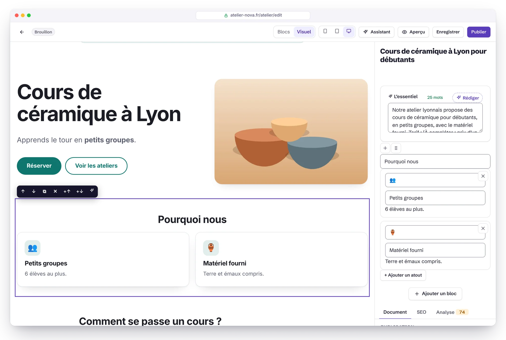
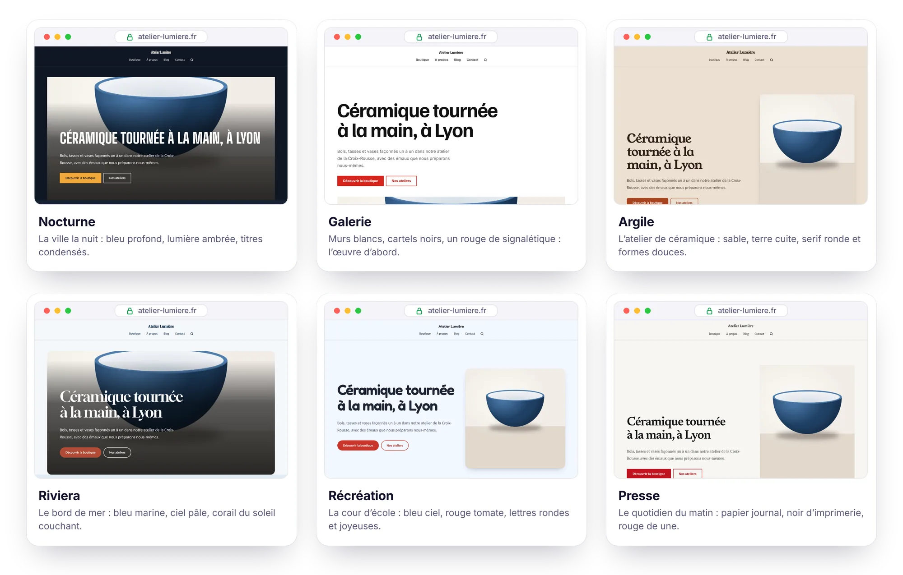
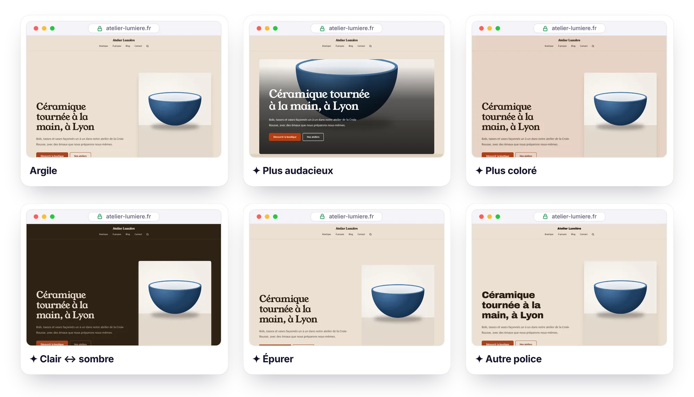
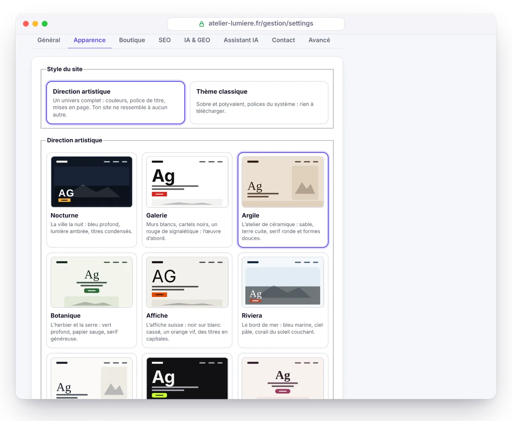

<p align="center">
  <b>Français</b> · <a href="GUIDE.en.md">English</a> · <a href="GUIDE.es.md">Español</a> · <a href="GUIDE.de.md">Deutsch</a> · <a href="GUIDE.it.md">Italiano</a> · <a href="GUIDE.pt-BR.md">Português</a> · <a href="GUIDE.zh-CN.md">简体中文</a>
</p>

# Guide d'Éclair CMS

Tout ce qu'il faut savoir pour installer, utiliser, sécuriser et maintenir Éclair. Pour la présentation, retourne au [README](../README.md).

## Sommaire

1. [Installation](#installation)
2. [Fonctionnalités en détail](#fonctionnalités-en-détail)
3. [Utiliser Éclair au quotidien](#utiliser-éclair-au-quotidien)
4. [Mode Visuel](#mode-visuel)
5. [Directions artistiques](#directions-artistiques) (dont les [Retouches en un clic](#retouches-en-un-clic), [Imagine ma direction avec l'IA](#imagine-ma-direction-avec-lia) et le [Score Design](#score-design))
6. [Thèmes](#thèmes)
7. [Boutique](#boutique)
8. [Assistant IA](#assistant-ia) (dont [Créer une page avec l'IA](#créer-une-page-avec-lia), le [Planning éditorial](#planning-éditorial), l'[Ancien site](#ancien-site-wayback-machine), l'[Affiliation](#affiliation) et [Google Discover](#google-discover))
9. [Connecteur MCP (Claude et ChatGPT)](#connecteur-mcp-claude-et-chatgpt)
10. [Sécurité](#sécurité)
11. [Mettre à jour, sauvegarder, déménager](#mettre-à-jour-sauvegarder-déménager) (dont la [Mise à jour en un clic](#mise-à-jour-en-un-clic) et les [Sauvegardes sur Google Drive](#sauvegardes-sur-google-drive))
12. [Dépannage](#dépannage) (dont [Nginx](#nginx))
13. [Pour les développeurs](#pour-les-développeurs)

---

## Installation

### Prérequis

- **PHP 8.1 ou plus** (8.3 recommandé), avec les extensions `mbstring`, `json`, `dom`, `session` et `zlib` (présentes par défaut presque partout).
- Recommandé : `gd` (images WebP), `zip` (sauvegardes en un clic), `curl` (IndexNow, assistant IA, police des directions artistiques).
- Un serveur **Apache ou LiteSpeed** (le cas de la quasi-totalité des mutualisés : OVH, o2switch, Hostinger, IONOS, PlanetHoster…). Pour Nginx, voir [plus bas](#nginx).
- Un certificat HTTPS (gratuit avec Let's Encrypt chez presque tous les hébergeurs).

L'assistant vérifie tout cela pour toi et explique quoi corriger.

### Étapes

1. Télécharge l'archive [`eclair-cms-2.1.0.zip`](https://github.com/Jacckisback/eclair-cms/raw/main/dist/eclair-cms-2.1.0.zip) (875 Ko) et décompresse-la.
2. Envoie **le contenu du dossier `eclair`** dans le dossier public de ton hébergement (`public_html`, `www`…) avec ton logiciel FTP (FileZilla…) ou le gestionnaire de fichiers de ton hébergeur.
   > ⚠️ Les fichiers `.htaccess` sont cachés : active « Afficher les fichiers cachés » pour être sûr de les envoyer.
3. Ouvre l'adresse de ton site : **l'assistant d'installation démarre** (en 7 langues).
4. Réponds à 4 questions (ton site, ton compte, ta visibilité, l'adresse de ton administration). Confettis 🎉 : ton site est en ligne, avec des pages et un article d'exemple.

> 🔒 Par sécurité, l'installation doit être faite **dans les 2 heures** qui suivent la première visite (sinon n'importe qui pourrait s'emparer d'un site déposé puis oublié). Passé ce délai, supprime le fichier `data/install-window.php` par FTP et recharge la page.

Installation dans un sous-dossier (`exemple.fr/site/`) : envoie simplement les fichiers dans ce sous-dossier, tout est détecté automatiquement.

### Les 7 types de site proposés

| Type | Ce qui est créé |
|---|---|
| 🏢 Site vitrine | Accueil (bannière, atouts, derniers articles), Services (avec FAQ), À propos, Contact, Blog, mentions légales, confidentialité |
| ✍️ Blog | Accueil = derniers articles, À propos, Contact, catégorie « Guides », pages légales |
| 🧑‍💻 Freelance / portfolio | Accueil à ton nom, compétences, À propos, Blog, Contact, pages légales |
| 🎯 Page unique | Une page de vente (bannière, atouts, FAQ, formulaire) + pages légales, sans blog |
| 🧭 Média / Google Discover | Comme un blog (accueil = derniers articles, À propos, Contact, pages légales) ; le tableau de bord met en avant Discover, les tendances du jour et la publicité |
| 🛍️ Affiliation | Comme un blog ; le tableau de bord met en avant tes liens d'affiliation et les articles rédigés par l'IA |
| 🕰️ Relancer un ancien site | Comme un blog ; le tableau de bord commence par retrouver les anciennes adresses de ton domaine (Ancien site) |

Les contenus de départ existent en français, espagnol et anglais. Les pages légales contiennent un squelette à compléter (LCEN en France, LSSI en Espagne, RGPD).

Le type choisi devient l'**usage du site** (Réglages › Général, modifiable à tout moment) : le tableau de bord s'ouvre sur une carte qui réunit les outils de cet usage, avec leur état. Rien ne change sur le site public.

### Juste après l'installation

Le tableau de bord affiche une checklist « Premiers pas » : logo et couleur, page d'accueil, premier article, profil d'auteur, double authentification, mentions légales, Google Search Console. La prochaine étape est surlignée en jaune, et chacune dit en une phrase à quoi elle sert. Pour un média, un site d'affiliation ou un ancien site, elle commence par l'étape propre à cet usage.

---

## Fonctionnalités en détail

### ⚡ Vitesse

- **Cache statique automatique** : chaque page est générée une fois, puis servie sans charger l'application. Le cache se vide tout seul à chaque modification (et à l'heure prévue pour un article programmé).
- **CSS intégré dans la page** (17 à 23 Ko selon le thème et la boutique, 5 à 6 Ko compressés), polices système : aucune requête bloquante, aucun décalage de mise en page. Avec une direction artistique, une seule police de titre s'y ajoute (12 à 27 Ko), servie par ton site et préchargée.
- **Images optimisées à l'envoi** : redimensionnées (2000 px max), déclinées en **WebP responsive** (480, 800, 1200, 1600 px), dimensions explicites, chargement différé, priorité donnée à l'image principale.
- ETag et réponses `304 Not Modified`, compression Brotli/Gzip et cache navigateur d'un an pour les fichiers statiques (via `.htaccess`).

### 🔎 SEO

- URL propres, **redirection 301 automatique** quand une adresse change, gestionnaire de redirections (pratique pour reprendre un ancien site WordPress ou Wix).
  - Les adresses sous `/.well-known/`, `/_eclair/` et `/__eclair/` ne peuvent pas être redirigées. Exception : un administrateur peut rediriger une adresse `/.well-known/…` comme `change-password`, mais jamais `acme-challenge` ni `pki-validation`. Les anciennes redirections depuis ces adresses sont marquées « Désactivée » et peuvent être supprimées (un administrateur peut recréer celles qui sont permises).
  - Suivre une redirection ne ralentit plus le site, et le nombre d'utilisations reste affiché.
- **Reprise d'un site WordPress complet** (fonction « Import WordPress ») : installe l'extension [Eclair Export](https://github.com/Jacckisback/eclair-export) sur le site WordPress, puis envoie son paquet ici (ou dépose-le par FTP dans `data/import/`). Contenus, images, documents PDF, SEO (Yoast, Rank Math, AIOSEO), menus et redirections sont repris, chaque adresse est gardée ou redirigée en 301, les liens internes sont réécrits. Le mode **Simuler** montre ce qui sera créé sans rien écrire. En SSH : `php app/bundled/wordpress/lib/cli.php import paquet.zip [--dry-run]`.
- Titre, méta-description et **aperçu Google en direct** dans l'éditeur, avec compteurs.
- **Analyse SEO en temps réel** avec score : longueur du titre et de la description, expression-clé (titre, URL, introduction, intertitres, densité), nombre de mots, structure, textes alternatifs, maillage interne, image à la une…
- **Données structurées JSON-LD** complètes : WebSite (+ recherche), Organization / Person / LocalBusiness (adresse, horaires, profils sociaux, politique de retour), WebPage / AboutPage / ContactPage, BlogPosting (auteur, dates, section), BreadcrumbList, FAQPage, ProfilePage, et pour la boutique Product / ProductGroup / Offer (prix, stock, livraison).
- Sitemap XML avec images et `hreflang`, robots.txt, flux RSS complet, Open Graph et Twitter Cards (**image de partage 1200×630 générée automatiquement**), fil d'Ariane, URL canoniques.
- Une seule adresse par contenu : redirections HTTPS, www/sans www, slash final, majuscules, `index.php`.
- **IndexNow** : Bing, Yandex, Seznam… sont prévenus à chaque publication.
- Vérification Google Search Console et Bing Webmaster Tools (colle la balise `<meta>`, Éclair extrait le code).
- Multilingue : langue par contenu, liaison des traductions et balises `hreflang` automatiques.
- Typographie française automatique (espaces insécables avant `: ; ! ?` et dans les guillemets).

### 🤖 GEO (moteurs de réponse IA)

- **`/llms.txt`** (standard llmstxt.org) et **`/llms-full.txt`** générés automatiquement.
- **Version Markdown de chaque page** : ajoute `.md` à n'importe quelle URL (avec en-tête de métadonnées, `noindex` et URL canonique pour ne pas créer de contenu dupliqué).
- **Politique robots IA en un clic** : ouvert (recommandé pour être cité), citations seulement (moteurs de réponse autorisés, entraînement refusé) ou fermé. Gère GPTBot, OAI-SearchBot, ChatGPT-User, ClaudeBot, Claude-SearchBot, Claude-User, PerplexityBot, Google-Extended, Applebot-Extended, CCBot, Meta-ExternalAgent… Directive `Content-Signal` en option.
- Bloc **« L'essentiel »** : le résumé que les IA citent volontiers, affiché en tête d'article.
- **Score GEO** dans l'éditeur : résumé, introduction directe, FAQ, intertitres en questions, listes et tableaux, chiffres concrets, sources externes, auteur identifié (E-E-A-T), paragraphes courts, fraîcheur.
- Pages auteur avec biographie et profils (`sameAs`), dates de publication et de mise à jour visibles.
- **Robots IA** (menu de l'administration) : quelles IA lisent tes pages (ChatGPT-User, Claude-User, OAI-SearchBot, PerplexityBot, GPTBot, ClaudeBot…), lesquelles, et pour quel usage : consultation à la demande (quelqu'un a posé une question, une citation en puissance), indexation d'un moteur de réponse ou entraînement. Visites par jour, par robot et par page, lectures du robots.txt, pages publiées jamais lues avec quoi faire, alerte si des robots d'entraînement passent malgré le robots.txt, et une carte sur le tableau de bord. `index.php` note seulement l'heure, le robot et l'adresse, jamais d'IP ni de visiteur humain ; journal limité à 4 Mo par mois, effacé après 13 mois ; mesure réglable dans Réglages › IA & GEO. L'identité est celle que le robot déclare.

### ✍️ Éditeur de blocs

- 18 blocs : texte, intertitre (H2-H4), liste, citation, image, encadré, FAQ, tableau, bouton, vidéo YouTube/Vimeo (sans cookie avant le clic), code, séparateur, bannière, atouts, équipe (portraits, fonctions, présentations), derniers articles, produits (vitrine de la boutique), formulaire de contact.
- Tape **`/`** sur une ligne vide pour choisir un bloc, glisser-déposer, barre de mise en forme (gras, italique, lien, code, surlignage).
- **Liens internes assistés** : en tapant un lien, l'éditeur propose tes pages et articles (maillage interne en 2 secondes).
- **Collage intelligent** depuis Word, Google Docs ou une page web : titres, listes, tableaux et gras sont convertis en blocs propres.
- Enregistrement `Ctrl+S`, brouillon local de secours (rien n'est perdu en cas de coupure), aperçu réel avant publication, **historique des 20 dernières versions**, publication programmée.
  - Ce brouillon de secours appartient au compte connecté et s'efface à la déconnexion : il n'est jamais proposé à un autre compte qui utilise le même navigateur. Ceux de la 1.10.2 qui portent sur un contenu déjà enregistré sont repris sur un site à un seul compte ; ceux d'un nouveau contenu jamais enregistré, ou tous s'il y a plusieurs comptes, sont effacés après la mise à jour : enregistre tes modifications en cours avant de mettre à jour.
- **Mode Visuel** : la page telle qu'elle s'affiche avec ton thème, modifiable sur place ([détails](#mode-visuel)).
- **Annuler et rétablir** : `Ctrl+Z` (`Cmd+Z` sur Mac) et `Ctrl+Maj+Z` ou `Ctrl+Y`, ou les boutons ↶ ↷ de la barre, en mode Blocs comme en mode Visuel (60 étapes). Dans le champ où tu écris, `Ctrl+Z` reste celui du navigateur, lettre par lettre. Un bloc ou un élément supprimé (question de FAQ, atout, membre de l'équipe, variante, lien de menu) revient aussi d'un clic sur « Annuler » dans la notification. Ce qui ne s'annule pas (supprimer une page, une image, un compte) demande confirmation dans une fenêtre où « Annuler » a le focus : `Entrée` ne supprime jamais rien par mégarde.

### 🧩 Le reste

Médiathèque (glisser-déposer, textes alternatifs, détection des images utilisées), menus en glisser-déposer (en-tête et pied de page), catégories « piliers » pour un cocon sémantique, recherche sur le site, formulaire de contact anti-spam **sans captcha** (champ piège, jeton, limites par réseau et par jour) avec boîte de réception, comptes administrateur et rédacteur, 6 thèmes et 12 directions artistiques avec aperçu en direct, mode sombre automatique, 6 polices système, couleur principale avec contraste WCAG garanti, administration en 7 langues (français, anglais, espagnol, allemand, italien, portugais, chinois), site public en 6 langues (fr, es, en, de, it, pt).

---

## Utiliser Éclair au quotidien

| Je veux… | Où |
|---|---|
| Écrire un article | Tableau de bord › **Écrire un article** |
| Demander un article, une page, une image à l'IA | Champ **« Que veux-tu créer aujourd'hui ? »** du tableau de bord, ou **✨ Assistant IA** (`Ctrl+J`) |
| Faire composer une page complète par l'IA | Nouvelle page › **✨ Créer avec l'IA** |
| Modifier une page telle qu'elle s'affiche | Éditeur › **Visuel** |
| Modifier une page depuis le site | Bouton **✏️ Modifier** (visible seulement quand tu es connecté) |
| Changer de thème, logo, couleur, polices | Réglages › Apparence |
| Ajouter mon propre CSS | Réglages › Apparence › CSS personnalisé |
| Activer ou couper les micro-animations | Réglages › Apparence › Micro-animations (site) · Mon profil › Interface (administration) |
| Voir quelles IA lisent mon site | **Robots IA** |
| Planifier mes articles, en faire proposer et rédiger par l'IA | **Planning** |
| Redonner une page aux anciennes adresses de mon domaine | **Ancien site** |
| Gérer mes liens d'affiliation, en tirer un article avec l'IA | **Affiliation** |
| Préparer mes articles pour Google Discover, trouver des idées dans les tendances du jour | **Discover** |
| Afficher de la publicité AdSense sur mes articles | **Discover** › Publicité |
| Adapter le tableau de bord à mon usage | Réglages › Général › Usage du site |
| Ouvrir la boutique | Réglages › Boutique |
| Ajouter un produit | Contenus › **+ Produit** |
| Choisir la page d'accueil | Réglages › Général |
| Autoriser ou bloquer les IA | Réglages › IA & GEO |
| Activer l'assistant IA | Réglages › Assistant IA |
| Relier Google Search Console | Réglages › SEO |
| Ajouter un lien au menu | Menus |
| Rediriger une ancienne URL | Redirections |
| Activer la double authentification | Mon profil › Double authentification |
| Télécharger une sauvegarde | Sécurité › Sauvegarde |

Raccourcis de l'éditeur : `/` insérer un bloc · `Ctrl+S` enregistrer · `Ctrl+K` lien · `Ctrl+B` gras · `Ctrl+I` italique · `Entrée` nouveau paragraphe · `Maj+Entrée` retour à la ligne · `Ctrl+J` assistant IA · `Ctrl+Z` annuler · `Ctrl+Maj+Z` ou `Ctrl+Y` rétablir (`Cmd` sur Mac).

---

## Mode Visuel

<p align="center">
  
</p>

Le mode Visuel affiche ta page avec le vrai thème du site, exactement comme tes visiteurs la verront, et te laisse la modifier sur place. Bascule entre **Blocs** et **Visuel** en haut de l'éditeur : ton choix est retenu pour la prochaine fois.

- **Écrire** : clique sur un titre, un paragraphe, une question de FAQ, le texte d'un bouton… et tape. `Ctrl+B` gras, `Ctrl+I` italique, `Ctrl+K` lien (la recherche de pages de l'éditeur s'ouvre). `Entrée` valide un champ d'une ligne ; dans un paragraphe, elle crée le paragraphe suivant (`Maj+Entrée` pour un simple retour à la ligne). Le collage se fait en texte brut.
- **Organiser** : un clic sur un bloc l'entoure et affiche sa barre : deux flèches pour le déplacer, deux boutons pour ajouter un bloc au-dessus ou en dessous, un pour le dupliquer et, à part au bout de la barre, la croix ✕ pour le supprimer (elle rougit au survol). La barre se manie aussi au clavier (`Tab`, puis `Entrée`) ; après `Échap`, `Suppr` supprime le bloc sélectionné.
- **Images** : clique sur une image (bannière, bloc image, portrait de l'équipe, image à la une d'un article) pour en choisir une autre dans la médiathèque.
- **Réglages du bloc** : le panneau de droite montre le formulaire du bloc choisi (lien d'un bouton, nombre d'articles, nouvelle question de FAQ…), puis les onglets Document, SEO et Analyse.
- **✨ Retouches IA** (si l'assistant est activé) : améliorer, corriger, raccourcir, développer, simplifier, changer de ton ou traduire le texte du bloc.
- **Annuler et rétablir** : `Ctrl+Z` (`Cmd+Z` sur Mac) ou le bouton ↶ revient en arrière, `Ctrl+Maj+Z` ou `Ctrl+Y` (bouton ↷) rétablit, étape par étape (jusqu'à 60 étapes, communes aux modes Blocs et Visuel).
- **Largeur** : 📱 390 px, ▭ 768 px ou 🖥 pleine largeur, pour vérifier le rendu sur mobile et tablette.

Tout passe par l'éditeur habituel : enregistrement (`Ctrl+S` fonctionne aussi dans la page), brouillon local de secours, historique des versions, analyse SEO et GEO en direct. Les liens, boutons et formulaires de la page ne réagissent pas pendant l'édition. Un bloc invisible sur le site (image pas encore choisie, boutique fermée…) apparaît comme un cadre pointillé, à remplir depuis le panneau.

> [!NOTE]
> Le mode Visuel n'existe que dans l'aperçu de l'administration : connexion, jeton de sécurité et droit d'écrire requis, page jamais mise en cache ni indexée. Tes pages publiques n'en portent aucune trace : elles restent identiques à l'octet près.

---

## Directions artistiques

<p align="center">
  
</p>

Un thème change des couleurs ; une **direction artistique** change tout l'univers du site, à partir d'une idée concrète : la ville la nuit, l'atelier de céramique, le quotidien du matin. Dans **Réglages › Apparence**, choisis **Direction artistique** (au lieu de **Thème classique**), clique sur une des 12 cartes et regarde l'aperçu en direct : ton vrai site, sur ordinateur ou sur mobile. Rien n'est publié avant d'enregistrer.

| Direction | Univers | Police de titre |
|---|---|---|
| **Nocturne** | La ville la nuit : bleu profond, lumière ambrée | Big Shoulders Display, en capitales |
| **Galerie** | Murs blancs, cartels noirs, un rouge de signalétique | Familjen Grotesk |
| **Argile** | L'atelier de céramique : sable, terre cuite, formes douces | Young Serif |
| **Botanique** | L'herbier et la serre : vert profond, papier sauge | DM Serif Display |
| **Affiche** | L'affiche suisse : noir sur blanc cassé, orange vif | Archivo Black, en capitales |
| **Riviera** | Le bord de mer : bleu marine, ciel pâle, corail | Gloock |
| **Cabinet** | Le papier à en-tête : encre marine, bordeaux, filets fins | Libre Caslon Display |
| **Néon** | L'écran de création la nuit : quasi-noir, vert citron | Unbounded |
| **Douceur** | Le cabinet de soin : poudre rosée, prune, beaucoup d'air | Cormorant Garamond |
| **Chantier** | Béton, jaune de sécurité, signalétique condensée | Barlow Condensed, en capitales |
| **Récréation** | La cour d'école : bleu ciel, rouge tomate, lettres rondes | Fredoka |
| **Presse** | Le quotidien du matin : papier journal, rouge de une | Newsreader |

**Ajuster** : sous les cartes, **Ajuster la direction** ouvre tous les réglages, à combiner librement :

- **5 couleurs** : fond, bandes et cartes, texte, texte secondaire, accent (boutons et liens).
- **Police des titres** : 18 polices de caractère choisies pour leur personnalité (aucune de celles qu'on voit partout), ou une police système. **Police du texte** : une police système, sans téléchargement.
- **Casse** (normale ou capitales), **taille des titres** (discrète, équilibrée, spectaculaire), **coins** (droits, adoucis, ronds), **espacement** (serré, normal, aéré).
- **Cartes** : filet fin, aplat de couleur ou ombre portée.
- **Bannière d'accueil** : texte et image côte à côte, image à gauche, affiche (très grand titre), image plein cadre (le titre sur la photo), éditorial (image verticale), centrée ou encadrée (texte et image dans un panneau de couleur).
- **Bloc « Atouts »** : cartes, rangées, colonnes à filet ou numérotés (01, 02…). **Sections** : fond uni, bandes de couleur ou filets entre les sections. **Icônes des atouts** : icônes dessinées (65 icônes au trait, reconnues à partir des émojis courants : ☕ 🚗 🐶 ✂️ 🎓 💼 🌸…), sans icône, ou émojis.
- **Boutons** : pleins, à contour ou en liens soulignés (avec une flèche).

En-tête, listes d'articles, logo, icône, pied de page et CSS personnalisé se règlent comme avant. Pour revenir au thème classique, choisis **Thème classique** et enregistre : ses réglages t'attendent, intacts.

**Toujours lisible** : quelles que soient les couleurs choisies, Éclair ajuste automatiquement le texte (contraste **7:1** sur le fond), le texte secondaire, les liens et les boutons (4,5:1), y compris sur les fonds teintés de la couleur d'accent (pastilles, menu, surlignage). Une couleur trop pâle pour un texte sur fond clair est donc foncée juste ce qu'il faut.

**Toujours rapide** : la police de titre est **téléchargée une seule fois par ton serveur** (depuis Fontsource, licence SIL Open Font License), rangée dans `media/fonts/`, puis servie par ton site et préchargée avec `font-display: optional` : aucune requête vers un service tiers pour tes visiteurs, aucun décalage de mise en page. Seules les règles CSS utiles à ta direction sont insérées dans la page, et le mode sombre automatique laisse la place au choix clair ou sombre de la direction. Mesuré avec Lighthouse : 100 dans les quatre catégories avec Nocturne, Riviera, Presse et Affiche, et avec les nouvelles compositions (bannière à gauche ou encadrée, atouts numérotés, filets, boutons à contour ou soulignés).

> [!TIP]
> Si ton hébergeur bloque les connexions sortantes, la police ne peut pas être téléchargée : un message te prévient, et le site utilise une police de secours de la même famille (avec empattements, condensée…) en attendant. Réessaie plus tard en enregistrant de nouveau.

### Retouches en un clic

<p align="center">
  
</p>

Sous les cartes, six boutons transforment la direction choisie d'un seul clic, et l'aperçu suit aussitôt :

| Retouche | Ce qui change |
|---|---|
| **Plus audacieux** | titres plus grands, plus d'air, bannière plus spectaculaire (affiche, puis plein cadre), bandes de couleur, accent plus vif, boutons pleins |
| **Plus sobre** | titres plus discrets, casse normale, filets fins au lieu des ombres, bannière plus calme, accent adouci |
| **Plus coloré** | fond et bandes teintés de la couleur d'accent, bandes de couleur, accent plus vif |
| **Épurer** | filets fins, aucune icône, fond uni, plus d'air, coins plus droits, atouts en colonnes |
| **Clair ↔ sombre** | inverse la luminosité du fond, des bandes et du texte, en gardant leurs teintes |
| **Autre police** | passe à la police de titre suivante, en alternant les familles (empattements, grotesque, condensée…) |

Les retouches s'enchaînent ; **Annuler la retouche** revient en arrière, une étape à la fois. Les contrastes restent garantis à chaque étape, et rien n'est publié avant d'enregistrer.

### Imagine ma direction avec l'IA

<p align="center">
  
</p>

Quand l'[assistant IA](#assistant-ia) est activé, **Imagine ma direction avec l'IA** apparaît sous les cartes. Décris ton activité, ton public et l'ambiance voulue en une ou deux phrases (« boulangerie bio de quartier à Lyon, clientèle familiale, chaleureux mais moderne »), puis clique sur **Proposer 3 directions**. L'IA lit aussi la présentation de ton site et ton profil éditorial, et suit la méthode d'[Impeccable](https://github.com/pbakaus/impeccable) :

1. partir du monde concret de l'activité (lieux, matières, objets, lumière) plutôt que d'adjectifs ;
2. donner à chaque proposition **une référence précise** (« les plaques émaillées d'une boulangerie des années 50 ») et en tirer couleurs, police et compositions ;
3. proposer trois directions **vraiment différentes** (claire ou sombre, chaude ou froide, avec ou sans empattements) ;
4. éviter le choix par défaut de la catégorie (bleu marine et or pour un avocat…), son contraire prévisible et les tics du « design généré par IA ».

Les trois propositions s'ajoutent en tête des cartes, marquées ✦ : clique pour les voir dans l'aperçu, ajuste, puis enregistre celle qui te plaît. L'IA ne choisit que parmi les réglages d'Éclair (couleurs, polices de la liste, compositions) et n'écrit jamais de CSS : chaque proposition est vérifiée et ses contrastes corrigés avant d'arriver sur ton site. Le coût indicatif s'affiche sous le bouton (≈ 0,03 $ avec Claude Sonnet 5.5) et il est déduit du budget de l'assistant. Réservé aux administrateurs.

### Score Design

Dans l'éditeur, l'onglet **Analyse** affiche un troisième anneau, **Design**, à côté du SEO et du GEO. Il vérifie que la page tient la route visuellement :

- **intertitres** : hiérarchie sans saut (H2, puis H3, puis H4), courts, sans émoji décoratif ;
- **bannière** : titre court (8 mots au plus, 6 en capitales), bouton d'action, image si ta direction l'exige (plein cadre, éditorial) ;
- **appels à l'action** mesurés (3 boutons au plus) ;
- **bloc « Atouts »** de 3 à 6 éléments décrits, avec des icônes qui ont leur équivalent dessiné ;
- **texte** : pas de phrases en MAJUSCULES, pas de formules creuses (« révolutionnaire », « clé en main », « seamless »… selon la langue de la page), pas d'abus de tirets cadratins, pas de passage répété à l'identique, pas de mur de plus de 350 mots sans intertitre, image ou liste ;
- **direction artistique** choisie pour le site.

La note de l'onglet Analyse fait désormais la moyenne des trois anneaux.

---

## Thèmes

Éclair est livré avec **6 thèmes**. Choisis-en un dans **Réglages › Apparence** : l'**aperçu en direct** montre ton vrai site (accueil, blog, un article, la boutique, un produit) sur ordinateur ou sur mobile, et rien n'est publié tant que tu n'as pas enregistré. Tu peux naviguer dans l'aperçu : les liens restent dans l'aperçu.

| Thème | Esprit | Pour qui |
|---|---|---|
| **Éclair** | Clair, moderne et polyvalent : le thème d'origine | Tous les sites |
| **Éditorial** | Un magazine : typographie à empattements, filets fins, lettrine, article à la une | Blogs, médias, auteurs |
| **Atelier** | Chaleureux et artisanal : tons crème et terre cuite, formes douces | Artisans, restaurants, bien-être |
| **Studio** | Portfolio minimaliste : noir et blanc, grands titres, images à vif | Photographes, designers, agences |
| **Boutique** | Pensé pour vendre : photos carrées, en-tête fixe, boutons francs | Boutiques, créateurs |
| **Contraste** | Lisibilité maximale : grand texte, contrastes forts, liens soulignés | Services publics, associations, seniors |

Choisir un thème applique sa couleur et ses polices conseillées : tu peux les changer ensuite. Deux réglages de mise en page complètent le thème : l'**en-tête** (logo à gauche et menu à droite, ou tout centré) et les **listes d'articles et de produits** (grille de cartes, ou liste avec l'image à gauche).

**Pourquoi c'est léger** : un thème Éclair n'est qu'une feuille de style de 1,5 à 3 Ko, ajoutée à celle de base. Le HTML ne change pas d'un thème à l'autre : la vitesse, l'accessibilité, les données structurées et le référencement restent identiques. Seul le thème actif est inséré dans la page, et le mode sombre automatique fonctionne avec chacun.

**CSS personnalisé** : pour aller plus loin que le thème (couleur d'un bouton, espacements, style d'un bloc), colle tes règles dans **Réglages › Apparence › CSS personnalisé**. Elles sont ajoutées après le thème dans chaque page, donc elles l'emportent, et elles sont rangées avec tes données (`data/`) : **les mises à jour d'Éclair les conservent**. Les repères `/*dark*/ … /*/dark*/` fonctionnent aussi : leurs règles disparaissent quand le mode sombre est réglé sur « Toujours clair ». Par sécurité, le caractère `<` et les règles `@import` sont retirés ; 64 Ko maximum.

**Micro-animations** (Réglages › Apparence) : cartes, atouts, questions de FAQ, encadrés et images apparaissent en glissant au défilement, et boutons et images réagissent au survol. C'est du CSS seul (moins de 1 Ko ajouté à la page, aucun script) : les éléments glissent sans jamais devenir transparents, donc aucun décalage de mise en page, aucun texte pâli, rien d'animé au chargement, et le texte reste dans la page pour Google et les IA. Mesuré : 100 dans les quatre catégories de Lighthouse, avec ou sans. Elles sont coupées pour les visiteurs qui ont demandé moins de mouvement à leur appareil, et à l'impression. Activées sur les sites installés avec la 1.11 ; sur un site plus ancien, les pages restent identiques à l'octet près tant que tu ne les actives pas. Les animations de l'administration se coupent, elles, dans **Mon profil › Interface** (réglage propre à ce navigateur).

---

## Boutique

Le **mode boutique léger** sert à vendre quelques dizaines de produits sans la lourdeur d'un e-commerce : pas de panier, pas de comptes clients, pas de base de données, aucune donnée bancaire sur ton serveur. Chaque produit a sa fiche, optimisée pour Google et les IA, et son bouton **Acheter** mène à un **lien de paiement Stripe, PayPal ou Revolut Business** : ton prestataire encaisse, envoie les reçus et gère les remboursements.

### Ouvrir la boutique

1. **Publie tes mentions légales** (l'installation en a créé un squelette à compléter) **et tes conditions générales de vente**. La boutique refuse de s'ouvrir sans elles : fais-les relire, elles engagent ta responsabilité de vendeur.
2. Dans **Réglages › Boutique** : choisis ces deux pages, la devise, les frais et délais de livraison, les pays livrés et le délai de retour (dans l'UE, la vente à distance donne au moins 14 jours pour se rétracter, sauf exceptions comme un produit personnalisé).
3. Clique sur **Créer la page de remerciement** : Stripe peut y renvoyer tes clients après le paiement.
4. Active **Boutique ouverte**, enregistre, puis ajoute la boutique au menu (Menus › Boutique).

Le catalogue est à l'adresse `/boutique` (`/tienda`, `/shop`, `/negozio` ou `/loja` selon la langue du site), modifiable ; si tu la changes, les anciennes adresses sont redirigées.

### Créer une fiche produit

Contenus › **+ Produit**. En haut de l'éditeur, la fiche produit :

- **Prix** et **prix barré** (facultatif : la remise s'affiche en pourcentage), **disponibilité** (en stock, épuisé, précommande).
- **Lien de paiement** : le lien Stripe, PayPal ou Revolut Business du produit.
- **Photos** : la première est la principale (Google, réseaux sociaux) ; vise au moins 3 vues.
- **Variantes** (taille, couleur…) : chacune peut avoir son prix et son lien. Sur le site, le choix se fait sans JavaScript.
- **Détails pour Google Shopping** : marque, référence, code-barres (GTIN/EAN), état (neuf, occasion, reconditionné), produit numérique ou service (pas de livraison).

Dessous, décris le produit avec les blocs habituels, et range-le dans une **catégorie de produits** (Catégories › « Elle regroupe : des produits »). L'analyse SEO vérifie en plus le prix, le lien de paiement, le nombre de photos et les identifiants. Pour mettre des produits en avant sur une page, ajoute le bloc **Produits**.

Avec l'assistant IA : joins une photo et demande « Crée la fiche produit de la photo jointe. Prix : 29,90 € ». Il rédige un brouillon complet, mais **n'invente jamais un prix, une remise ou un lien de paiement** : ce qui manque, tu le complètes.

### Relier Stripe (Payment Links)

1. Dans Stripe, ouvre **Liens de paiement** (Payment Links) et crée un lien : produit, prix, et collecte de l'adresse de livraison si besoin.
2. Dans l'onglet **Après le paiement**, choisis de rediriger le client vers ta page de remerciement (son adresse est affichée dans Réglages › Boutique).
3. Dans les réglages de Stripe (**E-mails clients**), active les reçus des paiements réussis.
4. Copie le lien et colle-le dans la fiche produit. Éclair y ajoute la référence du produit (`client_reference_id`) : chaque paiement indique ce qui a été acheté.

Chaque commande t'arrive dans Stripe (et par e-mail si tu l'as activé) : tu prépares et expédies, Stripe gère le remboursement si besoin. Un autre prestataire fonctionne aussi, du moment que son lien de paiement commence par `https://`.

### Ou relier PayPal ou Revolut Business

Même principe : un lien de paiement à prix fixe par produit (ou par variante à un autre prix), collé dans la fiche produit. Éclair reconnaît ces liens et affiche « Paiement sécurisé par PayPal » ou « par Revolut » sous le bouton d'achat.

- **PayPal** : dans ton compte professionnel, ouvre **Liens et boutons de paiement**, crée un lien à prix fixe pour ton produit, puis copie-le (il commence par `https://www.paypal.com/`). Ton client paie avec son compte PayPal ou par carte.
- **Revolut Business** : il faut un compte marchand. Dans **Marchand › Lien de paiement** (Merchant › Payment link), crée un lien avec le montant du produit, puis copie-le (`https://checkout.revolut.com/…`). Ton client paie sur la page de paiement de Revolut.

Deux différences avec Stripe : après le paiement, le client reste sur la page de confirmation du prestataire (pas de retour automatique vers ta page de remerciement), et la référence du produit n'est pas ajoutée au paiement : donne à chaque lien un nom clair pour reconnaître tes commandes.

### Ce qui est fait pour Google et les IA

- **Données structurées** Product et Offer sur chaque fiche (ProductGroup pour les variantes) : prix, devise, stock, état, marque, frais et délais de livraison, et **politique de retour** au niveau de ton entreprise. Ce sont les informations que Google affiche dans les résultats produits.
- **Flux produits** `/products.xml` au format Google Merchant Center : ajoute-le comme source de produits dans Merchant Center pour apparaître gratuitement dans l'onglet Shopping.
- Catégories de produits en pages piliers, sitemap avec toutes les photos, fil d'Ariane.
- Pour les IA : prix et disponibilité de chaque produit dans `llms.txt`, et dans la version Markdown de chaque fiche (ajoute `.md` à son adresse).

### Combien ça coûte ?

Rien côté Éclair. Stripe ne prend ni abonnement ni frais d'installation, et les liens de paiement sont inclus : tu paies seulement une commission par paiement, par exemple **1,5 % + 0,25 €** pour une carte standard de l'Espace économique européen (2,8 % + 0,25 € pour une carte premium, 3,15 % + 0,25 € pour une carte hors EEE, plus 2 % en cas de conversion de devise). Tarifs relevés le 30 octobre 2026 sur [stripe.com/fr/pricing](https://stripe.com/fr/pricing) ; ils peuvent évoluer.

Avec **Revolut Business**, la commission est de **1 % + 0,20 €** pour une carte de particulier de l'Espace économique européen (2,8 % + 0,20 € pour une carte hors EEE), liens de paiement inclus ([aide Revolut](https://help.revolut.com/en-ES/business/help/merchant-accounts/fees/how-much-does-it-cost-to-accept-card-payments/), [tarifs Revolut](https://www.revolut.com/en-IE/business/accept-payments-pricing/)). Avec **PayPal** en France, elle est de **1,2 % + 0,35 €** pour un paiement par carte et de **2,9 % + 0,35 €** avec un compte PayPal, plus 1,99 % hors EEE (1,29 % depuis le Royaume-Uni) ([grille PayPal](https://www.paypal.com/fr/business/paypal-business-fees), mise à jour du 15 juillet 2026). Tarifs relevés le 31 octobre 2026.

### Ce que la boutique ne fait pas

Pas de panier multi-produits, de codes promo, de comptes clients ni de gestion de stock automatique : l'idée est de rester simple. Si tu vends des centaines de références ou que tu as besoin de ces fonctions, un e-commerce complet (Shopify, WooCommerce, PrestaShop) sera plus adapté. Les prix affichés sont ceux que tu saisis : affiche-les TTC si tu vends à des particuliers.

---

## Assistant IA

L'assistant rédige des brouillons, améliore tes textes et crée des images **dans le ton de ton site**. Tu le pilotes en langage naturel, comme un collègue : « Écris un article sur le choix des couleurs d'une marque, avec une image. » Il cherche d'abord si le sujet existe déjà, crée l'image, rédige le brouillon complet (titre, L'essentiel, intertitres, listes ou tableaux, FAQ, méta-description, liens internes), puis te le présente avec ses scores SEO et GEO. **Rien n'est publié sans ton clic.**

Il fonctionne avec **Claude** (Anthropic) ou **ChatGPT** (OpenAI), avec ta propre clé d'API : pas d'abonnement Éclair, tu paies directement le fournisseur, au réel. Tu préfères utiliser ton abonnement Claude ou ChatGPT ? Passe par le [connecteur MCP](#connecteur-mcp-claude-et-chatgpt).

### Activer l'assistant (5 minutes)

1. Crée une clé d'API chez le fournisseur choisi : [console.anthropic.com](https://console.anthropic.com/settings/keys) pour Claude, [platform.openai.com](https://platform.openai.com/api-keys) pour ChatGPT, et ajoute quelques dollars de crédit.
2. Dans **Réglages › Assistant IA**, choisis le fournisseur, colle la clé, choisis le modèle, puis clique sur **Tester la connexion** (gratuit : aucun texte n'est généré).
3. Pour les images, choisis un générateur : **GPT Image 2.5** (même clé que ChatGPT), **FLUX 3** ([dashboard.bfl.ai](https://dashboard.bfl.ai)) ou **Ideogram 3** ([ideogram.ai](https://ideogram.ai/manage-api), idéal pour les visuels avec du texte). Sans générateur, l'assistant utilise ta médiathèque et les photos que tu lui joins.
4. Clique sur **Rédiger mon profil à partir de mon site**, relis, ajuste, enregistre.

L'assistant apparaît alors dans le menu (**✨ Assistant IA**, `Ctrl+J`), dans l'éditeur et sur le tableau de bord. Les rédacteurs y ont accès si tu le permets.

**Claude ou ChatGPT, au choix** : enregistre les deux clés et un sélecteur apparaît en haut de l'assistant pour choisir l'IA à chaque conversation. Ton choix est retenu pour ton compte, retouches de l'éditeur comprises ; le fournisseur choisi dans les réglages reste celui par défaut.

### Le profil éditorial

C'est ce qui fait écrire l'IA **comme toi** : qui tu es et ce que tu proposes, pour qui tu écris, ton et style (tutoiement ou vouvoiement, longueur des phrases, humour), valeurs, règles à respecter (« toujours un lien vers la page contact », « jamais de prix ») et style des images. Un clic le rédige à partir de tes pages et articles ; tu gardes le dernier mot. À chaque demande, l'assistant suit aussi les règles d'analyse d'Éclair : ses brouillons visent un score SEO et GEO élevé dès le départ.

### Ce que tu peux demander

- « Écris un article sur l'entretien d'un vélo électrique au printemps, avec une image. »
- « Ajoute Léa Martin, directrice artistique, à la page équipe avec la photo jointe. » (joins la photo avec 📎, un glisser-déposer ou un collage)
- « Crée une page Nos services qui présente nos trois formules. »
- « Propose-moi 5 idées d'articles pour attirer de nouveaux clients. »
- « Relis ma page d'accueil et propose des améliorations. »
- Dans l'éditeur : « Ajoute une FAQ à cet article », « Rends l'introduction plus percutante ».

Chaque action produit une **carte** sous la réponse :

| Carte | Ce qui s'est passé | Tes boutons |
|---|---|---|
| 📝 Brouillon | Nouvel article ou nouvelle page, jamais publié | Ouvrir · Aperçu · Publier maintenant ou programmer |
| ✏️ Modification proposée | Pour un contenu **publié** : rien ne change avant ton accord | Aperçu · Appliquer · Ignorer, puis Annuler si besoin |
| ✅ Mis à jour | Un **brouillon** modifié directement | Ouvrir · Aperçu · Annuler |
| ✅ Dans l'éditeur | Le contenu ouvert est modifié dans l'éditeur | Annuler (puis tu enregistres) |
| 🖼️ Image | Image créée, optimisée (WebP) et rangée dans la médiathèque | Image à la une (dans l'éditeur) |

« Annuler » reste possible tant que personne n'a retouché le contenu depuis ; sinon, ses versions précédentes restent dans l'**historique des versions** de l'éditeur. L'historique garde tes 30 dernières conversations. L'assistant n'invente jamais de faits sur ton activité (prix, horaires, chiffres, témoignages) : quand une information manque, il laisse un repère visible comme **[À compléter : prix]** et te le signale ; l'onglet Analyse les compte tant qu'ils restent.

### Créer une page avec l'IA

Dans un nouveau contenu (page, article ou produit), le cadre **✨ Créer avec l'IA** compose un brouillon complet en un seul appel :

1. Choisis le type et la langue, puis décris ce que tu veux en une ou deux phrases. Ajoute si tu veux l'**objectif** (« obtenir des demandes de devis »), le **public**, le **ton** et les **sections** souhaitées (« bannière, atouts, tarifs, FAQ, contact »).
2. Le **coût estimé** s'affiche avant de lancer (≈ 0,08 $ avec Claude Sonnet 5.5, ≈ 0,16 $ avec Claude Opus 5.5) ; il est déduit du budget de l'assistant. Avec les deux clés, tu choisis Claude ou ChatGPT.
3. Après 20 à 60 secondes, le brouillon s'ouvre en **mode Visuel** : titre, adresse, titre SEO et méta-description, « L'essentiel », expression-clé et une mise en page en sections (bandeau, atouts, intertitres, listes, encadrés, FAQ, boutons, équipe, formulaire de contact, derniers articles ou produits), avec un seul H1, le titre du bandeau.

L'IA s'appuie sur ton profil éditorial, la liste de tes pages et articles en ligne (pour des liens qui existent) et tes 30 dernières images. Elle n'invente aucun fait : prix, chiffres, noms ou horaires absents restent sous la forme **« [À compléter : …] »**, comptés par l'onglet Analyse jusqu'à ce que tu les remplisses. Le brouillon n'est jamais publié : relis, complète, puis publie. Si le site compte déjà 500 brouillons, le cadre te demande d'abord d'en publier ou d'en supprimer, avant toute dépense.

### Planning éditorial

Menu **Planning** : tes prochains articles dans un calendrier du mois (publiés, programmés, brouillons, idées) et une liste « À venir ».

- **Ajouter une idée** à la main : titre, date prévue, mot-clé, catégorie, angle et notes pour la rédaction.
- **Proposer des idées avec l'IA** : 4 à 12 idées d'après ton site (activité, catégories, articles déjà écrits, pages que les IA lisent le plus dans Robots IA) et un thème facultatif. Elles sont placées sur les prochains jours libres, au rythme choisi (1 à 5 par semaine). Rien n'est publié.
- **Rédiger** : l'IA écrit l'idée en brouillon complet, avec le même moteur que « Créer avec l'IA », puis l'éditeur s'ouvre. Relis, complète les « [À compléter : …] », programme.
- **Coût** : chaque bouton affiche le coût estimé (≈ 0,035 $ la série d'idées et ≈ 0,08 $ l'article avec Claude Sonnet 5.5) ; après coup, les jetons et les dollars dépensés sont notés sur l'idée et dans le total du planning, et comptés dans le budget de l'assistant.
- **Rédaction automatique** (administrateurs, coupée par défaut) : l'IA rédige l'idée due 1 à 14 jours avant sa date, une à la fois, dans le budget, quand un administrateur ouvre l'administration. Pour ne pas en dépendre, fais appeler toutes les heures l'adresse secrète affichée (cron de l'hébergeur, cron-job.org…). « Programmer sans relecture » existe mais est déconseillé : Google pénalise les textes publiés en série sans regard humain, et un article qui contient encore « À compléter » attend toujours ta relecture.

### Ancien site (Wayback Machine)

Menu **Ancien site** (administrateurs) : quand tu reprends un domaine qui a déjà eu un site, des liens pointent encore vers ses anciennes adresses. Éclair les retrouve dans la Wayback Machine et leur redonne une page.

- **Chercher** : Éclair interroge l'index de la Wayback Machine pour le domaine du site seulement (www compris), jusqu'à la date choisie. L'accueil, les adresses à paramètres (`?p=12`), les autres domaines et les adresses en `.php` (refusées par le `.htaccess`) sont écartés ; les pages de liste (étiquettes, catégories, pagination…) arrivent décochées.
- **Reconstruire** : pour chaque adresse cochée, l'IA écrit une page ou un article **neuf** à partir du seul titre de l'ancienne page. Ni son texte ni ses images ne sont recopiés, et l'ancienne marque n'est pas reprise. Une adresse à la fois, avec un bouton d'arrêt ; image de couverture neuve en option.
- **Adresses** : la page garde l'ancienne adresse quand Éclair peut la servir telle quelle ; sinon, l'ancienne redirige vers la nouvelle (301). Une adresse déjà servie par ton site n'est jamais remplacée.
- **Publier** : tout part en brouillon. « Publier les brouillons relus » publie en une fois, sauf ceux qui contiennent encore « [À compléter : …] ».
- **Coût** : affiché avant (par page) et après (jetons et dollars, par adresse et au total), dans le budget de l'assistant.

> ⚠️ Google pénalise les domaines expirés remplis de pages sans valeur pour le visiteur ([règles anti-spam](https://developers.google.com/search/docs/essentials/spam-policies#expired-domains)) : relis et enrichis chaque page avant de la publier.

### Affiliation

Menu **Affiliation** : tes liens d'affiliation au même endroit, avec tes notes sur chaque produit.

- **Mention publicitaire automatique** : sur chaque page qui contient un lien affilié, et dans le flux RSS, Éclair affiche la mention « Liens d'affiliation » dans la langue de la page (ou ton propre texte), juste après le bandeau d'ouverture. Une publicité doit être clairement identifiable comme telle : [LCEN, art. 20](https://www.legifrance.gouv.fr/loda/article_lc/LEGIARTI000018048180) en France, [LSSI, art. 20](https://www.boe.es/buscar/act.php?id=BOE-A-2002-13758) en Espagne.
- **Amazon** : pour un lien Amazon, la phrase exigée par le Partenariat Amazon est ajoutée, dans la langue de la boutique (« En tant que Partenaire Amazon, je réalise un bénéfice sur les achats remplissant les conditions requises. » pour amazon.fr). Les liens Amazon avec ton identifiant (`tag=`) et les liens courts amzn.to sont reconnus même s'ils ne sont pas dans la liste.
- **Pour Google** : chaque lien affilié est marqué `rel="sponsored nofollow"`. Aucun lien masqué ni redirection : les liens mènent directement au marchand.
- **Écrire un article avec l'IA** : coche des liens, choisis un comparatif (2 à 10 liens), une présentation de produit ou un guide d'achat. L'IA n'écrit qu'à partir des noms et de tes notes : elle n'invente ni prix, ni avis, ni résultat de test, et laisse « [À compléter : …] » là où ton avis compte. Le brouillon s'ouvre dans l'éditeur ; rien n'est publié.

Tant qu'aucun lien n'est enregistré, rien ne change sur ton site.

### Google Discover

Menu **Discover** : ce qui aide tes articles à apparaître dans le fil Discover de Google, les tendances du jour et la publicité. Google n'offre aucun réglage pour « se positionner » sur Discover : un article indexé y est éligible automatiquement ([recommandations de Google](https://developers.google.com/search/docs/appearance/google-discover?hl=fr)).

- **Prêt pour Discover** : le site (ouvert aux moteurs, HTTPS, logo, pages « À propos » et « Contact ») et tes 100 derniers articles sont contrôlés : image de 1200 px de large au moins (jamais le logo), titre sans sensationnalisme (majuscules, « !! »), auteur présenté, longueur. Un lien « Corriger » pour chaque point. Les données structurées donnent la grande image d'origine, sans recadrage.
- **Tendances du jour** : les recherches qui montent sur Google dans le pays choisi (flux public de Google Trends, lu au plus une fois par heure), avec les titres de presse. « Ajouter au planning » en fait une idée datée du jour. Avec l'assistant IA, « Proposer des idées pour mon site » ne garde que les tendances qui touchent ton sujet (souvent aucune) et propose au plus 4 articles utiles et durables, jamais un article d'actualité.
- **Publicité (Google AdSense)**, administrateurs : ton identifiant d'éditeur, les annonces automatiques et/ou un bloc d'annonces qu'Éclair place entre deux blocs du texte (après le 2e paragraphe, au milieu des articles longs, à la fin), avec l'étiquette « Publicités » exigée par Google et sa place réservée. Seulement sur les articles, jamais sur les pages ni dans l'aperçu ; case « Sans publicité sur cet article » dans l'éditeur.
- **Consentement** : la publicité ne s'active qu'une fois le message « Réglementations européennes » publié dans AdSense › Confidentialité et messages. Google exige une plateforme de consentement certifiée pour les visiteurs européens ([aide AdSense](https://support.google.com/adsense/answer/13554116)) ; la sienne s'affiche par le code AdSense.
- **ads.txt** : dès que l'identifiant est enregistré, Éclair publie `/ads.txt` et la balise qui permet à Google de valider ton site.

> ⚠️ Les scripts de Google ralentissent les pages qui ont de la publicité (Lighthouse n'y sera plus à 100) : Éclair réserve la place des annonces et ne charge rien sur les autres pages. Ne clique jamais sur tes propres annonces : Google l'interdit.

### Retouches dans l'éditeur

- **Sélectionne un passage**, puis ✨ dans la barre de mise en forme : améliorer, corriger les fautes, raccourcir, développer, simplifier, plus chaleureux, plus professionnel, traduire. Un clic sur « Annuler » rétablit le texte.
- **L'essentiel** : bouton « Rédiger ».
- **Onglet SEO** : titre SEO et méta-description, expression-clé, idées de titres.
- **Onglet Analyse** : ajouter une FAQ, textes alternatifs manquants, « Améliorer avec l'assistant ».
- **Image à la une** : « Créer avec l'IA » (articles).
- **Médiathèque** : « Décrire avec l'IA » écrit le texte alternatif d'une image en la regardant.

### Combien ça coûte ?

Tu paies le fournisseur selon l'usage réel. Éclair calcule chaque dépense à partir des jetons facturés et l'affiche dans Réglages › Assistant IA. Estimation pour un article complet (environ 25 000 jetons lus et 7 000 écrits, recherches et vérifications comprises) :

| Modèle | Prix pour 1 million de jetons (lus / écrits) | Article complet |
|---|---|---|
| Claude Opus 5.5 (le plus doué) | 4 $ / 20 $ | ≈ 0,24 $ |
| Claude Sonnet 5.5 | 2 $ / 10 $ | ≈ 0,12 $ |
| Claude Haiku 5.5 | 0,10 $ / 0,50 $ | < 0,01 $ |
| GPT-6 Astra | 10 $ / 50 $ | ≈ 0,60 $ |
| GPT-6.1 Sol | 2 $ / 10 $ | ≈ 0,12 $ |
| GPT-6.1 Terra | 1 $ / 5 $ | ≈ 0,06 $ |
| GPT-6 Luna | 0,10 $ / 0,50 $ | < 0,01 $ |

Une image coûte environ 0,05 $ (FLUX 3 en 1 mégapixel : 0,048 $). Tarifs publics relevés le 29 octobre 2026 sur les pages officielles d'[Anthropic](https://platform.claude.com/docs/en/about-claude/pricing), d'[OpenAI](https://developers.openai.com/api/docs/pricing) et de [Black Forest Labs](https://docs.bfl.ml/release-notes) ; ils peuvent évoluer. Les instructions fixes de l'assistant sont mises en cache chez le fournisseur, ce qui réduit le coût des demandes suivantes.

**Garde-fous** : budget mensuel maximum (10 $ par défaut), vérifié avant chaque étape d'une demande : une fois atteint, l'assistant s'arrête jusqu'au mois suivant. S'y ajoutent un nombre de demandes par personne et par jour (60 par défaut) et deux demandes à la fois au plus par personne. Quand le site compte 500 brouillons, l'IA n'en crée plus : elle te demande d'abord d'en publier ou d'en supprimer. Budget et quota se règlent dans Réglages › Assistant IA.

### Sécurité et confidentialité

- **L'IA prépare, tu décides** : elle peut chercher et lire tes contenus, créer des brouillons, modifier un brouillon (annulable), proposer une modification d'un contenu publié et créer des images. Elle ne peut **ni publier, ni supprimer, ni toucher aux réglages, aux menus ou aux comptes**. Publier reste un clic humain.
- **Brouillons et propositions vérifiés** : l'IA ne modifie directement qu'un contenu encore en brouillon ; s'il a été publié entre-temps, elle prépare une proposition à la place. Une proposition devient périmée dès que le contenu change, même dans la même seconde, et l'appliquer ne publie ni ne dépublie jamais le contenu.
- **Accès revérifié pendant la demande** : l'assistant s'arrête en pleine demande si le compte est supprimé, son mot de passe réinitialisé ou son accès à l'IA retiré.
- **Clés chiffrées** sur ton serveur (libsodium, ou AES-256-GCM), jamais envoyées au navigateur, jamais affichées (seul un indice « sk-ant…ab12 » l'est), **exclues des sauvegardes** comme l'historique des conversations. Pour une protection renforcée, ajoute `define('ECLAIR_SECRET', 'une-longue-phrase-secrète');` dans `eclair-config.php` (à faire avant d'enregistrer tes clés).
- **Ce qui part chez le fournisseur** : ta demande, les images que tu joins, le profil éditorial et le contexte utile (liste de tes pages et articles, contenu ouvert dans l'éditeur). N'y mets pas de données sensibles. Selon leurs conditions (vérifiées le 29 octobre 2026), [Anthropic](https://www.anthropic.com/legal/commercial-terms) n'entraîne pas ses modèles sur les données envoyées par API, et [OpenAI](https://help.openai.com/en/articles/5722486-api-data-usage-policies) non plus par défaut.
- **Contenus assainis** : tout ce que l'IA écrit passe par la même liste blanche que l'éditeur, et ses retouches ne touchent que le texte visible (jamais l'adresse d'un lien). Les images générées sont téléchargées en HTTPS depuis une adresse publique vérifiée, puis ré-encodées comme un envoi.
- **Injections de consignes** : les contenus lus par l'IA sont traités comme des données, jamais comme des ordres ; et même si une page piégée tentait de la détourner, elle ne pourrait que préparer un brouillon ou une proposition, que tu verrais avant tout effet.

### Si l'assistant ne répond pas

- **« Clé d'API refusée »** : la clé a été copiée incomplète ou révoquée : colle-la de nouveau et teste la connexion.
- **« Crédit épuisé »** : recharge ton compte chez le fournisseur.
- **« Budget IA du mois atteint »** : augmente le budget dans Réglages › Assistant IA, ou attends le mois suivant.
- **La réponse arrive d'un bloc au lieu de s'afficher au fil de l'eau** : un tampon de ton hébergeur retient le flux. Tout fonctionne, mais sans l'effet « en direct ». Sur Nginx, ajoute `fastcgi_buffering off;` dans le bloc PHP.
- **« Impossible de joindre… »** : ton hébergeur bloque les connexions sortantes. Demande-lui d'autoriser `api.anthropic.com` ou `api.openai.com` (et le générateur d'images choisi).
- **L'assistant ne s'affiche pas** : il faut l'extension PHP cURL et le chiffrement (sodium ou openssl), présents chez presque tous les hébergeurs ; l'assistant d'installation les vérifie.

---

## Connecteur MCP (Claude et ChatGPT)

Tu préfères travailler dans **Claude** ou **ChatGPT**, avec l'abonnement que tu as déjà ? Le connecteur MCP (*Model Context Protocol*, le standard ouvert qui relie les IA à des outils) leur ouvre ton site : ils lisent tes contenus, rédigent des brouillons dans ton ton et préparent des modifications. **Aucune clé d'API, aucun coût pour le site** : c'est ton abonnement qui travaille. Comme avec l'assistant intégré, **rien n'est publié ni supprimé** sans toi.

### Activer le connecteur (3 minutes)

1. Ton site doit être en **HTTPS** : Claude et ChatGPT refusent les autres adresses.
2. Dans **Réglages › Assistant IA**, en bas de page, active **Autoriser les connexions MCP**, enregistre, puis copie l'**adresse du connecteur** (`https://ton-site.fr/_eclair/mcp`).
3. Ajoute-la dans ton IA :
   - **Claude** (web et application de bureau) : *Personnaliser › Connecteurs › Ajouter › Ajouter un connecteur personnalisé*, donne un nom (« Mon site »), colle l'adresse, **Continuer**, garde les réglages d'authentification détectés, puis **Ajouter**. Sur les offres Team et Enterprise, c'est un propriétaire de l'organisation qui l'ajoute ; les membres cliquent ensuite sur **Connecter**.
   - **ChatGPT** (sur le web) : *Plugins › + › Ajouter un serveur MCP personnalisé*, donne un nom, colle l'adresse dans **Connexion**, choisis l'authentification **OAuth**, accepte l'avertissement, puis crée le plugin.
4. Une page de ton site s'ouvre : connecte-toi si besoin (double authentification comprise), vérifie l'application et son adresse de retour (`claude.ai` ou `chatgpt.com`), puis **Autoriser**. Ce bouton est d'abord grisé : il s'active au bout d'un instant, quand tu bouges la souris, touches l'écran ou utilises le clavier (sur écran tactile, un premier appui l'active, le second autorise).

C'est prêt. Demande par exemple : « Regarde mon site et propose-moi 5 idées d'articles », « Écris en brouillon un article sur l'entretien d'un vélo électrique » ou « Relis ma page d'accueil et propose une accroche plus directe ».

**Offres compatibles** (vérifiées le 30 octobre 2026) :

| Offre | Lire le site | Brouillons et propositions |
|---|---|---|
| **Claude** Free, Pro, Max, Team, Enterprise | ✅ | ✅ (Free : un seul connecteur personnalisé) |
| **ChatGPT** Business, Enterprise, Edu | ✅ | ✅ |
| **ChatGPT** Pro | ✅ | ❌ (lecture seule) |
| **ChatGPT**, autres offres | non prévu dans l'aide d'OpenAI | |

Sources : [aide Claude sur les connecteurs personnalisés](https://support.claude.com/en/articles/11175166-getting-started-with-custom-connectors-using-remote-mcp), [aide OpenAI sur les serveurs MCP personnalisés](https://help.openai.com/en/articles/12584461-connecting-custom-mcp-servers-in-chatgpt) et [documentation OpenAI](https://developers.openai.com/api/docs/guides/custom-mcp-server). Ces offres évoluent vite : vérifie dans ton application.

### Ce que l'IA peut faire

Elle commence par `get_site`, puis utilise les outils de l'assistant intégré, sauf la création d'images (payée par la clé du site) :

| Outil | Rôle |
|---|---|
| `get_site` | inventaire du site (pages, articles, produits, catégories et leurs identifiants), profil éditorial, règles SEO et GEO |
| `search_content` · `get_content` | chercher un contenu, le lire en Markdown |
| `find_media` | chercher une image dans la médiathèque |
| `create_draft` | créer un article, une page ou une fiche produit **en brouillon**, en Markdown ou en sections de mise en page (bandeau, atouts, FAQ…) |
| `update_content` | modifier un brouillon ; pour un contenu publié, préparer une **proposition** |

Chaque brouillon revient avec un lien pour l'**ouvrir dans Éclair** ; chaque proposition, avec un lien qui l'**applique dans l'éditeur** sans l'enregistrer : tu vérifies, puis tu enregistres (ou tu fermes, et rien ne change). Claude et ChatGPT te demandent en plus ton accord avant chaque action d'écriture, selon leurs propres réglages.

### Sécurité du connecteur

- **Désactivé par défaut** : tant qu'il l'est, aucune de ses adresses ne répond.
- **OAuth 2.1** : PKCE obligatoire, enregistrement automatique de l'application sans rien stocker, adresse de retour vérifiée à l'identique.
- **Ton accord explicite**, après connexion à ton compte (double authentification comprise), sur une page qui ne révèle jamais l'adresse de ton administration. Pour Claude et ChatGPT, elle te rappelle de n'accepter que si tu viens de lancer la connexion toi-même. Pour toute autre application, ton mot de passe est toujours demandé, même juste après la connexion : si tu te connectes sur cette page, tu le tapes donc deux fois. **Refuser** ne demande jamais le mot de passe.
- **Bouton Autoriser protégé** : sur chaque page d'accord, il est grisé au départ, ne s'active qu'après un instant et un geste dans la page, et se désactive dès que la fenêtre passe en arrière-plan. Sans JavaScript, impossible d'autoriser : la page le dit.
- **Jetons d'une heure**, renouvelés automatiquement et remplacés à chaque renouvellement ; après 60 jours sans usage, il faut redonner ton accord. Seules leurs empreintes sont stockées, hors des sauvegardes.
- **Couper l'accès** : un bouton par application dans Réglages › Assistant IA. Désactiver le connecteur coupe toutes les applications ; changer de mot de passe ou déconnecter tous tes appareils aussi.
- **Mêmes droits que l'assistant intégré** : les rédacteurs n'y ont accès que si « Les rédacteurs peuvent utiliser l'assistant » est coché ; au plus 60 modifications par heure et par application, contre les boucles (une limite stricte, qui ne se recharge plus au bout de 15 minutes) ; recherches limitées à 200 caractères.
- **Ce qui part chez Anthropic ou OpenAI** : les contenus que l'IA lit pour te répondre, selon les conditions de ton abonnement.

### Si la connexion échoue

- **L'IA ne joint pas le site, ou l'autorisation échoue** : vérifie que le site est en HTTPS et que l'adresse se termine par `/_eclair/mcp`. Sur Apache, garde le `.htaccess` d'Éclair à jour : il transmet l'en-tête d'autorisation que certains hébergements retirent.
- **Éclair est installé dans un sous-dossier** : certaines applications cherchent l'autorisation à la racine du domaine. Installe plutôt Éclair à la racine d'un domaine ou d'un sous-domaine.
- **Pare-feu ou protection anti-robots** (Cloudflare…) : laisse passer `/_eclair/` et `/.well-known/`.
- **Une proposition ne s'applique plus** : le contenu a changé depuis ; redemande la modification à l'IA.

---

## Sécurité

Éclair est conçu pour un environnement hostile (mutualisé, robots qui testent des mots de passe en permanence). Il a fait l'objet d'une revue de sécurité offensive (courses entre requêtes, force brute, redirections, injections, fichiers piégés) : chaque faille trouvée a été corrigée, puis l'attaque rejouée pour le prouver (`tests/run.php`).

**Données et serveur**
- **Aucune base de données** : pas d'injection SQL possible.
- **Données doublement protégées** : dossiers `data/`, `app/` et `cache/` interdits par `.htaccess` ; chaque fichier de données commence par `<?php exit; ?>` (même si un serveur ignorait les `.htaccess`, rien ne s'affiche) et aucune séquence `<?php` ne peut y être écrite. Fichiers privés (droits 0600), écritures atomiques.
- **Écritures toujours verrouillées** : si le serveur ne peut pas verrouiller ses données (`data/.lock` inutilisable), Éclair refuse d'enregistrer, avec un message clair, au lieu d'écrire sans protection ; les pages publiques restent en ligne. Un fichier de verrou inutilisable laissé par un déménagement ou une restauration est recréé automatiquement quand c'est possible.
- **Sauvegardes sans secrets** : elles ne contiennent jamais le coffre chiffré (clés d'API, jeton Google Drive), les sessions, les limites ni l'état des mises à jour, même si `ECLAIR_DATA` est écrit avec une barre oblique finale. Les fichiers ZIP de sauvegarde sont privés (droits 0600).
- **Mises à jour signées** : l'annonce de chaque version porte une signature Ed25519 du mainteneur, vérifiée avec la clé publique inscrite dans Éclair, ainsi qu'un numéro de série et une date d'expiration signés eux aussi. Une annonce plus ancienne, rejouée, est refusée et signalée ; une annonce non renouvelée depuis 180 jours affiche un avertissement ; le site ne dit « Tu as la dernière version d'Éclair » qu'après une vérification réussie. L'archive est contrôlée (empreinte, chemins, manifeste, syntaxe PHP) avant tout changement, et la mise à jour s'annule d'elle-même si le site ne répond plus (détails dans [Mise à jour en un clic](#mise-à-jour-en-un-clic)).
- **Installation protégée** : elle n'est possible que dans les 2 heures suivant la première visite, et l'adresse du site n'est utilisée pour rediriger les visiteurs qu'après avoir été **vérifiée par le serveur lui-même** (une adresse erronée ou piégée ne détourne rien).

**Connexion**
- **Mots de passe** chiffrés avec Argon2id (19 Mio, 2 passes : sûr et supportable sur un mutualisé ; bcrypt en repli), 10 caractères minimum, mots de passe courants refusés.
- **Anti-bruteforce** : chaque tentative est réservée avant d'être vérifiée, et chaque limite est stricte : jamais plus d'essais par période, même en parallèle ou après un blocage ; limite par réseau (adresse IPv4 ou bloc /64 en IPv6) et par compte visé. **Ton appareil habituel n'est jamais bloqué** par un attaquant qui rate exprès. Deux vérifications de mot de passe à la fois au maximum pour les appareils inconnus, plus une place réservée à tes appareils habituels et aux personnes connectées : un afflux de requêtes n'épuise pas la mémoire et ne peut plus t'empêcher d'entrer.
- **Appareils habituels** : un nouveau mot de passe, « Déconnecter mes autres appareils » ou « Déconnecter tout le monde », une réinitialisation du mot de passe par un administrateur et le secours par FTP font oublier les appareils habituels du compte ; le navigateur qui fait le changement reste reconnu. Après la mise à jour vers la 1.10.3, chaque appareil redevient habituel à sa prochaine connexion réussie.
- **Double authentification TOTP** (Google Authenticator, 1Password, Bitwarden…) avec QR code et 8 codes de secours affichés une seule fois ; chaque code ne sert qu'une fois, même envoyé en parallèle ; après 10 codes faux, la 2FA du compte est bloquée 15 minutes et son titulaire est prévenu par e-mail. Tant qu'elle est active, elle ne peut plus être reconfigurée depuis le profil : pour changer de téléphone, désactive-la avec ton mot de passe actuel, puis active-la de nouveau. L'activer redemande le mot de passe si ta connexion date de plus de 15 minutes, et les codes de configuration faux sont limités à 10 par 15 minutes. Dans **Utilisateurs**, un administrateur ne peut plus désactiver sa **propre** 2FA : il passe par **Mon profil**, qui demande le mot de passe actuel.
- **Comptes modifiés de façon atomique** : une connexion en cours ne peut jamais annuler un changement de mot de passe, une déconnexion générale, l'activation de la 2FA, une rétrogradation ou une suppression. Deux administrateurs qui se suppriment ou se rétrogradent l'un l'autre au même moment ne peuvent plus laisser le site sans administrateur, et deux comptes ne peuvent jamais avoir le même e-mail de connexion.
- **Mot de passe redemandé** pour les actions sensibles (sauvegarde, connexion de Google Drive, mise à jour, gestion des comptes, réglages avancés, changement d'e-mail) au-delà de 15 minutes après la connexion. Un mot de passe actuel erroné compte dans la même limite partout (changement de mot de passe du profil, désactivation de la 2FA, nouveaux codes de secours, confirmation des actions sensibles) : 10 essais par 15 minutes. Les mots de passe provisoires doivent être remplacés à la première connexion.
- **Sessions durcies** : aucune session avant la connexion (les robots ne remplissent pas le disque), cookies `HttpOnly`, `Secure`, `SameSite=Strict`, régénération à la connexion, déconnexion après inactivité, liées au navigateur, « Déconnecter mes autres appareils » et « Déconnecter tout le monde ». Ces deux boutons ne renouvellent plus ni la confirmation du mot de passe (15 minutes) ni la durée de vie de la session (48 heures), et une requête encore en cours ne peut plus annuler une déconnexion. L'administration est forcée en HTTPS dès que le site l'est.
- **Jetons CSRF** sur toutes les actions et vérification de l'origine des requêtes.

**Site public**
- **En-têtes stricts** : Content-Security-Policy (aucun script en ligne, empreinte SHA-256 pour le style), anti-clickjacking, `nosniff`, `Referrer-Policy`, `Permissions-Policy`, HSTS en option. Ils dépendent des réglages, jamais de la requête : le cache ne peut pas être empoisonné.
- **Aucune redirection ouverte** : les adresses piégées (`/\exemple.com`, caractères de contrôle…) donnent une 404.
- **Contenus assainis** par liste blanche (le HTML est analysé puis entièrement réécrit) ; liens `javascript:` et `data:` impossibles, même déguisés (`javascript&colon;`). Les versions Markdown, `llms.txt` et RSS restent inertes : dans les copies Markdown (`.md`, `llms.txt`, `llms-full.txt`), un texte saisi ne devient jamais un lien, une image ou du HTML. Ses caractères Markdown y sont échappés (tu peux voir `\[` dans le fichier brut), et les vrais liens gardent leur adresse vérifiée.
- **Pages et cache** : une page en cours de génération pendant que tu dépublies un contenu n'est jamais servie ensuite depuis le cache. Les pages publiques, les versions `.md`, le flux RSS, `llms-full.txt`, le sitemap et le flux produits ne montrent jamais un contenu enregistré en brouillon ou programmé. Supprimer un compte, ou changer son nom public ou sa présentation, rafraîchit les pages en cache. Une page auteur n'existe que pour un compte qui a au moins un article publié.
- **Formulaire de contact** sans captcha : champ piège, jeton, 5 messages par réseau toutes les 10 minutes et 100 par jour pour tout le site. Ces limites sont strictes : une fois les 100 messages atteints, le formulaire refuse tout le monde jusqu'à 24 heures après le premier d'entre eux (avant la 1.10.3, il rouvrait au bout de 6 heures). Boîte plafonnée à 500 messages (le spam part en premier), paginée. Une adresse contenant des guillemets, des barres obliques inverses, des espaces ou des retours à la ligne est refusée, ici comme partout où l'on saisit un e-mail.
- **Images ré-encodées à l'envoi** (supprime les charges cachées et les données EXIF/GPS) ; GIF animés réécrits bloc par bloc ; toute image contenant du code est refusée ; 40 mégapixels maximum ; SVG refusés, aucun script ni liste de fichiers dans `/media`.

**Administration**
- **Adresse d'administration personnalisable** (moins de robots), rôles administrateur / rédacteur ; le bouton « Modifier » du site ne révèle pas cette adresse.
- **Sauvegardes Google Drive cloisonnées** : accès limité aux fichiers créés par Éclair, jeton chiffré et révocable, jamais inclus dans une sauvegarde ; connexion soumise à la confirmation du mot de passe et liée à la session de l'administrateur qui la lance : le code ne s'affiche que là, et seulement dans les 15 minutes qui suivent son lancement. La page Sécurité indique qui l'a connecté. Si ce compte est supprimé ou n'est plus administrateur, les sauvegardes s'arrêtent, la connexion est retirée et les administrateurs sont invités à la refaire.
- **Assistant IA borné** : brouillons et propositions seulement, clés d'API chiffrées et exclues des sauvegardes, budget mensuel et quota quotidien (détails dans [Assistant IA](#sécurité-et-confidentialité)).
- **Journaux bornés** (champs tronqués, 2 Mo au plus par journal) : impossible de les faire gonfler. Un journal plein devient le segment précédent (`*-1.php`) au lieu de perdre sa moitié la plus ancienne ; les e-mails et navigateurs enregistrés sont coupés à 100 caractères. Les échecs de connexion anonymes ont leur propre fichier, `data/logs/login-failures.php` : un afflux de tentatives ne chasse plus les vrais événements du journal de sécurité. La page Sécurité affiche les derniers vrais événements et les derniers échecs anonymes.
- **Limites généreuses**, pour qu'une IA, un connecteur ou un compte qui s'emballe ne remplisse jamais le site : 3 000 contenus au plus (brouillons compris) ; l'IA (assistant, connecteur MCP, « Créer avec l'IA ») ne crée plus de brouillons dès que le site en compte 500 ; 16 Mo de texte publié dans la recherche (plus de 1 500 longs articles) ; 5 000 redirections, d'adresses de 1 000 caractères au plus ; 10 000 images ; 1 000 catégories. Les contenus existants restent toujours modifiables, et un message clair dit quoi supprimer.
- **Contrôle d'intégrité** : compare chaque fichier à son empreinte d'origine et repère les fichiers suspects, y compris un `.php` sans ligne de protection dans `data/` ou `cache/`.
- **Test de protection en direct** : la page Sécurité vérifie depuis ton navigateur que les fichiers internes sont bien inaccessibles, et que l'adresse du site est vérifiée.

---

## Mettre à jour, sauvegarder, déménager

### Mise à jour en un clic

Depuis la version 1.10, Éclair regarde deux fois par jour sur GitHub si une nouvelle version existe. Quand c'est le cas, un bandeau apparaît sur le tableau de bord et une pastille sur **Mises à jour** dans le menu (administrateurs seulement). Rien n'est installé sans ton accord.

1. Ouvre **Mises à jour** : tu y vois la version disponible et le lien vers ses nouveautés.
2. **Fais une sauvegarde** : bouton sur la même page, ou Google Drive si tu l'as connecté.
3. Coche « J'ai une sauvegarde récente de mon site », confirme ton mot de passe si on te le demande, puis clique sur **Mettre à jour**. Compte une dizaine de secondes.

Pendant ce temps, Éclair :

- vérifie de nouveau la **signature** de l'annonce reçue, puis télécharge l'archive depuis GitHub : chaque version est signée avec la clé privée du mainteneur (Ed25519), qui n'est jamais sur GitHub. Un dépôt piraté ne suffit donc pas à pousser du code sur ton site. L'annonce signée porte aussi un numéro de série et une date d'expiration :
  - une annonce plus ancienne, rejouée par le canal, est refusée : Éclair le note au journal et le dit sur la page **Mises à jour** ;
  - une annonce qui n'a pas été renouvelée depuis 180 jours affiche un avertissement, mais l'installation reste possible ;
  - « Tu as la dernière version d'Éclair » ne s'affiche qu'après la vérification réussie d'une annonce signée encore valable ;
- vérifie l'empreinte de l'archive, chaque fichier, et que ta version de PHP sait lire chaque fichier PHP, **avant de toucher à quoi que ce soit** ;
- met l'ancienne version de côté (`cache/update/previous`) et installe la nouvelle en un instant : seuls `app/`, `assets/`, `index.php` et `.htaccess` changent. Tes contenus, images, comptes, réglages et ton CSS personnalisé (`data/`, `media/`) ne bougent pas ;
- vérifie que ton site, ton administration et la nouvelle version répondent comme avant ; sinon, **il revient tout seul** à l'ancienne version.

Ensuite, **Revenir à la version précédente** (même page) remet l'ancienne version en un clic.

Bon à savoir :

- Un `.htaccess` que tu as modifié (ou que ton hébergeur a complété) est **conservé** ; le nouveau modèle est rangé dans `cache/update/htaccess-<version>.txt` pour que tu puisses comparer. De même, **Revenir à la version précédente** garde un `.htaccess` ou une protection de dossier modifiés depuis la mise à jour : leur version d'avant est rangée dans `cache/update/` et la page te le signale.
- Les fichiers d'Éclair modifiés à la main (thème…) sont remplacés par leur nouvelle version : la page Mises à jour les liste avant l'installation. Pour une retouche durable, utilise le **CSS personnalisé** (Réglages › Apparence).
- Si ton hébergeur empêche le serveur de s'appeler lui-même, Éclair installe la mise à jour sans pouvoir la contrôler et te le dit : ouvre ton site pour vérifier, et reviens en arrière si besoin.
- Si le retour automatique n'a pas pu se faire en entier, la page le dit (« Retour incomplet ») et t'indique de remettre en place par FTP le contenu de `cache/update/previous` (voir [Dépannage](#dépannage)).
- La mise à jour en un clic demande les extensions PHP `sodium`, `zip` et `curl`, et des dossiers modifiables par PHP. Sinon, la page explique quoi corriger, et la mise à jour par FTP reste possible.
- La vérification automatique se désactive dans Réglages › Avancé (le bouton « Vérifier maintenant » reste disponible).

**Mettre à jour par FTP** (serveur sans mise à jour en un clic, ou passage d'une version antérieure à la 1.10) :
1. Fais une sauvegarde.
2. Par FTP, **supprime** les dossiers `app/` et `assets/`, puis envoie ceux de la nouvelle version avec `index.php` et `.htaccess` (supprimer d'abord évite de garder d'anciens fichiers, que le contrôle d'intégrité signalerait).
3. **Ne touche pas** à `data/` (contenus, réglages, comptes, CSS personnalisé) ni à `media/` (images).
4. Le cache se vide tout seul à la première visite (sinon : Réglages › Avancé › Vider le cache).

### Sauvegarder

**Télécharger une sauvegarde** : Sécurité › Télécharger une sauvegarde, ou depuis la page Mises à jour. L'archive ZIP contient `data/` (contenus, réglages, comptes, messages) et `media/` (images). Le coffre chiffré (clés d'API, connexion Google Drive), les sessions et les limites n'y figurent jamais, et le fichier ZIP est privé sur le serveur (droits 0600). Sans l'extension zip, copie ces deux dossiers par FTP.

### Sauvegardes sur Google Drive

Sécurité › **Sauvegardes sur Google Drive** envoie une copie de ton site dans ton Google Drive, chaque jour, chaque semaine ou quand tu veux.

**La première fois : ton application Google.** Pour accéder à ton Drive, ton site a besoin d'une application Google à ton nom : gratuite, elle se crée une seule fois, en une dizaine de minutes, et seul ton site l'utilise. La carte Google Drive affiche le guide pas à pas, avec un lien vers chaque écran :

- Crée un projet dans la [console Google Cloud](https://console.cloud.google.com/projectcreate) et active l'**API Google Drive**.
- Dans **Google Auth Platform** : nom de l'application et ton e-mail (audience « External »), champ d'accès `…/auth/drive.file`, puis **Publish app** (en mode test, Google coupe l'accès au bout de 7 jours).
- Crée un client de type **TVs and Limited Input devices**, puis colle son **ID client** et son **code secret** dans la carte. Le code secret est chiffré sur ton serveur.

Ensuite, pour connecter ton Drive :

1. Clique sur **Connecter Google Drive** (ton mot de passe peut être redemandé).
2. Éclair affiche un code, seulement dans la session qui a cliqué sur **Connecter Google Drive** et pendant les 15 minutes qui suivent le lancement de la connexion (sinon, relance-la). Ouvre **google.com/device** sur ton ordinateur ou ton téléphone, saisis le code, choisis ton compte Google et autorise Éclair. Les autres administrateurs voient qu'une connexion est en cours, sans le code.
3. La page se met à jour toute seule : c'est connecté. Choisis la fréquence (chaque jour, chaque semaine, ou désactivées) et le nombre de sauvegardes à garder.

- Éclair n'a accès **qu'aux fichiers qu'il crée** (autorisation Google « drive.file ») : il ne voit rien d'autre de ton Drive. Les sauvegardes arrivent dans un dossier « Éclair – nom du site ».
- Au-delà du nombre choisi (8 par défaut), les plus anciennes partent dans la **corbeille** de ton Drive.
- **Sauvegarder maintenant** lance un envoi immédiat. Les gros sites partent par morceaux de 4 Mo : si l'hébergeur limite la durée d'exécution, l'envoi reprend là où il s'était arrêté (garde la page ouverte, elle continue toute seule).
- Les sauvegardes automatiques partent quand un administrateur ouvre l'administration. Pour qu'elles partent même sans visite, copie l'**adresse de tâche planifiée** (Sécurité › Sauvegardes sur Google Drive › Sauvegardes à heure fixe) dans la tâche planifiée (cron) de ton hébergeur ou sur [cron-job.org](https://cron-job.org), toutes les heures : elle ne lance une sauvegarde que lorsqu'elle est due. Garde cette adresse pour toi.
- La carte indique qui a connecté le compte (« connecté par … »). Si cet administrateur est supprimé ou rétrogradé, la connexion est retirée et les sauvegardes s'arrêtent jusqu'à ce qu'un administrateur reconnecte Google Drive. Un changement de mot de passe ne déconnecte rien. Une connexion faite avant la 1.10.3 (ou refaite par une version antérieure) est retirée de la même façon, car Éclair ne sait pas quel administrateur l'a établie : les sauvegardes s'arrêtent jusqu'à ce qu'un administrateur reconnecte Google Drive, ce qui note son compte.
- Le jeton d'accès est chiffré sur ton serveur. **Déconnecter Google Drive** le révoque, et une nouvelle connexion révoque l'ancienne ; tu peux aussi retirer l'accès depuis ton compte Google ([myaccount.google.com/connections](https://myaccount.google.com/connections)). Les sauvegardes déjà envoyées restent dans ton Drive.

### Restaurer une sauvegarde

Décompresse l'archive, puis remplace par FTP les dossiers `data/` et `media/` de ton installation par ceux de l'archive. Saisis de nouveau tes clés d'API (assistant IA) et reconnecte Google Drive si tu l'utilisais.

### Déménager

Vers un autre hébergement ou domaine : copie tout le dossier, puis change l'adresse dans Réglages › Général. Les liens internes s'adaptent automatiquement, y compris en sous-dossier.

---

## Dépannage

**Mot de passe oublié (ou téléphone 2FA perdu) et aucun autre administrateur ?**
Crée par FTP un fichier `data/reset.php` contenant exactement ces trois lignes :

```
<?php exit; ?>
ton-adresse@email.fr
TonNouveauMotDePasse2026
```

Remplace l'exemple de la troisième ligne par ton propre nouveau mot de passe (10 caractères au moins) : recopié tel quel, il est refusé.

Dans les 24 heures, **connecte-toi avec cet e-mail et ce nouveau mot de passe** : le mot de passe est remplacé, la double authentification de ce compte est désactivée, tes autres sessions sont fermées et le fichier est supprimé automatiquement. Personne d'autre ne peut le déclencher (il faut connaître son contenu) ; un fichier sans la première ligne, ou daté de plus d'une heure dans le futur, est refusé et supprimé.

**« Le serveur est très sollicité » à chaque connexion** : si le message persiste alors que personne n'attaque ton site, un des fichiers `data/.login-N.lock` est peut-être inutilisable : supprime-les par FTP (Éclair les recrée).

**L'administration ne s'affiche plus après une mise à jour** (rare : Éclair revient tout seul en arrière quand il peut contrôler le site) : par FTP, remplace les dossiers `app/` et `assets/` par ceux de `cache/update/previous/`, puis copie `cache/update/previous/index.php.txt` à la racine sous le nom `index.php`.

**« Mise à jour en un clic impossible sur ce serveur »** : la page Mises à jour dit pourquoi (extension PHP absente, dossier non modifiable, version de PHP trop ancienne). Corrige ce point chez ton hébergeur, ou mets à jour par FTP.

**« Annonce de mise à jour périmée » ou « annonce plus ancienne… ignorée » (page Mises à jour)** : le site va bien, il garde la plus récente annonce qu'il connaît. Si cela dure plus d'un jour, consulte la [page du projet sur GitHub](https://github.com/Jacckisback/eclair-cms).

**Google Drive : « Accès à Google Drive retiré »** : l'autorisation a été retirée depuis le compte Google (ou a expiré). Clique sur **Connecter Google Drive** : le même dossier est réutilisé.

**« Installation verrouillée »** : la fenêtre de 2 heures après la première visite est passée, ou le site a déjà été installé et `data/site.php` a disparu (réinstaller demande toujours l'accès FTP : tes comptes, clés et contenus sont gardés). Supprime `data/install-window.php` par FTP et recharge la page.

**« Adresse non vérifiée » (page Sécurité)** : ton serveur n'arrive pas à s'appeler lui-même sur l'adresse du site (pare-feu de l'hébergeur, DNS pas encore propagé…). Le site fonctionne normalement, mais sans redirection vers l'adresse officielle (www / sans www). Clique sur « Vérifier l'adresse du site » une fois le domaine en place.

**Erreur 404 sur toutes les pages sauf l'accueil** : le fichier `.htaccess` n'a pas été envoyé (fichier caché) ou la réécriture d'URL est désactivée. Si ton hébergeur l'exige, décommente la ligne `RewriteBase /` du `.htaccess`.

**Erreur 500 juste après l'envoi** : une directive du `.htaccess` est refusée par ton hébergeur (très rare : seules des directives tolérées partout sont utilisées). Supprime le bloc concerné ou contacte ton hébergeur.

**« Enregistrement impossible : le verrou des données (data/.lock) ne fonctionne pas… »** : supprime `data/.lock` par FTP (Éclair le recrée), ou demande à ton hébergeur si le verrouillage des fichiers (flock) est disponible. Le dossier `data/` doit se trouver sur un stockage local où ce verrouillage fonctionne.

**« Fichier des clés data/keys.php illisible »** : corrige ses droits par FTP. Ne le supprime pas, sauf si tu acceptes de saisir de nouveau tes clés d'API et de reconnecter Google Drive : le supprimer déconnecte aussi tout le monde et fait oublier les appareils habituels.

**Les images ne sont pas converties en WebP** : l'extension GD (ou son support WebP) manque. Active-la dans le panneau PHP de ton hébergeur ; en attendant, les images restent en JPG/PNG.

**Je ne reçois pas les e-mails du formulaire** : les messages sont aussi enregistrés dans l'administration (Messages). Vérifie l'adresse dans Réglages › Contact ; certains hébergeurs exigent que l'expéditeur appartienne au domaine.

**Mode débogage** : crée un fichier `eclair-config.php` à la racine (voir `eclair-config.exemple.php`) avec `define('ECLAIR_DEBUG', true);`, puis supprime-le une fois le problème réglé.

### Nginx

Éclair n'a pas besoin de `.htaccess` sous Nginx, mais il faut reproduire ces règles :

```nginx
location ~ ^/(app|data|cache)(/|$) { return 404; }
location ~ /\.(?!well-known/) { return 404; }
location ^~ /media/ {
    location ~* \.(php\d?|phtml|phar|inc|pl|py|cgi|sh|asp|aspx|jsp|s?html?|xht(ml)?|svgz?|xml|m?js)$ { return 404; }
    add_header X-Content-Type-Options nosniff;
    expires 1y;
}
location ~* \.(webp|avif|jpe?g|png|gif|ico|css|js|woff2)$ { expires 1y; add_header Cache-Control "public, immutable"; }
location / { try_files $uri /index.php$is_args$args; }
location = /index.php {
    include fastcgi_params;
    fastcgi_param SCRIPT_FILENAME $document_root/index.php;
    fastcgi_pass unix:/run/php/php-fpm.sock;   # adapte : /run/php/php8.3-fpm.sock sous Debian et Ubuntu
}
location ~ \.php$ { return 404; }
```

Éclair 2.0 ajoute deux règles, à placer en tête : voir [UPGRADE-2.md §4](UPGRADE-2.md#nginx). Cette configuration est vérifiée par la CI sur un vrai Nginx (`tools/ci-servers.sh`).

---

## Pour les développeurs

```
eclair/                  ← à envoyer sur l'hébergement
├── index.php            contrôleur frontal (sert le cache sans charger l'application)
├── .htaccess            réécriture, protections, compression, cache navigateur
├── app/lib/             code (classes Eclair\…) : Content, Blocks, Seo, Analyzer, Media, Auth…
├── app/admin/views/     écrans de l'administration (compressés en .php.gz dans l'archive)
├── app/theme/           gabarits du site public + theme.css (inséré dans chaque page)
├── app/theme/themes/    les 5 thèmes optionnels (une feuille CSS chacun, ajoutée à theme.css)
├── app/theme/directions.css  morceaux CSS des directions artistiques (seuls ceux de la direction choisie vont dans la page)
├── app/lang/            traductions de l'administration (6 langues, JSON compressé) — le français sert de clé
├── assets/admin/        CSS et JavaScript de l'administration (aucune dépendance)
├── assets/site/site.js  le seul script public (2,4 Ko, 1,2 Ko compressé)
├── data/                contenus, réglages, comptes (créé à l'installation, jamais public)
├── cache/               pages générées
└── media/               images envoyées (et media/fonts/ : la police de la direction artistique)
i18n/                    sources lisibles des traductions (compilées par tools/i18n.php)
tests/run.php            tests unitaires + intégration HTTP (dont les attaques de la revue de sécurité)
tests/fake-ai.php        faux fournisseurs d'IA (Claude, ChatGPT, images) : l'assistant est testé sans clé ni dépense
tests/shop.php           thèmes et boutique (fiches, Stripe, PayPal, Revolut, JSON-LD, flux Merchant Center)
tests/mcp.php            connecteur MCP (OAuth, PKCE, protocole, révocation) et choix de l'IA
tests/design.php         directions artistiques (contrastes, CSS, polices, réglages piégés, IA) et Score Design
tests/ux.php             ergonomie de la 1.11 (annuler/rétablir, fenêtres de confirmation, barre du mode Visuel, micro-animations)
tests/ai-visits.php      robots IA de la 1.12 (reconnaissance, journal noté par index.php sans IP, plafond, page et carte)
tests/plan.php           planning éditorial de la 1.12 (créneaux, idées et rédaction par l'IA, coût, rédaction automatique, tâche planifiée)
tests/wayback.php        ancien site de la 1.13 (fausse Wayback Machine : adresses du domaine, classement, page neuve par l'IA, redirections, publication)
tests/affiliate.php      affiliation de la 1.13 (mention publicitaire, phrase Amazon, rel="sponsored", article rédigé par l'IA)
tests/discover.php       Google Discover de la 1.14 (prêt pour Discover ; publicité AdSense : consentement, ads.txt, étiquette, nonce ; faux Google Trends, idées de l'IA)
tests/usage.php          usages de la 1.14 (types de site, tableau de bord adapté, réglage)
tests/update.php         mise à jour en un clic (faux canal signé : signature, archive piégée, syntaxe, retour automatique et manuel)
tests/drive.php          sauvegardes Google Drive (tests/fake-google.php : faux OAuth et faux Drive, envoi par morceaux, reprise)
tests/sec-*.php          tests de non-régression de la sécurité de la 1.10.3
tests/fixtures/          sites de référence et empreinte de leur rendu public (une version ne change pas un octet du site)
tools/router.php         routeur pour le serveur PHP intégré (développement)
tools/capture.php        capture de référence du rendu public, et mesures Lighthouse (--lighthouse)
tools/build.php          empreintes d'intégrité + archive dist/eclair-cms-<version>.zip (PHP compacté, vues de l'administration compressées, JS et CSS de l'administration allégés) + annonce signée dist/latest.json
tools/announce.php       signature et vérification de l'annonce de mise à jour (utilisé par build.php et les tests)
```

```bash
PHP_CLI_SERVER_WORKERS=4 php -S localhost:8000 -t eclair tools/router.php   # serveur de développement
php tests/run.php                                  # tests (unitaires + HTTP) ; ECLAIR_TEST_ROOT=… pour tester une archive décompressée
php tools/build.php                                # archive prête à distribuer
```

**Tests.** La suite complète dure environ 50 secondes. Ne lance pas deux suites en même temps sur une même machine.

**Publier une version.** `tools/build.php` signe l'annonce `dist/latest.json` (version, adresse, taille et SHA-256 de l'archive) avec la clé privée Ed25519 du mainteneur, lue dans la variable d'environnement `ECLAIR_SIGNING_KEY` (base64, 64 octets) ; il refuse une clé qui ne correspond pas à la clé publique d'`app/lib/Update.php`. Les identifiants de l'application Google des sauvegardes sont posés dans l'archive depuis `ECLAIR_GOOGLE_CLIENT_ID` et `ECLAIR_GOOGLE_CLIENT_SECRET` (type de client « TVs and Limited Input devices » dans la console Google Cloud, autorisation `drive.file`). Aucune de ces valeurs n'est dans le dépôt.

L'annonce porte deux signatures de la même clé : celle d'origine, lue par les sites en 1.10.0 à 1.10.2, et une signature « v2 » qui couvre en plus un numéro de série et une date d'expiration à 180 jours. Avant l'échéance, même sans nouvelle version, le mainteneur re-signe le canal d'une seule commande :

```bash
ECLAIR_SIGNING_KEY=… php tools/build.php --resign
```

Pour retirer une version, on annonce de nouveau une archive plus ancienne (déjà dans `dist/`), avec un numéro de série plus grand :

```bash
ECLAIR_SIGNING_KEY=… php tools/build.php --resign=<version>
```

L'archive doit être celle déjà signée pour cette version : son empreinte SHA-256 et sa taille doivent correspondre à une annonce de cette version dans l'historique Git de `dist/latest.json` (vérifiée avec la clé publique). Sinon, rien n'est signé, sauf si tu donnes son empreinte attendue, relevée à sa publication : `ECLAIR_EXPECT_SHA256=<sha256>`.

Une version signée ne se construit que dans un dépôt Git et n'inclut que les fichiers suivis ; le commit source est noté dans le manifeste. Les sources des traductions (`i18n/*.php`) doivent rester de simples tableaux de textes littéraux : elles sont lues comme des données, jamais exécutées.

**Fork ou installation autonome.** Dans `eclair-config.php` : `ECLAIR_UPDATE_URL` et `ECLAIR_UPDATE_KEY` (base64) pour ton propre canal de mises à jour signé ; `ECLAIR_GOOGLE_CLIENT_ID` et `ECLAIR_GOOGLE_CLIENT_SECRET` pour ta propre application Google. Ton canal doit publier des annonces faites par le `tools/build.php` de la 1.10.3 ou plus récent : sinon, tes sites en 1.10.3 les prennent pour un rejeu et les ignorent.

`PHP_CLI_SERVER_WORKERS` permet au site de s'appeler lui-même (vérification de son adresse) : avec un seul processus, la vérification échoue simplement et les redirections vers l'adresse officielle restent désactivées.

Pour un changement de style, préfère le **CSS personnalisé** (Réglages › Apparence) : il survit aux mises à jour. Pour aller plus loin, crée un thème du site dans `site/themes/<id>/` (voir [le contrat des thèmes](THEME-CONTRACT.md)) ou importe-le dans **Thèmes** : les mises à jour n'y touchent jamais. Ne modifie plus `app/theme/`, qu'une mise à jour remplace. Dans l'archive, le PHP est compacté (`php -w`, sans commentaires), les vues de l'administration sont compressées (lues par zlib) et le JavaScript et le CSS de l'administration sont allégés (l'archive tient en environ 875 Ko) : les sources commentées sont sur GitHub. Les fichiers du site public (thèmes, `site.js`) sont livrés tels quels.

---

Éclair est distribué sous [licence AGPL-3.0-only](../LICENSE) (voir [`NOTICE`](../NOTICE)). Une partie des icônes de l'administration est dérivée de [Lucide](https://lucide.dev) (licence ISC) : voir [`THIRD-PARTY-NOTICES.txt`](../THIRD-PARTY-NOTICES.txt).
