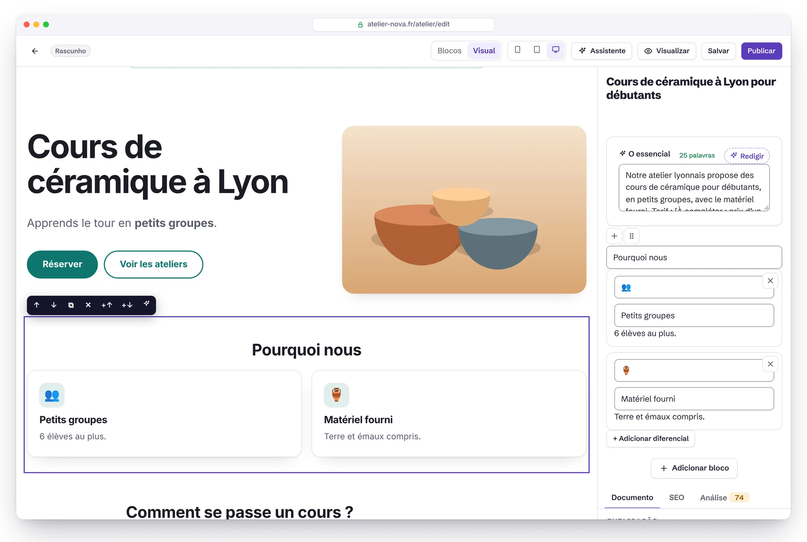
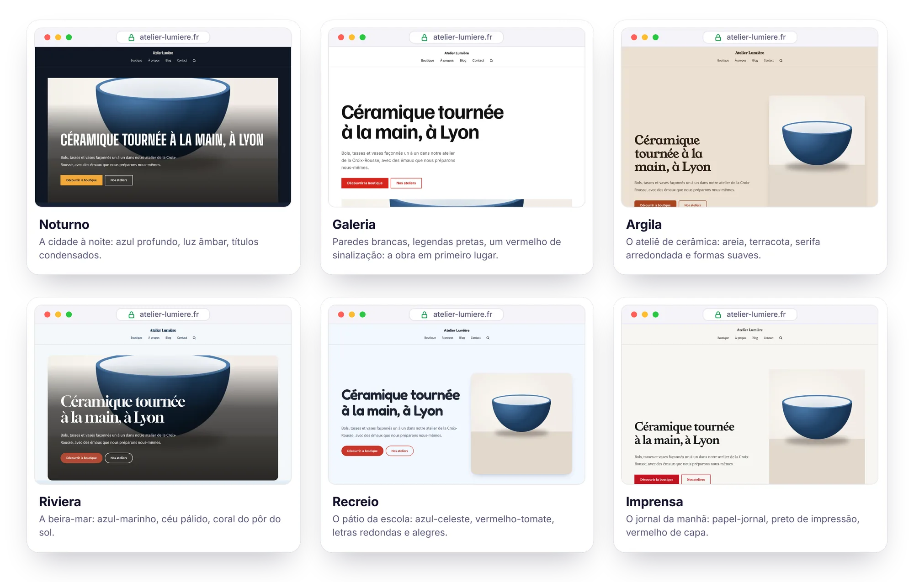
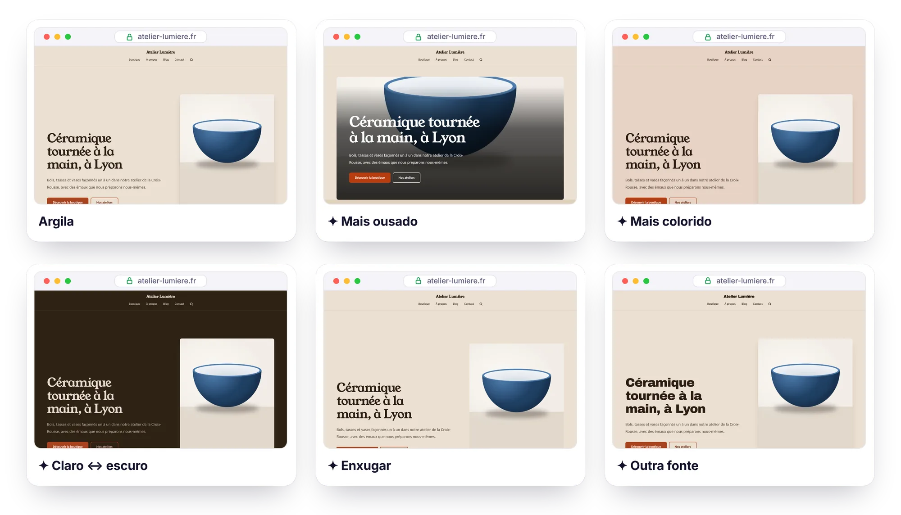
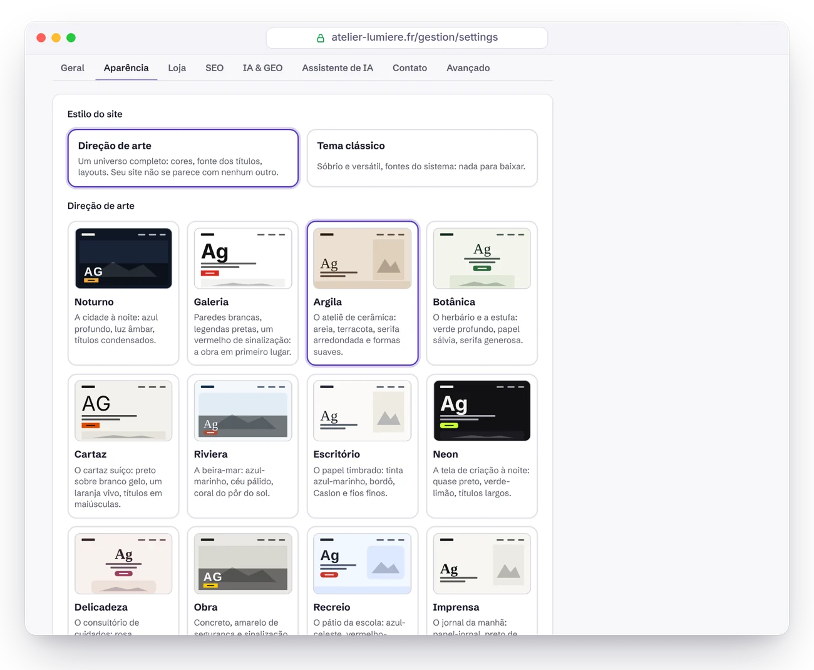

<p align="center">
  <a href="GUIDE.md">Français</a> · <a href="GUIDE.en.md">English</a> · <a href="GUIDE.es.md">Español</a> · <a href="GUIDE.de.md">Deutsch</a> · <a href="GUIDE.it.md">Italiano</a> · <b>Português</b> · <a href="GUIDE.zh-CN.md">简体中文</a>
</p>

# Guia do Éclair CMS

Tudo o que você precisa saber para instalar, usar, proteger e manter o Éclair. Para a apresentação, volte ao [README](../README.pt-BR.md).

## Sumário

1. [Instalação](#instalação)
2. [Recursos em detalhe](#recursos-em-detalhe)
3. [Uso no dia a dia](#uso-no-dia-a-dia)
4. [Modo Visual](#modo-visual)
5. [Direções de arte](#direções-de-arte) (incluindo os [Ajustes em um clique](#ajustes-em-um-clique), [Imagine minha direção com a IA](#imagine-minha-direção-com-a-ia) e a [Pontuação de design](#pontuação-de-design))
6. [Temas](#temas)
7. [Loja](#loja)
8. [Assistente de IA](#assistente-de-ia) (incluindo [Criar uma página com IA](#criar-uma-página-com-ia), o [Calendário editorial](#calendário-editorial), o [Site antigo](#site-antigo-wayback-machine), a [Afiliação](#afiliação) e o [Google Discover](#google-discover))
9. [Conector MCP (Claude e ChatGPT)](#conector-mcp-claude-e-chatgpt)
10. [Segurança](#segurança)
11. [Atualizar, fazer backup, mudar de hospedagem](#atualizar-fazer-backup-mudar-de-hospedagem) (incluindo a [Atualização em um clique](#atualização-em-um-clique) e os [Backups no Google Drive](#backups-no-google-drive))
12. [Solução de problemas](#solução-de-problemas) (incluindo [Nginx](#nginx))
13. [Para desenvolvedores](#para-desenvolvedores)

---

## Instalação

### Requisitos

- **PHP 8.1 ou superior** (8.3 recomendado), com as extensões `mbstring`, `json`, `dom`, `session` e `zlib` (ativas por padrão em quase todo lugar).
- Recomendado: `gd` (imagens WebP), `zip` (backup em um clique), `curl` (IndexNow, assistente de IA, fonte das direções de arte).
- Um servidor **Apache ou LiteSpeed** (praticamente todas as hospedagens compartilhadas: Hostinger, IONOS, OVHcloud…). Para Nginx, veja [mais abaixo](#nginx).
- Um certificado HTTPS (gratuito com Let's Encrypt em quase todas as hospedagens).

O assistente verifica tudo isso para você e explica o que corrigir.

### Passo a passo

1. Baixe o arquivo [`eclair-cms-2.1.0.zip`](https://github.com/Jacckisback/eclair-cms/raw/main/dist/eclair-cms-2.1.0.zip) (875 KB) e descompacte-o.
2. Envie **o conteúdo da pasta `eclair`** para a pasta pública da sua hospedagem (`public_html`, `www`…) com o seu programa de FTP (FileZilla…) ou pelo gerenciador de arquivos da hospedagem.
   > ⚠️ Os arquivos `.htaccess` são ocultos: ative “Mostrar arquivos ocultos” para ter certeza de enviá-los.
3. Abra o endereço do seu site: **o assistente de instalação começa** (em 7 idiomas, incluindo português).
4. Responda a 4 perguntas (seu site, sua conta, sua visibilidade, o endereço do seu painel). Confete 🎉: seu site está no ar, com páginas e um artigo de exemplo.

> 🔒 Por segurança, a instalação precisa ser feita **nas 2 horas** seguintes à primeira visita (senão qualquer pessoa poderia se apoderar de um site enviado e esquecido). Depois desse prazo, apague o arquivo `data/install-window.php` por FTP e recarregue a página.

Instalação em uma subpasta (`exemplo.com.br/site/`): basta enviar os arquivos para essa subpasta, tudo é detectado automaticamente.

### Os 7 tipos de site

| Tipo (no assistente) | O que é criado |
|---|---|
| 🏢 Site institucional | Página inicial (destaque, diferenciais, últimos artigos), Serviços (com FAQ), Sobre, Contato, Blog, aviso legal, política de privacidade |
| ✍️ Blog | Página inicial = últimos artigos, Sobre, Contato, categoria “Guides”, páginas legais |
| 🧑‍💻 Freelancer / portfólio | Página inicial com o seu nome, habilidades, Sobre, Blog, Contato, páginas legais |
| 🎯 Página única | Uma página de vendas (destaque, diferenciais, FAQ, formulário) + páginas legais, sem blog |
| 🧭 Mídia / Google Discover | Como um blog (início = últimos artigos, Sobre, Contato, páginas legais); o painel destaca o Discover, as tendências do dia e a publicidade |
| 🛍️ Afiliação | Como um blog; o painel destaca seus links de afiliado e os artigos escritos pela IA |
| 🕰️ Relançar um site antigo | Como um blog; o painel começa por encontrar os endereços antigos do seu domínio (Site antigo) |

Os conteúdos iniciais existem em francês, espanhol e inglês: um site em português começa com os textos em inglês, para você traduzir. As páginas legais trazem uma estrutura baseada na legislação francesa (LCEN), espanhola (LSSI) e no RGPD europeu; as exigências do seu país (por exemplo, a LGPD no Brasil) ficam por sua conta.

O tipo escolhido se torna o **uso do site** (Configurações › Geral, editável a qualquer momento): o painel abre com um cartão que reúne as ferramentas desse uso e o estado delas. Nada muda no site público.

### Logo após a instalação

O painel mostra uma checklist “Primeiros passos”: logo e cor, página inicial, primeiro artigo, perfil de autor, autenticação em dois fatores, aviso legal, Google Search Console. O próximo passo aparece destacado em amarelo, e cada um explica em uma frase para que serve. Para uma mídia, um site de afiliação ou um site antigo, ela começa pelo passo próprio desse uso.

---

## Recursos em detalhe

### ⚡ Velocidade

- **Cache estático automático**: cada página é gerada uma vez e depois servida sem carregar a aplicação. O cache se limpa sozinho a cada alteração (e no horário previsto para um artigo agendado).
- **CSS embutido na página** (de 17 a 23 KB conforme o tema e a loja, de 5 a 6 KB comprimido), fontes do sistema: nenhuma requisição bloqueante, nenhum deslocamento de layout. Com uma direção de arte, soma-se uma única fonte de títulos (de 12 a 27 KB), servida pelo seu site e pré-carregada.
- **Imagens otimizadas no envio**: redimensionadas (no máximo 2000 px), disponíveis em **WebP responsivo** (480, 800, 1200, 1600 px), dimensões explícitas, carregamento lento e prioridade para a imagem principal.
- ETag e respostas `304 Not Modified`, compressão Brotli/Gzip e cache do navegador de um ano para os arquivos estáticos (via `.htaccess`).

### 🔎 SEO

- URLs limpas, **redirecionamento 301 automático** quando um endereço muda, gerenciador de redirecionamentos (prático para migrar um site antigo em WordPress ou Wix).
  - Os endereços em `/.well-known/`, `/_eclair/` e `/__eclair/` não podem ser redirecionados. Exceção: um administrador pode redirecionar um endereço `/.well-known/…` como `change-password`, mas nunca `acme-challenge` nem `pki-validation`. Os redirecionamentos antigos a partir desses endereços aparecem marcados como “Desativada” e podem ser excluídos (um administrador pode recriar os que são permitidos).
  - Seguir um redirecionamento não deixa mais o site lento, e o número de usos continua visível.
- **Migração de um site WordPress completo** (função «Importar WordPress»): instale o plugin [Eclair Export](https://github.com/Jacckisback/eclair-export) no site WordPress e envie aqui o pacote dele (ou coloque-o por FTP em `data/import/`). Conteúdos, imagens, documentos PDF, SEO (Yoast, Rank Math, AIOSEO), menus e redirecionamentos são recuperados, cada endereço é mantido ou redirecionado com um 301 e os links internos são reescritos. **Simular** mostra o que será criado sem gravar nada. Por SSH: `php app/bundled/wordpress/lib/cli.php import pacote.zip [--dry-run]`.
- Título, meta description e **prévia do Google ao vivo** no editor, com contadores.
- **Análise de SEO em tempo real** com pontuação: tamanho do título e da descrição, frase-chave (título, URL, introdução, subtítulos, densidade), número de palavras, estrutura, textos alternativos, links internos, imagem destacada…
- **Dados estruturados JSON-LD** completos: WebSite (+ busca), Organization / Person / LocalBusiness (endereço, horários, perfis sociais, política de devolução), WebPage / AboutPage / ContactPage, BlogPosting (autor, datas, seção), BreadcrumbList, FAQPage, ProfilePage e, para a loja, Product / ProductGroup / Offer (preço, estoque, entrega).
- Sitemap XML com imagens e `hreflang`, robots.txt, feed RSS completo, Open Graph e Twitter Cards (**imagem de compartilhamento de 1200×630 gerada automaticamente**), breadcrumbs, URLs canônicas.
- Um único endereço por conteúdo: redirecionamentos para HTTPS, com/sem www, barra final, maiúsculas, `index.php`.
- **IndexNow**: Bing, Yandex, Seznam… são avisados a cada publicação.
- Verificação do Google Search Console e do Bing Webmaster Tools (cole a tag `<meta>` e o Éclair extrai o código).
- Multilíngue: idioma por conteúdo, ligação entre traduções e tags `hreflang` automáticas.
- Tipografia francesa automática para conteúdos em francês (espaços não separáveis antes de `: ; ! ?` e dentro das aspas « »).

### 🤖 GEO (motores de resposta com IA)

- **`/llms.txt`** (padrão llmstxt.org) e **`/llms-full.txt`** gerados automaticamente.
- **Versão Markdown de cada página**: adicione `.md` a qualquer URL (com cabeçalho de metadados, `noindex` e URL canônica para não criar conteúdo duplicado).
- **Regras para robôs de IA em um clique**: aberto (recomendado para ser citado), só citações (motores de resposta permitidos, treinamento recusado) ou fechado. Cobre GPTBot, OAI-SearchBot, ChatGPT-User, ClaudeBot, Claude-SearchBot, Claude-User, PerplexityBot, Google-Extended, Applebot-Extended, CCBot, Meta-ExternalAgent… Diretiva `Content-Signal` opcional.
- Bloco **“O essencial”**: o resumo que as IAs gostam de citar, exibido no início do artigo.
- **Pontuação GEO** no editor: resumo, introdução direta, FAQ, subtítulos em forma de pergunta, listas e tabelas, números concretos, fontes externas, autor identificado (E-E-A-T), parágrafos curtos, atualidade.
- Páginas de autor com biografia e perfis (`sameAs`), datas de publicação e de atualização visíveis.
- **Robôs IA** (menu da administração): quais IA leem suas páginas (ChatGPT-User, Claude-User, OAI-SearchBot, PerplexityBot, GPTBot, ClaudeBot…), quais páginas e para quê: consulta sob demanda (alguém fez uma pergunta, uma citação em potencial), indexação de um mecanismo de resposta ou treinamento. Visitas por dia, por robô e por página, leituras do robots.txt, páginas publicadas nunca lidas e o que fazer com elas, alerta se robôs de treinamento passam apesar do robots.txt, e um cartão no painel. O `index.php` anota só a hora, o robô e o endereço, nunca o IP nem visitantes humanos; registro limitado a 4 MB por mês e apagado após 13 meses; medição desativável em Configurações › IA e GEO. A identidade é a declarada pelo robô.

### ✍️ Editor de blocos

- 18 blocos: texto, subtítulo (H2-H4), lista, citação, imagem, quadro de destaque, FAQ, tabela, botão, vídeo do YouTube/Vimeo (sem cookies antes do clique), código, separador, destaque, diferenciais, equipe (retratos, cargos, apresentações), últimos artigos, produtos (vitrine da loja), formulário de contato.
- Digite **`/`** em uma linha vazia para escolher um bloco, arraste e solte, barra de formatação (negrito, itálico, link, código, marca-texto).
- **Links internos assistidos**: enquanto você digita um link, o editor sugere suas páginas e artigos (links internos em 2 segundos).
- **Colagem inteligente** do Word, do Google Docs ou de uma página web: títulos, listas, tabelas e negritos viram blocos limpos.
- Salvamento com `Ctrl+S`, rascunho local de segurança (nada se perde se a conexão cair), prévia real antes de publicar, **histórico das últimas 20 versões**, publicação agendada.
  - Esse rascunho de segurança pertence à conta conectada e é apagado quando você sai: ele nunca é oferecido a outra conta que use o mesmo navegador. Os da 1.10.2 de um conteúdo já salvo são mantidos em um site com uma única conta; os de um conteúdo novo nunca salvo, ou todos com várias contas, são apagados depois da atualização: salve as edições em andamento antes de atualizar.
- **Modo Visual**: a página do jeito que ela aparece com o seu tema, editável ali mesmo ([detalhes](#modo-visual)).
- **Desfazer e refazer**: `Ctrl+Z` (`Cmd+Z` no Mac) e `Ctrl+Shift+Z` ou `Ctrl+Y`, ou os botões ↶ ↷ da barra, no modo Blocos como no modo Visual (60 passos). No campo em que você está escrevendo, `Ctrl+Z` continua sendo o do navegador, letra por letra. Um bloco ou item excluído (pergunta do FAQ, diferencial, membro da equipe, variante, link do menu) também volta com um clique no aviso. O que não pode ser desfeito (excluir uma página, uma imagem, uma conta) pede confirmação em uma janela em que “Cancelar” tem o foco: `Enter` nunca exclui nada por engano.

### 🧩 Todo o resto

Biblioteca de mídia (arrastar e soltar, textos alternativos, detecção das imagens em uso), menus com arrastar e soltar (cabeçalho e rodapé), categorias “pilar” para um cluster de conteúdo, busca no site, formulário de contato antispam **sem captcha** (campo isca, token, limites por rede e por dia) com caixa de entrada, contas de administrador e redator, 6 temas e 12 direções de arte com pré-visualização ao vivo, modo escuro automático, 6 fontes do sistema, cor principal com contraste WCAG garantido, painel em 7 idiomas (português, inglês, francês, espanhol, alemão, italiano, chinês), site público em 6 idiomas (fr, es, en, de, it, pt).

---

## Uso no dia a dia

| Quero… | Onde |
|---|---|
| Escrever um artigo | Painel › **Escrever um artigo** |
| Pedir à IA um artigo, uma página ou uma imagem | Campo **“O que você quer criar hoje?”** do painel ou **✨ Assistente de IA** (`Ctrl+J`) |
| Fazer a IA montar uma página completa | Nova página › **✨ Criar com IA** |
| Editar uma página do jeito que ela aparece | Editor › **Visual** |
| Editar uma página a partir do site | Botão **✏️ Editar** (visível só quando você está logado) |
| Mudar tema, logo, cor, fontes | Configurações › Aparência |
| Adicionar meu próprio CSS | Configurações › Aparência › CSS personalizado |
| Ativar ou desativar as microanimações | Configurações › Aparência › Microanimações (site) · Meu perfil › Interface (administração) |
| Ver quais IA leem meu site | **Robôs IA** |
| Planejar meus artigos, pedir à IA que os proponha e redija | **Planeamento** |
| Devolver uma página aos endereços antigos do meu domínio | **Site antigo** |
| Gerenciar meus links de afiliado e criar um artigo com a IA | **Afiliação** |
| Preparar meus artigos para o Google Discover, encontrar ideias nas tendências do dia | **Discover** |
| Mostrar publicidade do AdSense nos meus artigos | **Discover** › Publicidade |
| Adaptar o painel ao meu uso | Configurações › Geral › Uso do site |
| Abrir a loja | Configurações › Loja |
| Adicionar um produto | Conteúdos › **+ Produto** |
| Escolher a página inicial | Configurações › Geral |
| Permitir ou bloquear as IAs | Configurações › IA & GEO |
| Ativar o assistente de IA | Configurações › Assistente de IA |
| Conectar o Google Search Console | Configurações › SEO |
| Adicionar um link ao menu | Menus |
| Redirecionar uma URL antiga | Redirecionamentos |
| Ativar a autenticação em dois fatores | Meu perfil › Autenticação de dois fatores |
| Baixar um backup | Segurança › Backup |

Atalhos do editor: `/` inserir um bloco · `Ctrl+S` salvar · `Ctrl+K` link · `Ctrl+B` negrito · `Ctrl+I` itálico · `Enter` novo parágrafo · `Shift+Enter` quebra de linha · `Ctrl+J` assistente de IA · `Ctrl+Z` desfazer · `Ctrl+Shift+Z` ou `Ctrl+Y` refazer (`Cmd` no Mac).

---

## Modo Visual

<p align="center">
  
</p>

O modo Visual mostra a sua página com o tema real do site, exatamente como os seus visitantes vão vê-la, e deixa você editá-la ali mesmo. Alterne entre **Blocos** e **Visual** no topo do editor: a sua escolha fica guardada para a próxima vez.

- **Escrever**: clique em um título, um parágrafo, uma pergunta do FAQ, o texto de um botão… e digite. `Ctrl+B` negrito, `Ctrl+I` itálico, `Ctrl+K` link (a busca de páginas do editor se abre). `Enter` confirma um campo de uma linha; em um parágrafo, cria o parágrafo seguinte (`Shift+Enter` para uma simples quebra de linha). O que você cola entra como texto simples.
- **Organizar**: um clique em um bloco o destaca com um contorno e mostra a sua barra: duas setas para movê-lo, dois botões para adicionar um bloco acima ou abaixo, um para duplicá-lo e, à parte no fim da barra, o ✕ para excluí-lo (fica vermelho ao passar o mouse). A barra também funciona pelo teclado (`Tab` e depois `Enter`); depois de `Esc`, `Delete` exclui o bloco selecionado.
- **Imagens**: clique em uma imagem (bloco de destaque, bloco de imagem, retrato da equipe, imagem destacada de um artigo) para escolher outra na biblioteca de mídia.
- **Configurações do bloco**: o painel da direita mostra o formulário do bloco escolhido (link de um botão, número de artigos, nova pergunta do FAQ…) e, em seguida, as abas Documento, SEO e Análise.
- **✨ Retoques com IA** (se o assistente estiver ativado): melhorar, corrigir, encurtar, desenvolver, simplificar, mudar o tom ou traduzir o texto do bloco.
- **Desfazer e refazer**: `Ctrl+Z` (`Cmd+Z` no Mac) ou o botão ↶ desfaz, `Ctrl+Shift+Z` ou `Ctrl+Y` (botão ↷) refaz, passo a passo (até 60 passos, comuns aos modos Blocos e Visual).
- **Largura**: 📱 390 px, ▭ 768 px ou 🖥 largura total, para conferir o resultado no celular e no tablet.

Tudo passa pelo editor de sempre: salvamento (`Ctrl+S` também funciona dentro da página), rascunho local de segurança, histórico de versões, análise de SEO e GEO em tempo real. Os links, botões e formulários da página não reagem durante a edição. Um bloco invisível no site (imagem ainda não escolhida, loja fechada…) aparece como uma moldura pontilhada, para você preencher pelo painel da direita.

> [!NOTE]
> O modo Visual só existe na pré-visualização do painel: exige login, token de segurança e permissão de escrita, e a página nunca é armazenada em cache nem indexada. As suas páginas públicas não carregam nenhum vestígio dele: continuam idênticas até o último byte.

---

## Direções de arte

<p align="center">
  
</p>

Um tema muda as cores; uma **direção de arte** muda o universo inteiro do site, a partir de uma ideia concreta: a cidade à noite, o ateliê de cerâmica, o jornal da manhã. Em **Configurações › Aparência**, escolha **Direção de arte** (em vez de **Tema clássico**), clique em um dos 12 cartões e veja a pré-visualização ao vivo: o seu site de verdade, no computador ou no celular. Nada é publicado antes de você salvar.

| Direção | Universo | Fonte dos títulos |
|---|---|---|
| **Noturno** | A cidade à noite: azul profundo, luz âmbar | Big Shoulders Display, em maiúsculas |
| **Galeria** | Paredes brancas, legendas pretas, um vermelho de sinalização | Familjen Grotesk |
| **Argila** | O ateliê de cerâmica: areia, terracota, formas suaves | Young Serif |
| **Botânica** | O herbário e a estufa: verde profundo, papel sálvia | DM Serif Display |
| **Cartaz** | O cartaz suíço: preto sobre branco gelo, laranja vivo | Archivo Black, em maiúsculas |
| **Riviera** | A beira-mar: azul-marinho, céu pálido, coral | Gloock |
| **Escritório** | O papel timbrado: tinta azul-marinho, bordô, fios finos | Libre Caslon Display |
| **Neon** | A tela de criação à noite: quase preto, verde-limão | Unbounded |
| **Delicadeza** | O consultório de cuidados: rosa empoado, ameixa, muito espaço | Cormorant Garamond |
| **Obra** | Concreto, amarelo de segurança, sinalização condensada | Barlow Condensed, em maiúsculas |
| **Recreio** | O pátio da escola: azul-celeste, vermelho-tomate, letras redondas | Fredoka |
| **Imprensa** | O jornal da manhã: papel-jornal, vermelho de capa | Newsreader |

**Ajustar**: abaixo dos cartões, **Ajustar a direção** abre todos os ajustes, para combinar à vontade:

- **5 cores**: fundo, faixas e cartões, texto, texto secundário, destaque (botões e links).
- **Fonte dos títulos**: 18 fontes tipográficas escolhidas pela personalidade (nenhuma daquelas que se veem em todo lugar) ou uma fonte do sistema. **Fonte do texto**: uma fonte do sistema, sem download.
- **Caixa dos títulos** (normal ou maiúsculas), **tamanho dos títulos** (discreto, equilibrado, impactante), **cantos** (retos, suavizados, arredondados), **espaçamento** (compacto, normal, arejado).
- **Cartões**: borda fina, cor sólida ou sombra projetada.
- **Banner de abertura**: texto e imagem lado a lado, imagem à esquerda, cartaz (título muito grande), imagem de ponta a ponta (o título sobre a foto), editorial (imagem vertical), centralizado ou emoldurado (texto e imagem em um painel colorido).
- **Bloco “Diferenciais”**: cartões, linhas, colunas com fio ou numerados (01, 02…). **Seções**: fundo liso, faixas de cor ou linhas entre as seções. **Ícones dos diferenciais**: ícones desenhados (65 ícones de traço, reconhecidos a partir dos emojis mais comuns: ☕ 🚗 🐶 ✂️ 🎓 💼 🌸…), sem ícone ou emojis.
- **Botões**: preenchidos, com contorno ou como links sublinhados (com uma seta).

Cabeçalho, listas de artigos, logo, ícone, rodapé e CSS personalizado se configuram como antes. Para voltar ao tema clássico, escolha **Tema clássico** e salve: as configurações dele esperam por você, intactas.

**Sempre legível**: sejam quais forem as cores escolhidas, o Éclair ajusta automaticamente o texto (contraste de **7:1** sobre o fundo), o texto secundário, os links e os botões (4,5:1), inclusive sobre os fundos tingidos com a cor de destaque (selos, menu, realce). Assim, uma cor clara demais para um texto sobre fundo claro é escurecida só o necessário.

**Sempre rápido**: a fonte dos títulos é **baixada uma única vez pelo seu servidor** (do Fontsource, licença SIL Open Font License), guardada em `media/fonts/` e depois servida pelo seu site e pré-carregada com `font-display: optional`: nenhuma requisição a um serviço de terceiros para os seus visitantes, nenhum deslocamento de layout. Só as regras CSS que a sua direção usa são inseridas na página, e o modo escuro automático dá lugar à escolha clara ou escura da direção. Medido com o Lighthouse: 100 nas quatro categorias com Noturno, Riviera, Imprensa e Cartaz, e com as novas composições (banner com a imagem à esquerda ou emoldurado, diferenciais numerados, linhas entre as seções, botões com contorno ou como links sublinhados).

> [!TIP]
> Se a sua hospedagem bloqueia as conexões de saída, a fonte não pode ser baixada: uma mensagem avisa você e, enquanto isso, o site usa uma fonte de reserva da mesma família (serifada, condensada…). Tente de novo mais tarde salvando outra vez.

### Ajustes em um clique

<p align="center">
  
</p>

Abaixo dos cartões, seis botões transformam a direção escolhida com um único clique, e a pré-visualização se atualiza na hora:

| Ajuste | O que muda |
|---|---|
| **Mais ousado** | títulos maiores, mais espaço, banner mais impactante (cartaz e, depois, imagem de ponta a ponta), faixas de cor, destaque mais vivo, botões preenchidos |
| **Mais sóbrio** | títulos mais discretos, caixa normal, bordas finas no lugar das sombras, banner mais calmo, destaque suavizado |
| **Mais colorido** | fundo e faixas tingidos com a cor de destaque, faixas de cor, destaque mais vivo |
| **Enxugar** | bordas finas, nenhum ícone, fundo liso, mais espaço, cantos mais retos, diferenciais em colunas |
| **Claro ↔ escuro** | inverte a luminosidade do fundo, das faixas e do texto, mantendo as tonalidades |
| **Outra fonte** | passa para a próxima fonte dos títulos, alternando as famílias (serifada, grotesca, condensada…) |

Os ajustes podem ser encadeados; **Desfazer ajuste** volta uma etapa de cada vez. Os contrastes continuam garantidos a cada etapa, e nada é publicado antes de você salvar.

### Imagine minha direção com a IA

<p align="center">
  
</p>

Quando o [assistente de IA](#assistente-de-ia) está ativado, **Imagine minha direção com a IA** aparece abaixo dos cartões. Descreva a sua atividade, o seu público e o clima que você quer em uma ou duas frases (“padaria orgânica de bairro em Curitiba, clientela familiar, acolhedora mas moderna”) e clique em **Propor 3 direções**. A IA também lê a apresentação do seu site e o seu perfil editorial, e segue o método do [Impeccable](https://github.com/pbakaus/impeccable):

1. partir do mundo concreto da atividade (lugares, materiais, objetos, luz) em vez de adjetivos;
2. dar a cada proposta **uma referência precisa** (“as placas esmaltadas de uma padaria dos anos 50”) e tirar dela as cores, a fonte e as composições;
3. propor três direções **realmente diferentes** (clara ou escura, quente ou fria, com ou sem serifa);
4. evitar a escolha padrão do segmento (azul-marinho e dourado para um advogado…), o seu oposto previsível e os tiques do “design gerado por IA”.

As três propostas entram no início dos cartões, marcadas com ✦: clique em uma para vê-la na pré-visualização, ajuste e salve a que você preferir. A IA só escolhe entre os ajustes do Éclair (cores, fontes da lista, composições) e nunca escreve CSS: cada proposta é verificada e tem os contrastes corrigidos antes de chegar ao seu site. O custo estimado aparece abaixo do botão (≈ US$ 0,03 com o Claude Sonnet 5.5) e é descontado do orçamento do assistente. Exclusivo para administradores.

### Pontuação de design

No editor, a aba **Análise** mostra um terceiro anel, **Design**, ao lado do SEO e do GEO. Ele verifica se a página se sustenta visualmente:

- **subtítulos**: hierarquia sem saltos (H2, depois H3, depois H4), curtos, sem emoji decorativo;
- **banner**: título curto (no máximo 8 palavras, 6 em maiúsculas), botão de ação, imagem se a sua direção exigir (de ponta a ponta, editorial);
- **chamadas para ação** na medida (no máximo 3 botões);
- **bloco “Diferenciais”** com 3 a 6 itens descritos, com ícones que tenham o seu equivalente desenhado;
- **texto**: nada de frases em MAIÚSCULAS, de fórmulas vazias (“revolucionário”, “chave na mão”, “seamless”… conforme o idioma da página), de abuso de travessões, de trechos repetidos de forma idêntica nem de muros de mais de 350 palavras sem subtítulo, imagem ou lista;
- **direção de arte** escolhida para o site.

A nota da aba Análise agora é a média dos três anéis.

---

## Temas

O Éclair vem com **6 temas**. Escolha um em **Configurações › Aparência**: a **pré-visualização ao vivo** mostra o seu site de verdade (início, blog, um artigo, a loja, um produto) no computador ou no celular, e nada é publicado enquanto você não salvar. Você pode navegar pela pré-visualização: os links continuam dentro dela.

| Tema | Estilo | Para quem |
|---|---|---|
| **Éclair** | Claro, moderno e versátil: o tema original | Todos os sites |
| **Editorial** | Uma revista: tipografia serifada, linhas finas, letra capitular, artigo em destaque | Blogs, veículos de comunicação, autores |
| **Ateliê** | Caloroso e artesanal: tons de creme e terracota, formas suaves | Artesãos, restaurantes, bem-estar |
| **Estúdio** | Portfólio minimalista: preto e branco, títulos grandes, imagens sem moldura | Fotógrafos, designers, agências |
| **Loja** | Pensado para vender: fotos quadradas, cabeçalho fixo, botões marcantes | Lojas, criadores |
| **Contraste** | Legibilidade máxima: texto grande, contrastes fortes, links sublinhados | Serviços públicos, associações, idosos |

Escolher um tema aplica a cor e as fontes recomendadas dele: você pode alterá-las depois. Duas configurações de layout completam o tema: o **cabeçalho** (logo à esquerda e menu à direita, ou tudo centralizado) e as **listas de artigos e produtos** (grade de cards ou lista com a imagem à esquerda).

**Por que é leve**: um tema do Éclair é só uma folha de estilo de 1,5 a 3 KB, somada à folha de estilo base. O HTML não muda de um tema para outro: a velocidade, a acessibilidade, os dados estruturados e o SEO continuam iguais. Só o tema ativo é inserido na página, e o modo escuro automático funciona com todos eles.

**CSS personalizado**: para ir além do tema (a cor de um botão, os espaçamentos, o estilo de um bloco), cole suas regras em **Configurações › Aparência › CSS personalizado**. Elas são adicionadas depois do tema em todas as páginas, então têm prioridade, e ficam guardadas com os seus dados (`data/`): **as atualizações do Éclair as mantêm**. Os marcadores `/*dark*/ … /*/dark*/` também funcionam: as regras deles somem quando o modo escuro está em “Sempre claro”. Por segurança, o caractere `<` e as regras `@import` são removidos; máximo de 64 KB.

**Microanimações** (Configurações › Aparência): cartões, diferenciais, perguntas do FAQ, quadros de destaque e imagens aparecem deslizando ao rolar a página, e botões e imagens reagem ao passar o mouse. É só CSS (menos de 1 KB a mais na página, sem script): os elementos deslizam sem nunca ficar transparentes, então nenhum deslocamento de layout, nenhum texto desbotado, nada animado no carregamento, e o texto continua na página para o Google e as IAs. Medido: 100 nas quatro categorias do Lighthouse, com ou sem. Ficam desativadas para os visitantes que pediram menos movimento ao seu dispositivo, e na impressão. Ativadas nos sites instalados com a 1.11; num site mais antigo, as páginas continuam idênticas byte a byte enquanto você não as ativar. As animações da administração se desativam em **Meu perfil › Interface** (configuração própria deste navegador).

---

## Loja

O **modo loja leve** serve para vender algumas dezenas de produtos sem o peso de um e-commerce: sem carrinho, sem contas de clientes, sem banco de dados, nenhum dado bancário no seu servidor. Cada produto tem sua própria página, otimizada para o Google e as IAs, com um botão **Comprar** que leva a um **link de pagamento da Stripe, do PayPal ou do Revolut Business**: seu provedor de pagamentos recebe os pagamentos, envia os recibos e gerencia os reembolsos.

### Abrir a loja

1. **Publique o seu aviso legal** (a instalação já criou uma estrutura para você completar) **e as suas condições gerais de venda**. A loja não abre sem essas páginas. Peça para alguém revisá-las: você responde por elas como vendedor.
2. Em **Configurações › Loja**: escolha essas duas páginas, a moeda, o valor do frete e o prazo de entrega, os países de entrega e o prazo de devolução (na UE, a venda a distância dá ao cliente pelo menos 14 dias para desistir da compra, salvo exceções, como um produto personalizado).
3. Clique em **Criar a página de agradecimento**: a Stripe pode redirecionar seus clientes para ela depois do pagamento.
4. Ative **Loja aberta**, salve e depois adicione a loja ao menu (Menus › Loja).

O catálogo fica no endereço `/loja` (`/boutique`, `/tienda`, `/shop` ou `/negozio`, conforme o idioma do site), que pode ser alterado; se você mudá-lo, os endereços antigos são redirecionados.

### Criar uma página de produto

Conteúdos › **+ Produto**. No topo do editor ficam os campos da página de produto:

- **Preço** e **preço riscado** (opcional: o desconto aparece em porcentagem), **disponibilidade** (em estoque, esgotado, pré-venda).
- **Link de pagamento**: o link da Stripe, do PayPal ou do Revolut Business do produto.
- **Fotos**: a primeira é a principal (Google, redes sociais); tente mostrar pelo menos 3 ângulos.
- **Variantes** (tamanho, cor…): cada uma pode ter seu próprio preço e link. No site, a escolha é feita sem JavaScript.
- **Detalhes para o Google Shopping**: marca, referência, código de barras (GTIN/EAN), condição (novo, usado, recondicionado), produto digital ou serviço (sem entrega).

Logo abaixo, descreva o produto com os blocos de sempre e coloque-o em uma **categoria de produtos** (Categorias › “Ela reúne: Produtos (loja)”). A análise de SEO também verifica o preço, o link de pagamento, o número de fotos e os identificadores. Para destacar produtos em uma página, adicione o bloco **Produtos**.

Com o assistente de IA: anexe uma foto e peça “Crie a página do produto da foto anexada. Preço: € 29,90”. Ele redige um rascunho completo, mas **nunca inventa um preço, um desconto ou um link de pagamento**: o que faltar, você completa.

### Conectar a Stripe (Payment Links)

1. Na Stripe, abra **Payment Links** e crie um link: produto, preço e, se necessário, a coleta do endereço de entrega.
2. Na aba **After the payment**, escolha redirecionar o cliente para a sua página de agradecimento (o endereço dela aparece em Configurações › Loja).
3. Nas configurações da Stripe (**Customer emails**), ative os recibos de pagamentos bem-sucedidos.
4. Copie o link e cole-o na página do produto. O Éclair acrescenta a ele a referência do produto (`client_reference_id`): cada pagamento mostra o que foi comprado.

Cada pedido chega para você na Stripe (e por e-mail, se você ativou essa opção): você prepara e envia, e a Stripe cuida do reembolso, se for preciso. Outro provedor de pagamento também funciona, desde que o link de pagamento dele comece com `https://`.

### Ou conectar o PayPal ou o Revolut Business

Mesmo princípio: um link de pagamento com preço fixo por produto (ou por variante com outro preço), colado na página do produto. O Éclair reconhece esses links e mostra “Pagamento seguro com PayPal” ou “com Revolut” abaixo do botão de compra.

- **PayPal**: na sua conta empresarial, abra **Links e botões de pagamento**, crie um link com preço fixo para o seu produto e copie-o (ele começa com `https://www.paypal.com/`). Seu cliente paga com a conta PayPal ou com cartão.
- **Revolut Business**: você precisa de uma conta de comerciante. Em **Comerciante › Link de pagamento** (Merchant › Payment link), crie um link com o valor do produto e copie-o (`https://checkout.revolut.com/…`). Seu cliente paga na página de pagamento do Revolut.

Duas diferenças em relação à Stripe: depois do pagamento, o cliente fica na página de confirmação do provedor (sem voltar automaticamente para a sua página de agradecimento), e a referência do produto não é adicionada ao pagamento: dê a cada link um nome claro para reconhecer seus pedidos.

### O que já vem pronto para o Google e as IAs

- **Dados estruturados** Product e Offer em cada página de produto (ProductGroup para as variantes): preço, moeda, estoque, condição, marca, valor do frete e prazo de entrega, e **política de devolução** no nível da sua empresa. São as informações que o Google exibe nos resultados de produtos.
- **Feed de produtos** `/products.xml` no formato do Google Merchant Center: adicione-o como fonte de produtos no Merchant Center para aparecer gratuitamente na aba Shopping.
- Categorias de produtos como páginas pilar, sitemap com todas as fotos, breadcrumbs.
- Para as IAs: preço e disponibilidade de cada produto no `llms.txt` e na versão Markdown de cada página de produto (adicione `.md` ao endereço dela).

### Quanto custa?

Nada do lado do Éclair. A Stripe não cobra assinatura nem taxa de adesão, e os links de pagamento estão incluídos: você paga só uma taxa por pagamento, por exemplo **1,5% + € 0,25** para um cartão padrão do Espaço Econômico Europeu (2,8% + € 0,25 para um cartão premium, 3,15% + € 0,25 para um cartão de fora do EEE, mais 2% em caso de conversão de moeda). Tarifas da Stripe na França, consultadas em 30 de outubro de 2026 em [stripe.com/fr/pricing](https://stripe.com/fr/pricing); elas podem mudar.

Com o **Revolut Business**, a taxa é de **1% + € 0,20** para um cartão de pessoa física do Espaço Econômico Europeu (2,8% + € 0,20 para um cartão de fora do EEE), com links de pagamento incluídos ([ajuda do Revolut](https://help.revolut.com/en-ES/business/help/merchant-accounts/fees/how-much-does-it-cost-to-accept-card-payments/), [tarifas do Revolut](https://www.revolut.com/en-IE/business/accept-payments-pricing/)). Com o **PayPal** na França, é de **1,2% + € 0,35** para um pagamento com cartão e de **2,9% + € 0,35** com uma conta PayPal, mais 1,99% fora do EEE (1,29% a partir do Reino Unido) ([tarifas do PayPal](https://www.paypal.com/fr/business/paypal-business-fees), atualizadas em 15 de julho de 2026). Tarifas consultadas em 31 de outubro de 2026.

### O que a loja não faz

Não há carrinho com vários produtos, cupons de desconto, contas de clientes nem controle automático de estoque: a ideia é continuar simples. Se você vende centenas de produtos ou precisa desses recursos, um e-commerce completo (Shopify, WooCommerce, PrestaShop) vai atender melhor. Os preços exibidos são os que você digita: mostre-os com impostos incluídos se você vende para consumidores finais.

---

## Assistente de IA

O assistente escreve rascunhos, melhora seus textos e cria imagens **no tom do seu site**. Você dá as instruções em linguagem natural, como faria com um colega: “Escreva um artigo sobre como escolher as cores de uma marca, com uma imagem.” Primeiro ele verifica se já existe algo sobre o assunto no site; depois cria a imagem, redige o rascunho completo (título, O essencial, subtítulos, listas ou tabelas, FAQ, meta description, links internos) e o apresenta a você com as pontuações de SEO e GEO. **Nada é publicado sem o seu clique.**

Ele funciona com o **Claude** (Anthropic) ou o **ChatGPT** (OpenAI), com a sua própria chave de API: sem assinatura do Éclair, você paga direto ao provedor, pelo uso real. Você prefere usar a sua assinatura do Claude ou do ChatGPT? Use o [conector MCP](#conector-mcp-claude-e-chatgpt).

### Ativar o assistente (5 minutos)

1. Crie uma chave de API no provedor escolhido: [console.anthropic.com](https://console.anthropic.com/settings/keys) para o Claude, [platform.openai.com](https://platform.openai.com/api-keys) para o ChatGPT, e adicione alguns dólares de crédito.
2. Em **Configurações › Assistente de IA**, escolha o provedor, cole a chave, escolha o modelo e clique em **Testar a conexão** (é gratuito: nenhum texto é gerado).
3. Para as imagens, escolha um gerador: **GPT Image 2.5** (a mesma chave do ChatGPT), **FLUX 3** ([dashboard.bfl.ai](https://dashboard.bfl.ai)) ou **Ideogram 3** ([ideogram.ai](https://ideogram.ai/manage-api), ideal para imagens com texto). Sem gerador, o assistente usa a sua biblioteca de mídia e as fotos que você anexar.
4. Clique em **Redigir meu perfil a partir do meu site**, revise, ajuste e salve.

A partir daí, o assistente aparece no menu (**✨ Assistente de IA**, `Ctrl+J`), no editor e no painel. Os redatores também podem usá-lo, se você permitir.

**Claude ou ChatGPT, à sua escolha**: salve as duas chaves e um seletor aparece no topo do assistente para você escolher a IA a cada conversa. A sua escolha fica guardada na sua conta, inclusive para os retoques no editor; o provedor escolhido nas configurações continua sendo o padrão.

### O perfil editorial

É o que faz a IA escrever **como você**: quem você é e o que oferece, para quem você escreve, tom e estilo (tratamento formal ou informal, tamanho das frases, humor), valores, regras a seguir (“sempre um link para a página de contato”, “nunca falar de preços”) e estilo das imagens. Ele é redigido em um clique a partir das suas páginas e artigos; a palavra final é sua. A cada pedido, o assistente também segue as regras de análise do Éclair: os rascunhos já miram uma pontuação alta de SEO e GEO desde o início.

### O que você pode pedir

- “Escreva um artigo sobre a manutenção de uma bicicleta elétrica na primavera, com uma imagem.”
- “Adicione Léa Martin, diretora de arte, à página da equipe com a foto anexada.” (anexe a foto pelo 📎, arrastando e soltando ou colando)
- “Crie uma página Nossos serviços que apresente nossos três pacotes.”
- “Sugira 5 ideias de artigos para atrair novos clientes.”
- “Revise minha página inicial e sugira melhorias.”
- No editor: “Adicione um FAQ a este artigo”, “Deixe a introdução mais impactante”.

Cada ação gera um **card** abaixo da resposta:

| Card | O que aconteceu | Seus botões |
|---|---|---|
| 📝 Rascunho | Novo artigo ou nova página, nunca publicado | Abrir · Visualizar · Publicar agora ou agendar |
| ✏️ Alteração proposta | Para um conteúdo **publicado**: nada muda até você aprovar | Visualizar · Aplicar · Ignorar e, se precisar, Cancelar |
| ✅ Atualizado | Um **rascunho** alterado diretamente | Abrir · Visualizar · Cancelar |
| ✅ No editor | O conteúdo aberto é alterado no editor | Cancelar (depois você salva) |
| 🖼️ Imagem | Imagem criada, otimizada (WebP) e guardada na biblioteca de mídia | Imagem destacada (no editor) |

“Cancelar” funciona enquanto ninguém tiver mexido no conteúdo desde então; caso contrário, as versões anteriores continuam no **histórico de versões** do editor. O histórico do assistente guarda as suas 30 últimas conversas. O assistente nunca inventa fatos sobre o seu negócio (preços, horários, números, depoimentos): quando falta uma informação, ele deixa uma marcação visível, como **[A completar: preço]**, e avisa você; a aba Análise conta essas marcações enquanto elas existirem.

### Criar uma página com IA

Em um conteúdo novo (página, artigo ou produto), a caixa **✨ Criar com IA** monta um rascunho completo em uma única chamada:

1. Escolha o tipo e o idioma e descreva o que você quer em uma ou duas frases. Opcionalmente, acrescente o **objetivo** (“conseguir pedidos de orçamento”), o **público**, o **tom** e as **seções** desejadas (“banner, vantagens, preços, FAQ, contato”).
2. O **custo estimado** aparece antes de começar (≈ US$ 0,08 com o Claude Sonnet 5.5, ≈ US$ 0,16 com o Claude Opus 5.5) e é descontado do orçamento do assistente. Com as duas chaves salvas, você escolhe entre o Claude e o ChatGPT.
3. Depois de 20 a 60 segundos, o rascunho abre no **modo Visual**: título, endereço, título SEO e meta descrição, “O essencial”, frase-chave e um layout em seções (destaque, diferenciais, subtítulos, listas, quadros de destaque, FAQ, botões, equipe, formulário de contato, últimos artigos ou produtos), com um único H1: o título do bloco de destaque.

A IA se baseia no seu perfil editorial, na lista das suas páginas e artigos publicados (para que os links levem a páginas que existem) e nas suas 30 imagens mais recentes. Ela não inventa nenhum fato: preços, números, nomes ou horários que faltam ficam no formato **“[A completar: …]”**, contados pela aba Análise até você preenchê-los. O rascunho nunca é publicado: revise, complete e depois publique. Se o site já tiver 500 rascunhos, a caixa pede primeiro que você publique ou exclua alguns, antes de gastar qualquer coisa.

### Calendário editorial

Menu **Planeamento**: seus próximos artigos em um calendário mensal (publicados, agendados, rascunhos, ideias) e uma lista «A seguir».

- **Adicionar uma ideia** à mão: título, data prevista, palavra-chave, categoria, ângulo e notas para a redação.
- **Propor ideias com a IA**: de 4 a 12 ideias com base no seu site (atividade, categorias, artigos já escritos, páginas que as IA mais leem em Robôs IA) e em um tema opcional. Elas são colocadas nos próximos dias livres, no ritmo escolhido (de 1 a 5 por semana). Nada é publicado.
- **Redigir**: a IA escreve a ideia como rascunho completo, com o mesmo motor de «Criar com IA», e o editor se abre. Revise, complete os «[A completar: …]», agende.
- **Custo**: cada botão mostra o custo estimado (≈ 0,035 $ por série de ideias e ≈ 0,08 $ por artigo com Claude Sonnet 5.5); depois, os tokens e os dólares gastos ficam anotados na ideia e no total do planeamento, e contam no orçamento do assistente.
- **Redação automática** (administradores, desligada por padrão): a IA redige a ideia prevista de 1 a 14 dias antes da data, uma de cada vez, dentro do orçamento, quando um administrador abre a administração. Para não depender disso, faça uma tarefa agendada chamar a cada hora o endereço secreto exibido (cron da hospedagem, cron-job.org…). «Agendar sem revisão» existe, mas não é recomendado: o Google penaliza textos publicados em série sem revisão humana, e um artigo que ainda contém «A completar» sempre espera a sua revisão.

### Site antigo (Wayback Machine)

Menu **Site antigo** (administradores): quando você retoma um domínio que já teve um site, ainda há links apontando para os endereços antigos. O Éclair os encontra na Wayback Machine e devolve uma página a cada um.

- **Pesquisar**: o Éclair consulta o índice da Wayback Machine apenas para o domínio do site (www incluído), até a data escolhida. A página inicial, os endereços com parâmetros (`?p=12`), os outros domínios e os endereços `.php` (recusados pelo `.htaccess`) são descartados; as páginas de listagem (tags, categorias, paginação…) chegam desmarcadas.
- **Reconstruir**: para cada endereço marcado, a IA escreve uma página ou um artigo **novo** apenas a partir do título da página antiga. Nem o texto nem as imagens são copiados, e a marca antiga não é reaproveitada. Um endereço por vez, com um botão para parar; imagem de capa nova opcional.
- **Endereços**: a página mantém o endereço antigo quando o Éclair consegue servi-lo como está; caso contrário, o antigo redireciona para o novo (301). Um endereço que seu site já serve nunca é substituído.
- **Publicar**: tudo começa como rascunho. «Publicar os rascunhos revistos» publica todos de uma vez, exceto os que ainda contêm «[A completar: …]».
- **Custo**: exibido antes (por página) e depois (tokens e dólares, por endereço e no total), dentro do orçamento do assistente.

> ⚠️ O Google penaliza domínios expirados cheios de páginas sem valor para o visitante ([políticas contra spam](https://developers.google.com/search/docs/essentials/spam-policies#expired-domains)): revise e enriqueça cada página antes de publicá-la.

### Afiliação

Menu **Afiliação**: seus links de afiliado em um só lugar, com suas notas sobre cada produto.

- **Aviso publicitário automático**: em cada página que contém um link de afiliado, e no feed RSS, o Éclair mostra o aviso «Links de afiliado» no idioma da página (ou o seu próprio texto), logo após o banner de abertura. A publicidade deve ser claramente identificável como tal: [LCEN, art. 20](https://www.legifrance.gouv.fr/loda/article_lc/LEGIARTI000018048180) na França, [LSSI, art. 20](https://www.boe.es/buscar/act.php?id=BOE-A-2002-13758) na Espanha.
- **Amazon**: para um link da Amazon, é adicionada a frase exigida pelo Programa de Afiliados da Amazon, no idioma da loja (por exemplo «As an Amazon Associate I earn from qualifying purchases.» para amazon.com). Os links da Amazon com seu identificador (`tag=`) e os links curtos amzn.to são reconhecidos mesmo fora da lista.
- **Para o Google**: cada link de afiliado é marcado com `rel="sponsored nofollow"`. Nenhum link mascarado nem redirecionamento: os links levam diretamente ao comerciante.
- **Escrever um artigo com a IA**: marque links e escolha um comparativo (2 a 10 links), uma apresentação de produto ou um guia de compra. A IA escreve apenas a partir dos nomes e das suas notas: não inventa preços, avaliações nem resultados de testes, e deixa «[A completar: …]» onde a sua opinião conta. O rascunho abre no editor; nada é publicado.

Enquanto você não salvar um primeiro link, nada muda no seu site.

### Google Discover

Menu **Discover**: o que ajuda seus artigos a aparecer no feed Discover do Google, as tendências do dia e a publicidade. O Google não oferece nenhuma configuração para «se posicionar» no Discover: um artigo indexado é elegível automaticamente ([recomendações do Google](https://developers.google.com/search/docs/appearance/google-discover?hl=pt-br)).

- **Pronto para o Discover**: são verificados o site (aberto aos buscadores, HTTPS, logo, páginas «Sobre» e «Contato») e seus 100 últimos artigos: imagem com pelo menos 1200 px de largura (nunca o logo), título sem sensacionalismo (maiúsculas, «!!»), autor apresentado, extensão. Um link «Corrigir» para cada ponto. Os dados estruturados indicam a imagem grande original, sem recorte.
- **Tendências do dia**: as pesquisas que sobem no Google no país escolhido (feed público do Google Trends, lido no máximo uma vez por hora), com as manchetes da imprensa. «Adicionar ao planejamento» cria uma ideia com a data de hoje. Com o assistente de IA, «Propor ideias para o meu site» mantém só as tendências ligadas ao seu tema (muitas vezes nenhuma) e propõe no máximo 4 artigos úteis e duradouros, nunca uma notícia.
- **Publicidade (Google AdSense)**, administradores: seu ID de editor, os anúncios automáticos e/ou um bloco de anúncios que o Éclair coloca entre dois blocos do texto (depois do 2º parágrafo, no meio dos artigos longos, no fim), com a etiqueta «Publicidade» exigida pelo Google e seu espaço reservado. Só nos artigos, nunca nas páginas nem na pré-visualização; caixa «Sem publicidade neste artigo» no editor.
- **Consentimento**: a publicidade só é ativada depois que a mensagem «Regulamentos europeus» for publicada em AdSense › Privacidade e mensagens. O Google exige uma plataforma de consentimento certificada para os visitantes europeus ([ajuda do AdSense](https://support.google.com/adsense/answer/13554116?hl=pt-BR)); a dele é exibida pelo código do AdSense.
- **ads.txt**: assim que o ID é salvo, o Éclair publica `/ads.txt` e a tag que permite ao Google validar seu site.

> ⚠️ Os scripts do Google deixam mais lentas as páginas com publicidade (o Lighthouse deixa de dar 100 nelas): o Éclair reserva o espaço dos anúncios e não carrega nada nas outras páginas. Nunca clique nos seus próprios anúncios: o Google proíbe.

### Retoques no editor

- **Selecione um trecho** e clique em ✨ na barra de formatação: melhorar, corrigir erros, encurtar, desenvolver, simplificar, mais caloroso, mais profissional, traduzir. Um clique em “Cancelar” restaura o texto.
- **O essencial**: botão “Redigir”.
- **Aba SEO**: título SEO e descrição, frase-chave, ideias de títulos.
- **Aba Análise**: adicionar um FAQ, textos alternativos que faltam, “Melhorar com o assistente”.
- **Imagem destacada**: “Criar com IA” (artigos).
- **Biblioteca de mídia**: “Descrever com IA” escreve o texto alternativo de uma imagem olhando para ela.

### Quanto custa?

Você paga ao provedor conforme o uso real. O Éclair calcula cada gasto a partir dos tokens cobrados e mostra esses gastos em Configurações › Assistente de IA. Estimativa para um artigo completo (cerca de 25.000 tokens lidos e 7.000 escritos, incluindo pesquisas e verificações):

| Modelo | Preço por 1 milhão de tokens (lidos / escritos) | Artigo completo |
|---|---|---|
| Claude Opus 5.5 (o mais capaz) | US$ 4 / US$ 20 | ≈ US$ 0,24 |
| Claude Sonnet 5.5 | US$ 2 / US$ 10 | ≈ US$ 0,12 |
| Claude Haiku 5.5 | US$ 0,10 / US$ 0,50 | < US$ 0,01 |
| GPT-6 Astra | US$ 10 / US$ 50 | ≈ US$ 0,60 |
| GPT-6.1 Sol | US$ 2 / US$ 10 | ≈ US$ 0,12 |
| GPT-6.1 Terra | US$ 1 / US$ 5 | ≈ US$ 0,06 |
| GPT-6 Luna | US$ 0,10 / US$ 0,50 | < US$ 0,01 |

Uma imagem custa cerca de US$ 0,05 (FLUX 3 em 1 megapixel: US$ 0,048). Preços públicos consultados em 29 de outubro de 2026 nas páginas oficiais da [Anthropic](https://platform.claude.com/docs/en/about-claude/pricing), da [OpenAI](https://developers.openai.com/api/docs/pricing) e da [Black Forest Labs](https://docs.bfl.ml/release-notes); eles podem mudar. As instruções fixas do assistente ficam em cache no provedor, o que reduz o custo dos pedidos seguintes.

**Travas de segurança**: orçamento mensal máximo (US$ 10 por padrão), verificado antes de cada etapa de um pedido: quando ele é atingido, o assistente para até o mês seguinte. Além disso, há um limite de solicitações por pessoa e por dia (60 por padrão), e cada pessoa pode ter no máximo dois pedidos em andamento ao mesmo tempo. Quando o site tem 500 rascunhos, a IA para de criar novos: ela pede primeiro que você publique ou exclua alguns. O orçamento e a cota são definidos em Configurações › Assistente de IA.

### Segurança e privacidade

- **A IA prepara, você decide**: ela pode buscar e ler seus conteúdos, criar rascunhos, alterar um rascunho (dá para desfazer), propor uma alteração em um conteúdo publicado e criar imagens. Ela **não pode publicar, excluir nem mexer nas configurações, nos menus ou nas contas**. Publicar continua sendo um clique humano.
- **Rascunhos e propostas verificados**: a IA só altera diretamente um conteúdo enquanto ele ainda é rascunho; se ele foi publicado nesse meio-tempo, ela prepara uma proposta no lugar. Uma proposta fica desatualizada assim que o conteúdo muda, mesmo no mesmo segundo, e aplicá-la nunca muda o estado de publicação do conteúdo.
- **Acesso verificado de novo durante o pedido**: o assistente para no meio de um pedido se a conta for excluída, se a senha dela for redefinida ou se o acesso dela à IA for retirado.
- **Chaves criptografadas** no seu servidor (libsodium ou AES-256-GCM), nunca enviadas ao navegador, nunca exibidas (só aparece um trecho, como “sk-ant…ab12”), **excluídas dos backups**, assim como o histórico de conversas. Para uma proteção reforçada, adicione `define('ECLAIR_SECRET', 'uma-frase-secreta-longa');` em `eclair-config.php` (faça isso antes de salvar suas chaves).
- **O que vai para o provedor**: o seu pedido, as imagens que você anexar, o perfil editorial e o contexto necessário (lista das suas páginas e artigos, conteúdo aberto no editor). Não inclua dados sensíveis. Segundo os termos de cada um (verificados em 29 de outubro de 2026), a [Anthropic](https://www.anthropic.com/legal/commercial-terms) não treina seus modelos com os dados enviados pela API, e a [OpenAI](https://help.openai.com/en/articles/5722486-api-data-usage-policies) também não, por padrão.
- **Conteúdo higienizado**: tudo o que a IA escreve passa pela mesma lista de permissões do editor, e os retoques dela só alteram o texto visível (nunca o endereço de um link). As imagens geradas são baixadas por HTTPS de um endereço público verificado e depois recodificadas como qualquer imagem enviada.
- **Injeção de instruções**: os conteúdos lidos pela IA são tratados como dados, nunca como ordens; e, mesmo que uma página maliciosa tentasse desviá-la, ela só conseguiria preparar um rascunho ou uma proposta, que você veria antes de qualquer efeito.

### Se o assistente não responder

- **“Chave de API recusada”**: a chave foi copiada incompleta ou foi revogada; cole-a de novo e teste a conexão.
- **“Crédito esgotado”**: recarregue sua conta no provedor.
- **“Orçamento de IA do mês esgotado”**: aumente o orçamento em Configurações › Assistente de IA ou espere o mês seguinte.
- **A resposta chega de uma vez, em vez de aparecer aos poucos**: um buffer da sua hospedagem está retendo o fluxo. Tudo funciona, mas sem o efeito “ao vivo”. No Nginx, adicione `fastcgi_buffering off;` no bloco do PHP.
- **“Não foi possível conectar à…”**: sua hospedagem bloqueia as conexões de saída. Peça ao suporte da hospedagem para liberar `api.anthropic.com` ou `api.openai.com` (e o gerador de imagens escolhido).
- **O assistente não aparece**: ele precisa da extensão cURL do PHP e de criptografia (sodium ou openssl), disponíveis em quase todas as hospedagens; o assistente de instalação verifica isso.

---

## Conector MCP (Claude e ChatGPT)

Você prefere trabalhar no **Claude** ou no **ChatGPT**, com a assinatura que já tem? O conector MCP (*Model Context Protocol*, o padrão aberto que conecta as IAs a ferramentas) abre o seu site para eles, que leem os seus conteúdos, escrevem rascunhos no seu tom e preparam alterações. **Sem chave de API e sem custo para o site**: quem trabalha é a sua assinatura. Assim como no assistente integrado, **nada é publicado nem excluído** sem você.

### Ativar o conector (3 minutos)

1. O seu site precisa estar em **HTTPS**: o Claude e o ChatGPT recusam os outros endereços.
2. Em **Configurações › Assistente de IA**, no fim da página, ative **Permitir conexões MCP**, salve e depois copie o **endereço do conector** (`https://seu-site.com.br/_eclair/mcp`).
3. Adicione-o à sua IA:
   - **Claude** (na web e no aplicativo para desktop): *Personalizar › Conectores › Adicionar › Adicionar conector personalizado*, dê um nome (“Meu site”), cole o endereço, **Continuar**, mantenha as configurações de autenticação detectadas e depois **Adicionar**. Nos planos Team e Enterprise, quem adiciona o conector é um proprietário da organização; depois, os membros clicam em **Conectar**.
   - **ChatGPT** (na web): *Plugins › + › Adicionar servidor MCP personalizado*, dê um nome, cole o endereço em **Conexão**, escolha a autenticação **OAuth**, aceite o aviso e depois crie o plugin.
4. Uma página do seu site se abre: faça login se for preciso (autenticação em dois fatores incluída), confira o aplicativo e o endereço de retorno dele (`claude.ai` ou `chatgpt.com`) e depois **Permitir**. Esse botão começa acinzentado: ele é ativado depois de um instante, quando você move o mouse, toca a tela ou usa o teclado (em uma tela sensível ao toque, o primeiro toque o ativa e o segundo autoriza).

Pronto. Peça, por exemplo: “Dê uma olhada no meu site e sugira 5 ideias de artigos”, “Escreva um rascunho de artigo sobre a manutenção de uma bicicleta elétrica” ou “Revise minha página inicial e sugira uma chamada mais direta”.

**Planos compatíveis** (verificados em 30 de outubro de 2026):

| Plano | Ler o site | Rascunhos e propostas |
|---|---|---|
| **Claude** Free, Pro, Max, Team, Enterprise | ✅ | ✅ (Free: um único conector personalizado) |
| **ChatGPT** Business, Enterprise, Edu | ✅ | ✅ |
| **ChatGPT** Pro | ✅ | ❌ (somente leitura) |
| **ChatGPT**, outros planos | não previsto na ajuda da OpenAI | |

Fontes: [ajuda do Claude sobre conectores personalizados](https://support.claude.com/en/articles/11175166-getting-started-with-custom-connectors-using-remote-mcp), [ajuda da OpenAI sobre servidores MCP personalizados](https://help.openai.com/en/articles/12584461-connecting-custom-mcp-servers-in-chatgpt) e [documentação da OpenAI](https://developers.openai.com/api/docs/guides/custom-mcp-server). Esses planos mudam rápido: confira no seu aplicativo.

### O que a IA pode fazer

Ela começa por `get_site` e depois usa as ferramentas do assistente integrado, exceto a criação de imagens (paga com a chave do site):

| Ferramenta | Função |
|---|---|
| `get_site` | inventário do site (páginas, artigos, produtos, categorias e seus identificadores), perfil editorial, regras de SEO e GEO |
| `search_content` · `get_content` | buscar um conteúdo e lê-lo em Markdown |
| `find_media` | buscar uma imagem na biblioteca de mídia |
| `create_draft` | criar um artigo, uma página ou uma página de produto **como rascunho**, em Markdown ou em seções de layout (destaque, diferenciais, FAQ…) |
| `update_content` | alterar um rascunho; para um conteúdo publicado, preparar uma **proposta** |

Cada rascunho volta com um link para **abri-lo no Éclair**; cada proposta, com um link que a **aplica no editor** sem salvá-la: você revisa e depois salva (ou fecha, e nada muda). Além disso, o Claude e o ChatGPT pedem a sua autorização antes de cada ação de escrita, conforme as configurações deles.

### Segurança do conector

- **Desativado por padrão**: enquanto ele estiver desativado, nenhum dos endereços dele responde.
- **OAuth 2.1**: PKCE obrigatório, registro automático do aplicativo sem armazenar nada, endereço de retorno verificado de forma exata.
- **A sua autorização explícita**, depois do login na sua conta (autenticação em dois fatores incluída), em uma página que nunca revela o endereço do seu painel. Para o Claude e o ChatGPT, ela lembra você de aceitar só se você mesmo acabou de iniciar a conexão. Para qualquer outro aplicativo, a sua senha é sempre pedida, mesmo logo depois do login: se você fizer login nessa página, vai digitá-la duas vezes. **Recusar** nunca pede a senha.
- **Botão Permitir protegido**: em cada página de autorização, ele começa acinzentado, só é ativado depois de um instante e de um gesto na página, e é desativado assim que a janela vai para segundo plano. Sem JavaScript, é impossível autorizar, e a página avisa.
- **Tokens de uma hora**, renovados automaticamente e substituídos a cada renovação; depois de 60 dias sem uso, é preciso dar a sua autorização de novo. Só os hashes deles são armazenados, fora dos backups.
- **Revogar acesso**: um botão por aplicativo em Configurações › Assistente de IA. Desativar o conector corta o acesso de todos os aplicativos; trocar a senha ou desconectar todos os seus dispositivos também.
- **Mesmas permissões do assistente integrado**: os redatores só têm acesso se a opção “Os editores podem usar o assistente” estiver marcada; no máximo 60 alterações por hora e por aplicativo, para evitar loops (um limite rígido, que não se recarrega mais depois de 15 minutos); buscas limitadas a 200 caracteres.
- **O que vai para a Anthropic ou a OpenAI**: os conteúdos que a IA lê para responder a você, conforme os termos da sua assinatura.

### Se a conexão falhar

- **A IA não consegue acessar o site, ou a autorização falha**: confira se o site está em HTTPS e se o endereço termina em `/_eclair/mcp`. No Apache, mantenha o `.htaccess` do Éclair atualizado: ele repassa o cabeçalho de autorização que algumas hospedagens removem.
- **O Éclair está instalado em uma subpasta**: alguns aplicativos procuram a autorização na raiz do domínio. Prefira instalar o Éclair na raiz de um domínio ou de um subdomínio.
- **Firewall ou proteção contra robôs** (Cloudflare…): libere `/_eclair/` e `/.well-known/`.
- **Uma proposta não pode mais ser aplicada**: o conteúdo mudou desde então; peça a alteração de novo à IA.

---

## Segurança

O Éclair foi feito para um ambiente hostil (hospedagem compartilhada, robôs testando senhas o tempo todo). Ele passou por uma auditoria de segurança ofensiva (condições de corrida, força bruta, redirecionamentos, injeções, arquivos maliciosos): cada falha encontrada foi corrigida e o ataque foi repetido para comprovar (`tests/run.php`).

**Dados e servidor**
- **Sem banco de dados**: nenhuma injeção de SQL é possível.
- **Dados com dupla proteção**: as pastas `data/`, `app/` e `cache/` são bloqueadas pelo `.htaccess`; cada arquivo de dados começa com `<?php exit; ?>` (mesmo que um servidor ignorasse os `.htaccess`, nada seria exibido) e nenhuma sequência `<?php` pode ser gravada nele. Arquivos privados (permissões 0600), gravações atômicas.
- **Gravações sempre com bloqueio**: se o servidor não consegue bloquear os dados dele (`data/.lock` inutilizável), o Éclair se recusa a salvar, com uma mensagem clara, em vez de gravar sem proteção; as páginas públicas continuam no ar. Um arquivo de bloqueio inutilizável deixado por uma mudança de hospedagem ou uma restauração é recriado automaticamente quando possível.
- **Backups sem segredos**: eles nunca contêm o cofre criptografado (chaves de API, token do Google Drive), as sessões, os limites nem o estado das atualizações, mesmo que `ECLAIR_DATA` seja escrito com uma barra no final. Os arquivos ZIP de backup são privados (permissões 0600).
- **Atualizações assinadas**: o anúncio de cada versão traz uma assinatura Ed25519 do mantenedor, verificada com a chave pública gravada no Éclair, além de um número de série e uma data de expiração também assinados. Um anúncio mais antigo, reenviado, é recusado e sinalizado; um anúncio que não é renovado há 180 dias mostra um aviso; o site só diz “Você tem a versão mais recente do Éclair” depois de uma verificação bem-sucedida. O arquivo zip é verificado (impressão digital, caminhos, manifesto, sintaxe PHP) antes de qualquer mudança, e a atualização se desfaz sozinha se o site parar de responder (detalhes em [Atualização em um clique](#atualização-em-um-clique)).
- **Instalação protegida**: ela só é possível nas 2 horas seguintes à primeira visita, e o endereço do site só é usado para redirecionar os visitantes depois de ser **verificado pelo próprio servidor** (um endereço errado ou adulterado não desvia nada).

**Login**
- **Senhas** protegidas com Argon2id (19 MiB, 2 passagens: seguro e viável em hospedagem compartilhada; bcrypt como alternativa), no mínimo 10 caracteres, senhas comuns recusadas.
- **Proteção contra força bruta**: cada tentativa é reservada antes de ser verificada, e cada limite é rígido: nunca mais tentativas por período, nem em paralelo nem depois de um bloqueio; limite por rede (endereço IPv4 ou bloco /64 em IPv6) e por conta visada. **Seu dispositivo de costume nunca é bloqueado** por um atacante que erra de propósito. No máximo duas verificações de senha ao mesmo tempo para dispositivos desconhecidos, mais uma vaga reservada aos seus dispositivos de costume e às pessoas já conectadas: uma enxurrada de requisições não esgota a memória nem consegue mais impedir você de entrar.
- **Dispositivos de costume**: uma nova senha, “Desconectar meus outros dispositivos” ou “Desconectar todo mundo”, uma redefinição de senha feita por um administrador e a recuperação por FTP fazem a conta esquecer os dispositivos de costume dela; o navegador que faz a mudança continua reconhecido. Depois da atualização para a 1.10.3, cada dispositivo volta a ser de costume no próximo login bem-sucedido.
- **Autenticação em dois fatores TOTP** (Google Authenticator, 1Password, Bitwarden…) com QR code e 8 códigos de recuperação exibidos uma única vez; cada código só vale uma vez, mesmo enviado em paralelo; depois de 10 códigos errados, a 2FA da conta fica bloqueada por 15 minutos e o titular é avisado por e-mail. Enquanto ela está ativa, não pode mais ser configurada de novo pelo perfil: para trocar de celular, desative-a com a sua senha atual e depois ative-a de novo. Ativá-la pede a senha de novo se o seu login tiver mais de 15 minutos, e os códigos de configuração errados são limitados a 10 a cada 15 minutos. Em **Usuários**, um administrador não pode mais desativar a **própria** 2FA: ele passa por **Meu perfil**, que pede a senha atual.
- **Contas alteradas de forma atômica**: um login em andamento nunca consegue desfazer uma troca de senha, uma desconexão geral, a ativação da 2FA, um rebaixamento ou uma exclusão. Dois administradores que se excluem ou se rebaixam um ao outro no mesmo instante não podem mais deixar o site sem administrador, e duas contas nunca podem ter o mesmo e-mail de login.
- **Senha solicitada de novo** nas ações sensíveis (backup, conexão do Google Drive, atualização, gestão de contas, configurações avançadas, troca de e-mail) depois de 15 minutos do login. Uma senha atual errada conta no mesmo limite em todos os lugares (troca de senha no perfil, desativação da 2FA, novos códigos de recuperação, confirmação das ações sensíveis): 10 tentativas a cada 15 minutos. As senhas provisórias precisam ser trocadas no primeiro login.
- **Sessões reforçadas**: nenhuma sessão antes do login (os robôs não enchem o disco), cookies `HttpOnly`, `Secure`, `SameSite=Strict`, regeneradas no login, desconexão por inatividade, vinculadas ao navegador, “Desconectar meus outros dispositivos” e “Desconectar todo mundo”. Esses dois botões não renovam mais nem a confirmação da senha (15 minutos) nem a duração da sessão (48 horas), e uma requisição ainda em andamento não consegue mais desfazer uma desconexão. O painel é forçado para HTTPS assim que o site usa HTTPS.
- **Tokens CSRF** em todas as ações e verificação da origem das requisições.

**Site público**
- **Cabeçalhos rígidos**: Content-Security-Policy (nenhum script embutido, hash SHA-256 para o estilo), proteção contra clickjacking, `nosniff`, `Referrer-Policy`, `Permissions-Policy`, HSTS opcional. Eles dependem das configurações, nunca da requisição: o cache não pode ser envenenado.
- **Nenhum redirecionamento aberto**: endereços adulterados (`/\exemplo.com`, caracteres de controle…) retornam 404.
- **Conteúdo higienizado** por lista de permissões (o HTML é analisado e depois totalmente reescrito); links `javascript:` e `data:` são impossíveis, mesmo disfarçados (`javascript&colon;`). As versões Markdown, `llms.txt` e RSS continuam inertes: nas cópias Markdown (`.md`, `llms.txt`, `llms-full.txt`), um texto digitado nunca vira link, imagem ou HTML. Os caracteres Markdown dele são escapados (você pode ver `\[` no arquivo bruto), e os links de verdade mantêm o endereço verificado.
- **Páginas e cache**: uma página que está sendo gerada enquanto você tira um conteúdo do ar nunca é servida depois a partir do cache. As páginas públicas, as versões `.md`, o feed RSS, o `llms-full.txt`, o sitemap e o feed de produtos nunca mostram um conteúdo salvo como rascunho ou agendado. Excluir uma conta, ou mudar o nome público ou a apresentação dela, atualiza as páginas em cache. Uma página de autor só existe para uma conta com pelo menos um artigo publicado.
- **Formulário de contato** sem captcha: campo isca, token, 5 mensagens por rede a cada 10 minutos e 100 por dia para o site inteiro. Esses limites são rígidos: quando as 100 mensagens são atingidas, o formulário recusa todo mundo até 24 horas depois da primeira delas (antes da 1.10.3, ele reabria depois de 6 horas). Caixa limitada a 500 mensagens (o spam sai primeiro), com paginação. Um endereço com aspas duplas, barras invertidas, espaços ou quebras de linha é recusado, aqui e em qualquer lugar onde se digite um e-mail.
- **Imagens recodificadas no envio** (remove cargas ocultas e dados EXIF/GPS); GIFs animados reescritos bloco a bloco; qualquer imagem que contenha código é recusada; no máximo 40 megapixels; SVGs recusados, nenhum script nem listagem de arquivos em `/media`.

**Painel**
- **Endereço do painel personalizável** (menos robôs), papéis de administrador / redator; o botão “Editar” do site não revela esse endereço.
- **Backups no Google Drive isolados**: acesso limitado aos arquivos criados pelo Éclair, token criptografado e revogável, nunca incluído em um backup; conexão sujeita à confirmação da senha e vinculada à sessão do administrador que a inicia: o código só aparece ali, e só nos 15 minutos seguintes ao seu início. A página Segurança mostra quem fez a conexão. Se essa conta for excluída ou deixar de ser administradora, os backups param, a conexão é removida e os administradores são convidados a refazê-la.
- **Assistente de IA com limites**: só rascunhos e propostas, chaves de API criptografadas e excluídas dos backups, orçamento mensal e cota diária (detalhes em [Assistente de IA](#segurança-e-privacidade)).
- **Registros limitados** (campos truncados, no máximo 2 MB por registro): impossível inflá-los. Um registro cheio vira o segmento anterior (`*-1.php`) em vez de perder a metade mais antiga; os e-mails e navegadores gravados são cortados em 100 caracteres. As falhas de login anônimas têm um arquivo próprio, `data/logs/login-failures.php`: uma enxurrada de tentativas não expulsa mais os eventos reais do registro de segurança. A página Segurança mostra os últimos eventos reais e as últimas falhas anônimas.
- **Limites generosos**, para que uma IA, um conector ou uma conta descontrolados nunca encham o site: no máximo 3.000 conteúdos (rascunhos incluídos); a IA (assistente, conector MCP, “Criar com IA”) para de criar rascunhos assim que o site tem 500; 16 MB de texto publicado na busca (mais de 1.500 artigos longos); 5.000 redirecionamentos, com endereços de até 1.000 caracteres; 10.000 imagens; 1.000 categorias. Os conteúdos existentes continuam sempre editáveis, e uma mensagem clara diz o que excluir.
- **Verificação de integridade**: compara cada arquivo com sua impressão digital original e aponta arquivos suspeitos, inclusive um `.php` sem a linha de proteção em `data/` ou `cache/`.
- **Teste de proteção ao vivo**: a página Segurança verifica, a partir do seu navegador, se os arquivos internos estão mesmo inacessíveis e se o endereço do site está verificado.

---

## Atualizar, fazer backup, mudar de hospedagem

### Atualização em um clique

Desde a versão 1.10, o Éclair confere duas vezes por dia no GitHub se existe uma nova versão. Quando existe, um aviso aparece no painel e um indicador aparece ao lado de **Atualizações**, no menu (só para administradores). Nada é instalado sem a sua autorização.

1. Abra **Atualizações**: ali você vê a versão disponível e o link para as novidades dela.
2. **Faça um backup**: com o botão na mesma página, ou no Google Drive, se você o conectou.
3. Marque “Tenho um backup recente do meu site”, confirme a sua senha se ela for pedida e clique em **Atualizar para a versão…**. Leva uns dez segundos.

Enquanto isso, o Éclair:

- verifica de novo a **assinatura** do anúncio recebido e depois baixa o arquivo zip do GitHub: cada versão é assinada com a chave privada do mantenedor (Ed25519), que nunca fica no GitHub. Por isso, um repositório invadido não basta para enviar código ao seu site. O anúncio assinado também traz um número de série e uma data de expiração:
  - um anúncio mais antigo, reenviado pelo canal, é recusado: o Éclair anota isso no registro e avisa na página **Atualizações**;
  - um anúncio que não foi renovado há 180 dias mostra um aviso, mas a instalação continua possível;
  - “Você tem a versão mais recente do Éclair” só aparece depois de uma verificação bem-sucedida de um anúncio assinado ainda válido;
- verifica a impressão digital do arquivo zip, cada arquivo e se a sua versão do PHP consegue ler cada arquivo PHP, **antes de mexer em qualquer coisa**;
- guarda a versão antiga (`cache/update/previous`) e instala a nova em um instante: só `app/`, `assets/`, `index.php` e `.htaccess` mudam. Os seus conteúdos, imagens, contas, configurações e o seu CSS personalizado (`data/`, `media/`) continuam como estão;
- verifica se o seu site, o seu painel e a nova versão respondem como antes; se não, **ele volta sozinho** para a versão antiga.

Depois, **Voltar à versão anterior** (na mesma página) restaura a versão antiga com um clique.

Bom saber:

- Um `.htaccess` que você modificou (ou que a sua hospedagem complementou) é **mantido**; o novo modelo fica guardado em `cache/update/htaccess-<version>.txt` para você poder comparar. Da mesma forma, **Voltar à versão anterior** mantém um `.htaccess` ou uma proteção de pasta alterados desde a atualização: a versão anterior deles fica guardada em `cache/update/` e a página avisa você.
- Os arquivos do Éclair modificados à mão (tema…) são substituídos pela nova versão deles: a página Atualizações lista esses arquivos antes da instalação. Para um ajuste duradouro, use o **CSS personalizado** (Configurações › Aparência).
- Se a sua hospedagem impede que o servidor chame a si mesmo, o Éclair instala a atualização sem conseguir conferi-la e avisa você: abra o seu site para verificar e volte à versão anterior se for preciso.
- Se a volta automática não pôde ser concluída, a página avisa (“Retorno incompleto”) e pede que você recoloque no lugar, por FTP, o conteúdo de `cache/update/previous` (veja [Solução de problemas](#solução-de-problemas)).
- A atualização em um clique precisa das extensões PHP `sodium`, `zip` e `curl`, e de pastas que o PHP possa modificar. Caso contrário, a página explica o que corrigir, e a atualização por FTP continua possível.
- A verificação automática pode ser desativada em Configurações › Avançado (o botão “Verificar agora” continua disponível).

**Atualizar por FTP** (servidor sem atualização em um clique, ou vindo de uma versão anterior à 1.10):
1. Faça um backup.
2. Por FTP, **apague** as pastas `app/` e `assets/` e depois envie as da nova versão, junto com `index.php` e `.htaccess` (apagar antes evita que sobrem arquivos antigos, que a verificação de integridade apontaria).
3. **Não mexa** em `data/` (conteúdos, configurações, contas, CSS personalizado) nem em `media/` (imagens).
4. O cache se limpa sozinho na primeira visita (caso contrário: Configurações › Avançado › Limpar cache).

### Fazer backup

**Baixar um backup**: Segurança › Baixar backup, ou pela página Atualizações. O arquivo ZIP contém `data/` (conteúdos, configurações, contas, mensagens) e `media/` (imagens). O cofre criptografado (chaves de API, conexão com o Google Drive), as sessões e os limites nunca são incluídos nele, e o arquivo ZIP fica privado no servidor (permissões 0600). Sem a extensão zip, copie essas duas pastas por FTP.

### Backups no Google Drive

Segurança › **Backups no Google Drive** envia uma cópia do seu site para o seu Google Drive, todos os dias, todas as semanas ou quando você quiser.

**Na primeira vez: o seu aplicativo Google.** Para acessar o seu Drive, o seu site precisa de um aplicativo Google em seu nome: é gratuito, criado uma única vez em uns dez minutos, e só o seu site o usa. O cartão Google Drive mostra o guia passo a passo, com um link para cada tela:

- Crie um projeto no [console do Google Cloud](https://console.cloud.google.com/projectcreate) e ative a **API do Google Drive**.
- Em **Google Auth Platform**: nome do aplicativo e o seu e-mail (público “External”), o escopo `…/auth/drive.file` e depois **Publish app** (no modo de teste, o Google corta o acesso após 7 dias).
- Crie um cliente do tipo **TVs and Limited Input devices** e cole o **ID do cliente** e a **chave secreta** no cartão. A chave secreta é criptografada no seu servidor.

Depois, para conectar o seu Drive:

1. Clique em **Conectar o Google Drive** (a sua senha pode ser pedida de novo).
2. O Éclair mostra um código, só na sessão que clicou em **Conectar o Google Drive** e durante os 15 minutos seguintes ao início da conexão (senão, comece-a de novo). Abra **google.com/device** no computador ou no celular, digite o código, escolha a sua conta Google e autorize o Éclair. Os outros administradores veem que há uma conexão em andamento, sem o código.
3. A página se atualiza sozinha: está conectado. Escolha a frequência (todos os dias, todas as semanas ou desativados) e quantos backups guardar.

- O Éclair só tem acesso **aos arquivos que ele mesmo cria** (permissão “drive.file” do Google): ele não vê mais nada do seu Drive. Os backups ficam em uma pasta “Éclair – nome do site”.
- Quando o número escolhido (8 por padrão) é ultrapassado, os mais antigos vão para a **lixeira** do seu Drive.
- **Fazer backup agora** inicia um envio imediato. Os sites grandes são enviados em partes de 4 MB: se a hospedagem limita o tempo de execução, o envio continua de onde parou (deixe a página aberta: ela continua sozinha).
- Os backups automáticos são enviados quando um administrador abre o painel. Para que sejam enviados mesmo sem visitas, copie o **endereço da tarefa agendada** (Segurança › Backups no Google Drive › Backups em horário fixo) e cole-o na tarefa agendada (cron) da sua hospedagem ou no [cron-job.org](https://cron-job.org), para ser chamado a cada hora: ele só inicia um backup quando é o momento de fazer um. Não compartilhe esse endereço.
- O cartão mostra quem conectou a conta (“conectado por …”). Se esse administrador for excluído ou rebaixado, a conexão é removida e os backups param até que um administrador conecte o Google Drive de novo. Uma troca de senha não desconecta nada. Uma conexão feita antes da 1.10.3 (ou refeita por uma versão anterior) é removida da mesma forma, porque o Éclair não sabe qual administrador a criou: os backups param até que um administrador conecte o Google Drive de novo, o que registra a conta dele.
- O token de acesso fica criptografado no seu servidor. **Desconectar o Google Drive** revoga esse token, e uma nova conexão revoga a anterior; você também pode retirar o acesso pela sua conta Google ([myaccount.google.com/connections](https://myaccount.google.com/connections)). Os backups já enviados continuam no seu Drive.

### Restaurar um backup

Descompacte o arquivo zip e, por FTP, substitua as pastas `data/` e `media/` da sua instalação pelas do arquivo zip. Digite de novo as suas chaves de API (assistente de IA) e conecte o Google Drive outra vez, se você o usava.

### Mudar de hospedagem

Para outra hospedagem ou outro domínio: copie a pasta inteira e depois troque o endereço em Configurações › Geral. Os links internos se adaptam automaticamente, inclusive em uma subpasta.

---

## Solução de problemas

**Esqueceu a senha (ou perdeu o celular da 2FA) e não há outro administrador?**
Crie por FTP um arquivo `data/reset.php` contendo exatamente estas três linhas:

```
<?php exit; ?>
seu-endereco@exemplo.com.br
SuaNovaSenha2026
```

Substitua o exemplo da terceira linha pela sua própria senha nova (no mínimo 10 caracteres): copiado como está, ele é recusado.

Em até 24 horas, **faça login com esse e-mail e essa nova senha**: a senha é substituída, a autenticação em dois fatores dessa conta é desativada, suas outras sessões são encerradas e o arquivo é apagado automaticamente. Ninguém mais consegue acionar isso (é preciso conhecer o conteúdo do arquivo); um arquivo sem a primeira linha, ou com data mais de uma hora no futuro, é recusado e apagado.

**“O servidor está muito ocupado” a cada login**: se a mensagem continuar mesmo sem ninguém atacando o seu site, talvez um dos arquivos `data/.login-N.lock` esteja inutilizável: apague-os por FTP (o Éclair os recria).

**O painel não aparece mais depois de uma atualização** (raro: o Éclair volta sozinho à versão anterior quando consegue conferir o site): por FTP, substitua as pastas `app/` e `assets/` pelas de `cache/update/previous/` e depois copie `cache/update/previous/index.php.txt` para a raiz com o nome `index.php`.

**“Não é possível atualizar com um clique neste servidor”**: a página Atualizações diz o motivo (extensão PHP ausente, pasta sem permissão de escrita, versão do PHP antiga demais). Corrija isso com a sua hospedagem ou atualize por FTP.

**“Anúncio de atualização expirado” ou “anúncio mais antigo… ignorado” (página Atualizações)**: o site está bem; ele mantém o anúncio mais recente que conhece. Se isso durar mais de um dia, consulte a [página do projeto no GitHub](https://github.com/Jacckisback/eclair-cms).

**Google Drive: “Acesso ao Google Drive revogado”**: a autorização foi retirada pela conta Google (ou expirou). Clique em **Conectar o Google Drive**: a mesma pasta é reutilizada.

**“Instalação bloqueada”**: a janela de 2 horas após a primeira visita já passou, ou o site já estava instalado e o `data/site.php` sumiu (reinstalar sempre exige acesso FTP; suas contas, chaves e conteúdos são mantidos). Apague `data/install-window.php` por FTP e recarregue a página.

**Endereço do site não verificado (página Segurança)**: seu servidor não consegue chamar a si mesmo no endereço do site (firewall da hospedagem, DNS ainda não propagado…). O site funciona normalmente, mas sem redirecionamento para o endereço oficial (com/sem www). Clique em “Verificar endereço do site” quando o domínio estiver pronto.

**Erro 404 em todas as páginas, menos na inicial**: o arquivo `.htaccess` não foi enviado (arquivo oculto) ou a reescrita de URL está desativada. Se a sua hospedagem exigir, tire o comentário da linha `RewriteBase /` do `.htaccess`.

**Erro 500 logo depois do envio**: sua hospedagem recusa uma diretiva do `.htaccess` (muito raro: só são usadas diretivas aceitas em todo lugar). Remova o bloco em questão ou fale com a sua hospedagem.

**“Não foi possível salvar: o bloqueio dos dados (data/.lock) não funciona…”**: apague `data/.lock` por FTP (o Éclair o recria) ou pergunte à sua hospedagem se o bloqueio de arquivos (flock) está disponível. A pasta `data/` precisa ficar em um armazenamento local onde esse bloqueio funcione.

**“Fichier des clés data/keys.php illisible”** (esta mensagem técnica está em francês: o arquivo de chaves não pode ser lido): corrija as permissões dele por FTP. Não o apague, a não ser que aceite digitar de novo as suas chaves de API e reconectar o Google Drive: apagá-lo também desconecta todo mundo e faz esquecer os dispositivos de costume.

**As imagens não são convertidas em WebP**: falta a extensão GD (ou o suporte a WebP dela). Ative-a no painel de PHP da sua hospedagem; enquanto isso, as imagens continuam em JPG/PNG.

**Não recebo os e-mails do formulário**: as mensagens também ficam salvas no painel (Mensagens). Confira o endereço em Configurações › Contato; algumas hospedagens exigem que o remetente pertença ao domínio.

**Modo de depuração**: crie um arquivo `eclair-config.php` na raiz (veja `eclair-config.exemple.php`) com `define('ECLAIR_DEBUG', true);` e apague-o quando o problema estiver resolvido.

### Nginx

No Nginx, o Éclair não precisa de `.htaccess`, mas é preciso reproduzir estas regras:

```nginx
location ~ ^/(app|data|cache)(/|$) { return 404; }
location ~ /\.(?!well-known/) { return 404; }
location ^~ /media/ {
    location ~* \.(php\d?|phtml|phar|inc|pl|py|cgi|sh|asp|aspx|jsp|s?html?|xht(ml)?|svgz?|xml|m?js)$ { return 404; }
    add_header X-Content-Type-Options nosniff;
    expires 1y;
}
location ~* \.(webp|avif|jpe?g|png|gif|ico|css|js|woff2)$ { expires 1y; add_header Cache-Control "public, immutable"; }
location / { try_files $uri /index.php$is_args$args; }
location = /index.php {
    include fastcgi_params;
    fastcgi_param SCRIPT_FILENAME $document_root/index.php;
    fastcgi_pass unix:/run/php/php-fpm.sock;
}
location ~ \.php$ { return 404; }
```

---

## Para desenvolvedores

```
eclair/                  ← o que vai para a hospedagem
├── index.php            front controller (serve o cache sem carregar a aplicação)
├── .htaccess            reescrita, proteções, compressão, cache do navegador
├── app/lib/             código (classes Eclair\…): Content, Blocks, Seo, Analyzer, Media, Auth…
├── app/admin/views/     telas do painel (comprimidas em .php.gz no arquivo zip)
├── app/theme/           templates do site público + theme.css (inserido em cada página)
├── app/theme/themes/    os 5 temas opcionais (uma folha CSS cada, somada ao theme.css)
├── app/theme/directions.css  trechos de CSS das direções de arte (só os da direção escolhida vão para a página)
├── app/lang/            traduções do painel (6 idiomas, JSON comprimido); o texto em francês serve de chave
├── assets/admin/        CSS e JavaScript do painel (sem dependências)
├── assets/site/site.js  o único script público (2,4 KB, 1,2 KB comprimido)
├── data/                conteúdos, configurações, contas (criado na instalação, nunca público)
├── cache/               páginas geradas
└── media/               imagens enviadas (e media/fonts/: a fonte da direção de arte)
i18n/                    arquivos-fonte legíveis das traduções (compilados por tools/i18n.php)
tests/run.php            testes unitários + integração HTTP (incluindo os ataques da auditoria de segurança)
tests/fake-ai.php        provedores de IA falsos (Claude, ChatGPT, imagens): o assistente é testado sem chave nem custo
tests/shop.php           temas e loja (páginas de produto, Stripe, PayPal, Revolut, JSON-LD, feed do Merchant Center)
tests/mcp.php            conector MCP (OAuth, PKCE, protocolo, revogação) e escolha da IA
tests/design.php         direções de arte (contrastes, CSS, fontes, configurações maliciosas, IA) e pontuação de design
tests/ux.php             usabilidade da 1.11 (desfazer/refazer, janelas de confirmação, barra do modo Visual, microanimações)
tests/ai-visits.php      robôs IA da 1.12 (detecção, registro feito pelo index.php sem IP, limite, página e cartão)
tests/plan.php           calendário editorial da 1.12 (datas livres, ideias e redação com IA, custo, redação automática, tarefa agendada)
tests/wayback.php        site antigo da 1.13 (Wayback Machine simulada: endereços do domínio, classificação, página nova pela IA, redirecionamentos, publicação)
tests/affiliate.php      afiliação da 1.13 (aviso publicitário, frase da Amazon, rel="sponsored", artigo escrito pela IA)
tests/discover.php       Google Discover da 1.14 (pronto para o Discover; publicidade do AdSense: consentimento, ads.txt, etiqueta, nonce; Google Trends simulado, ideias da IA)
tests/usage.php          usos da 1.14 (tipos de site, painel adaptado, configuração)
tests/update.php         atualização em um clique (canal assinado falso: assinatura, arquivo zip malicioso, sintaxe, volta automática e manual)
tests/drive.php          backups no Google Drive (tests/fake-google.php: OAuth e Drive falsos, envio em partes, retomada)
tests/sec-*.php          testes de não regressão da segurança da 1.10.3
tests/fixtures/          sites de referência e a impressão digital da renderização pública deles (uma nova versão não muda nem um byte do site)
tools/router.php         roteador para o servidor embutido do PHP (desenvolvimento)
tools/capture.php        captura de referência da renderização pública e medições do Lighthouse (--lighthouse)
tools/build.php          impressões de integridade + arquivo dist/eclair-cms-<versão>.zip (PHP compactado, telas do painel comprimidas, JS e CSS do painel enxugados) + anúncio assinado dist/latest.json
tools/announce.php       assina e verifica o anúncio de atualização (usado pelo build.php e pelos testes)
```

```bash
PHP_CLI_SERVER_WORKERS=4 php -S localhost:8000 -t eclair tools/router.php   # servidor de desenvolvimento
php tests/run.php                                  # testes (unitários + HTTP); ECLAIR_TEST_ROOT=… para testar um arquivo zip descompactado
php tools/build.php                                # arquivo pronto para distribuir
```

**Testes.** A suíte completa leva cerca de 50 segundos. Não rode duas suítes ao mesmo tempo na mesma máquina.

**Publicar uma versão.** O `tools/build.php` assina o anúncio `dist/latest.json` (versão, endereço, tamanho e SHA-256 do arquivo zip) com a chave privada Ed25519 do mantenedor, lida da variável de ambiente `ECLAIR_SIGNING_KEY` (base64, 64 bytes); ele recusa uma chave que não corresponda à chave pública de `app/lib/Update.php`. As credenciais do aplicativo Google dos backups são gravadas no arquivo zip a partir de `ECLAIR_GOOGLE_CLIENT_ID` e `ECLAIR_GOOGLE_CLIENT_SECRET` (tipo de cliente “TVs and Limited Input devices” no console do Google Cloud, permissão `drive.file`). Nenhum desses valores está no repositório.

O anúncio traz duas assinaturas da mesma chave: a original, lida pelos sites nas versões 1.10.0 a 1.10.2, e uma assinatura “v2” que cobre também um número de série e uma data de expiração de 180 dias. Antes do vencimento, mesmo sem nova versão, o mantenedor assina o canal de novo com um único comando:

```bash
ECLAIR_SIGNING_KEY=… php tools/build.php --resign
```

Para retirar uma versão, o mantenedor anuncia de novo um arquivo zip mais antigo (já em `dist/`) com um número de série maior:

```bash
ECLAIR_SIGNING_KEY=… php tools/build.php --resign=<versão>
```

O arquivo deve ser o já assinado para essa versão: o SHA-256 e o tamanho devem corresponder a um anúncio dessa versão no histórico Git de `dist/latest.json` (verificado com a chave pública). Caso contrário, nada é assinado, a menos que você informe a impressão digital esperada, anotada na publicação: `ECLAIR_EXPECT_SHA256=<sha256>`.

Uma versão assinada só é gerada em um checkout Git e só inclui os arquivos versionados; o commit de origem é registrado no manifesto. As fontes das traduções (`i18n/*.php`) precisam continuar sendo arrays simples de textos literais: elas são lidas como dados, nunca executadas.

**Fork ou instalação independente.** Em `eclair-config.php`: `ECLAIR_UPDATE_URL` e `ECLAIR_UPDATE_KEY` (base64) para o seu próprio canal de atualizações assinado; `ECLAIR_GOOGLE_CLIENT_ID` e `ECLAIR_GOOGLE_CLIENT_SECRET` para o seu próprio aplicativo Google. O seu canal deve publicar anúncios feitos com o `tools/build.php` da 1.10.3 ou posterior: senão, os seus sites em 1.10.3 os tratam como repetição e os ignoram.

`PHP_CLI_SERVER_WORKERS` permite que o site chame a si mesmo (verificação do endereço): com um único processo, a verificação simplesmente falha e os redirecionamentos para o endereço oficial continuam desativados.

Para uma mudança de estilo, prefira o **CSS personalizado** (Configurações › Aparência): ele sobrevive às atualizações. Para ir além, crie um tema do site em `site/themes/<id>/` (veja [o contrato de temas](THEME-CONTRACT.md)) ou importe-o em **Temas**: as atualizações nunca o alteram. Não edite mais `app/theme/`, que uma atualização substitui. No arquivo zip, o PHP é compactado (`php -w`, sem comentários), as telas do painel são comprimidas (lidas via zlib) e o JavaScript e o CSS do painel são enxugados (o arquivo zip tem cerca de 875 KB): o código-fonte comentado está no GitHub. Os arquivos do site público (temas, `site.js`) são entregues como estão.

---

O Éclair é distribuído sob a [licença AGPL-3.0-only](../LICENSE) (veja [`NOTICE`](../NOTICE)). Parte dos ícones do painel é derivada do [Lucide](https://lucide.dev) (licença ISC): veja [`THIRD-PARTY-NOTICES.txt`](../THIRD-PARTY-NOTICES.txt).
