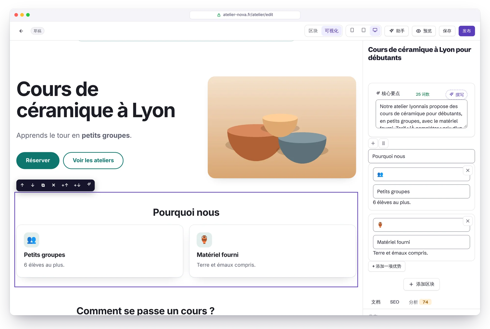
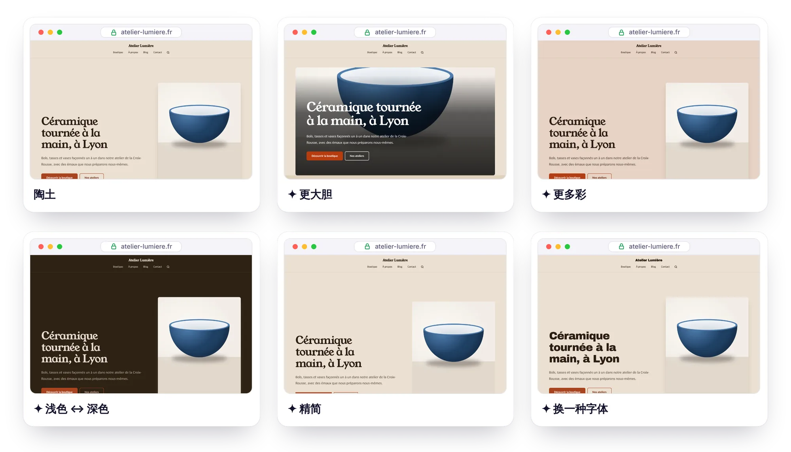
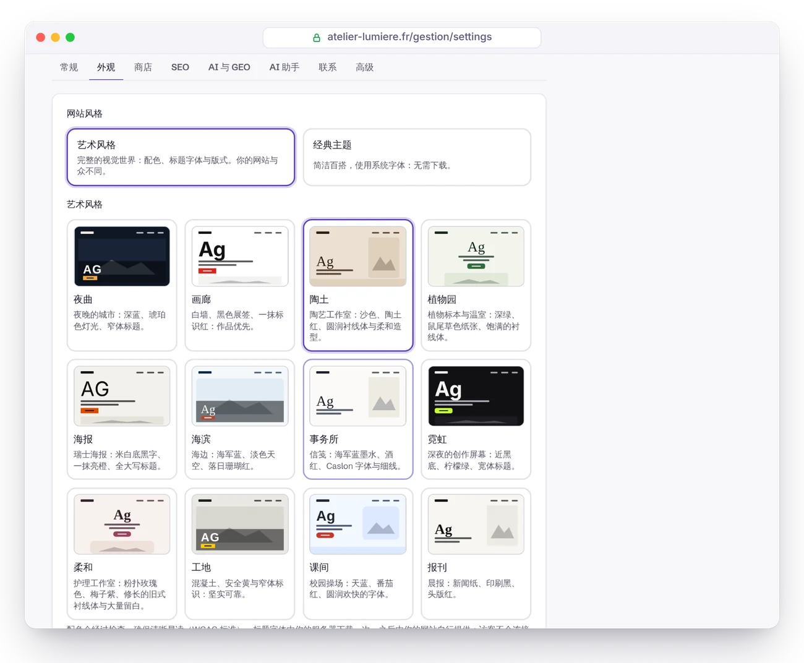

<p align="center">
  <a href="GUIDE.md">Français</a> · <a href="GUIDE.en.md">English</a> · <a href="GUIDE.es.md">Español</a> · <a href="GUIDE.de.md">Deutsch</a> · <a href="GUIDE.it.md">Italiano</a> · <a href="GUIDE.pt-BR.md">Português</a> · <b>简体中文</b>
</p>

# Éclair CMS 使用指南

安装、使用、保护和维护 Éclair 所需了解的一切。如需项目介绍，请返回 [README](../README.zh-CN.md)。

> [!NOTE]
> Éclair 的后台支持 7 种语言（含简体中文），本指南中的菜单和按钮名称以简体中文界面为准。网站前台支持 6 种语言（法语、西班牙语、英语、德语、意大利语、葡萄牙语），暂不支持中文。

## 目录

1. [安装](#安装)
2. [功能详解](#功能详解)
3. [日常使用](#日常使用)
4. [可视化模式](#可视化模式)
5. [艺术风格](#艺术风格)（包括[一键微调](#一键微调)、[用 AI 构想我的风格](#用-ai-构想我的风格)和[设计评分](#设计评分)）
6. [主题](#主题)
7. [商店](#商店)
8. [AI 助手](#ai-助手)（包括[用 AI 生成页面](#用-ai-生成页面)）
9. [MCP 连接器（Claude 与 ChatGPT）](#mcp-连接器claude-与-chatgpt)
10. [安全](#安全)
11. [更新、备份、迁移](#更新备份迁移)（包括[一键更新](#一键更新)和 [Google Drive 备份](#google-drive-备份)）
12. [故障排除](#故障排除)（包括 [Nginx](#nginx)）
13. [开发者指南](#开发者指南)

---

## 安装

### 环境要求

- **PHP 8.1 及以上**（推荐 8.3），需要 `mbstring`、`json`、`dom`、`session` 和 `zlib` 扩展（几乎所有环境都默认启用）。
- 推荐：`gd`（WebP 图片）、`zip`（一键备份）、`curl`（IndexNow、AI 助手、艺术风格的字体）。
- **Apache 或 LiteSpeed** 服务器（几乎所有虚拟主机都满足：Hostinger、IONOS、OVHcloud……）。使用 Nginx 请见[下文](#nginx)。
- HTTPS 证书（几乎所有主机商都提供免费的 Let's Encrypt 证书）。

安装向导会替你检查以上所有条件，并说明如何修正。

### 安装步骤

1. 下载安装包 [`eclair-cms-1.10.0.zip`](https://github.com/Jacckisback/eclair-cms/raw/main/dist/eclair-cms-1.10.0.zip)（528 KB）并解压。
2. 使用 FTP 软件（如 FileZilla）或主机的文件管理器，把 **`eclair` 文件夹里的内容**上传到主机的公开目录（`public_html`、`www`……）。
   > ⚠️ `.htaccess` 是隐藏文件：请开启“显示隐藏文件”，确保它们也被上传。
3. 打开你的网站地址：**安装向导随即启动**（支持 7 种语言，包括简体中文）。
4. 回答 4 个问题（你的网站、你的账户、你的可见性、后台地址）。彩纸飘落 🎉：网站上线，并自带几个页面和一篇示例文章。

> 🔒 出于安全考虑，必须在首次访问后的 **2 小时内**完成安装（否则任何人都可能接管一个上传后被遗忘的网站）。超时后，请通过 FTP 删除 `data/install-window.php` 文件并刷新页面。

安装到子目录（`example.com/site/`）：只需把文件上传到该子目录，一切都会自动识别。

### 4 种网站类型

| 类型（安装向导中的名称） | 自动创建的内容 |
|---|---|
| 🏢 企业官网 | 首页（横幅、优势、最新文章）、服务（含 FAQ）、关于、联系、博客、法律声明、隐私政策 |
| ✍️ 博客 | 首页 = 最新文章、关于、联系、“Guides”分类、法律页面 |
| 🧑‍💻 自由职业 / 作品集 | 以你的名字命名的首页、技能、关于、博客、联系、法律页面 |
| 🎯 单页网站 | 一个销售页面（横幅、优势、FAQ、表单）+ 法律页面，没有博客 |

初始内容提供法语、西班牙语和英语版本，其他语言的网站会使用英语内容。法律页面提供了一个待完善的框架，依据的是法国（LCEN）、西班牙（LSSI）和欧盟 GDPR 的要求；你所在国家或地区的其他法律要求需要自行补充。

### 安装完成后

仪表盘会显示一份“新手入门”入门清单：标志和主色、首页、第一篇文章、作者资料、双重认证、法律声明、Google Search Console。

---

## 功能详解

### ⚡ 速度

- **自动静态缓存**：每个页面只生成一次，之后无需加载应用即可直接输出。每次修改后缓存会自动清空（定时发布的文章会在预定时间清空）。
- **CSS 内联在页面中**（17 至 23 KB，视主题和是否启用商店而定，压缩后 5 至 6 KB），使用系统字体：没有阻塞渲染的请求，也没有布局偏移。使用艺术风格时，只会额外加载一种标题字体（12 至 27 KB），由你的网站自行提供并预加载。
- **上传时自动优化图片**：缩放尺寸（最大 2000 px），生成**响应式 WebP**（480、800、1200、1600 px），写明宽高，延迟加载，并优先加载主图。
- ETag 与 `304 Not Modified` 响应，静态文件启用 Brotli/Gzip 压缩和一年的浏览器缓存（通过 `.htaccess`）。

### 🔎 SEO

- 简洁的网址，网址变更时**自动 301 重定向**，另有重定向管理器（方便接手旧的 WordPress 或 Wix 网站）。
- 编辑器内可设置标题和元描述，并带计数器和**实时 Google 搜索预览**。
- **实时 SEO 分析**并给出评分：标题和描述长度、关键词（标题、网址、引言、小标题、密度）、字数、结构、替代文本、内部链接、特色图片……
- 完整的 **JSON-LD 结构化数据**：WebSite（+ 站内搜索）、Organization / Person / LocalBusiness（地址、营业时间、社交主页、退货政策）、WebPage / AboutPage / ContactPage、BlogPosting（作者、日期、栏目）、BreadcrumbList、FAQPage、ProfilePage，商店还有 Product / ProductGroup / Offer（价格、库存、配送）。
- 包含图片和 `hreflang` 的 XML 站点地图、robots.txt、全文 RSS 订阅、Open Graph 和 Twitter Cards（**自动生成 1200×630 分享图**）、面包屑导航、规范网址。
- 每个内容只有一个地址：自动处理 HTTPS、带或不带 www、末尾斜杠、大写字母和 `index.php` 的重定向。
- **IndexNow**：每次发布都会通知 Bing、Yandex、Seznam 等搜索引擎。
- 支持 Google Search Console 和 Bing Webmaster Tools 验证（粘贴 `<meta>` 标签即可，Éclair 会自动提取验证码）。
- 多语言：每个内容可设置语言，关联各语言版本并自动生成 `hreflang` 标签。
- 法语内容自动应用法语排版规范（在 `: ; ! ?` 前和 « » 引号内加不换行空格）。

### 🤖 GEO（AI 问答引擎）

- 自动生成 **`/llms.txt`**（llmstxt.org 标准）和 **`/llms-full.txt`**。
- **每个页面都有 Markdown 版本**：在任意网址后加上 `.md` 即可（带元数据头、`noindex` 和规范网址，不会产生重复内容）。
- **一键设置 AI 爬虫策略**：开放（推荐，便于被引用）、仅限引用（允许问答引擎，拒绝模型训练）或关闭。覆盖 GPTBot、OAI-SearchBot、ChatGPT-User、ClaudeBot、Claude-SearchBot、Claude-User、PerplexityBot、Google-Extended、Applebot-Extended、CCBot、Meta-ExternalAgent 等，并可选 `Content-Signal` 指令。
- **要点区块**（后台中名为“核心要点”）：显示在文章开头，是 AI 最爱引用的摘要。
- 编辑器内的 **GEO 评分**：摘要、开门见山的引言、FAQ、问句式小标题、列表和表格、具体数据、外部来源、明确的作者（E-E-A-T）、短段落、内容新鲜度。
- 作者页面包含简介和社交主页（`sameAs`），并显示发布日期和更新日期。

### ✍️ 区块编辑器

- 18 种区块：文本、小标题（H2-H4）、列表、引用、图片、提示框、FAQ、表格、按钮、YouTube/Vimeo 视频（点击前不加载任何 Cookie）、代码、分隔线、横幅、优势、团队（头像、职位、简介）、最新文章、商品（商店橱窗）、联系表单。
- 在空行输入 **`/`** 即可选择区块，支持拖放，并带格式工具栏（粗体、斜体、链接、代码、高亮）。
- **智能内部链接**：输入链接时，编辑器会推荐你的页面和文章（2 秒完成内部链接）。
- **智能粘贴**：从 Word、Google Docs 或网页粘贴时，标题、列表、表格和粗体会自动转换为整洁的区块。
- `Ctrl+S` 保存，本地备份草稿（断网也不会丢失内容），发布前可真实预览，**保留最近 20 个历史版本**，支持定时发布。
- **可视化模式**：以你的主题显示页面的实际效果，可直接在页面上修改（[详情](#可视化模式)）。

### 🧩 其他功能

媒体库（拖放上传、替代文本、识别正在使用的图片）、可拖放的菜单（页眉和页脚）、用于构建主题集群的“支柱”分类、站内搜索、**无需验证码**的防垃圾联系表单（蜜罐字段、令牌、按网络和按天限流）及收件箱、管理员和编辑账户、6 个主题和 12 种艺术风格（支持实时预览）、自动深色模式、6 种系统字体、保证 WCAG 对比度的主色、7 种语言的后台界面（含简体中文）、6 种语言的公开网站（fr、es、en、de、it、pt）。

---

## 日常使用

| 我想…… | 位置 |
|---|---|
| 写一篇文章 | 仪表盘 › **撰写文章** |
| 让 AI 写文章、建页面、生成图片 | 仪表盘上的 **“今天想创作什么？”** 输入框，或 **✨ AI 助手**（`Ctrl+J`） |
| 让 AI 编排一个完整的页面 | 新建页面 › **✨ 用 AI 生成** |
| 按页面的实际显示效果进行编辑 | 编辑器 › **可视化** |
| 在网站上直接编辑页面 | **✏️ Edit** 按钮（仅在登录后可见，名称随网站语言变化） |
| 更换主题、标志、主色、字体 | 设置 › 外观 |
| 添加自己的 CSS | 设置 › 外观 › 自定义 CSS |
| 开放商店 | 设置 › 商店 |
| 添加商品 | 内容 › **+ 商品** |
| 设置首页 | 设置 › 常规 |
| 允许或屏蔽 AI | 设置 › AI 与 GEO |
| 启用 AI 助手 | 设置 › AI 助手 |
| 关联 Google Search Console | 设置 › SEO |
| 在菜单中添加链接 | 菜单 |
| 重定向旧网址 | 重定向 |
| 开启双重认证 | 个人资料 › 双重验证 |
| 下载备份 | 安全 › 备份 |

编辑器快捷键：`/` 插入区块 · `Ctrl+S` 保存 · `Ctrl+K` 链接 · `Ctrl+B` 粗体 · `Ctrl+I` 斜体 · `Enter` 新段落 · `Shift+Enter` 换行 · `Ctrl+J` AI 助手。

---

## 可视化模式

<p align="center">
  
</p>

可视化模式会用网站真实的主题显示你的页面，和访客看到的完全一样，并让你直接在页面上修改。在编辑器顶部切换**区块**和**可视化**：系统会记住你的选择，下次继续沿用。

- **输入文字**：点击标题、段落、FAQ 问题、按钮文字……然后直接输入。`Ctrl+B` 粗体，`Ctrl+I` 斜体，`Ctrl+K` 链接（会打开编辑器的页面搜索）。在单行字段中，`Enter` 用于确认；在段落中，`Enter` 会新建下一个段落（`Shift+Enter` 仅换行）。粘贴的内容一律作为纯文本插入。
- **调整结构**：点击某个区块，它会被框出并显示工具栏：↑ ↓ 移动，⧉ 创建副本，✕ 删除，+↑ 和 +↓ 在上方或下方添加区块。工具栏也可以用键盘操作（先按 `Tab`，再按 `Enter`）。
- **图片**：点击图片（横幅、图片区块、团队头像、文章的特色图片），即可从媒体库中另选一张。
- **区块设置**：右侧面板显示所选区块的表单（按钮链接、文章数量、新的 FAQ 问题……），下方是“文档”“SEO”和“分析”标签页。
- **✨ AI 修改**（需启用助手）：润色、修正、缩短、扩写、简化、调整语气或翻译区块中的文字。
- **撤销**：`Ctrl+Z`（Mac 上为 `Cmd+Z`）逐步撤销（最多 50 步）。
- **宽度**：📱 390 px、▭ 768 px 或 🖥 全宽，用来检查在手机和平板上的显示效果。

一切仍通过平常的编辑器完成：保存（在页面中按 `Ctrl+S` 同样有效）、本地备份草稿、版本历史、实时 SEO 和 GEO 分析。编辑期间，页面上的链接、按钮和表单不会响应。在网站上不可见的区块（尚未选择图片、商店已关闭……）会显示为虚线框，可在右侧面板中补充内容。

> [!NOTE]
> 可视化模式只存在于后台的预览中：必须登录、持有安全令牌并拥有写入权限，该页面永远不会被缓存或索引。你的公开页面不会留下任何痕迹：它们逐字节保持不变。

---

## 艺术风格

<p align="center">
  
</p>

主题改变的只是配色；**艺术风格**则从一个具体的意象出发（夜晚的城市、陶艺工作室、晨报），改变网站的整个视觉世界。在**设置 › 外观**中选择**艺术风格**（而不是**经典主题**），点击 12 张卡片中的一张，然后查看实时预览：你的真实网站，电脑或手机视图均可。保存之前，什么都不会发布。

| 风格 | 视觉世界 | 标题字体 |
|---|---|---|
| **夜曲** | 夜晚的城市：深蓝、琥珀色灯光 | Big Shoulders Display，全大写 |
| **画廊** | 白墙、黑色展签、一抹标识红 | Familjen Grotesk |
| **陶土** | 陶艺工作室：沙色、陶土红、柔和造型 | Young Serif |
| **植物园** | 植物标本与温室：深绿、鼠尾草色纸张 | DM Serif Display |
| **海报** | 瑞士海报：米白底黑字、亮橙 | Archivo Black，全大写 |
| **海滨** | 海边：海军蓝、淡色天空、珊瑚红 | Gloock |
| **事务所** | 信笺：海军蓝墨水、酒红、细线 | Libre Caslon Display |
| **霓虹** | 深夜的创作屏幕：近黑底、柠檬绿 | Unbounded |
| **柔和** | 护理工作室：粉扑玫瑰色、梅子紫、大量留白 | Cormorant Garamond |
| **工地** | 混凝土、安全黄、窄体标识 | Barlow Condensed，全大写 |
| **课间** | 校园操场：天蓝、番茄红、圆润的字体 | Fredoka |
| **报刊** | 晨报：新闻纸、头版红 | Newsreader |

**调整**：在卡片下方，**调整风格**会展开所有设置，可自由组合：

- **5 种颜色**：背景、色带与卡片、文本、次要文字、强调色（按钮和链接）。
- **标题字体**：18 种因个性而精选的字体（没有一种是随处可见的大路货），或一种系统字体。**正文字体**：一种系统字体，无需下载。
- **标题大小写**（标准或全大写）、**标题大小**（低调、均衡、醒目）、**圆角**（直角、柔和、圆形）、**间距**（紧凑、正常、宽松）。
- **卡片**：细边框、纯色填充或投影。
- **首页横幅**：图文并排、图片居左、海报（超大标题）、全幅图片（标题叠在照片上）、杂志风（竖幅图片）、居中或带底框（文字和图片置于彩色面板中）。
- **“优势”区块**：卡片、行列表、带线分栏或编号（01、02……）。**分区**：纯色背景、色带或分区之间加细线。**优势图标**：线条图标（共 65 个线条绘制的图标，可识别常用表情符号：☕ 🚗 🐶 ✂️ 🎓 💼 🌸……）、无图标或表情符号。
- **按钮**：实心、描边或下划线链接（带箭头）。

页眉、文章列表、Logo、网站图标、页脚和自定义 CSS 的设置方式与以前相同。如需回到经典主题，选择**经典主题**并保存即可：它的设置原封不动地等着你。

**始终清晰易读**：无论选择什么颜色，Éclair 都会自动调整正文（与背景的对比度达到 **7:1**）、次要文字、链接和按钮（4.5:1），包括带有强调色色调的背景（徽标、菜单、高亮）。因此，在浅色背景上显得太浅的文字颜色，会被恰到好处地加深。

**始终快速**：标题字体**只由你的服务器下载一次**（来自 Fontsource，采用 SIL Open Font License），保存在 `media/fonts/` 中，之后由你的网站自行提供，并通过 `font-display: optional` 预加载：访客不会向任何第三方服务发出请求，也不会出现布局偏移。页面中只插入你的风格用到的 CSS 规则，自动深色模式则让位于风格自身的浅色或深色设定。Lighthouse 实测：夜曲、海滨、报刊和海报在全部四个类别中均获 100 分，新版式（图片居左或带底框的横幅、带编号的优势、分区之间加细线、描边或下划线链接样式的按钮）同样如此。

> [!TIP]
> 如果你的主机商屏蔽了对外连接，字体就无法下载：系统会显示提示，在此期间网站会使用同一类别的备用字体（衬线体、窄体……）。稍后重新保存即可再试。

### 一键微调

<p align="center">
  
</p>

卡片下方的六个按钮只需点击一下即可调整所选风格，预览随即更新：

| 微调 | 变化 |
|---|---|
| **更大胆** | 标题更大、留白更多、横幅更醒目（先变为海报，再变为全幅图片）、分区改用色带、强调色更鲜明、实心按钮 |
| **更简约** | 标题更低调、标准大小写、以细边框取代投影、横幅更沉稳、强调色更柔和 |
| **更多彩** | 背景和色带染上强调色的色调、分区改用色带、强调色更鲜明 |
| **精简** | 细边框、无图标、纯色背景、留白更多、圆角更小、优势改为分栏 |
| **浅色 ↔ 深色** | 反转背景、色带和文字的明暗，同时保留各自的色相 |
| **换一种字体** | 切换到下一种标题字体，并在不同字体类别之间轮换（衬线体、无衬线体、窄体……） |

微调可以连续叠加；**撤销微调**每次后退一步。每一步都保证对比度达标，保存之前不会发布任何内容。

### 用 AI 构想我的风格

<p align="center">
  
</p>

启用 [AI 助手](#ai-助手)后，卡片下方会出现**用 AI 构想我的风格**。用一两句话描述你的业务、受众和想要的氛围（“上海的社区有机面包店，顾客多为家庭，温馨又现代”），然后点击**提出 3 种风格**。AI 还会阅读你网站的介绍和你的编辑风格档案，并遵循 [Impeccable](https://github.com/pbakaus/impeccable) 的方法：

1. 从业务所处的具体世界（场所、材料、物件、光线）出发，而不是从形容词出发；
2. 为每个方案找到**一个明确的参照**（“五十年代面包店的搪瓷招牌”），并由此确定配色、字体和版式；
3. 提出三种**真正不同**的风格（浅色或深色、暖调或冷调、衬线或无衬线）；
4. 避开行业的默认选择（比如律师用海军蓝配金色……）、可预见的反向选择，以及“AI 生成设计”的套路。

三个方案会排在卡片的最前面，并标有 ✦：点击某个方案即可在预览中查看，调整后保存你喜欢的那一个。AI 只在 Éclair 的设置中选择（配色、列表中的字体、版式），从不编写 CSS：每个方案在应用到你的网站之前都会经过检查，并修正对比度。按钮下方会显示预估费用（使用 Claude Sonnet 5.5 约 $0.03），费用从助手预算中扣除。仅限管理员使用。

### 设计评分

在编辑器中，**分析**标签页会在 SEO 和 GEO 旁边显示第三个圆环：**设计**。它检查页面在视觉上是否站得住脚：

- **小标题**：层级连贯不跳级（H2 → H3 → H4），简短，不带装饰性表情符号；
- **横幅**：标题简短（最多 8 个词，全大写时最多 6 个），带行动按钮；如果你的风格需要，还要配图（全幅图片、杂志风）；
- **行动号召**适度（最多 3 个按钮）；
- **“优势”区块**有 3 到 6 项带描述的内容，所用图标都有对应的线条图标；
- **文字**：没有全大写的句子，没有空洞套话（如英文的“seamless”“cutting-edge”、法文的“révolutionnaire”……视页面语言而定），不滥用长破折号，没有完全重复的段落，也没有超过 350 词却不含小标题、图片或列表的大段文字；
- 网站已选择**艺术风格**。

分析标签页上的分数现在是三个圆环的平均值。

---

## 主题

Éclair 自带 **6 个主题**。在**设置 › 外观**中选择一个：**实时预览**会在电脑或手机视图中展示你的真实网站（首页、博客、一篇文章、商店、一件商品），在你保存之前，什么都不会发布。你还可以在预览中浏览网站：点击链接后仍停留在预览中。

| 主题 | 风格 | 适用对象 |
|---|---|---|
| **Éclair** | 清爽、现代、百搭：原版主题 | 所有网站 |
| **杂志** | 宛如一本杂志：衬线字体、细分隔线、首字下沉、头条文章 | 博客、媒体、作者 |
| **工坊** | 温暖而富有手作感：奶油色与赤陶色调、柔和的造型 | 手艺人、餐厅、健康养生 |
| **工作室** | 极简作品集：黑白配色、大标题、无边框图片 | 摄影师、设计师、创意机构 |
| **商店** | 专为销售打造：方形照片、固定页眉、醒目按钮 | 店铺、创作者 |
| **高对比** | 可读性最佳：大字号、强对比、链接带下划线 | 公共服务、协会、老年人 |

选择主题会应用它推荐的主色和字体：之后你仍可以修改。另有两项布局设置与主题搭配：**页眉**（Logo 居左、菜单居右，或整体居中）和**文章和商品列表**（卡片网格，或图片居左的列表）。

**为什么这么轻**：一个 Éclair 主题只是一个 1.5 至 3 KB 的样式表，叠加在基础样式表之上。不同主题之间 HTML 完全相同：速度、无障碍、结构化数据和 SEO 都保持不变。页面中只内联当前启用的主题，而且每个主题都支持自动深色模式。

**自定义 CSS**：如果想在主题之外做更多调整（按钮颜色、间距、某个区块的样式），把你的规则粘贴到**设置 › 外观 › 自定义 CSS**。它们会添加在每个页面的主题之后，因此优先生效，并与你的数据（`data/`）一起保存：**Éclair 更新时会保留它们**。`/*dark*/ … /*/dark*/` 标记同样有效：当深色模式设为“始终浅色”时，其中的规则会被移除。出于安全考虑，`<` 字符和 `@import` 规则会被删除；最大 64 KB。

---

## 商店

**轻量商店模式**适合销售几十件商品，而不必承担一整套电商系统的负担：没有购物车，没有客户账户，没有数据库，你的服务器上也不保存任何银行卡数据。每件商品都有自己的详情页，并针对 Google 和 AI 优化；详情页上的**购买**按钮通向一个 **Stripe、PayPal 或 Revolut Business 付款链接**：由你的支付服务商负责收款、发送收据并处理退款。

### 开放商店

1. **发布你的法律声明**（安装时已为你创建了一个待完善的框架）**和销售条款**。缺少这两个页面，商店就无法开放：请找人审阅，它们关系到你作为卖家的法律责任。
2. 在**设置 › 商店**中：选择这两个页面，设置货币、运费和配送时间、配送国家，以及退货期限（在欧盟，远程销售须提供至少 14 天的无理由退货期，定制商品等特殊情况除外）。
3. 点击**创建感谢页面**：客户付款后，Stripe 可以把他们带回这个页面。
4. 打开**商店已开放**开关并保存，然后把商店添加到菜单中（菜单 › 商店）。

商品目录的地址取决于网站语言：`/boutique`（法语）、`/tienda`（西班牙语）、`/shop`（英语、德语）、`/negozio`（意大利语）或 `/loja`（葡萄牙语）。这个地址可以修改；修改后，旧地址会自动重定向。

### 创建商品详情页

内容 › **+ 商品**。编辑器顶部是商品详情：

- **价格**和**划线价**（可选：折扣会以百分比显示），**库存状态**（有货、已售罄、预售）。
- **付款链接**：该商品的 Stripe、PayPal 或 Revolut Business 链接。
- **照片**：第一张是主图（用于 Google 和社交媒体）；建议至少 3 个角度。
- **规格**（尺码、颜色等）：每个规格都可以有自己的价格和链接。在网站上，选择规格无需 JavaScript。
- **Google Shopping 详细信息**：品牌、货号、条形码（GTIN/EAN）、商品状况（全新、二手、翻新）、数字商品或服务（无需配送）。

在下方用常用的区块描述商品，并把它归入一个**商品分类**（分类 › “包含：商品（商店）”）。SEO 分析还会额外检查价格、付款链接、照片数量和商品标识。如需在某个页面上展示商品，请添加**商品**区块。

使用 AI 助手时：附上一张照片，然后输入“根据附上的照片创建商品详情页。价格：€29.90”。它会写出一份完整的草稿，但**绝不会编造价格、折扣或付款链接**：缺少的信息由你来补充。

### 关联 Stripe（Payment Links）

1. 在 Stripe 中打开 **Payment Links**（付款链接）并创建一个链接：填写商品和价格，需要时开启收集配送地址。
2. 在 **After the payment**（付款后）标签页中，选择将客户重定向到你的感谢页面（它的地址显示在 设置 › 商店 中）。
3. 在 Stripe 设置的 **Customer emails**（客户邮件）中，启用付款成功收据。
4. 复制链接，粘贴到商品详情中。Éclair 会在链接中加上商品标识（`client_reference_id`）：每笔付款都会注明买的是什么。

每笔订单都会出现在 Stripe 中（如果你启用了邮件通知，也会通过电子邮件发给你）：你负责备货和发货，需要退款时由 Stripe 处理。其他支付服务商也可以使用，只要它的付款链接以 `https://` 开头。

### 或者关联 PayPal 或 Revolut Business

原理相同：每件商品（或每个价格不同的规格）一个固定价格的付款链接，粘贴到商品详情中。Éclair 会识别这些链接，并在购买按钮下方注明付款由 PayPal 或 Revolut 安全处理。

- **PayPal**：在你的商家账户中打开**付款链接和按钮**，为商品创建一个固定价格的链接，然后复制（链接以 `https://www.paypal.com/` 开头）。顾客可以用 PayPal 账户或银行卡付款。
- **Revolut Business**：需要开通商户账户。在**商户 › 付款链接**（Merchant › Payment link）中按商品金额创建链接，然后复制（`https://checkout.revolut.com/…`）。顾客在 Revolut 的付款页面完成付款。

与 Stripe 相比有两点不同：付款后，顾客会停留在服务商的确认页面（不会自动回到你的感谢页面）；商品编号也不会附加到付款中，请给每个链接起一个清楚的名称，方便识别订单。

### 为 Google 和 AI 所做的优化

- 每个详情页都带有 Product 和 Offer **结构化数据**（有规格时使用 ProductGroup）：价格、货币、库存、商品状况、品牌、运费和配送时间，以及全店统一的**退货政策**。这些正是 Google 在商品搜索结果中展示的信息。
- Google Merchant Center 格式的**商品 Feed** `/products.xml`：在 Merchant Center 中把它添加为商品来源，你的商品就能免费出现在“购物”（Shopping）标签页中。
- 商品分类作为支柱页面，站点地图包含所有照片，并带面包屑导航。
- 面向 AI：每件商品的价格和库存状态都会写入 `llms.txt` 和每个详情页的 Markdown 版本（在详情页地址后加上 `.md` 即可）。

### 要花多少钱？

Éclair 不收任何费用。Stripe 不收订阅费，也不收开通费，付款链接也已包含在内：你只需为每笔付款支付手续费。以 Stripe 在法国的价格为例，欧洲经济区标准卡为 **1.5% + €0.25**（高级卡为 2.8% + €0.25，欧洲经济区以外的卡为 3.15% + €0.25，涉及货币兑换时另加 2%）。以上为 2026 年 10 月 30 日在 [stripe.com/fr/pricing](https://stripe.com/fr/pricing) 查到的 Stripe 法国价格，今后可能会调整。

使用 **Revolut Business** 时，欧洲经济区个人卡的手续费为 **1% + €0.20**（欧洲经济区以外的卡为 2.8% + €0.20），付款链接已包含在内（[Revolut 帮助中心](https://help.revolut.com/en-ES/business/help/merchant-accounts/fees/how-much-does-it-cost-to-accept-card-payments/)、[Revolut 价格](https://www.revolut.com/en-IE/business/accept-payments-pricing/)）。在法国使用 **PayPal** 时，银行卡付款为 **1.2% + €0.35**，使用 PayPal 账户付款为 **2.9% + €0.35**，欧洲经济区以外另加 1.99%（来自英国为 1.29%）（[PayPal 收费标准](https://www.paypal.com/fr/business/paypal-business-fees)，2026 年 7 月 15 日更新）。以上价格于 2026 年 10 月 31 日核实。

### 商店不提供的功能

没有多商品购物车、优惠码和客户账户，也不会自动管理库存：目的就是保持简单。如果你要销售数百种商品，或者需要这些功能，完整的电商系统（Shopify、WooCommerce、PrestaShop）会更合适。网站上显示的价格就是你输入的价格：面向个人消费者销售时，请填写含税价格。

---

## AI 助手

助手会**按照你网站的语气**撰写草稿、润色你的文字、生成图片。你可以用自然语言指挥它，就像跟同事交代工作一样：“写一篇关于如何选择品牌色彩的文章，并配一张图片。”它会先查找网站上是否已有这个主题，然后生成图片，写出完整的草稿（标题、核心要点、小标题、列表或表格、FAQ、元描述、内部链接），再连同 SEO 和 GEO 评分一起交给你。**不经你点击，任何内容都不会发布。**

它支持 **Claude**（Anthropic）或 **ChatGPT**（OpenAI），使用你自己的 API 密钥：Éclair 不收订阅费，你按实际用量直接向服务商付费。更想用你的 Claude 或 ChatGPT 订阅？请使用 [MCP 连接器](#mcp-连接器claude-与-chatgpt)。

### 启用助手（5 分钟）

1. 在所选服务商处创建 API 密钥：Claude 请前往 [console.anthropic.com](https://console.anthropic.com/settings/keys)，ChatGPT 请前往 [platform.openai.com](https://platform.openai.com/api-keys)，并充值几美元的额度。
2. 在**设置 › AI 助手**中选择服务商，粘贴密钥，选择模型，然后点击**测试连接**（免费：不会生成任何文字）。
3. 如需配图，请选择一个图片生成器：**GPT Image 2.5**（与 ChatGPT 共用同一个密钥）、**FLUX 3**（[dashboard.bfl.ai](https://dashboard.bfl.ai)）或 **Ideogram 3**（[ideogram.ai](https://ideogram.ai/manage-api)，最适合带文字的图片）。不设置图片生成器时，助手会使用你的媒体库和你附上的照片。
4. 点击**根据我的网站起草档案**，通读一遍，按需调整，然后保存。

之后，助手会出现在菜单（**✨ AI 助手**，`Ctrl+J`）、编辑器和仪表盘中。如果你开启“编辑可以使用助手”，编辑角色的用户也能使用它。

**Claude 或 ChatGPT，任你选择**：保存两个密钥后，助手顶部会出现一个选择器，每次对话都可以选择 AI。系统会为你的账户记住这个选择，编辑器中的快速修改也会沿用；在设置中选择的服务商仍是默认服务商。

### 编辑风格档案

正是它让 AI 写得**像你本人**：你是谁、提供什么，你为谁写作，语气与风格（称呼读者用“你”还是“您”、句子长短、是否幽默），价值观，需要遵守的规则（如“始终附上联系页面的链接”“绝不提价格”），以及图片风格。一键即可根据你的页面和文章起草这份档案，最终由你拍板。每次处理请求时，助手还会遵循 Éclair 的分析规则：草稿从一开始就力求获得较高的 SEO 和 GEO 评分。

### 你可以让它做什么

- “写一篇关于春季电动自行车保养的文章，并配一张图片。”
- “把艺术总监 Léa Martin 连同附带的照片加到团队页面。”（可以用 📎、拖放或粘贴的方式附上照片）
- “新建一个‘我们的服务’页面，介绍我们的三种套餐。”
- “给我 5 个能吸引新客户的文章选题。”
- “看看我的首页，提一些改进建议。”
- 在编辑器中：“为这篇文章添加常见问题”“让引言更有吸引力”。

每个操作都会在回复下方生成一张**卡片**：

| 卡片 | 发生了什么 | 可用的按钮 |
|---|---|---|
| 📝 草稿 | 新文章或新页面，绝不自动发布 | 打开 · 预览 · 立即发布或定时发布 |
| ✏️ 建议修改 | 针对**已发布**的内容：未经你同意，什么都不会改变 | 预览 · 应用 · 忽略，应用后如有需要还可取消 |
| ✅ 已更新 | 直接修改了一篇**草稿** | 打开 · 预览 · 取消 |
| ✅ 已在编辑器中修改 | 直接修改编辑器中打开的内容 | 取消（之后由你保存） |
| 🖼️ 图片 | 图片已生成、优化（WebP）并存入媒体库 | 特色图片（在编辑器中） |

只要之后没有人再改动过该内容，就可以点“取消”撤销；否则，之前的版本仍保存在编辑器的**版本历史**中。对话记录会保留你最近的 30 次对话。助手绝不会编造与你的业务有关的事实（价格、营业时间、数据、客户评价）：缺少信息时，它会留下一个醒目的标记（用内容的语言书写，例如 **[To complete: price]**），并提醒你；只要这些标记还在，分析标签页就会统计它们。

### 用 AI 生成页面

在新内容（页面、文章或商品）中，**✨ 用 AI 生成**面板只需一次调用，就能编排出一份完整的草稿：

1. 选择类型和语言，然后用一两句话描述你想要的内容。你还可以补充**目标**（“获得更多询价”）、**受众**、**语气**和想要的**版块**（“横幅、优势、价格、常见问题、联系”）。
2. 开始之前会显示**预计费用**（使用 Claude Sonnet 5.5 约 $0.08，使用 Claude Opus 5.5 约 $0.16），费用从助手预算中扣除。如果两个密钥都已保存，你可以选择 Claude 或 ChatGPT。
3. 20 至 60 秒后，草稿会在**可视化模式**中打开：标题、网址、SEO 标题和元描述、“核心要点”、主关键词，以及按版块编排的布局（横幅、优势、小标题、列表、提示框、FAQ、按钮、团队、联系表单、最新文章或商品），全文只有一个 H1，即横幅的标题。

AI 会参考你的编辑风格档案、已发布页面和文章的列表（确保链接真实存在）以及你最近的 30 张图片。它不会编造任何事实：缺失的价格、数据、名称或营业时间会保留为 **“[To complete: …]”**，分析标签页会统计它们，直到你补全为止。草稿永远不会自动发布：请通读、补全，然后再发布。

### 在编辑器中快速修改

- **选中一段文字**，然后点击格式工具栏中的 ✨：润色、修正错误、缩短、扩写、简化、更亲切、更专业、翻译。点击“取消”即可恢复原文。
- **核心要点**：“撰写”按钮。
- **SEO 标签页**：SEO 标题和描述、主关键词、标题建议。
- **分析标签页**：添加常见问题、补全缺失的替代文本、“用助手改进”。
- **特色图片**：“用 AI 生成”（仅限文章）。
- **媒体库**：“用 AI 描述”会查看图片，并为它撰写替代文本。

### 要花多少钱？

你按实际用量向服务商付费。Éclair 会根据计费的 token 数算出每一笔开销，并显示在 设置 › AI 助手 中。以下是一篇完整文章的费用估算（约 25,000 个输入 token 和 7,000 个输出 token，已包括检索和核查）：

| 模型 | 每百万 token 价格（输入 / 输出） | 一篇完整文章 |
|---|---|---|
| Claude Opus 5.5（能力最强） | $4 / $20 | ≈ $0.24 |
| Claude Sonnet 5.5 | $2 / $10 | ≈ $0.12 |
| Claude Haiku 5.5 | $0.10 / $0.50 | < $0.01 |
| GPT-6 Astra | $10 / $50 | ≈ $0.60 |
| GPT-6.1 Sol | $2 / $10 | ≈ $0.12 |
| GPT-6.1 Terra | $1 / $5 | ≈ $0.06 |
| GPT-6 Luna | $0.10 / $0.50 | < $0.01 |

一张图片约 $0.05（FLUX 3 生成一张 100 万像素的图片为 $0.048）。以上为 2026 年 10 月 29 日在 [Anthropic](https://platform.claude.com/docs/en/about-claude/pricing)、[OpenAI](https://developers.openai.com/api/docs/pricing) 和 [Black Forest Labs](https://docs.bfl.ml/release-notes) 官方页面查到的公开价格，今后可能会调整。助手的固定指令会缓存在服务商那里，从而降低后续请求的费用。

**防护措施**：每月预算上限（默认 $10），在处理请求的每一步之前都会检查；一旦达到上限，助手就会停止工作，直到下个月。此外还有每人每天的请求次数限制（默认 60 次），而且每人同一时间最多只能进行两个请求。预算和配额都可以在 设置 › AI 助手 中调整。

### 安全与隐私

- **AI 负责准备，你来做决定**：它可以搜索和读取你的内容、创建草稿、修改草稿（可撤销）、对已发布的内容提出修改建议，以及生成图片。它**不能发布、不能删除，也不能改动设置、菜单或账户**。发布始终需要由人来点击。
- **密钥加密**存储在你的服务器上（libsodium，或 AES-256-GCM），从不发送到浏览器，界面上也从不显示完整密钥（只显示“sk-ant…ab12”这样的提示），并且和对话记录一样**不纳入备份**。如需更强的保护，请在 `eclair-config.php` 中加入 `define('ECLAIR_SECRET', 'a-long-secret-phrase');`（须在保存密钥之前完成）。
- **哪些内容会发送给服务商**：你的请求、你附上的图片、编辑风格档案，以及必要的上下文（你的页面和文章列表、编辑器中打开的内容）。请不要在其中放入敏感数据。根据两家服务商的条款（2026 年 10 月 29 日核实），[Anthropic](https://www.anthropic.com/legal/commercial-terms) 不会用通过 API 发送的数据训练模型，[OpenAI](https://help.openai.com/en/articles/5722486-api-data-usage-policies) 默认也不会。
- **内容经过过滤**：AI 写出的所有内容都要经过与编辑器相同的白名单过滤，它的修改只涉及可见文字（绝不会改动链接地址）。生成的图片通过 HTTPS 从经过验证的公开地址下载，再像普通上传的图片一样重新编码。
- **提示词注入**：AI 读到的内容一律被当作数据，绝不会被当作指令；即使某个被动了手脚的页面试图劫持它，它也只能准备一份草稿或一条修改建议，而且在产生任何效果之前，你都会先看到。

### 助手没有回应时

- **“……拒绝了 API 密钥”**：密钥没有复制完整，或者已被撤销。请重新粘贴，然后测试连接。
- **“……的额度已用完”**：请到服务商那里为账户充值。
- **“本月 AI 预算已用完”**：在 设置 › AI 助手 中提高预算，或者等到下个月。
- **回复一次性整段出现，而不是逐步显示**：主机的缓冲机制拦住了数据流。功能一切正常，只是没有“实时”效果。如果使用 Nginx，请在 PHP 配置块中加入 `fastcgi_buffering off;`。
- **“无法连接……”**：你的主机商屏蔽了对外连接。请让主机商放行 `api.anthropic.com` 或 `api.openai.com`（以及你选用的图片生成器）。
- **助手没有出现**：它需要 PHP 的 cURL 扩展和加密功能（sodium 或 openssl），几乎所有主机商都具备；安装向导会检查这些条件。

---

## MCP 连接器（Claude 与 ChatGPT）

你更喜欢用已有的订阅，直接在 **Claude** 或 **ChatGPT** 中工作？MCP 连接器（*Model Context Protocol*，把 AI 与工具连接起来的开放标准）让它们能够访问你的网站：读取你的内容，按照你的语气撰写草稿，并准备修改。**无需 API 密钥，网站零成本**：干活的是你的订阅。和内置助手一样，不经你手，**任何内容都不会被发布或删除**。

### 启用连接器（3 分钟）

1. 你的网站必须启用 **HTTPS**：Claude 和 ChatGPT 不接受其他地址。
2. 在**设置 › AI 助手**页面底部，打开**允许 MCP 连接**，保存，然后复制**连接器地址**（`https://example.com/_eclair/mcp`）。
3. 把它添加到你的 AI 中：
   - **Claude**（网页版和桌面应用）：*自定义 › 连接器 › 添加 › 添加自定义连接器*，填写名称（如“我的网站”），粘贴地址，点击**继续**，保留检测到的认证设置，然后点击**添加**。在 Team 和 Enterprise 方案中，由组织所有者添加连接器；之后成员点击**连接**即可。
   - **ChatGPT**（网页版）：*插件 › + › 添加自定义 MCP 服务器*，填写名称，在**连接**中粘贴地址，选择 **OAuth** 认证，接受警告，然后创建插件。
4. 你网站上的一个页面随即打开：如有需要请先登录（含双重认证），核对应用及其返回地址（`claude.ai` 或 `chatgpt.com`），然后点击**允许**。

设置完成。你可以这样提要求：“看看我的网站，给我 5 个文章选题”“写一篇关于电动自行车保养的文章草稿”或“看看我的首页，提一个更直截了当的标语”。

**支持的订阅方案**（2026 年 10 月 30 日核实）：

| 方案 | 读取网站 | 草稿和修改建议 |
|---|---|---|
| **Claude** Free、Pro、Max、Team、Enterprise | ✅ | ✅（Free：仅限一个自定义连接器） |
| **ChatGPT** Business、Enterprise、Edu | ✅ | ✅ |
| **ChatGPT** Pro | ✅ | ❌（只读） |
| **ChatGPT** 其他方案 | OpenAI 帮助文档中未列出 | |

来源：[Claude 关于自定义连接器的帮助文档](https://support.claude.com/en/articles/11175166-getting-started-with-custom-connectors-using-remote-mcp)、[OpenAI 关于自定义 MCP 服务器的帮助文档](https://help.openai.com/en/articles/12584461-connecting-custom-mcp-servers-in-chatgpt)和 [OpenAI 文档](https://developers.openai.com/api/docs/guides/custom-mcp-server)。这些方案变化很快：请在你的应用中确认。

### AI 能做什么

它会先调用 `get_site`，然后使用内置助手的工具，但不包括生成图片（图片费用由网站的密钥支付）：

| 工具 | 作用 |
|---|---|
| `get_site` | 网站清单（页面、文章、商品、分类及其 ID）、编辑风格档案、SEO 和 GEO 规则 |
| `search_content` · `get_content` | 查找内容，以 Markdown 格式读取 |
| `find_media` | 在媒体库中查找图片 |
| `create_draft` | 以**草稿**形式创建文章、页面或商品详情页，内容可以是 Markdown，也可以是按版块编排的布局（横幅、优势、FAQ……） |
| `update_content` | 修改草稿；对于已发布的内容，则准备一条**修改建议** |

每份草稿都会附带一个链接，用于**在 Éclair 中打开**；每条修改建议则附带一个链接，可以**在编辑器中应用**它，但不会保存：你检查之后再保存（或者直接关闭，什么都不会改变）。此外，Claude 和 ChatGPT 还会根据它们自己的设置，在每次写入操作之前征求你的同意。

### 连接器安全

- **默认关闭**：只要处于关闭状态，它的所有地址都不会响应。
- **OAuth 2.1**：强制使用 PKCE，应用自动注册且不存储任何数据，返回地址经过严格核对，必须完全一致。
- **由你明确授权**，须先登录你的账户（含双重认证），授权页面绝不会暴露你的后台地址。
- **令牌有效期 1 小时**，自动续期，每次续期都会换成新令牌；连续 60 天未使用后，需要重新授权。服务器只保存令牌的哈希值，且不纳入备份。
- **撤销访问**：在 设置 › AI 助手 中，每个应用都有一个对应的按钮。关闭连接器会撤销所有应用的访问；修改密码或让所有设备退出登录也是如此。
- **与内置助手权限相同**：只有勾选了“编辑可以使用助手”，编辑角色的用户才能使用；每个应用每小时最多 60 次修改，以防陷入循环。
- **哪些内容会发送给 Anthropic 或 OpenAI**：AI 为了回答你而读取的内容，适用你的订阅条款。

### 连接失败时

- **AI 无法连接网站，或授权失败**：请检查网站是否已启用 HTTPS，以及地址是否以 `/_eclair/mcp` 结尾。如果使用 Apache，请保持 Éclair 的 `.htaccess` 为最新版本：它会传递授权请求头，而有些主机会去掉这个请求头。
- **Éclair 安装在子目录中**：有些应用会在域名根目录查找授权信息。请改为把 Éclair 安装在域名或子域名的根目录。
- **防火墙或反机器人防护**（Cloudflare……）：请放行 `/_eclair/` 和 `/.well-known/`。
- **修改建议无法再应用**：内容在此期间已被改动；请让 AI 重新提出这项修改。

---

## 安全

Éclair 为恶劣环境而设计（共享主机，以及全天候尝试破解密码的机器人）。它经过了一次攻击性安全审计（竞态条件、暴力破解、重定向、注入、恶意文件）：发现的每个漏洞都已修复，并重放攻击加以验证（`tests/run.php`）。

**数据与服务器**
- **没有数据库**：不可能发生 SQL 注入。
- **数据双重保护**：`data/`、`app/` 和 `cache/` 目录由 `.htaccess` 禁止访问；每个数据文件都以 `<?php exit; ?>` 开头（即使服务器忽略 `.htaccess`，也不会显示任何内容），并且任何 `<?php` 序列都无法写入其中。文件权限私有（0600），以原子方式写入。
- **签名更新**：每个版本的发布公告都带有维护者的 Ed25519 签名，并用内置在 Éclair 中的公钥进行验证；在做任何改动之前，都会先检查安装包（指纹、路径、清单、PHP 语法）；如果网站不再响应，更新会自动撤销（详见[一键更新](#一键更新)）。
- **受保护的安装过程**：只能在首次访问后的 2 小时内安装；网站地址在**由服务器自行验证**之后，才会用于重定向访客（错误或被篡改的地址无法劫持任何流量）。

**登录**
- **密码**使用 Argon2id 哈希（19 MiB，2 轮：安全且适合共享主机；以 bcrypt 作为后备），至少 10 个字符，常见密码会被拒绝。
- **防暴力破解**：每次尝试在校验前先预占名额（即使并发请求也无法突破限制）；按网络（IPv4 地址或 IPv6 的 /64 段）和被攻击的账户分别限流。攻击者故意输错密码，**也绝不会把你常用的设备锁在门外**。同一时间最多进行两次密码校验：大量请求涌入也不会耗尽内存。
- **TOTP 双重认证**（Google Authenticator、1Password、Bitwarden……），附二维码和 8 个只显示一次的恢复码；每个验证码只能使用一次，并发提交也一样；连续输错 10 个验证码后，该账户的双重认证会锁定 15 分钟，并通过电子邮件通知账户所有者。
- **账户修改为原子操作**：正在进行的登录永远无法撤销修改密码、全部下线、启用双重认证、降级或删除账户等操作。
- **敏感操作需再次输入密码**（备份、连接 Google Drive、更新、账户管理、高级设置、修改邮箱），适用于登录超过 15 分钟之后。临时密码必须在首次登录时更换。
- **加固的会话**：登录前不创建会话（机器人无法塞满磁盘），Cookie 设置 `HttpOnly`、`Secure`、`SameSite=Strict`，登录时重新生成，闲置后自动退出，与浏览器绑定，并提供“让其他设备退出登录”。网站启用 HTTPS 后，后台会强制使用 HTTPS。
- 所有操作都带 **CSRF 令牌**，并校验请求来源。

**公开网站**
- **严格的安全响应头**：Content-Security-Policy（不允许内联脚本，样式使用 SHA-256 哈希）、防点击劫持、`nosniff`、`Referrer-Policy`、`Permissions-Policy`，以及可选的 HSTS。它们只取决于设置，与请求无关：缓存无法被投毒。
- **没有开放重定向**：被构造的地址（`/\example.com`、控制字符……）一律返回 404。
- **基于白名单过滤内容**（先解析 HTML，再完整重写）；`javascript:` 和 `data:` 链接无法使用，即使经过伪装（`javascript&colon;`）也不行。Markdown、`llms.txt` 和 RSS 版本始终是惰性内容。
- **联系表单**无需验证码：蜜罐字段、令牌，每个网络每 10 分钟最多 5 条消息，全站每天最多 100 条；收件箱上限 500 条消息（优先清除垃圾信息），并分页显示。
- **上传图片时重新编码**（清除隐藏载荷和 EXIF/GPS 数据）；GIF 动图逐块重写；任何包含代码的图片都会被拒绝；最大 4000 万像素；拒绝 SVG，`/media` 目录不执行脚本，也不列出文件。

**后台**
- **可自定义后台地址**（减少机器人骚扰），区分管理员和编辑角色；网站上的“Edit”按钮不会暴露后台地址。
- **Google Drive 备份权限隔离**：访问权限仅限 Éclair 自己创建的文件，令牌加密存储且可撤销，绝不会包含在备份中；连接时需要确认密码。
- **AI 助手权限受限**：只能生成草稿和修改建议，API 密钥加密存储且不纳入备份，并设有每月预算和每日配额（详见 AI 助手一章的[安全与隐私](#安全与隐私)）。
- **日志有上限**（字段会截断，最大 1 MB）：无法被恶意撑大。
- **完整性检查**：把每个文件与其原始指纹比对，找出可疑文件，包括 `data/` 或 `cache/` 中缺少保护行的 `.php` 文件。
- **实时防护测试**：安全页面会从你的浏览器检测内部文件是否确实无法访问，以及网站地址是否已通过验证。

---

## 更新、备份、迁移

### 一键更新

从 1.10 版开始，Éclair 每天两次在 GitHub 上检查是否有新版本。有新版本时，仪表盘上会出现一条提示，菜单中的**更新**旁也会出现一个标记（仅管理员可见）。未经你同意，不会安装任何东西。

1. 打开**更新**：你可以看到可用的版本，以及查看新功能的链接。
2. **先做一次备份**：可以使用同一页面上的按钮；如果已连接 Google Drive，也可以备份到 Google Drive。
3. 勾选“我有一份近期的网站备份”，如果系统要求，请确认密码，然后点击**更新到……**。整个过程大约需要十秒钟。

在此期间，Éclair 会：

- 从 GitHub 下载安装包，并验证其发布公告的**签名**：每个版本都用维护者的私钥（Ed25519）签名，而这个私钥从不存放在 GitHub 上。因此，即使仓库被入侵，也无法把代码推送到你的网站；
- **在改动任何东西之前**，先检查安装包的指纹和每个文件，并确认你的 PHP 版本能够读取每个 PHP 文件；
- 把旧版本保存在一旁（`cache/update/previous`），然后瞬间装好新版本：只有 `app/`、`assets/`、`index.php` 和 `.htaccess` 会改变。你的内容、图片、账户、设置和自定义 CSS（`data/`、`media/`）都保持不变；
- 检查你的网站、后台和新版本是否像以前一样正常响应；如果不正常，**它会自动回退**到旧版本。

之后，同一页面上的**回退到上一版本**可以一键换回旧版本。

须知：

- 你修改过（或主机商补充过）的 `.htaccess` 会被**保留**；新的模板保存在 `cache/update/htaccess-<version>.txt` 中，方便你对比。
- 手动修改过的 Éclair 文件（主题……）会被替换为新版本：更新页面会在安装前列出这些文件。如需长期保留的调整，请使用**自定义 CSS**（设置 › 外观）。
- 如果你的主机商不允许服务器访问自身，Éclair 会在无法检查的情况下安装更新，并告诉你这一点：请打开你的网站检查，必要时回退到旧版本。
- 一键更新需要 PHP 的 `sodium`、`zip` 和 `curl` 扩展，以及 PHP 可写入的目录。否则，页面会说明需要修正什么，你仍然可以通过 FTP 更新。
- 可以在 设置 › 高级 中关闭自动检查（“立即检查”按钮仍然可用）。

**通过 FTP 更新**（服务器不支持一键更新，或者从 1.10 之前的版本升级）：
1. 先做一次备份。
2. 通过 FTP **删除** `app/` 和 `assets/` 目录，然后上传新版本中的这两个目录，以及 `index.php` 和 `.htaccess`（先删除可以避免残留旧文件，否则完整性检查会把它们标记出来）。
3. **不要改动** `data/`（内容、设置、账户、自定义 CSS）和 `media/`（图片）。
4. 首次访问时缓存会自动清空（否则请执行：设置 › 高级 › 清除缓存）。

### 备份

**下载备份**：安全 › 下载备份，或者在更新页面下载。ZIP 压缩包包含 `data/`（内容、设置、账户、消息）和 `media/`（图片）。API 密钥和 Google Drive 连接信息绝不会包含在其中。如果没有 zip 扩展，请通过 FTP 复制这两个目录。

### Google Drive 备份

在**安全 › Google Drive 备份**中，可以把网站的副本发送到你的 Google Drive：每天、每周，或者随时手动备份。

1. 点击**连接 Google Drive**（可能需要再次输入密码）。
2. Éclair 会显示一个代码。在电脑或手机上打开 **google.com/device**，输入代码，选择你的 Google 账户并授权 Éclair。
3. 页面会自动更新：连接完成。选择备份频率（每天、每周或关闭）以及要保留的备份数量。

- Éclair **只能访问它自己创建的文件**（Google 的“drive.file”权限）：你 Drive 中的其他内容它一概看不到。备份会存放在名为“Éclair – 网站名称”的文件夹中。
- 超过所选数量（默认 8 份）后，最旧的备份会被移到你 Drive 的**回收站**。
- **立即备份**会马上开始上传。大型网站会分成 4 MB 的块上传：如果主机限制了执行时间，上传会从中断的地方继续（请保持页面打开，它会自动继续）。
- 自动备份会在管理员打开后台时发送。如果希望没有人访问时也能发送，请复制**计划任务地址**（安全 › Google Drive 备份 › 定时备份），把它填入主机的计划任务（cron）或 [cron-job.org](https://cron-job.org)，每小时调用一次：只有到了该备份的时候，它才会启动备份。请不要把这个地址告诉别人。
- 访问令牌在你的服务器上加密保存。**断开 Google Drive 连接**会撤销该令牌；你也可以在 Google 账户中撤销访问权限（[myaccount.google.com/connections](https://myaccount.google.com/connections)）。已经上传的备份仍会保留在你的 Drive 中。

### 恢复备份

解压备份压缩包，然后通过 FTP，用压缩包中的 `data/` 和 `media/` 目录替换你安装中的这两个目录。重新输入你的 API 密钥（AI 助手）；如果之前使用了 Google Drive，请重新连接。

### 迁移

迁移到其他主机或域名：复制整个目录，然后在 设置 › 常规 中修改网站地址。内部链接会自动适配，子目录也不例外。

---

## 故障排除

**忘记密码（或丢失了双重认证手机），又没有其他管理员？**
通过 FTP 创建 `data/reset.php` 文件，内容必须正好是以下三行：

```
<?php exit; ?>
your-address@example.com
YourNewPassword2026
```

在 24 小时内，**用这个邮箱和新密码登录**：密码会被替换，该账户的双重认证会被关闭，你的其他会话会被注销，文件也会被自动删除。其他人无法触发此操作（必须知道文件内容）；缺少第一行的文件会被拒绝并删除。

**更新后后台无法显示**（很少见：只要能检查网站，Éclair 就会自动回退）：通过 FTP，用 `cache/update/previous/` 中的 `app/` 和 `assets/` 目录替换现有的这两个目录，然后把 `cache/update/previous/index.php.txt` 复制到根目录，并命名为 `index.php`。

**“此服务器无法使用一键更新”**：更新页面会说明原因（缺少 PHP 扩展、目录不可写、PHP 版本过旧）。请在主机商那里解决这个问题，或者通过 FTP 更新。

**Google Drive：“Google Drive 访问权限已撤销”**：授权已在 Google 账户中被撤销（或已过期）。点击**连接 Google Drive**：会继续使用原来的文件夹。

**“安装已锁定”**：首次访问后的 2 小时安装时限已过。通过 FTP 删除 `data/install-window.php` 并刷新页面。

**网站地址未验证（安全页面）**：你的服务器无法通过网站地址访问自身（主机防火墙、DNS 尚未生效……）。网站可以正常运行，但不会重定向到正式地址（带或不带 www）。域名就绪后，点击“验证网站地址”即可。

**除首页外所有页面都是 404 错误**：`.htaccess` 文件没有上传（它是隐藏文件），或者网址重写功能未启用。如果主机商要求，请取消 `.htaccess` 中 `RewriteBase /` 这一行的注释。

**上传后立即出现 500 错误**：主机商拒绝了 `.htaccess` 中的某条指令（非常少见：只使用了各处都支持的指令）。删除相关代码块，或联系你的主机商。

**图片没有转换为 WebP**：缺少 GD 扩展（或其 WebP 支持）。请在主机的 PHP 设置面板中启用；在此之前，图片会保留为 JPG/PNG 格式。

**收不到联系表单的邮件**：消息也会保存在后台（消息）。请在 设置 › 联系 中检查邮箱地址；有些主机商要求发件人必须属于网站域名。

**调试模式**：在根目录创建 `eclair-config.php` 文件（参考 `eclair-config.exemple.php`），写入 `define('ECLAIR_DEBUG', true);`，问题解决后再将其删除。

### Nginx

在 Nginx 下，Éclair 不需要 `.htaccess`，但必须复现以下规则：

```nginx
location ~ ^/(app|data|cache)(/|$) { return 404; }
location ~ /\.(?!well-known/) { return 404; }
location ^~ /media/ {
    location ~* \.(php\d?|phtml|phar|s?html?|svgz?|xml|js)$ { return 404; }
    add_header X-Content-Type-Options nosniff;
    expires 1y;
}
location ~* \.(webp|avif|jpe?g|png|gif|ico|css|js|woff2)$ { expires 1y; add_header Cache-Control "public, immutable"; }
location / { try_files $uri /index.php$is_args$args; }
location = /index.php {
    include fastcgi_params;
    fastcgi_param SCRIPT_FILENAME $document_root/index.php;
    fastcgi_pass unix:/run/php/php-fpm.sock;
}
location ~ \.php$ { return 404; }
```

---

## 开发者指南

```
eclair/                  ← 上传到主机的目录
├── index.php            前端控制器（无需加载应用即可输出缓存）
├── .htaccess            网址重写、防护规则、压缩、浏览器缓存
├── app/lib/             代码（Eclair\… 类）：Content、Blocks、Seo、Analyzer、Media、Auth……
├── app/admin/views/     后台界面（在安装包中压缩为 .php.gz）
├── app/theme/           公开网站模板 + theme.css（内联到每个页面）
├── app/theme/themes/    5 个可选主题（每个主题一个 CSS 文件，追加在 theme.css 之后）
├── app/theme/directions.css  艺术风格的 CSS 片段（只有所选风格的片段会插入页面）
├── app/lang/            后台翻译（6 种语言，压缩 JSON），以法语原文作为键
├── assets/admin/        后台的 CSS 和 JavaScript（无任何依赖）
├── assets/site/site.js  唯一的公开脚本（2.4 KB，压缩后 1.2 KB）
├── data/                内容、设置、账户（安装时创建，永不公开）
├── cache/               生成的页面
└── media/               上传的图片（以及 media/fonts/：艺术风格的字体）
i18n/                    可读的翻译源文件（由 tools/i18n.php 编译）
tests/run.php            单元测试 + HTTP 集成测试（包括安全审计中的攻击场景）
tests/fake-ai.php        模拟的 AI 服务商（Claude、ChatGPT、图片）：测试助手无需密钥，也不产生费用
tests/shop.php           主题和商店测试（商品详情页、Stripe、PayPal、Revolut、JSON-LD、Merchant Center Feed）
tests/mcp.php            MCP 连接器（OAuth、PKCE、协议、撤销）和 AI 选择测试
tests/design.php         艺术风格（对比度、CSS、字体、恶意设置、AI）和设计评分测试
tests/update.php         一键更新测试（模拟的签名发布渠道：签名、恶意安装包、语法、自动和手动回退）
tests/drive.php          Google Drive 备份测试（tests/fake-google.php：模拟的 OAuth 和 Drive、分块上传、断点续传）
tests/fixtures/          参考网站及其公开页面渲染结果的指纹（新版本不会改动网站的任何一个字节）
tools/router.php         PHP 内置服务器的路由脚本（开发用）
tools/capture.php        公开页面渲染结果的参考快照，以及 Lighthouse 测量（--lighthouse）
tools/build.php          生成完整性指纹 + 安装包 dist/eclair-cms-<版本>.zip（PHP 经过精简，后台视图经过压缩，后台的 JS 和 CSS 也经过精简）+ 签名的发布公告 dist/latest.json
```

```bash
PHP_CLI_SERVER_WORKERS=4 php -S localhost:8000 -t eclair tools/router.php   # 开发服务器
php tests/run.php                                  # 609 项单元与 HTTP 检查；ECLAIR_TEST_ROOT=… 可测试解压后的安装包
php tools/build.php                                # 生成可发布的安装包
```

**发布新版本。** `tools/build.php` 用维护者的 Ed25519 私钥为发布公告 `dist/latest.json`（版本、地址、安装包的大小和 SHA-256）签名，私钥从环境变量 `ECLAIR_SIGNING_KEY`（base64，64 字节）中读取；如果私钥与 `app/lib/Update.php` 中的公钥不匹配，它会拒绝该密钥。备份功能所用 Google 应用的凭据，会在构建时从 `ECLAIR_GOOGLE_CLIENT_ID` 和 `ECLAIR_GOOGLE_CLIENT_SECRET` 写入安装包（Google Cloud 控制台中的客户端类型为“TVs and Limited Input devices”，授权范围为 `drive.file`）。这些值都不在代码仓库中。

**Fork 或独立安装。** 在 `eclair-config.php` 中：`ECLAIR_UPDATE_URL` 和 `ECLAIR_UPDATE_KEY`（base64）用于你自己的签名更新渠道；`ECLAIR_GOOGLE_CLIENT_ID` 和 `ECLAIR_GOOGLE_CLIENT_SECRET` 用于你自己的 Google 应用。

`PHP_CLI_SERVER_WORKERS` 让网站能够访问自身（用于验证网站地址）：如果只有一个进程，验证会直接失败，重定向到正式地址的功能将保持关闭。

如果只是调整样式，建议使用**自定义 CSS**（设置 › 外观）：它在更新后依然保留。如需更深入地定制主题，请修改 `app/theme/*.php`、`app/theme/theme.css` 和 `app/theme/themes/*.css`（记得保留一份副本：完整性检查会把这些文件标记为已修改，而且更新时它们会被替换；更新页面会在替换之前列出这些文件）。安装包中的 PHP 代码经过精简（`php -w`，去除了注释），后台视图经过压缩（通过 zlib 读取），后台的 JavaScript 和 CSS 也经过精简（安装包约 530 KB）：带注释的源代码在 GitHub 上。公开网站的文件（主题、`site.js`）则原样发布。

---

Éclair 以 [AGPL-3.0-only 许可证](../LICENSE)发布（见 [`NOTICE`](../NOTICE)）。后台的部分图标源自 [Lucide](https://lucide.dev)（ISC 许可证）：见 [`THIRD-PARTY-NOTICES.txt`](../THIRD-PARTY-NOTICES.txt)。
